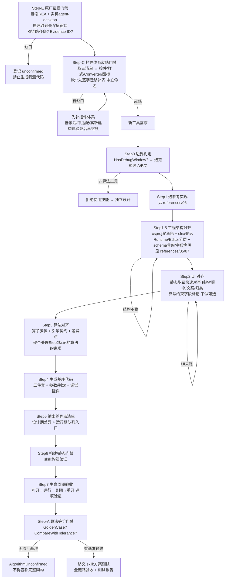

# 视觉工具构建技能

> **定位**：算法工具的"证据驱动批量生成器"，本质是**把重复分析逐轮固化，让工具开发越来越快、越来越准**。
> 原厂证据定语义 → 已验收工具提供工程范式 → **三阶段对齐（工程结构 → UI → 算法，顺序不可颠倒，否则相互掣肘效率极低）** →
> 输出差异点清单 → 生成**单项目双角色基座代码** → 标注独立修改点 → 算法等价与反馈闭环收口。
> 该三阶段顺序**新建工具与复核已有工具通用**。
>
> **快从哪来**：每轮把重复做过的事沉淀成可直接复用的资产（证据清单、范式、工程模板、差异表、冻结样板），下一轮直接拿去用，不重新分析一遍。
> **准从哪来**：证据门禁、算法等价基准、差异队列。门禁是防重复犯错，不是增加审批；只为"准"服务。
>
> **渐进式披露**：主文件只保留判定、铁律、工作流、验收；范式细节与生产台账细则在 `references/` 下按需读取。
>
> **顶层生产机制**：见 [07-evidence-pipeline.md](references/07-evidence-pipeline.md)。开工前先过 §0.4 证据门禁，收口时按状态机停在 `Accepted` 或 `Unconfirmed`，通过的工具冻结为下一轮的模板。

## 0. 适用范围边界（Step0 必须两步判定）

### Step0-1 是否本技能对象

| 适用性 | 工具类型 | 判别标准 | 处理方式 |
|---|---|---|---|
| ✅ **适用** | 算法工具 | 有输入图像 → 算法 → 结果+可视化+**调试窗口**（`HasDebugWindow=true`） | 本技能批量生成 |
| ❌ 不适用 | 流程控制（Condition） | 无图像、有控制信号（`IControlFlowResult`） | 独立设计、多轮迭代 |
| ❌ 不适用 | 子程序（Subroutine） | 嵌套工作流、动态输出映射 | 独立设计 |
| ❌ 不适用 | 脚本（Script） | 动态编译（`IPrecompilableTool`） | 独立设计 |
| ❌ 不适用 | 图像源（ImageLoad） | `HasDebugWindow=false`，无调试窗口 | 非本技能对象 |

**硬性前提**：`HasDebugWindow=true`。无调试窗口的工具一律不适用本技能。

### Step0-2 选哪条范式线（决定参数/判定/UI 装配写法）

| 范式线 | 判别 | 代表工具 | 关键基座 | 范式详情 |
|---|---|---|---|---|
| **A 图像处理式** | 输入图像 → 区域/全图 → 算子链 → 统计/判定 | Blob、Threshold、ImageFilter、Morphology、ImageThreshold | `HalconRegionPipeline` + `RoiEditorManagerControl` + `ResultConfig` | [02](references/02-paradigm-run.md) / [03](references/03-paradigm-ui.md) / [04](references/04-paradigm-results.md) |
| **B 引导检测式** | 单条引导几何（线/圆/弧）→ metrology 卡尺 → 拟合**单个**被测几何 | 直线查找、圆查找 | `MeasurementEditorManagerControl` + 逐项判定开关 | 同上 |
| **C 几何测量式** | **两个**测量元素 → 各自 measure 拟合 → 元素间几何量 → 公差判定 | 线-线、线-圆、圆-圆、点-线、点-圆、点-点 | `MeasureElementsEditorControl` + `ParamValue<T>` + `MeasureThreshold`/`MeasureJudge` | [01](references/01-paradigm-params.md) / [02](references/02-paradigm-run.md) / [03](references/03-paradigm-ui.md) |

> ⚠️ **范式线 C 是 v4 定稿最新范式**（2026-09 线-线测量落地）。新建测量工具**必须**走 C：
> 参数一律 `ParamValue<T>`、判定一律 `MeasureThreshold` 列表 + `MeasureJudge`、Tab1 一律装配 `MeasureElementsEditorControl`。
> **禁止**照搬 B 的旧写法（普通 `double` 参数 + 手写 `IsXxxCheckEnabled/XxxMin/Max`）——那是无效绑定缺陷的来源。

---

## 0.4 原厂证据门禁（先于 Step0，不可跳过）

1. 新工具必须先具备原厂证据包：模块 DLL/反编译源码、Algorithm XML、AlgorithmTab XML、Display XML、ToolItemInfo、原厂运行快照。缺项登记 `unconfirmed`，**禁止生成猜测性代码**。
2. **证据必须走双链路，缺一不可**（详见 [07-evidence-pipeline.md](references/07-evidence-pipeline.md) §4.1）：
   - **链路 A 静态证据**（REA / 反编译源码 / 原厂配置 XML / XAML 资源）：定**语义**——字段名、类型、默认值、控件组合、页签分组、命令、资源键、生命周期。**带文件 + 行号**。
   - **链路 B 实机证据**（agent-desktop 驱动已安装的原厂程序，打开含该节点的原厂方案）：定**呈现与顺序**——每个页签/弹窗的实际控件、分组标题、按钮、顺序、状态、底栏命令。**带窗口快照编号 + 截图**。
   - **UI 对齐判定**：静态源码定结构与语义（控件体系具备时快速高保证），实机只补静态定不了的项并复核争议项；**"能打开/冒烟无错"≠对齐**——必须按 5 个维度（控件清单/位置/分栏/文案/顺序）逐项对照，已有实机截图必须拿出来核。历史返工：说"已对齐无需改动"，实际本方缺载入按钮、多错误按钮、布局错位；四 tab 冒烟通过却没发现。详见 [07](references/07-evidence-pipeline.md) §4.2「对齐判定维度」。
- **取证以静态为主、真机补充复核**（[07](references/07-evidence-pipeline.md) §4.1，禁止跳步）：①先查**本工具自己的静态声明**（AlgorithmTab.xml/Modu.xml/DialogUI xaml/zh-cn.xaml/DialogData.cs）——控件体系具备时照静态即可**快速高保证同构**；②静态充分即落地、不必全量真机，只有 LinkName 引用/定不了项数标签展开态才标"需真机补"；③真机**只补缺项**并针对性交叉验证（映射陷阱如 kind 数≠按钮数）；④逐工具固化绑 Evidence ID。**口诀：静态先行充分即落地、定不了才真机且只补缺项、逐工具固化；平台默认值和其它工具范式永远不是原厂事实。禁止把双链路做成每次全量真机（会拖慢开发）。**
- **取证必须递归覆盖窗口层级**（§4.1「窗口层级取证」）：页签集合 → **每页签内分组与功能控件（展开每组）** → 功能弹窗 → **弹窗内子交互** → 弹窗里再开的子弹窗，直到无可打开新窗口；并做**页签↔弹窗关联取证**。只取表面会漏整组功能控件（历史返工：漏基本页 ROI 区域、继承方式项数、形状集）。
   - 两条链路互相印证：配置/XML 给出控件清单，实机快照给出真实可见性与顺序；不一致处以实机为准并登记差异。
3. 每个专属控件、字段、分组、页签、端口、资源绑定唯一 **Evidence ID**（文件 + 行号 / 配置键 / 快照编号）；无 ID 的 UI 不得生成。普通字段走公共参数集合链，不重复声明。
4. 本方已验收工具只作工程范式源，不作语义来源；工具目录命名不统一（`SunEyeVision.PixelCount` / `SunEyeVision.Tool.BlobAnalysis` 并存），工程路径以 `product/ToolComponents.props` 与生产台账为准。
5. 每轮迭代留痕六项：证据哈希、生成参数、代码变更、构建日志、运行快照、未确认项。
6. 完整状态机、台账格式、算法等价与差异队列细则见 [07-evidence-pipeline.md](references/07-evidence-pipeline.md)。

## 1. 技能产出物（三大件）

1. **UI 方案**（所选范式线 + 差异点 + 3-Tab ASCII 图）
2. **算法方案**（Run 范式 + 差异点 + 引擎契约）
3. **基座代码**（三件套 + 参数/判定装配 + 调试控件 + csproj/slnx 登记）

---

## 2. 引擎契约（三铁律，经架构分层 V2 验证）

```
工具层公开 API 永不暴露具体引擎类型
  ├─ 图像：parameters.ResolvedInputImage（IVisionImage?，框架注入）
  ├─ Run Halcon 路径：parameters.GetHalconImage() → HOperatorSet.*
  │    扩展方法位于 SunEyeVision.HalAdapter（工具 csproj 须引 HalAdapter）
  ├─ Run OpenCV 路径：parameters.GetCvImage() → CvImage.Image(Mat) → CvOp.*
  │    扩展方法位于 SunEyeVision.CvAdapter（工具按需引 CvAdapter/CvEngine）
  └─ 适配载体：IVisionImage ← HalImage(HalAdapter) / Cv 适配(CvAdapter)
      跨后端提取：VisionBackendExtractorLocator.ToHalcon / .ToOpenCv（SDK Hosting，宿主装配注册）
```

1. **Run 默认走 Halcon**：`parameters.GetHalconImage()`（需 `using SunEyeVision.HalAdapter;` + csproj `ProjectReference` 引 `SunEyeVision.HalAdapter`）
2. **公开 API 不出现 `HImage`/`Mat`**，图像统一 `IVisionImage`
3. OpenCV 实现走 `CvToolHelpers.GetCvImage()` + `CvOp.*`，不直接 `Cv2.*`
4. **契约/适配分层**：SDK 只定义契约（`IVisionImage`/`VisionBackendExtractorLocator`）；引擎类型与适配载体一律不在 SDK（Hal→`SunEyeVision.HalAdapter`，Cv 算法→`SunEyeVision.CvEngine`，Cv 适配→`SunEyeVision.CvAdapter`）
5. **图像处理式工具区域前置（两段式，v1.4 统一）**：区域/修正解析与"按域执行"分离
   - 纯几何：`HalconRegionPipeline.Resolve(imgWidth, imgHeight, 检测区, 屏蔽区, nodeResults, correctionMatrix)` → `RoiScope`
     只做订阅解析 + 位置修正（按形状有向性）+ 检测−屏蔽差集；**签名不接收任何图像对象**；scope 用后 `Dispose()`（只释放 region，防重入）
   - 执行方式由算法自决：按域 → `HalImageDomain.Restrict(grayImage, scope.RoiRegion)`（返回新图，谁调用谁释放）；全图 → 直接用原图
   - 所有权铁律：**谁 Restrict 谁释放**（标准 `using`/`finally`，无所有权转移/Detach 概念）；位置修正矩阵 Run（Resolve）与交互层（控件实时查询）同源
   - 适用边界：图像处理式工具（Blob/阈值化/滤波/二值化/形态学）
6. **几何测量式（范式线 C）不走 Resolve**：区域语义不同（无检测区/屏蔽区），每个测量元素**独立**做 metrology measure（`AddMetrologyObjectLineMeasure` / `...CircleMeasure`），引导几何与卡尺参数取自 `ParamValue<T>`；位置修正矩阵 Run 与交互层同源（`PositionCorrectionResolver.ResolveFirstMatrix`）

---

## 3. UI 控件复用铁律

0. **逆向同构优先，禁止自研近似控件**：原厂控件体系（style xaml / Converter / 图标 / 模板）已大量反编译迁移到 `src/Plugin.Wpf`，部分停在 `.pending` 未激活。做 UI 时必须先盘点并**迁移/激活/复用这些现成资产**，再考虑新写。禁止"照着原厂控件清单自己拼一个纯 C# 近似壳/控件"——那会把 UI 细节实现责任揽回工具层，必然漏控件（历史返工：模板窗口漏 14 键工具条/匹配中心/样本列表）。确需新写的项（如像素画笔/橡皮擦）必须在方案里标为"成本/接缝"并带原厂证据，不得冒充同构。
1. 调试控件**必须**继承 `ToolDebugControlBase`（自动获得 Execute/Confirm/ContinuousExecute/ResetParameters 命令、ToolExecutionCompleted 事件、AvailableDataSources、SetParameters/SetDataProvider/SetMainImageControl）
2. 参数输入**一律** SDK 控件：`LabeledControl`/`ConfigSetting`/`RangeInputControl`/`RangeSlider`/`NumericUpDown`/`ToggleSwitch`/`ParamComboBox`/`ParamTextBox`/`ImageSourceSelector`
3. 区域编辑用 `RoiEditorManagerControl`（图像处理式）/ `MeasurementEditorManagerControl`（引导检测式）/ `MeasureElementsEditorControl`（几何测量式双元素）
4. 图像显示用 `ImageControl`
5. 工具层只做「装配 + 参数绑定」，**禁止自建参数/区域/图像控件**
6. 基本参数页走共享 `NativeStandardBasicPage.Compose(...)`：工具只提供 `NativeStandardBasicPageSpec`（`RoiFieldIds`/`PositionCorrectionFieldId`/`ComposeRoi`/`ComposeAssist`/`CreateRoiDocument`/`RoiShapes`），**不再各自重复抑制行、创建 ROI 编辑宿主或接线开关**（见 `src/Plugin.Wpf/Presenters/Parameters/NativeStandardBasicPage.cs`）

---

## 4. 参数与判定铁律（范式线 C 必读，v4 定稿）

| # | 铁律 | 违反后果 |
|---|---|---|
| 1 | 参数一律 `ParamValue<T>`：`public ParamValue<double> Sigma { get; set; } = ParamValue<double>.CreateConstant(1.0, "Sigma");`，XAML 绑 `.Value` | 普通 `double` + `ConfigSetting` = **无效绑定**（上游值注入不进来） |
| 2 | 参数属性**必须可写**（`{ get; set; }`） | get-only 属性 JSON 反序列化不回填 → 方案保存后重开参数回默认 |
| 3 | 判定一律 `ObservableCollection<MeasureThreshold> Judgments` + `MeasureJudge.EvaluateAll(...)` / `IsAllPass(...)` | 逐工具手写判定 = 6 份重复样板，且启用项无值时静默判 OK（违反 rule-015） |
| 4 | 卡尺口径：**参数存半长**（Halcon `MeasureLength1/2` 语义），**UI/结果显示用全宽/全长**（×2） | 参数与显示差 2 倍，改一个参数两处语义打架 |
| 5 | **参数单一入口**：卡尺几何（宽/长/数量）只在 Tab1 元素面板编辑，Tab2 禁止重复编辑 | 两处可改同一参数 → 改完不生效/互相覆盖 |
| 6 | 枚举参数走 `ComboBox` + **索引翻译**（`(int)参数.Value` ↔ `SelectedIndex`），不用 `ParamComboBox` 的 enum 绑定 | 枚举直绑易静默失配 |

> 完整代码骨架（参数类 / 判定列表 / 双态绑定 / 口径换算）见 [references/01-paradigm-params.md](references/01-paradigm-params.md)。

---

## 5. 工作流（证据门禁 → Step0–7 → 算法等价 → 测试）



| Step | 动作 | 产出/门禁 |
|---|---|---|
| **E** | **原厂证据门禁（双链路）** | 链路 A 静态证据（REA/反编译/配置/XML，带行号）+ 链路 B 实机证据（agent-desktop 打开原厂含该节点方案，逐页签/弹窗快照+截图，**递归到最深层窗口**，见 §4.1 窗口层级取证）齐备或登记缺口（静态为主、真机只补缺项）；专属 UI 全部绑 Evidence ID；对齐按 5 维度核、冒烟≠对齐（§0.4 / [07](references/07-evidence-pipeline.md) §4.2） |
| **C** | **控件体系就绪门禁（取证后、落地前，强制）** | 按取证清单盘点现有控件体系（`src/Plugin.Wpf`）能否支撑工具落地：每个原厂控件/样式键/Converter/图标 → 已激活 / .pending / 等价件 / 缺失。**有缺口先补控件体系再进入工具开发**，禁止用自研近似控件绕过；缺口分档（低激活/中适配/高新建）+ 逐字迁移反编译源（中立命名）。**已验证资产（如位置修正 Fixture/AssistGroup）只核对不重构，不为外观差异改动**（§4.2 已验证资产冻结）。历史返工：converter 缺失强上 ROI → StaticResource 异常；为组标题重复改位置修正 → XML 错/锁 dll 多轮返工。（[07](references/07-evidence-pipeline.md) §4.2） |
| 0 | 边界判定 + 选范式线 | 判定表 + 范式线（A/B/C） |
| 1 | 选参考实现 | 工程范式源路径（[references/06](references/06-reference-impl.md)），不替代原厂证据 |

> **三阶段铁律（新建工具与复核已有工具通用，顺序不可颠倒）**：**工程结构对齐 → UI 对齐 → 算法对齐**。
> 很多参数之所以存在，是因为算法里有对应实现——但**先定结构**（Runtime/Editor 分层、schema 字段声明、端口契约）
> 才能让 UI 和算法都落到稳定基座上。若边做 UI 边补结构、边改算法边动 UI，会相互掣肘、反复推翻，对齐效率极低（本次十工具复核多轮返工的根因）。
> 每阶段完成才进下一阶段；本阶段未稳就停在本阶段（流程图回环）。

| **1.5** | **工程结构对齐（先于 UI/算法，强制）** | **csproj（Runtime/Editor 双角色，模板见 [05](references/05-project-skeleton.md)）+ 两个 slnx 登记（漏登记 = IDE 不编译）+ Runtime/Editor 分层（Runtime 不得依赖 WPF）+ schema/字段声明/端口契约骨架**。字段清单来自原厂取证（参数之所以存在是因为算法中有对应实现，先声明结构再填 UI/算法） |
| 2 | UI 对齐（结构稳定后进入） | 3-Tab ASCII 图 + 共享基本页 Spec + 控件清单 + 参数项清单。**按静态取证快速对齐**（结构/顺序/文案/归类），实机只复核争议项；**遇到算法约束字段（Validate 拒绝非默认值）标记为算法未确认，不在 UI 做成可选项**（[07](references/07-evidence-pipeline.md) §4.2） |
| 3 | 算法对齐（UI 稳定后进入） | 算子步骤序列 + 引擎契约 + 差异点。逐个处理 Step2 标记的算法约束项：能迁移则迁移、不能则显式 `AlgorithmUnconfirmed`，禁止为凑 UI 做假实现 |
| 4 | 基座代码 | 三件套（Tool/Parameters/Results）+ Views；普通字段走公共参数集合链 |
| 5 | 差异点清单 | 设计期差异 + 独立修改点位置 + 运行期差异队列入口 |
| 6 | 构建/静态门禁 | `[skill:构建验证]` 先单 csproj 后 slnx；发布单元/基本页/组装映射门禁；0 error |
| 7 | 生命周期验收 | §7 全环节逐项通过 + Agent Desktop 工具窗口快照 |
| **A** | **算法等价门禁** | **逻辑对照优先**：按原厂 AlgorithmIndex + 参数语义逐项确认本方有对应算法动作，能用 Halcon/平台 API 实现就实现（不因缺 GoldenCase 而拒绝逻辑迁移）；真实精度由专门测试人员验证，GoldenCase 仅作争议复核。能力模型限制的项如实 `AlgorithmUnconfirmed`（[07](references/07-evidence-pipeline.md) §7） |
| — | 全链路测试 | 移交 `[skill:方案测试]`（防御机制逐项验证 + 测试报告归档） |
| — | **固化本轮资产** | 把新增的证据清单 / 范式 / 模板 / 差异表 / 冻结样板登记下来，下一轮直接复用（[07](references/07-evidence-pipeline.md) §1.1）；没新增资产不算完成一次有效迭代 |

---

## 6. 差异点清单模板（每个工具必填）

| 差异维度 | 范式默认 | 本工具差异 | 处理方式 |
|---|---|---|---|
| 范式线 | 图像处理式 | 几何测量式 | Tab1 装配 `MeasureElementsEditorControl`，判定走 `MeasureJudge` |
| 输入几何 | 无引导 | 需引导(Line/Circle/Arc) | 装配元素编辑器 + `ConfigureElement` 限定类型 |
| 元素来源 | — | 绘制 / 参数订阅 | Tab1 双来源；点元素**仅订阅**（X/Y `ParamValue<double>`，无绘制入口） |
| 参数基类 | `RoiParameters` | 无区域需求 | 改继承 `ToolParameters` |
| 算法步骤 | 固定管线 | 自定义算子序列 | 独立实现 Run 核心 |
| 结果项 | 统计+判定 | 工具特有结果 | 扩展 Results + 分组（[references/04](references/04-paradigm-results.md)） |
| 可视化 | `GetVisualElements` | 几何/ROI 叠加 | 自定义绘制（样式默认色不得自定义） |
| 判定配置 | `ResultConfig` | 公差判定 | `ObservableCollection<MeasureThreshold>` |
| 区域启用开关 | 无开关（Blob，区域常显） | 需"启用区域限制"开关 | 加 `IsRegionEnabled` + CheckBox（参考 Threshold） |
| 位置修正 | 标配（ToggleSwitch + ParamBinding 矩阵） | 无需位置修正 | 移除 Tab1 位置修正段（参考 Threshold） |
| 几何量（距离/角度/交点/平行） | HALCON 算子优先（`DistanceSs`/`DistanceSl`/`DistancePl`/`DistancePp`/`AngleLl`/`IntersectionLl`） | 本工具实际所用算子或自研理由 | 命中自研例外条款（a 无对应算子 / b 纯显示层 / c 性能热点）必须在此列注明 |

### 6.1 运行期差异队列（失败后必填）

上表是**设计期差异**；构建或运行失败时另建运行期差异队列，按六阶段归类：

| 阶段 | 修复入口 | 禁止做法 |
|---|---|---|
| 入口 | 工程声明、双角色注册、组件封存 | 改工具业务代码绕过注册 |
| 声明 | 参数/结果声明、词目表、证据映射 | 静默回退默认类型（rule-015） |
| 模板 | 原厂 XML / 模板资源映射 | 凭截图猜控件 |
| 组装 | 工具 Editor 接缝 | **先改公共框架** |
| 执行 | 回原厂取证；缺证据保留未确认 | 猜测算法策略 |
| 释放 | 生命周期 `Cleanup` 闭链 | 吞异常 / 留残留 |

同一失败连续出现 → 自动提升为差异条目，**阻止工具进入下一批**。细则见 [07](references/07-evidence-pipeline.md) §8。

---

## 7. 调试窗口全生命周期覆盖（打开→关闭→重开，新建工具必检）

> 生命周期 = 宿主驱动的回调链 + 工具侧清理闭环。完整表格与双卡尺特有链路见 [references/03-paradigm-ui.md](references/03-paradigm-ui.md)。

### 7.1 打开 / 初始化
`构造` → `SetParameters`（类型不符 **throw**，rule-015）→ `SetDataProvider`（`RestoreImageSource`/`RestorePositionCorrectionSource`）→ `SetMainImageControl`（托管子编辑器 + zoom/overlay 共享）→ `InitializeAsync`（可选）→ `OnExternalResultArrived`。

### 7.2 运行 / 交互
`UpdatePositionCorrectionMatrix`（交互/结果/算法同源）→ `ExecuteTool` → `UpdateResultDisplay` → 元素编辑（绘制/订阅）→ Confirm/Reset/Continuous → 缩放平移同步。

### 7.3 关闭 / 清理（必须闭环）
1. **Loaded 时挂接**：`Loaded += (_, _) => { if (Window.GetWindow(this) is { } w) w.Closing += (_, _) => Cleanup(); }`
2. `Cleanup()` 职责：卸载事件订阅 + 清 overlay
   - 图像处理式：`regionManager.ClearMainOverlay()`
   - 引导检测式：`MeasurementManager?.ClearMainOverlay()`
   - **几何测量式（双卡尺）**：`ElementsEditor?.ClearMainOverlay()`（解订阅 + 清共享 overlay + 解除两个子编辑器的 overlay canvas）
3. **重开回归**：关闭后再开同一节点 → 叠加层无残留、事件无重复订阅、可正常执行

### 7.4 算法等价收口（独立于 UI/功能闭口）

生命周期全通过 ≠ 算法等价。收口时按 [07](references/07-evidence-pipeline.md) §7 判定：

- 有同图像/同 ROI/同参数/同版本原厂基准：归一化比较状态、数量、数组顺序、区域覆盖、几何量、浮点误差、错误码、空输入行为 → `AlgorithmEquivalent` / `AlgorithmDiverged`。
- 缺原厂基准：`AlgorithmUnconfirmed`，登记进生产台账 `docs/evidence/tool-batch-manifest-20261120.json`，工具可交付 UI/功能闭口但**不得宣称完整同构**。
- 当前台账全部工具的 `equivalenceStatus` 均为 `unconfirmed`、`goldenCases` 为空；不要因构建或 UI 通过改写。

---

## 8. 参考实现与代码锚点

- 参考实现清单（基准源 + 辅助源 + 最新测量范式）：[references/06-reference-impl.md](references/06-reference-impl.md)
- 真实符号名/文件路径索引：同上

> ⚠️ **路径注意**：工具目录命名**不统一**——Blob 分析已迁到 `tools/SunEyeVision.Tool.BlobAnalysis/SunEyeVision.Tool.BlobAnalysis.csproj`（单项目双角色，旧 `SunEyeVision.BlobAnalysis` 无前缀目录已删除）；PixelCount 仍为 `tools/SunEyeVision.PixelCount/SunEyeVision.Tool.PixelCount.csproj`。**禁止凭目录名猜工程路径**，以 `product/ToolComponents.props` 与 `docs/evidence/tool-batch-manifest-20261120.json` 登记为准。**禁止**参考 `ImageLoad`（`HasDebugWindow=false`，非本技能对象）。

---

## 9. references 索引

| 文件 | 内容 | 何时读 |
|---|---|---|
| [01-paradigm-params.md](references/01-paradigm-params.md) | 参数范式（`ParamValue<T>` 全量装配、枚举翻译、判定 `MeasureThreshold`/`MeasureJudge`、卡尺口径换算） | 写 Parameters 类 / Tab2 / Tab3 判定 |
| [02-paradigm-run.md](references/02-paradigm-run.md) | Run 范式（图像处理式算子链、几何测量式 metrology、几何量铁律、异常与结果落位） | 写 Tool.Run |
| [03-paradigm-ui.md](references/03-paradigm-ui.md) | UI 范式（3-Tab 布局、绑定铁律、双卡尺装配 API、生命周期完整表） | 写 XAML / Code-Behind |
| [04-paradigm-results.md](references/04-paradigm-results.md) | 结果范式（模块结果分组顺序、`GetPropertyMap`、词目表硬约束、可视化） | 写 Results 类 / Tab3 样式 |
| [05-project-skeleton.md](references/05-project-skeleton.md) | 工程骨架（csproj 模板、slnx 登记、构建验证与方案测试衔接） | Step3.5 建工程 / 登记 |
| [06-reference-impl.md](references/06-reference-impl.md) | 参考实现清单 + 代码锚点（真实符号名与路径） | Step1 选参考源 / 查符号 |
| [07-evidence-pipeline.md](references/07-evidence-pipeline.md) | 生产状态机、证据门禁、生产台账格式、算法等价、反馈闭环、样板推广门禁 | 开工前 Step-E / 收口 Step-A / 失败归类 / 台账登记 |

---

## 10. 约束

- 序列化必须 `System.Text.Json`，禁止 Newtonsoft.Json
- 必须 `[JsonPolymorphic]` + `[JsonDerivedType]` 多态
- JSON 使用 PascalCase
- 命名遵循 PascalCase，禁止缩写
- 结果类 `GetPropertyMap()` 必须 `.. base.GetPropertyMap()` 合并基类，禁止重复声明 ExecutionTimeMs
- 工具层公开 API **永不暴露** `HImage`/`Mat`，图像统一 `IVisionImage`
- Run 默认走 Halcon（`GetHalconImage()`），公开 API 不出现引擎类型
- UI 必须复用 SDK 控件，禁止自建参数/区域/图像控件
- 参数必须 `ParamValue<T>`（范式线 C 强制；A/B 新增参数同样推荐），禁止新增裸 `double` + `ConfigSetting` 组合
- 判定必须 `MeasureThreshold` + `MeasureJudge`（范式线 C 强制），禁止逐工具复制判定样板
- 结果几何量（距离/角度/交点/平行判定）**必须优先 HALCON 算子**（`DistanceSs`/`DistanceSl`/`DistancePl`/`DistancePp`/`AngleLl`/`AngleLx`/`IntersectionLl`）；自研几何必须命中例外条款（HALCON 无对应算子 / 纯显示层 / 性能热点）并在差异点清单注明理由（rule-004 复用优先，非必要不自研）
- 样式默认颜色**不得自定义**：`GraphicsStyle`/`TextStyle` 的 `OkColor`/`NgColor` 必须保留 SDK 默认值（OK=绿 0,255,0 / NG=红 255,0,0），工具层不写自定义颜色。**特例**（如确实需要区分多元素/语义上必须用特定色）须在差异点清单注明理由，并与评审讨论；禁止私自选色
- 文本显示**同锚点自动排版**：同一几何点的多条文本必须传**同一锚点**（图像坐标），由渲染层按锚点分组自动换行（行高 = 字号×1.4，屏幕恒定；字号变更时间距自动适配）。需要避开几何的微偏移一律用 `AddText(style, anchorX, anchorY, content, screenOffsetX, screenOffsetY)` 的**屏幕像素偏移**，**禁止**用图像坐标手写 `±N` 微偏移（缩放时会与屏幕恒定字号失配，出现"字变小、间距变大"或重叠）
- **原厂证据先行（双链路）**：专属 UI/字段/端口必须绑 Evidence ID；静态证据（REA/反编译/配置）与实机证据（agent-desktop 原厂逐页签/弹窗快照）缺一不可；**只凭静态证据不得判定 UI 对齐**，证据缺失项登记 `unconfirmed`，禁止生成猜测性代码
- **算法等价独立收口**：无同版本原厂黄金样例时保持 `AlgorithmUnconfirmed`，不得因构建/UI 通过宣称完整同构；台账字段不得擅自改写
- **单项目双角色**：工具只建一个 csproj（Runtime/Editor 共享程序集），登记两个 slnx；基本页走 `NativeStandardBasicPage`，工具只提供 Spec
- **差异队列阻止推广**：同一失败连续出现升级为差异条目，阻止工具进入下一批；样板未全通过不得复制生成规则
