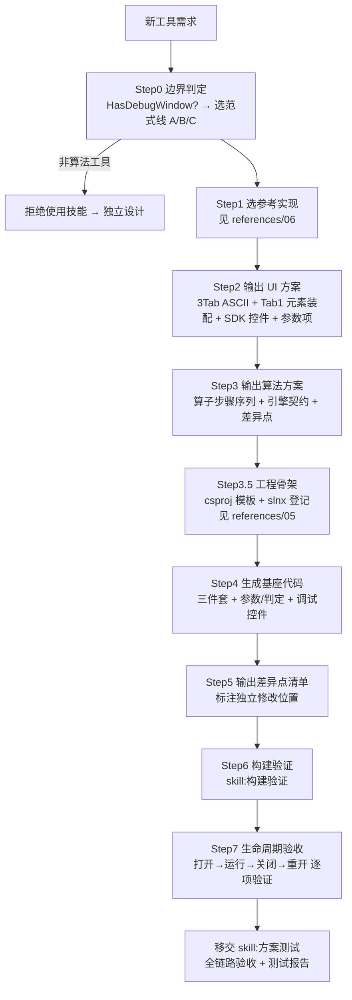

# 视觉工具构建技能

> **定位**：算法工具的"批量生成器"。基于已验收工具提炼**开发范式** → 输出 **UI 方案 + 算法方案 + 差异点清单** → 生成**基座代码** → 标注**独立修改点**。
>
> **渐进式披露**：主文件只保留判定、铁律、工作流、验收；范式细节在 `references/` 下按需读取。

## 0. 适用范围边界（Step0 必须两步判定）

### Step0-1 是否本技能对象

| 适用性 | 工具类型 | 判别标准 | 处理方式 |
|---|---|---|---|
| ✅ **适用** | 算法工具 | 有输入图像 → 算法 → 结果+可视化+**调试窗口**（`HasDebugWindow=true`） | 本技能批量生成 |
| ❌ 不适用 | 流程控制（Condition） | 无图像、有控制信号（`IControlFlowResult`） | 独立设计、多轮迭代 |
| ❌ 不适用 | 子程序（Subroutine） | 嵌套工作流、动态输出映射 | 独立设计 |
| ❌ 不适用 | 脚本（Script） | 动态编译（`IPrecompilableTool`） | 独立设计 |
| ❌ 不适用 | 图像源（ImageLoad） | `HasDebugWindow=false`，无调试窗口 | 非本技能对象 |

**硬性前提**：`HasDebugWindow=true`。无调试窗口的工具一律不适用本技能。

### Step0-2 选哪条范式线（决定参数/判定/UI 装配写法）

| 范式线 | 判别 | 代表工具 | 关键基座 | 范式详情 |
|---|---|---|---|---|
| **A 图像处理式** | 输入图像 → 区域/全图 → 算子链 → 统计/判定 | Blob、Threshold、ImageFilter、Morphology、ImageThreshold | `HalconRegionPipeline` + `RoiEditorManagerControl` + `ResultConfig` | [02](references/02-paradigm-run.md) / [03](references/03-paradigm-ui.md) / [04](references/04-paradigm-results.md) |
| **B 引导检测式** | 单条引导几何（线/圆/弧）→ metrology 卡尺 → 拟合**单个**被测几何 | 直线查找、圆查找 | `MeasurementEditorManagerControl` + 逐项判定开关 | 同上 |
| **C 几何测量式** | **两个**测量元素 → 各自 measure 拟合 → 元素间几何量 → 公差判定 | 线-线、线-圆、圆-圆、点-线、点-圆、点-点 | `MeasureElementsEditorControl` + `ParamValue<T>` + `MeasureThreshold`/`MeasureJudge` | [01](references/01-paradigm-params.md) / [02](references/02-paradigm-run.md) / [03](references/03-paradigm-ui.md) |

> ⚠️ **范式线 C 是 v4 定稿最新范式**（2026-09 线-线测量落地）。新建测量工具**必须**走 C：
> 参数一律 `ParamValue<T>`、判定一律 `MeasureThreshold` 列表 + `MeasureJudge`、Tab1 一律装配 `MeasureElementsEditorControl`。
> **禁止**照搬 B 的旧写法（普通 `double` 参数 + 手写 `IsXxxCheckEnabled/XxxMin/Max`）——那是无效绑定缺陷的来源。

---

## 1. 技能产出物（三大件）

1. **UI 方案**（所选范式线 + 差异点 + 3-Tab ASCII 图）
2. **算法方案**（Run 范式 + 差异点 + 引擎契约）
3. **基座代码**（三件套 + 参数/判定装配 + 调试控件 + csproj/slnx 登记）

---

## 2. 引擎契约（三铁律，经架构分层 V2 验证）

```
工具层公开 API 永不暴露具体引擎类型
  ├─ 图像：parameters.ResolvedInputImage（IVisionImage?，框架注入）
  ├─ Run Halcon 路径：parameters.GetHalconImage() → HOperatorSet.*
  │    扩展方法位于 SunEyeVision.HalAdapter（工具 csproj 须引 HalAdapter）
  ├─ Run OpenCV 路径：parameters.GetCvImage() → CvImage.Image(Mat) → CvOp.*
  │    扩展方法位于 SunEyeVision.CvAdapter（工具按需引 CvAdapter/CvEngine）
  └─ 适配载体：IVisionImage ← HalImage(HalAdapter) / Cv 适配(CvAdapter)
      跨后端提取：VisionBackendExtractorLocator.ToHalcon / .ToOpenCv（SDK Hosting，宿主装配注册）
```

1. **Run 默认走 Halcon**：`parameters.GetHalconImage()`（需 `using SunEyeVision.HalAdapter;` + csproj `ProjectReference` 引 `SunEyeVision.HalAdapter`）
2. **公开 API 不出现 `HImage`/`Mat`**，图像统一 `IVisionImage`
3. OpenCV 实现走 `CvToolHelpers.GetCvImage()` + `CvOp.*`，不直接 `Cv2.*`
4. **契约/适配分层**：SDK 只定义契约（`IVisionImage`/`VisionBackendExtractorLocator`）；引擎类型与适配载体一律不在 SDK（Hal→`SunEyeVision.HalAdapter`，Cv 算法→`SunEyeVision.CvEngine`，Cv 适配→`SunEyeVision.CvAdapter`）
5. **图像处理式工具区域前置（两段式，v1.4 统一）**：区域/修正解析与"按域执行"分离
   - 纯几何：`HalconRegionPipeline.Resolve(imgWidth, imgHeight, 检测区, 屏蔽区, nodeResults, correctionMatrix)` → `RoiScope`
     只做订阅解析 + 位置修正（按形状有向性）+ 检测−屏蔽差集；**签名不接收任何图像对象**；scope 用后 `Dispose()`（只释放 region，防重入）
   - 执行方式由算法自决：按域 → `HalImageDomain.Restrict(grayImage, scope.RoiRegion)`（返回新图，谁调用谁释放）；全图 → 直接用原图
   - 所有权铁律：**谁 Restrict 谁释放**（标准 `using`/`finally`，无所有权转移/Detach 概念）；位置修正矩阵 Run（Resolve）与交互层（控件实时查询）同源
   - 适用边界：图像处理式工具（Blob/阈值化/滤波/二值化/形态学）
6. **几何测量式（范式线 C）不走 Resolve**：区域语义不同（无检测区/屏蔽区），每个测量元素**独立**做 metrology measure（`AddMetrologyObjectLineMeasure` / `...CircleMeasure`），引导几何与卡尺参数取自 `ParamValue<T>`；位置修正矩阵 Run 与交互层同源（`PositionCorrectionResolver.ResolveFirstMatrix`）

---

## 3. UI 控件复用铁律

1. 调试控件**必须**继承 `ToolDebugControlBase`（自动获得 Execute/Confirm/ContinuousExecute/ResetParameters 命令、ToolExecutionCompleted 事件、AvailableDataSources、SetParameters/SetDataProvider/SetMainImageControl）
2. 参数输入**一律** SDK 控件：`LabeledControl`/`ConfigSetting`/`RangeInputControl`/`RangeSlider`/`NumericUpDown`/`ToggleSwitch`/`ParamComboBox`/`ParamTextBox`/`ImageSourceSelector`
3. 区域编辑用 `RoiEditorManagerControl`（图像处理式）/ `MeasurementEditorManagerControl`（引导检测式）/ `MeasureElementsEditorControl`（几何测量式双元素）
4. 图像显示用 `ImageControl`
5. 工具层只做「装配 + 参数绑定」，**禁止自建参数/区域/图像控件**

---

## 4. 参数与判定铁律（范式线 C 必读，v4 定稿）

| # | 铁律 | 违反后果 |
|---|---|---|
| 1 | 参数一律 `ParamValue<T>`：`public ParamValue<double> Sigma { get; set; } = ParamValue<double>.CreateConstant(1.0, "Sigma");`，XAML 绑 `.Value` | 普通 `double` + `ConfigSetting` = **无效绑定**（上游值注入不进来） |
| 2 | 参数属性**必须可写**（`{ get; set; }`） | get-only 属性 JSON 反序列化不回填 → 方案保存后重开参数回默认 |
| 3 | 判定一律 `ObservableCollection<MeasureThreshold> Judgments` + `MeasureJudge.EvaluateAll(...)` / `IsAllPass(...)` | 逐工具手写判定 = 6 份重复样板，且启用项无值时静默判 OK（违反 rule-015） |
| 4 | 卡尺口径：**参数存半长**（Halcon `MeasureLength1/2` 语义），**UI/结果显示用全宽/全长**（×2） | 参数与显示差 2 倍，改一个参数两处语义打架 |
| 5 | **参数单一入口**：卡尺几何（宽/长/数量）只在 Tab1 元素面板编辑，Tab2 禁止重复编辑 | 两处可改同一参数 → 改完不生效/互相覆盖 |
| 6 | 枚举参数走 `ComboBox` + **索引翻译**（`(int)参数.Value` ↔ `SelectedIndex`），不用 `ParamComboBox` 的 enum 绑定 | 枚举直绑易静默失配 |

> 完整代码骨架（参数类 / 判定列表 / 双态绑定 / 口径换算）见 [references/01-paradigm-params.md](references/01-paradigm-params.md)。

---

## 5. 工作流（Step0 → Step7）



| Step | 动作 | 产出/门禁 |
|---|---|---|
| 0 | 边界判定 + 选范式线 | 判定表 + 范式线（A/B/C） |
| 1 | 选参考实现 | 基准参考源路径（[references/06](references/06-reference-impl.md)） |
| 2 | UI 方案 | 3-Tab ASCII 图 + 控件清单 + 参数项清单 |
| 3 | 算法方案 | 算子步骤序列 + 引擎契约 + 差异点 |
| **3.5** | **工程骨架** | **csproj（模板见 [references/05](references/05-project-skeleton.md)）+ slnx 登记**（漏登记 = IDE 不编译、构建产物缺失） |
| 4 | 基座代码 | 三件套（Tool/Parameters/Results）+ Views |
| 5 | 差异点清单 | 逐维度差异 + 独立修改点位置 |
| 6 | 构建验证 | 使用 `[skill:构建验证]`：先单 csproj 后 slnx，区分 MSBuild 配置错误与业务代码错误，0 error |
| 7 | 生命周期验收 | §7 全环节逐项通过 |
| — | 全链路测试 | 移交 `[skill:方案测试]`（防御机制逐项验证 + 测试报告归档） |

---

## 6. 差异点清单模板（每个工具必填）

| 差异维度 | 范式默认 | 本工具差异 | 处理方式 |
|---|---|---|---|
| 范式线 | 图像处理式 | 几何测量式 | Tab1 装配 `MeasureElementsEditorControl`，判定走 `MeasureJudge` |
| 输入几何 | 无引导 | 需引导(Line/Circle/Arc) | 装配元素编辑器 + `ConfigureElement` 限定类型 |
| 元素来源 | — | 绘制 / 参数订阅 | Tab1 双来源；点元素**仅订阅**（X/Y `ParamValue<double>`，无绘制入口） |
| 参数基类 | `RoiParameters` | 无区域需求 | 改继承 `ToolParameters` |
| 算法步骤 | 固定管线 | 自定义算子序列 | 独立实现 Run 核心 |
| 结果项 | 统计+判定 | 工具特有结果 | 扩展 Results + 分组（[references/04](references/04-paradigm-results.md)） |
| 可视化 | `GetVisualElements` | 几何/ROI 叠加 | 自定义绘制（样式默认色不得自定义） |
| 判定配置 | `ResultConfig` | 公差判定 | `ObservableCollection<MeasureThreshold>` |
| 区域启用开关 | 无开关（Blob，区域常显） | 需"启用区域限制"开关 | 加 `IsRegionEnabled` + CheckBox（参考 Threshold） |
| 位置修正 | 标配（ToggleSwitch + ParamBinding 矩阵） | 无需位置修正 | 移除 Tab1 位置修正段（参考 Threshold） |
| 几何量（距离/角度/交点/平行） | HALCON 算子优先（`DistanceSs`/`DistanceSl`/`DistancePl`/`DistancePp`/`AngleLl`/`IntersectionLl`） | 本工具实际所用算子或自研理由 | 命中自研例外条款（a 无对应算子 / b 纯显示层 / c 性能热点）必须在此列注明 |

---

## 7. 调试窗口全生命周期覆盖（打开→关闭→重开，新建工具必检）

> 生命周期 = 宿主驱动的回调链 + 工具侧清理闭环。完整表格与双卡尺特有链路见 [references/03-paradigm-ui.md](references/03-paradigm-ui.md)。

### 7.1 打开 / 初始化
`构造` → `SetParameters`（类型不符 **throw**，rule-015）→ `SetDataProvider`（`RestoreImageSource`/`RestorePositionCorrectionSource`）→ `SetMainImageControl`（托管子编辑器 + zoom/overlay 共享）→ `InitializeAsync`（可选）→ `OnExternalResultArrived`。

### 7.2 运行 / 交互
`UpdatePositionCorrectionMatrix`（交互/结果/算法同源）→ `ExecuteTool` → `UpdateResultDisplay` → 元素编辑（绘制/订阅）→ Confirm/Reset/Continuous → 缩放平移同步。

### 7.3 关闭 / 清理（必须闭环）
1. **Loaded 时挂接**：`Loaded += (_, _) => { if (Window.GetWindow(this) is { } w) w.Closing += (_, _) => Cleanup(); }`
2. `Cleanup()` 职责：卸载事件订阅 + 清 overlay
   - 图像处理式：`regionManager.ClearMainOverlay()`
   - 引导检测式：`MeasurementManager?.ClearMainOverlay()`
   - **几何测量式（双卡尺）**：`ElementsEditor?.ClearMainOverlay()`（解订阅 + 清共享 overlay + 解除两个子编辑器的 overlay canvas）
3. **重开回归**：关闭后再开同一节点 → 叠加层无残留、事件无重复订阅、可正常执行

---

## 8. 参考实现与代码锚点

- 参考实现清单（基准源 + 辅助源 + 最新测量范式）：[references/06-reference-impl.md](references/06-reference-impl.md)
- 真实符号名/文件路径索引：同上

> ⚠️ **路径注意**：Blob 分析目录为 `tools/SunEyeVision.BlobAnalysis/`（**无 `Tool.` 前缀**），csproj 名为 `SunEyeVision.Tool.BlobAnalysis.csproj`。**禁止**参考 `ImageLoad`（`HasDebugWindow=false`，无调试窗口，非本技能对象）。

---

## 9. references 索引

| 文件 | 内容 | 何时读 |
|---|---|---|
| [01-paradigm-params.md](references/01-paradigm-params.md) | 参数范式（`ParamValue<T>` 全量装配、枚举翻译、判定 `MeasureThreshold`/`MeasureJudge`、卡尺口径换算） | 写 Parameters 类 / Tab2 / Tab3 判定 |
| [02-paradigm-run.md](references/02-paradigm-run.md) | Run 范式（图像处理式算子链、几何测量式 metrology、几何量铁律、异常与结果落位） | 写 Tool.Run |
| [03-paradigm-ui.md](references/03-paradigm-ui.md) | UI 范式（3-Tab 布局、绑定铁律、双卡尺装配 API、生命周期完整表） | 写 XAML / Code-Behind |
| [04-paradigm-results.md](references/04-paradigm-results.md) | 结果范式（模块结果分组顺序、`GetPropertyMap`、词目表硬约束、可视化） | 写 Results 类 / Tab3 样式 |
| [05-project-skeleton.md](references/05-project-skeleton.md) | 工程骨架（csproj 模板、slnx 登记、构建验证与方案测试衔接） | Step3.5 建工程 / 登记 |
| [06-reference-impl.md](references/06-reference-impl.md) | 参考实现清单 + 代码锚点（真实符号名与路径） | Step1 选参考源 / 查符号 |

---

## 10. 约束

- 序列化必须 `System.Text.Json`，禁止 Newtonsoft.Json
- 必须 `[JsonPolymorphic]` + `[JsonDerivedType]` 多态
- JSON 使用 PascalCase
- 命名遵循 PascalCase，禁止缩写
- 结果类 `GetPropertyMap()` 必须 `.. base.GetPropertyMap()` 合并基类，禁止重复声明 ExecutionTimeMs
- 工具层公开 API **永不暴露** `HImage`/`Mat`，图像统一 `IVisionImage`
- Run 默认走 Halcon（`GetHalconImage()`），公开 API 不出现引擎类型
- UI 必须复用 SDK 控件，禁止自建参数/区域/图像控件
- 参数必须 `ParamValue<T>`（范式线 C 强制；A/B 新增参数同样推荐），禁止新增裸 `double` + `ConfigSetting` 组合
- 判定必须 `MeasureThreshold` + `MeasureJudge`（范式线 C 强制），禁止逐工具复制判定样板
- 结果几何量（距离/角度/交点/平行判定）**必须优先 HALCON 算子**（`DistanceSs`/`DistanceSl`/`DistancePl`/`DistancePp`/`AngleLl`/`AngleLx`/`IntersectionLl`）；自研几何必须命中例外条款（HALCON 无对应算子 / 纯显示层 / 性能热点）并在差异点清单注明理由（rule-004 复用优先，非必要不自研）
- 样式默认颜色**不得自定义**：`GraphicsStyle`/`TextStyle` 的 `OkColor`/`NgColor` 必须保留 SDK 默认值（OK=绿 0,255,0 / NG=红 255,0,0），工具层不写自定义颜色。**特例**（如确实需要区分多元素/语义上必须用特定色）须在差异点清单注明理由，并与评审讨论；禁止私自选色
- 文本显示**同锚点自动排版**：同一几何点的多条文本必须传**同一锚点**（图像坐标），由渲染层按锚点分组自动换行（行高 = 字号×1.4，屏幕恒定；字号变更时间距自动适配）。需要避开几何的微偏移一律用 `AddText(style, anchorX, anchorY, content, screenOffsetX, screenOffsetY)` 的**屏幕像素偏移**，**禁止**用图像坐标手写 `±N` 微偏移（缩放时会与屏幕恒定字号失配，出现"字变小、间距变大"或重叠）
