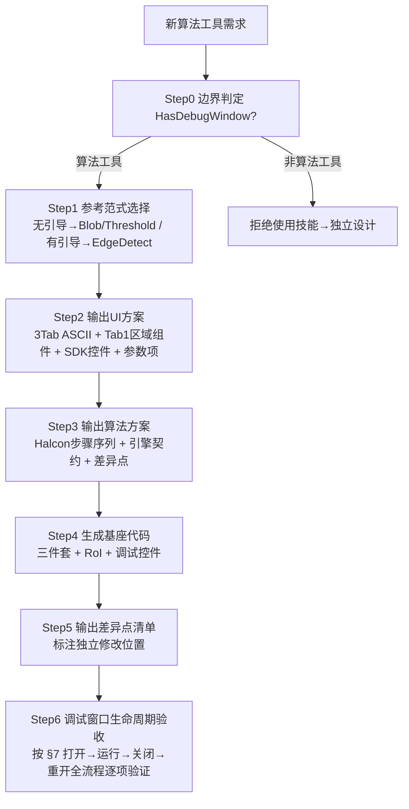

# 视觉工具构建技能

> **定位**：算法工具的"批量生成器"。基于现有算法工具提炼**开发范式** → 输出 **UI 方案 + 算法方案 + 差异点清单** → 生成**基座代码** → 标注**独立修改点**。

## 0. 适用范围边界（Step0 必须先判定）

| 适用性 | 工具类型 | 判别标准 | 处理方式 |
|---|---|---|---|
| ✅ **适用** | 算法工具 | 有输入图像 → Halcon 算法 → 结果+可视化+**调试窗口**（`HasDebugWindow=true`） | 本技能批量生成 |
| ❌ 不适用 | 流程控制（Condition） | 无图像、有控制信号（`IControlFlowResult`） | 独立设计、多轮迭代 |
| ❌ 不适用 | 子程序（Subroutine） | 嵌套工作流、动态输出映射 | 独立设计 |
| ❌ 不适用 | 脚本（Script） | 动态编译（`IPrecompilableTool`） | 独立设计 |
| ❌ 不适用 | 图像源（ImageLoad） | `HasDebugWindow=false`，无调试窗口 | 非本技能对象 |

**硬性前提**：`HasDebugWindow=true` 是算法工具的本技能适用前提。无调试窗口的工具一律不适用本技能。

---

## 1. 技能产出物（三大件）

1. **UI 方案**（范式 A + 差异点 + 3-Tab ASCII 图）
2. **算法方案**（范式 C + 差异点 + 引擎契约）
3. **基座代码**（三件套 + RoI + 调试控件）

---

## 2. 引擎契约（三铁律，经架构分层 V2 验证）

```
工具层公开 API 永不暴露具体引擎类型
  ├─ 图像：parameters.ResolvedInputImage（IVisionImage?，框架注入）
  ├─ Run Halcon 路径：parameters.GetHalconImage() → HOperatorSet.*
  │    扩展方法位于 SunEyeVision.HalAdapter（工具 csproj 须引 HalAdapter）
  ├─ Run OpenCV 路径：parameters.GetCvImage() → CvImage.Image(Mat) → CvOp.*
  │    扩展方法位于 SunEyeVision.CvAdapter（工具按需引 CvAdapter/CvEngine）
  └─ 适配载体：IVisionImage ← HalImage(HalAdapter) / Cv 适配(CvAdapter)
      跨后端提取：VisionBackendExtractorLocator.ToHalcon / .ToOpenCv（SDK Hosting，宿主装配注册）
```

1. **Run 默认走 Halcon**：`parameters.GetHalconImage()`（需 `using SunEyeVision.HalAdapter;` + csproj `ProjectReference` 引 `SunEyeVision.HalAdapter`）
2. **公开 API 不出现 `HImage`/`Mat`**，图像统一 `IVisionImage`
3. OpenCV 实现走 `CvToolHelpers.GetCvImage()` + `CvOp.*`，不直接 `Cv2.*`
4. **契约/适配分层**：SDK 只定义契约（`IVisionImage`/`VisionBackendExtractorLocator`）；引擎类型与适配载体一律不在 SDK（Hal→`SunEyeVision.HalAdapter`，Cv 算法→`SunEyeVision.CvEngine`，Cv 适配→`SunEyeVision.CvAdapter`）
5. **图像处理式工具区域前置（两段式，v1.4 统一）**：区域/修正解析与"按域执行"分离
   - 纯几何：`HalconRegionPipeline.Resolve(imgWidth, imgHeight, 检测区, 屏蔽区, nodeResults, correctionMatrix)` → `RoiScope`
     只做订阅解析 + 位置修正（按形状有向性）+ 检测−屏蔽差集；**签名不接收任何图像对象**；scope 用后 `Dispose()`（只释放 region，防重入）
   - 执行方式由算法自决：按域 → `HalImageDomain.Restrict(grayImage, scope.RoiRegion)`（返回新图，谁调用谁释放）；全图 → 直接用原图
   - 所有权铁律：**谁 Restrict 谁释放**（标准 `using`/`finally`，无所有权转移/Detach 概念）；位置修正矩阵 Run（Resolve）与交互层（控件实时查询）同源
   - 适用边界：图像处理式工具（Blob/阈值化/滤波/二值化/形态学）；Metrology/匹配类工具区域语义不同，不适用

---

## 3. UI 控件复用铁律

1. 调试控件**必须**继承 `ToolDebugControlBase`（自动获得 Execute/Confirm/ContinuousExecute/ResetParameters 命令、ToolExecutionCompleted 事件、AvailableDataSources、SetParameters/SetDataProvider/SetMainImageControl）
2. 参数输入**一律** SDK 控件：`LabeledControl`/`ConfigSetting`/`RangeInputControl`/`RangeSlider`/`NumericUpDown`/`ToggleSwitch`/`ParamComboBox`/`ParamTextBox`/`ImageSourceSelector`
3. 区域编辑用 `RoiEditorManagerControl` / `MeasurementEditorManagerControl` / `MeasureToolBar` / `ShapeToolBar`
4. 图像显示用 `ImageControl`
5. 工具层只做「装配 + 参数绑定」，**禁止自建参数/区域/图像控件**

---

## 4. 开发范式（含出处，可溯源）

### 范式 A：UI 三件套

#### A1. 3-Tab XAML 布局（基本参数/运行参数/结果显示）

**整体结构 ASCII 图**：

```
┌──────────────────────────────────────────────────────────────┐
│ ToolDebugControlBase (PreferredDebugWindowSize 900×620)        │
│  ┌────────────────────────────────────────────────────────┐  │
│  │ [基本参数] [运行参数] [结果显示]        ← TabControl     │  │
│  └────────────────────────────────────────────────────────┘  │
│                                                              │
│ Tab1 基本参数（无引导，Blob 范式 - 基准参考源）：              │
│  ┌────────────────────────────────────────────────────────┐  │
│  │ [输入图像] ImageSourceSelector (SDK)                    │  │
│  │ ┌─ 区域设置 ─────────────────────────────────────────┐ │  │
│  │ │ RoiEditorManagerControl (SDK)                      │ │  │
│  │ │   ├─ 检测区域 InspectionRegions                    │ │  │
│  │ │   └─ 屏蔽区域 MaskRegions                          │ │  │
│  │ └─────────────────────────────────────────────────────┘ │  │
│  │ [位置修正] ToggleSwitch + ParamBinding(矩阵绑定源)       │  │
│  └────────────────────────────────────────────────────────┘  │
│                                                              │
│ Tab1 基本参数（有引导，EdgeDetect 范式）：                     │
│  ┌────────────────────────────────────────────────────────┐  │
│  │ MeasurementEditorManagerControl (SDK)                  │  │
│  │   = MeasureToolBar + GuideEditor + MaskRegions         │  │
│  └────────────────────────────────────────────────────────┘  │
│                                                              │
│ Tab2 运行参数（SDK 参数控件）：                                │
│  ┌────────────────────────────────────────────────────────┐  │
│  │ LabeledControl + ConfigSetting(数值+Slider)            │  │
│  │               + ParamComboBox(枚举+Converter)          │  │
│  │               + ToggleSwitch(开关) + RangeInputControl │  │
│  └────────────────────────────────────────────────────────┘  │
│                                                              │
│ Tab3 结果显示（Blob 范式）：                                   │
│  ┌────────────────────────────────────────────────────────┐  │
│  │ ▾ Expander 结果判断 (IsExpanded=True)                   │  │
│  │   [ToggleSwitch + RangeInputControl]×N 绑定 ResultConfig│  │
│  │   (输出为空/面积/数量/圆度/矩形度/独立Blob判定...)       │  │
│  │ ▾ Expander 图形显示 (IsExpanded=True)                   │  │
│  │   DispItemColorControl×N (检测区域/屏蔽区域/轮廓/质心...)│  │
│  │ ▾ Expander 文本显示 (IsExpanded=True)                   │  │
│  │   DispTextColorControl×N (面积列表...)                  │  │
│  └────────────────────────────────────────────────────────┘  │
└──────────────────────────────────────────────────────────────┘
```

**XAML 骨架**（出处 `BlobAnalysisToolDebugControl.xaml` / `ThresholdToolDebugControl.xaml`）：

```xaml
<controls:ToolDebugControlBase x:Class="SunEyeVision.Tool.{ToolName}.Views.{ToolName}ToolDebugControl"
        xmlns:controls="clr-namespace:SunEyeVision.Plugin.SDK.UI.Controls;assembly=SunEyeVision.Plugin.SDK"
        xmlns:region="clr-namespace:SunEyeVision.Plugin.SDK.UI.Controls.Roi.Views;assembly=SunEyeVision.Plugin.SDK"
        xmlns:results="clr-namespace:SunEyeVision.Plugin.SDK.Execution.Results;assembly=SunEyeVision.Plugin.SDK"
        DataContext="{Binding Parameters, RelativeSource={RelativeSource Self}}">
  <TabControl Margin="5,0,5,0">
    <!-- Tab1 基本参数（Blob 范式：区域管理器常显 + 位置修正） -->
    <TabItem Header="基本参数" IsSelected="True">
      <StackPanel>
        <controls:LabeledControl Label="输入图像">
          <controls:ImageSourceSelector
              PlaceholderText="请选择输入图像源" Width="250"
              AvailableDataSources="{Binding AvailableDataSources, RelativeSource={RelativeSource FindAncestor, AncestorType={x:Type controls:ToolDebugControlBase}}}"
              SelectedDataSource="{Binding ImageSource, Mode=TwoWay}"/>
        </controls:LabeledControl>

        <!-- 区域设置（检测区域数量=0 时全图分析，否则自动启用区域限制） -->
        <GroupBox Header="区域设置" Margin="0,8,0,0">
          <region:RoiEditorManagerControl x:Name="regionManager"
              InspectionRegionsSource="{Binding InspectionRegions.Regions}"
              MaskRegionsSource="{Binding MaskRegions.Regions}"/>
        </GroupBox>

        <!-- 位置修正（算法工具标配：ROI 随定位矩阵变换） -->
        <controls:LabeledControl Label="位置修正" Margin="0,8,0,0" HorizontalAlignment="Left">
          <controls:ToggleSwitch
              IsChecked="{Binding IsPositionCorrectionEnabled, Mode=TwoWay}"
              SwitchWidth="48" SwitchHeight="24"/>
        </controls:LabeledControl>
        <controls:LabeledControl Label="修正信息" Margin="0,4,0,0" HorizontalAlignment="Left"
            Visibility="{Binding IsPositionCorrectionEnabled, Converter={StaticResource BoolToVisibilityConverter}}">
          <controls:ParamBinding
              x:Name="positionCorrectionBinding"
              DataType="{x:Type results:AffineMatrix}"
              ParameterName="位置修正" Width="200"
              BindingSource="{Binding PositionCorrectionBindingSource, Mode=TwoWay}"
              BindingDisplayText="{Binding PositionCorrectionBindingDisplayText, Mode=TwoWay}"
              AvailableDataSources="{Binding AvailableDataSources, RelativeSource={RelativeSource FindAncestor, AncestorType={x:Type controls:ToolDebugControlBase}}}"/>
        </controls:LabeledControl>
      </StackPanel>
    </TabItem>

    <!-- Tab2 运行参数 -->
    <TabItem Header="运行参数">
      <StackPanel>
        <controls:LabeledControl Label="阈值">
          <controls:ConfigSetting ParameterName="Threshold"
              DataType="{x:Type sys:Int32}"
              Value="{Binding Threshold.Value, Mode=TwoWay}"
              Minimum="0" Maximum="255" ShowSlider="True" Width="250"
              AvailableDataSources="{Binding AvailableDataSources, ...}"/>
        </controls:LabeledControl>
      </StackPanel>
    </TabItem>

    <!-- Tab3 结果显示（Blob 范式：结果判断 + 图形显示 + 文本显示） -->
    <TabItem Header="结果显示">
      <Grid Background="{DynamicResource ThemePanelBackgroundBrush}">
        <Grid.RowDefinitions>
          <RowDefinition Height="*"/>
          <RowDefinition Height="Auto"/>
        </Grid.RowDefinitions>
        <ScrollViewer Grid.Row="0" Padding="3">
          <StackPanel>
            <!-- 结果判断（每个判定 = ToggleSwitch + RangeInputControl，绑定 ResultConfig） -->
            <Expander Header="结果判断" IsExpanded="True">
              <StackPanel Margin="16,8">
                <controls:LabeledControl Label="输出为空判断">
                  <controls:ToggleSwitch IsChecked="{Binding ResultConfig.IsEmptyCheckEnabled, Mode=TwoWay}"/>
                </controls:LabeledControl>
                <controls:LabeledControl Label="面积判断">
                  <controls:ToggleSwitch IsChecked="{Binding ResultConfig.IsTotalAreaCheckEnabled, Mode=TwoWay}"/>
                </controls:LabeledControl>
                <controls:LabeledControl Label="面积范围 (px²)"
                    Visibility="{Binding ResultConfig.IsTotalAreaCheckEnabled, Converter={StaticResource BoolToVisibilityConverter}}">
                  <controls:RangeInputControl Unit="px²" Minimum="0" Maximum="10000000"
                      MinValue="{Binding ResultConfig.TotalAreaMin, Mode=TwoWay}"
                      MaxValue="{Binding ResultConfig.TotalAreaMax, Mode=TwoWay}"
                      DecimalPlaces="0" NumericWidth="120"/>
                </controls:LabeledControl>
                <!-- 更多判定项按工具差异扩展：数量/圆度/矩形度/独立Blob... -->
              </StackPanel>
            </Expander>

            <!-- 图形显示（DispItemColorControl 控制各类叠加元素颜色/可见性） -->
            <Expander Header="图形显示" IsExpanded="True">
              <StackPanel Margin="16,8">
                <controls:LabeledControl Label="检测区域">
                  <controls:DispItemColorControl Item="{Binding InspectionRegionStyle, Mode=TwoWay}"/>
                </controls:LabeledControl>
                <controls:LabeledControl Label="屏蔽区域">
                  <controls:DispItemColorControl Item="{Binding MaskRegionStyle, Mode=TwoWay}"/>
                </controls:LabeledControl>
              </StackPanel>
            </Expander>

            <!-- 文本显示（DispTextColorControl 控制文本标注） -->
            <Expander Header="文本显示" IsExpanded="True">
              <StackPanel Margin="16,8">
                <controls:LabeledControl Label="面积列表">
                  <controls:DispTextColorControl Item="{Binding AreaDisplayStyle, Mode=TwoWay}"
                      AvailableDataSources="{Binding AvailableDataSources, RelativeSource={RelativeSource FindAncestor, AncestorType={x:Type controls:ToolDebugControlBase}}}"/>
                </controls:LabeledControl>
              </StackPanel>
            </Expander>
          </StackPanel>
        </ScrollViewer>
      </Grid>
    </TabItem>
  </TabControl>
</controls:ToolDebugControlBase>
```

**A1.1 UI 绑定铁律（三则，缺一则绑定失效）**：

1. **XAML 根必须有 `DataContext`**：
   ```xaml
   <controls:ToolDebugControlBase x:Class="..."
       DataContext="{Binding Parameters, RelativeSource={RelativeSource Self}}">
   ```
   缺此 → 所有 `X` 绑定（无 `Parameters.` 前缀）静默失败（DataContext 为 null/父级）。绑定路径 = `ResultConfig.IsXxx`（DataContext 已是 Parameters），**禁用** `Parameters.ResultConfig.IsXxx`。

2. **converter 必须在 Resources 声明**：
   ```xaml
   <controls:ToolDebugControlBase.Resources>
     <ResourceDictionary>
       <converters:BoolToVisibilityConverter x:Key="BoolToVisibilityConverter"/>
     </ResourceDictionary>
   </controls:ToolDebugControlBase.Resources>
   ```
   需 `xmlns:converters="clr-namespace:SunEyeVision.Plugin.SDK.UI.Controls.Roi.Converters;assembly=SunEyeVision.Plugin.SDK"`。

3. **开关必须控制下方参数可见性**（每个判定 = ToggleSwitch + 范围输入联动）：
   ```xaml
   <!-- 开关 -->
   <controls:LabeledControl Label="面积判断">
     <controls:ToggleSwitch IsChecked="{Binding ResultConfig.IsTotalAreaCheckEnabled, Mode=TwoWay}"/>
   </controls:LabeledControl>
   <!-- 范围输入（可见性绑定开关，关闭则隐藏） -->
   <controls:LabeledControl Label="面积范围 (px²)"
       Visibility="{Binding ResultConfig.IsTotalAreaCheckEnabled, Converter={StaticResource BoolToVisibilityConverter}}">
     <controls:RangeInputControl Unit="px²" Minimum="0" Maximum="10000000"
         MinValue="{Binding ResultConfig.TotalAreaMin, Mode=TwoWay}"
         MaxValue="{Binding ResultConfig.TotalAreaMax, Mode=TwoWay}"
         NumericWidth="120"/>
   </controls:LabeledControl>
   ```
   > **范式要求**：范围输入必须带 `Visibility` 绑定到对应开关，开关关闭 → 范围隐藏。

#### A2. Code-Behind 骨架（出处 `EdgeDetectToolDebugControl.xaml.cs`）

```
[DependencyProperty Parameters]
[INPC ResultText / ResultRMSE / ResultEdgePointCount]   ← 结果展示字段
PreferredDebugWindowSize => 900×620

构造：InitializeComponent + Parameters = new {ToolName}Parameters()

Overrides（五件套）：
  SetParameters: base.SetParameters + 类型不符 throw(rule-015) + Parameters = typed
  ExecuteTool:  new {ToolName}Tool().Run(Parameters) → UpdateResultDisplay
  CanExecuteTool: Parameters != null
  SetMainImageControl: base + 托管子编辑器 + Restore{Guide/Roi}FromParameters
  InitializeAsync: 依赖多项数据的初始化（可选）
```

#### A3. SDK 控件复用清单

| 类别 | SDK 控件 |
|---|---|
| 容器/基类 | `ToolDebugControlBase` |
| 参数输入 | `LabeledControl` / `ConfigSetting` / `RangeInputControl` / `RangeSlider` / `NumericUpDown` / `ToggleSwitch` / `ParamComboBox` / `ParamTextBox` / `ImageSourceSelector` |
| 区域编辑 | `RoiEditorManagerControl` / `MeasurementEditorManagerControl` / `MeasureToolBar` / `ShapeToolBar` / `ToolBarControl` |
| 图像显示 | `ImageControl` |
| RoI 辅助 | `DrawingParameterPanel` / `RoiInfoPanel` / `RoiSubscribePanel` / `NodeSelectorPopup` |

---

### 范式 B：参数类（出处 `BlobAnalysisParameters.cs` / `EdgeDetectParameters.cs`）

**枚举**（工具特有枚举放参数文件顶部，对齐 Halcon 算子参数语义）：

```csharp
public enum {Enum}Type { All, {Option1}, {Option2} }
```

**参数类骨架**：

```csharp
[JsonDerivedType(typeof({ToolName}Parameters), "{ToolName}")]   // 反序列化必需
public class {ToolName}Parameters : RoiParameters               // 算法工具基类（含区域）
{
    private double _param = 20.0;
    public double Param
    {
        get => _param;
        set => SetProperty(ref _param, value, "参数中文名");      // 中文名用于 UI/日志
    }
    // 枚举：set 内不 clamp；数值：set 内 clamp（如 Math.Max(1, value)）
}
```

**差异点**：
- 无区域需求 → 继承 `ToolParameters`（非 `RoiParameters`）
- 有引导几何 → 加 `GeometryType` + 几何字段（`GuideCircle`/`LineStartPoint`/`LineEndPoint`）
- 判定配置 → `ResultConfig` 模型（面积/均值/质心判定）

---

### 范式 C：算法 Run 范式（Halcon 优先，出处 `BlobAnalysisTool.cs` / `ThresholdTool.cs`）

```csharp
[Tool(
    id: "{ToolId}", displayName: "{中文显示名}",
    Description = "{工具描述}", Icon = "{emoji}",
    Category = "{分类名}", Version = "1.0.0", HasDebugWindow = true)]
[JsonDerivedType(typeof({ToolName}Parameters), "{ToolName}")]
public class {ToolName}Tool : IToolPlugin<{ToolName}Parameters, {ToolName}Results>
{
    private readonly ToolAttribute? _attribute;
    public {ToolName}Tool() => _attribute = GetType().GetCustomAttribute<ToolAttribute>();

    public {ToolName}Results Run({ToolName}Parameters parameters)
    {
        var result = new {ToolName}Results
        {
            ToolName = _attribute?.DisplayName ?? "{ToolName}",
            ToolId = _attribute?.Id ?? "{ToolName}",
            Timestamp = DateTime.Now
        };
        var sw = Stopwatch.StartNew();
        try
        {
            // ✅ 图像获取：Halcon 优先（GetHalconImage 内部兼容 Cv→Hal 转换）
            var hImage = parameters.GetHalconImage()
                ?? throw new InvalidOperationException("无输入图像");
            parameters.LogInfo("开始{ToolName}处理");

            // —— 算法步骤（本工具差异点核心）——
            // Step1: 区域前置（图像处理式工具）→ HalconRegionPipeline.Resolve(w,h,检测区,屏蔽区,nodeResults,修正矩阵)
            //        = 纯几何：订阅解析 + 位置修正 + 检测−屏蔽差集；scope 用后 finally Dispose（只释放 region）
            // Step2: 执行方式由算法自决 → 按域 HalImageDomain.Restrict(grayImage, scope.RoiRegion)（新图自管用后释放）
            //        或全图直接用原图；Metrology/匹配类工具不走 Resolve（区域语义不同）
            // Step3: Halcon 算子序列（HOperatorSet.*，喂 Step2 处理图）
            // Step4: 结果计算 + 判定

            result.DurationMs = sw.Elapsed.TotalMilliseconds;
            result.SetSuccess(result.DurationMs);
            parameters.LogSuccess("...完成");
        }
        catch (Exception ex)
        {
            result.SetError(ex.Message, ex);        // rule-015 禁止静默
            parameters.LogError($"失败: {ex.Message}");
        }
        return result;
    }

    public FrameworkElement? CreateDebugControl(IToolPlugin tool)
        => new {ToolName}ToolDebugControl("{ToolName}", tool, null);

    public FrameworkElement? CreateDataAnalysisControl()
        => new {ToolName}DataAnalysisControl();
}
```

**差异点**：算法步骤序列（Step1-3）、`GetHalconImage` 后的处理、参数如何驱动算子。

---

### 范式 D：结果类（出处 `BlobAnalysisResults.cs`）

```csharp
[JsonDerivedType(typeof({ToolName}Results), "{ToolName}Results")]
public class {ToolName}Results : ToolResults
{
    /// <summary>输出图像（框架自动识别）</summary>
    public IVisionImage? OutputImage { get; set; }

    /// <summary>属性映射（UI 显示用）</summary>
    public override List<PropertyMapEntry> GetPropertyMap()
    {
        return
        [
            // ⚠️ 必须合并基类，获得"执行耗时/执行信息"分组
            .. base.GetPropertyMap(),
            new("ExampleValue", "示例值", "结果"),
        ];
    }

    /// <summary>可视化元素（图像叠加）</summary>
    public override IEnumerable<VisualElement> GetVisualElements()
    {
        // yield return VisualElement.Circle(...);  // 几何/ROI 叠加
        yield break;
    }

    /// <summary>输出变量（数据变量面板 SSOT）</summary>
    public override IReadOnlyList<OutputVariableDefinition> GetOutputVariables() { ... }
}
```

---

### 范式 E：RoI 契约（算法工具标配）

```
InspectionRegions（检测区）→ 限定算法作用范围
MaskRegions（屏蔽区）→ 排除区域
GetRoisByType(RoiType.Inspection/Mask) + ToolRegionHelper.BuildHalconROI
GetVisualElements 输出区域可视化
```

---

### 范式 F：数据分析控件（可选，复杂工具，出处 `BlobDataAnalysisControl.cs`）

实现 `IToolControlDataAnalysis`，订阅 `OnResultUpdated` 刷新统计图表/列表。用于主界面右下角数据分析 Tab。

---

## 5. 差异点清单模板（每个工具必填）

| 差异维度 | 范式默认 | 本工具差异 | 处理方式 |
|---|---|---|---|
| 输入几何 | 无引导 | 需引导(Line/Circle/Arc) | 组装 `MeasurementEditorManagerControl` |
| 参数基类 | `RoiParameters` | 无区域需求 | 改继承 `ToolParameters` |
| 算法步骤 | 固定管线 | 自定义 Halcon 序列 | 独立实现 Run 核心 |
| 结果项 | 统计+判定 | 工具特有结果 | 扩展 Results |
| 可视化 | `GetVisualElements` | 几何/ROI 叠加 | 自定义绘制 |
| 判定配置 | `ResultConfig` | 工具特有判定 | 扩展 Model 子类 |
| 区域启用开关 | 无开关（Blob，区域常显） | 需"启用区域限制"开关 | 加 `IsRegionEnabled` + CheckBox（参考 Threshold） |
| 位置修正 | 标配（Blob：ToggleSwitch + ParamBinding 矩阵） | 无需位置修正 | 移除 Tab1 位置修正段（参考 Threshold） |
| 结果展示 | 三 Expander（结果判断/图形显示/文本显示） | 展示项按工具扩展 | 结果判断加判定项、图形显示加 `DispItemColorControl`、文本显示加 `DispTextColorControl` |

---

## 6. 工作流



---

## 7. 调试窗口全生命周期覆盖（打开→关闭→重开，新建工具必检）

> 生命周期 = 宿主驱动的回调链 + 工具侧清理闭环。新建算法工具必须完整覆盖以下环节并逐项验收。

### 7.1 打开 / 初始化阶段
| # | 宿主回调 | 工具侧职责 | 验收点 |
|---|---|---|---|
| 1 | 构造 | `new {Tool}DebugControl(...)`：`InitializeComponent` + `Parameters = new {Tool}Parameters()` | 窗口能打开、无绑定错误 |
| 2 | `SetParameters(Parameters)` | `base.SetParameters` + 类型不符 `throw`（rule-015）→ 强类型 Parameters | 传错类型必抛 |
| 3 | `SetDataProvider(queryService)` | 保存 `_dataProvider`；`RestoreImageSource` / `RestorePositionCorrectionSource` / `UpdatePositionCorrectionMatrix()` | 图像源/矩阵回填 |
| 4 | `SetMainImageControl(ImageControl)` | `base.SetMainImageControl` + 托管子编辑器（`regionManager` / `MeasurementManager.SetMainImageControl`）+ zoom 传递 + overlay 共享 | 画布可用、叠加层正常 |
| 5 | `InitializeAsync()` | 语义预热 / workspace 重建（可选；有则必须 await） | 打开即就绪无白屏 |
| 6 | `OnExternalResultArrived()` | 工作流执行完成 → 刷新位置修正矩阵/结果 | 外部执行后显示同步 |

### 7.2 运行 / 交互阶段
| # | 环节 | 工具侧职责 | 验收点 |
|---|---|---|---|
| 7 | 图像/位置修正选择 | `UpdatePositionCorrectionMatrix()`：交互/结果/算法同一矩阵源 | 选源后几何即时修正 |
| 8 | 执行 `ExecuteTool` | `new {Tool}Tool().Run(Parameters)` → `UpdateResultDisplay(result)` | 图像+叠加+文本均刷新 |
| 9 | 区域/引导编辑 | Roi/Measure 命中、绘制、手柄、屏蔽 | 编辑与结果层一致 |
| 10 | Confirm / Reset / Continuous | 写回方案 / 重置参数 / 连续执行 | 无残留叠加 |
| 11 | 缩放平移 | `ViewTransformed` → zoom 同步子编辑器/渲染器 | 线宽不随放大变粗 |

### 7.3 关闭 / 清理阶段（必须闭环，防泄漏/残留叠加）
1. **Loaded 时挂接**：`Loaded += (_, _) => { if (Window.GetWindow(this) is { } w) w.Closing += (_, _) => Cleanup(); }`
2. `Cleanup()` 职责：卸载事件订阅 + `regionManager.ClearMainOverlay()`（Blob/Threshold 路径）或 `MeasurementManager?.ClearMainOverlay()`（测量工具路径）；释放 `WpfShapeRenderer` 等资源
3. **重开回归**：关闭后再次打开同一节点 → 叠加层无残留、事件无重复订阅、可正常执行

> 参考实现（Loaded→Closing→Cleanup 链路）：
> `LineDetectToolDebugControl.xaml.cs:110` / `CircleDetectToolDebugControl.xaml.cs:110` / `BlobAnalysisToolDebugControl.xaml.cs:158`

---

## 8. 参考实现（真实路径）

**基准参考源（已验收）**：

```
tools/SunEyeVision.BlobAnalysis/          ← 无引导+区域算法工具完整范例（区域/屏蔽/判定/数据分析）
  ├─ BlobAnalysisTool.cs                  （Halcon 全流程 + 分步计时 + 延迟计算 + 屏蔽区）
  ├─ BlobAnalysisParameters.cs            （RoiParameters 完整参数模型 24KB）
  ├─ BlobAnalysisResults.cs               （结果 + 可视化 + 输出变量）
  ├─ Models/BlobAnalysisResultConfig.cs   （结果判定配置）
  ├─ Views/BlobAnalysisToolDebugControl.xaml(+.cs)  （3-Tab UI + Cleanup 链路）
  └─ Views/BlobDataAnalysisControl.xaml(+.cs)       （数据分析范式 F）

tools/SunEyeVision.Tool.LineDetect/      ← 有引导 Metrology + 屏蔽点过滤 + 全点鲁棒拟合
  ├─ LineDetectTool.cs                    （AddMetrologyObjectLineMeasure + 全点鲁棒拟合）
  ├─ LineDetectParameters.cs              （BuildMeasureGuideItems 结果层回显）
  └─ Views/LineDetectToolDebugControl.xaml(+.cs)  （Measurement 编辑 + 矩阵同步 + Cleanup）

tools/SunEyeVision.Tool.CircleDetect/    ← 有引导整圆/圆弧 Metrology + 屏蔽 + 位置修正旋转语义
  ├─ CircleDetectTool.cs                  （圆心/半径/弧角 + start_phi 相位旋转 + 屏蔽点过滤）
  ├─ CircleDetectParameters.cs            （BuildMeasureGuideItems 结果层回显）
  └─ Views/CircleDetectToolDebugControl.xaml(+.cs)  （Measurement 编辑 + 矩阵同步 + Cleanup）

tools/SunEyeVision.Tool.ShapeMatch/      ← 模板匹配 + 位置修正矩阵输出 + 数据分析控件
  ├─ ShapeMatchTool.cs                    （形状匹配定位，输出 AffineMatrix）
  └─ Views/ShapeMatchToolDebugControl.xaml(+.cs)
```

**辅助参考**：

```
tools/SunEyeVision.Tool.Threshold/      （标准无引导，UI 精简范例 + Loaded→Closing→Cleanup）
tools/SunEyeVision.Tool.EdgeDetect/     （引导式 Metrology，引导几何 UI 范例）
tools/SunEyeVision.Tool.ImageFilter/    （图像滤波）
tools/SunEyeVision.Tool.Morphology/     （形态学）
```

> ⚠️ **路径注意**：Blob 分析目录为 `tools/SunEyeVision.BlobAnalysis/`（**无 `Tool.` 前缀**），csproj 名为 `SunEyeVision.Tool.BlobAnalysis.csproj`。**禁止**参考 `ImageLoad`（`HasDebugWindow=false`，无调试窗口，非本技能对象）。

---

## 9. 代码锚点（真实符号名）

### 图像/引擎契约

| 符号 | 位置 | 用途 |
|---|---|---|
| `parameters.ResolvedInputImage` | `src/Plugin.SDK/Execution/Parameters/ToolParameters.cs` | 通用图像契约（`IVisionImage?`，框架注入） |
| `GetHalconImage()`（扩展） | `src/SunEyeVision.HalAdapter/HalconHelpers.cs`（`HalconToolHelpers`，namespace `SunEyeVision.HalAdapter`） | Run 取 HImage（工具需引 HalAdapter） |
| `GetCvImage()`（扩展） | `src/SunEyeVision.CvAdapter/CvToolHelpers.cs`（namespace `SunEyeVision.CvAdapter`） | 取 CvEngine `CvImage`（工具需引 CvAdapter） |
| `IVisionImage` | `src/Plugin.SDK/Vision/Contracts/IVisionImage.cs`（namespace `SunEyeVision.Plugin.SDK.Vision.Contracts`） | 图像通用接口（SDK 契约层） |
| `VisionBackendExtractorLocator` | `src/Plugin.SDK/Vision/Hosting/VisionBackendExtractorLocator.cs` | 跨后端提取（ToHalcon→HImage / ToOpenCv→Mat），宿主装配注册 |
| `HalImage` | `src/SunEyeVision.HalAdapter/HalImage.cs` | Hal 适配载体（实现 `IVisionImage`，`Unwrap()→HImage`） |
| `CvImage` | `src/SunEyeVision.CvEngine/VisionAdapters/CvImage.cs` | Cv 算法层载体（包装 Mat，纯算法类型） |

### 工具三件套核心

| 符号 | 位置 | 用途 |
|---|---|---|
| `IToolPlugin<TParams, TResult>` | `src/Plugin.SDK/Core/IToolPlugin.cs` | 工具开发者入口 |
| `ToolAttribute` | `src/Plugin.SDK/Core/ToolAttribute.cs` | 工具元数据特性 |
| `ToolParameters` | `src/Plugin.SDK/Execution/Parameters/ToolParameters.cs` | 参数基类 |
| `RoiParameters` | `src/Plugin.SDK/Execution/Parameters/RoiParameters.cs` | 算法工具参数基类（含区域） |
| `ToolResults` | `src/Plugin.SDK/Execution/Results/ToolResults.cs` | 结果基类 |

### UI 控件（工具开发者用）

| 符号 | 位置 | 用途 |
|---|---|---|
| `ToolDebugControlBase` | `src/Plugin.SDK/UI/Controls/ToolDebugControlBase.cs` | 调试控件基类 |
| `ImageControl` | `src/Plugin.SDK/UI/Controls/ImageControl/ImageControl.xaml.cs` | 图像显示 |
| `RoiEditorManagerControl` | `src/Plugin.SDK/UI/Controls/Roi/Views/RoiEditorManagerControl.xaml.cs` | 检测区+屏蔽区管理 |
| `MeasurementEditorManagerControl` | `src/Plugin.SDK/UI/Controls/Measure/Views/MeasurementEditorManagerControl.xaml.cs` | 测量引导+屏蔽区管理 |
| `ConfigSetting` | `src/Plugin.SDK/UI/Controls/ConfigSetting.cs` | 数值参数配置 |

---

## 10. 约束

- 序列化必须 `System.Text.Json`，禁止 Newtonsoft.Json
- 必须 `[JsonPolymorphic]` + `[JsonDerivedType]` 多态
- JSON 使用 PascalCase
- 命名遵循 PascalCase，禁止缩写
- 结果类 `GetPropertyMap()` 必须 `.. base.GetPropertyMap()` 合并基类，禁止重复声明 ExecutionTimeMs
- 工具层公开 API **永不暴露** `HImage`/`Mat`，图像统一 `IVisionImage`
- Run 默认走 Halcon（`GetHalconImage()`），公开 API 不出现引擎类型
- UI 必须复用 SDK 控件，禁止自建参数/区域/图像控件
