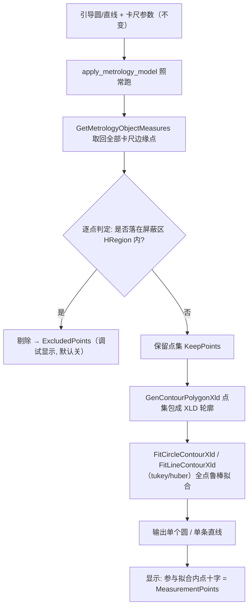

# 方案：圆查找/直线查找屏蔽区域算法层生效（点集空间过滤 + 全点鲁棒拟合）

> 遵循 rule-004（全局视角/复用优先）与 rule-008（YAGNI/KISS/报错优先）。
> 状态：已与用户确认定稿（2026-09-03）。

---

## 0. 用户功能性视角（改前 → 改后）

**改前**：在圆查找/直线查找上画屏蔽区（盖住毛刺/焊点/螺丝孔等干扰），运行时屏蔽区只是装饰——卡尺照常沿整圆/整条线抓点，屏蔽区内的坏点照常进入拟合，把圆/直线结果带偏；结果层显示的拟合点十字中也包含坏点。

**改后**：

- 卡尺照常铺、`apply_metrology_model` 照常执行（**不拆段、不建多个 metrology object**）；
- 用 `get_metrology_object_measures` 把每根卡尺抓到的边缘点**全部取回**；
- **逐点判定"是否落在屏蔽区内"，落在屏蔽区内的点直接剔除**；
- 剔除后剩余的点**全部合并，做一次全点鲁棒拟合** → 输出一个圆 / 一条直线；
- 结果层显示的拟合点十字 = **过滤后实际参与拟合的点**（显示与拟合数据一致，屏蔽区内的点不再显示为拟合点）；
- 屏蔽区把可测点全部挡光 / 过滤后点数不足 → **明确报错**，不硬拟合出假结果。

---

## 1. 问题分析与需求背景

### 1.1 现状证据

| 事实 | 来源 |
|------|------|
| 屏蔽区参数已存在：`CircleDetectParameters : RoiParameters`，`MaskRegions` = `RoiCollectionParameter`（`ObservableCollection<RoiData>`） | CircleDetectParameters.cs:58；RoiParameters.cs:99-104；RoiCollectionParameter.cs:75 |
| 屏蔽区 UI 已接入：调试控件将 `Parameters.MaskRegions.Regions` 绑给 `MeasurementManager`（引导+屏蔽统一编排） | LineDetectToolDebugControl.xaml.cs:261-264 |
| 屏蔽区算法未消费：`Run` 全程只用 GuideCircle/Line + 带参数，无任何 `MaskRegions` / `RoiType.Mask` 读取 | CircleDetectTool.cs:88-177；LineDetectTool.cs:92-194 |
| 测量点回读 API 已用：`GetMetrologyObjectMeasures` 取全部检测点 | CircleDetectTool.cs:141-152, 416-434 |
| 屏蔽区 RoiData → HRegion 转换已有：支持圆/旋转矩形/多边形/矩形/订阅模式 | ToolRegionHelper.cs:60-105, 196-214 |
| 点集鲁棒拟合 API 在 HalconDotNet 中存在：`HXLDCont.GenContourPolygonXld`、`FitCircleContourXld`、`FitLineContourXld` | libs/halcon/net/halcondotnetxl.xml:31738,32141,61506,61542 |
| EdgeDetect 同族，同样使用 metrology line+circle | EdgeDetectTool.cs:91-99 |

### 1.2 根本矛盾

屏蔽数据（参数）→ UI（编辑器）→ 显示（结果层）链路已通，**唯独缺"参数 → 算法"这一环**。属于功能缺失/实现偏差：写了 UI 没接算法。

---

## 2. Bug 模式分析

- **当前缺陷**：屏蔽区不参与采样/拟合 → 干扰点污染拟合结果 → 误判/误测。
- **真因分类**：实现偏差（功能链断节）。
- **同类潜伏点**：
  - EdgeDetectTool 与 Circle/Line 三件套同构，同样未消费 MaskRegions（EdgeDetectTool.cs:91-99）；
  - `RoiParameters.GetEffectiveRois()` 存在半成品边界盒差集实现 + TODO（RoiParameters.cs:334-364）。
- **治本点**：在 SDK 提供"屏蔽区 → 点集空间过滤"公共能力，圆/直线/边缘三工具共用；拟合统一收敛到"全点鲁棒拟合"。

---

## 3. 业界对标与方案否决记录（决策依据）

| 做法 | 结论 | 依据 |
|------|------|------|
| VisionMaster 找线/找圆"屏蔽区"：屏蔽区内的卡尺不采样 | **采纳其语义**：屏蔽只影响"参与拟合的点"，卡尺数量/相位不变 | VisionMaster 直线查找基本参数=形状+屏蔽区（CSDN《记录｜Vision Master——查找工具》） |
| HALCON 图像层扣屏蔽（reduce_domain 挖洞 / paint_region 抹像素） | **否决**：实测 `measure_pos` 不尊重 reduce 后的 domain，抓点仍出现在域外；抹像素会让屏蔽边界成为新假边缘 | CSDN《halcon易错系列—reduce_domain》（blog.csdn.net/a584020745/article/details/112439036） |
| HALCON 拆段多 object（measure_stamping_part 范式） | **否决（本需求范围）**：每段对象独立拟合、各段结果分裂，同圆多段需"选段/联合"二选一，复杂度高 | 官方 measure_stamping_part 各段独立取结果（例程注释） |
| 点集空间过滤 + 全点鲁棒拟合（本方案） | **采纳**：屏蔽多边形形状任意、多段任意，算法与屏蔽形状无关；`fit_circle_contour_xld`/`fit_line_contour_xld` 原生支持 huber/tukey | HalconDotNet API 存在；生态标准补法（GitHub Halcon-Find-Circle 例程第 8 步同款组合） |

**机制说明（为什么不能在图像层做）**：Blob 用 reduce_domain 有效是因为 `Threshold` 是"区域算子"（只看像素区间、不看灰度跳变），domain 裁剪天然生效；而 metrology 是"沿测量带找灰度跳变"的剖面算子，图像层任何人为挖洞/抹色都会成为候选边缘或被越过。屏蔽必须在"点集参与拟合"这一层表达。

---

## 4. 最终架构

### 4.1 关键语义

- **屏蔽区 = 空间硬剔除**：屏蔽区内的点无条件不参与拟合，不管其离几何远近（这是画屏蔽区的意义）。
- **鲁棒拟合 = 统计兜底**：屏蔽没画准或别处有漏网点时，`tukey/huber` 将其作为离群点剔除，不拖偏结果。
- **显示与拟合一致**：结果层拟合点十字数据源 = 最终参与拟合的点集。

---

## 5. 修改清单

### 5.1 SDK 公共能力
| # | 类型 | 文件 | 核心变更 | 前置 |
|---|------|------|---------|------|
| 1 | 修改 | `src/Plugin.SDK/Execution/Helpers/ToolRegionHelper.cs` | 新增屏蔽区点集过滤：屏蔽 RoiData → HRegion（复用 `BuildHalconRegion`）→ 逐点包含测试剔除；支持位置修正矩阵作用于屏蔽区几何 | 无 |

### 5.2 圆查找
| # | 类型 | 文件 | 核心变更 | 前置 |
|---|------|------|---------|------|
| 2 | 修改 | `CircleDetectTool.cs` | Run 改造：apply → measures 点 → 空间过滤 → `GenContourPolygonXld`+`FitCircleContourXld('tukey')` → 圆心/半径；`MeasurementPoints` = 参与拟合内点；`ExcludedPoints` = 被剔除点；`EdgePointCount` = 内点数；RMSE 自算（点→圆距离均方根，沿用现有逻辑改造输入）；过滤后点数不足/全剔除 → `SetError` | #1 |
| 3 | 修改 | `CircleDetectParameters.cs` | 新增 `ExcludedPointStyle`（默认不可见）；`min_score`/`distance_threshold` 保留字段、语义迁移为判定层（见 §6 决策②） | #2 |
| 4 | 修改 | `CircleDetectResults.cs` | 新增 `ExcludedPoints` 集合；`FillDisplay` 增加被剔除点渲染（样式开关控制） | #2 |

### 5.3 直线查找（同构）
| # | 类型 | 文件 | 核心变更 | 前置 |
|---|------|------|---------|------|
| 5 | 修改 | `LineDetectTool.cs` | 同 #2：measures → 过滤 → `FitLineContourXld` → 直线起终点/角度；结果字段沿用 | #1 |
| 6 | 修改 | `LineDetectParameters.cs` | 同 #3 | #5 |
| 7 | 修改 | `LineDetectResults.cs` | 同 #4 | #5 |

### 5.4 测试
| # | 类型 | 文件 | 核心变更 | 前置 |
|---|------|------|---------|------|
| 8 | 新增 | `tests/.../MaskPointFilterTests.cs` | 点过滤契约测试（见防御机制） | #1 |

### 5.5 可选（并列同构，二期）
| # | 类型 | 文件 | 核心变更 | 前置 |
|---|------|------|---------|------|
| 10 | 修改 | `EdgeDetectTool` + Parameters/Results | 复用同一套点过滤 + 鲁棒拟合（UI 若已接屏蔽区则同批接入，否则先落 SDK 公共能力） | #1 |

---

## 6. 已确认决策与默认决策

1. **屏蔽区内点不参与拟合、不显示为拟合点**（用户确认）。
2. **`min_score`/`distance_threshold` 保留 UI 不动，语义迁移为判定层**：鲁棒拟合后用 `distance_threshold` 划定内点、`min_score` 校验内点比例，任一不满足判 NG（延续 ResultConfig 判定思路）；实施时在参数面板/帮助注明语义迁移。
3. **被剔除点调试显示**：提供 `ExcludedPointStyle`，默认隐藏；用于确认"屏蔽是否挡对了点"（与现有 DiagnosticPoints 体系一致，成本低）。

---

## 7. 清理清单

| 文件 | 清理内容 | 原因 |
|------|---------|------|
| CircleDetectTool/LineDetectTool | 拟合主路径切换后，收敛/移除对 HALCON 对象内拟合结果（`result_type='all_param'`）的读取；`ComputeRmsFromUsedEdges` 改为基于过滤后点输入 | 避免"引擎结果"与"自拟合结果"两套结果源 |
| RoiParameters.cs:334-364 | `GetEffectiveRois()` 半成品边界盒差集 + TODO 若无调用方则删（实施时核实调用方） | 与点过滤公共能力职责重复的简化实现 |
| 两工具 Run 诊断埋点 | 收敛为诊断日志（不误删 Debug 窗口依赖的调试数据） | 代码纯净 |

---

## 8. 防御机制

1. **点过滤契约测试**：屏蔽圆/矩形/多边形、点恰在边界、屏蔽全盖、无屏蔽快路径、位置修正矩阵下过滤正确。
2. **鲁棒拟合兜底**：构造含少量离群点集，断言 `tukey` 拟合不被拖偏；空点集/点太少 → 明确报错不硬拟合。
3. **端到端冒烟**：真实图 + 毛刺 → 画屏蔽 → 拟合点集中在干净弧、结果圆正确、屏蔽区无拟合点；**不画屏蔽 → 与旧版行为一致（回归门）**。
4. **Fail-Forward**：无屏蔽 / 无 Mask 区域时走原逻辑快路径，零行为变化。

---

## 9. 验收标准

| # | 验收项 | 验收方法 | 对应防御 |
|---|--------|---------|---------|
| 1 | 画屏蔽后：屏蔽区内点被剔除，拟合圆不被毛刺带偏 | manual | 冒烟 |
| 2 | 结果层拟合点十字 = 过滤后内点（无屏蔽区点混入） | manual | 冒烟 |
| 3 | 不画屏蔽：结果与旧版一致（回归） | manual | 冒烟 |
| 4 | 屏蔽区全盖住可测区 / 过滤后点不足 → 报错而非假结果 | manual + UT | 契约 |
| 5 | 点过滤：各形状屏蔽、边界点、位置修正正确 | unit | 契约 |
| 6 | 直线查找同构场景通过 | manual + UT | 契约 |
| 7 | 被剔除点调试显示可开关（默认关） | manual | 冒烟 |
| 8 | min_score/distance_threshold 判定语义生效 | manual | 冒烟 |

---

## 10. 测试方法与实施顺序

| 阶段 | 内容 | 验证 | 风险 |
|------|------|------|:---:|
| S1 | SDK 点过滤公共能力 + 契约测试（纯新增） | 构建 + UT | 低 |
| S2 | CircleDetect 接入（无屏蔽回归 → 有屏蔽验证） | 构建 + 冒烟 | 中 |
| S3 | LineDetect 接入 | 构建 + 冒烟 | 中 |
| S4 | 结果显示（内点十字 / 剔除点开关）+ 全量冒烟 | 构建 + 冒烟 | 低 |
| S5（可选） | EdgeDetect 接入 | 构建 + 冒烟 | 中 |

> 每阶段独立构建（MSBuild）+ 独立 git 提交，可独立回退。

---

## 11. 风险评估

- **拟合主路径变化**：从"引擎内置拟合"改为"自组织点集鲁棒拟合"，需保证最小内点数（圆≥3、线≥2）与鲁棒参数合理，S2 阶段重点验证。
- **参数语义迁移**：`min_score`/`distance_threshold` 语义调整需在参数面板/帮助文档注明，避免老用户困惑。
- **回退**：改动集中在工具 Run + SDK 新增；无屏蔽快路径保底；可独立回退。

---

## 12. 调研记录

### 关键代码来源
- [来源] CircleDetectParameters.cs:58 — 继承 RoiParameters，屏蔽区集合可用
- [来源] RoiParameters.cs:99-104 — MaskRegions（RoiCollectionParameter）
- [来源] RoiCollectionParameter.cs:75 — Regions = ObservableCollection<RoiData>
- [来源] ToolRegionHelper.cs:60-105,196-214 — BuildHalconRegion：RoiData → HRegion
- [来源] CircleDetectTool.cs:141-152 — GetMetrologyObjectMeasures 回读全部检测点
- [来源] CircleDetectTool.cs:88-177 — Run 未消费 MaskRegions（缺口）
- [来源] LineDetectTool.cs:92-194 — 同缺口
- [来源] CircleDetectResults.cs:81-135 — FillDisplay 渲染拟合点/诊断点
- [来源] halcondotnetxl.xml:31738,32141,61506,61542 — FitCircle/LineContourXld、GenContourPolygonXld 存在

### 业界/生态来源
- [来源] CSDN《记录｜Vision Master——查找工具》 — VM 直线查找"屏蔽区"为基本参数
- [来源] CSDN《halcon易错系列—reduce_domain》 — 图像层屏蔽对测量算子无效/引入假边缘
- [来源] measure_stamping_part.hdev 例程注释 — HALCON 多对象/各段独立取结果范式
- [来源] GitHub tony2278/Halcon-Find-Circle — 取点后 gen_contour_polygon_xld + fit_circle_contour_xld 的生态补法
