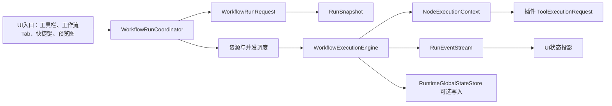

# 工作流运行引擎全量重构设计

日期：2026-09-16  
状态：设计评审完成，尚未实施。  
目标：让单次运行、连续运行、运行全部、子程序运行和未来的后台触发都进入同一条确定、可取消、可审计的执行链；运行数据不再污染方案设计数据。

## 1. 结论与边界

本次不是把同组节点直接改成 `Task.WhenAll`，也不是单独修一个工具。要先建立以下边界：



### 必须遵守的原则

1. **方案定义只读。** `Solution`、`Workflow`、节点参数、绑定配置、全局变量定义是设计态对象；运行时不得修改它们。
2. **一次根运行只有一个 `RunId`、一个会话和一个取消边界。** 子程序使用同一个根 `RunId`，但有自己的 `ScopeId`。
3. **运行输入均为快照。** 图像、运行参数、全局变量、绑定设置、节点参数在开始执行前冻结；UI 后续修改只影响下一次运行。
4. **默认串行，受证明后并行。** 没有声明线程安全和资源需求的工具一律不并行。
5. **UI 只显示运行事件。** UI 不调度、不写执行上下文、不把 WPF 对象传进工作流核心。
6. **全局变量的“定义、运行快照、可写共享状态”分开建模。** 不能再把一个可变 `Dictionary` 同时当作三者。

## 2. 当前架构中的问题

| 编号 | 当前事实 | 风险 |
|---|---|---|
| A1 | 管理器创建的停止令牌未传入引擎自行创建的 `WorkflowRunSession` | 停止不能可靠取消当前长耗时节点 |
| A2 | 输入快照只记录日志；实际运行直接写设计节点 `Parameters.FilePath` | 运行污染方案、切图与执行错轮 |
| A3 | 每轮都新建 `WorkflowExecutionEngine`，但“运行全部”并发调用 | 引擎内并发锁失效，共享资源可重叠 |
| A4 | “并行组”是拓扑层，组内 `foreach await` 串行 | 名称误导；性能没有按设计获得提升 |
| A5 | `WorkflowContext`、全局变量字典和 `RunContext` 都是普通可变集合 | 真并行或并发根运行时读写不安全 |
| A6 | 子程序结果回传以 `NodeId` 写回根上下文 | 同一子程序被多次调用或节点 ID 复用时，结果可能覆盖；结果必须按作用域定位 |
| A7 | `GlobalVariable.Value`、`RunContext.SetGlobalVariable`、UI 编辑对象都可能直接修改同一引用 | 用户编辑、执行、保存之间没有一致性规则 |

## 3. 运行数据模型

### 3.1 方案定义（持久化、不可由运行修改）

```csharp
sealed record GlobalVariableDefinition(
    string Id,
    string Name,
    string Type,
    GlobalValue DefaultValue,
    string Group,
    string Description);

sealed record WorkflowDefinition(...); // 节点、连接、参数、绑定配置
```

现有 `GlobalVariable` 保留为 UI/持久化模型，但运行核心不直接持有它的引用。`Id` 是绑定的稳定键；`Name` 仅用于显示和兼容旧方案。重命名只更新显示名和绑定索引，不影响已保存的稳定绑定。

### 3.2 运行请求与快照（一次运行只读）

```csharp
sealed record WorkflowRunRequest(
    string RootWorkflowId,
    WorkflowRunMode Mode,                 // Single / Continuous / RunAllChild
    RuntimeInputSnapshot Input,
    IReadOnlyDictionary<string, RuntimeValue> RuntimeParameters,
    GlobalVariableSnapshot Globals,
    RunOptions Options);

sealed record RunSnapshot(
    Guid RunId,
    WorkflowExecutionPlan Plan,
    RuntimeInputSnapshot Input,
    IReadOnlyDictionary<string, RuntimeValue> RuntimeParameters,
    GlobalVariableSnapshot Globals,
    DateTimeOffset CreatedAt);
```

`WorkflowExecutionPlan` 是从 `WorkflowDefinition` 编译出的运行计划：节点参数深拷贝、绑定配置深拷贝、连接关系、静态依赖、资源声明和稳定拓扑序均在其中。运行引擎只接收 `RunSnapshot`，不读取 `ImageInputSource`，也不修改 `WorkflowNodeBase.Parameters`。

### 3.3 节点上下文与结果

```csharp
sealed record NodeRunKey(Guid RunId, Guid ScopeId, string NodeId);

sealed record NodeExecutionContext(
    NodeRunKey Key,
    CancellationToken CancellationToken,
    IReadOnlyDictionary<NodeRunKey, NodeExecutionResult> ParentResults,
    IReadOnlyDictionary<string, RuntimeValue> RuntimeParameters,
    GlobalVariableSnapshot Globals,
    RuntimeInputSnapshot Input);
```

每个节点只读父节点已经**提交**的结果，并返回一个局部 `NodeExecutionResult`。调度器在节点完成后按 `NodeRunKey` 写入结果仓库。子程序结果不能再用裸 `NodeId` 合并；UI 要显示子程序节点时，通过 `(RunId, ScopeId, NodeId)` 查询。

## 4. 全局变量的读写安全设计

> **2026-09-16 设计校正：** 参考 VisionMaster 的全局变量界面，普通全局变量的默认模型改为
> “一个输入来源（生产者）→ 多个目标输出（订阅者）”。不将普通全局变量设计成任意节点可写的共享字典。
> `RuntimeGlobalStateStore` 只保留给计数器等少量高级共享状态，不替代普通全局变量。

### 4.1 三类数据不能混用

| 类型 | 用途 | 是否持久化 | 读写规则 |
|---|---|---|---|
| `GlobalVariableDefinition` | 方案默认值、类型、名称、分组、绑定元数据 | 是 | 设计时编辑；运行只读 |
| `GlobalVariableSnapshot` | 本次运行的冻结值 | 否 | 工具只读；任何节点不得修改 |
| `RuntimeGlobalStateStore` | 明确需要跨运行保存的计数、配方当前值、设备状态 | 否，除非用户显式保存 | 仅显式写入节点/API；版本化原子更新 |

默认情况下，全局变量是**运行开始时的只读快照**。工具 SDK 中的 `ToolExecutionRequest.GlobalVariables` 改为 `IReadOnlyDictionary<string, RuntimeValue>`；不再将可修改的 `IDictionary` 暴露给插件。

### 4.1.1 普通全局变量的数据总线模型

每个普通全局变量增加两类绑定：

```csharp
sealed record GlobalVariableBinding(
    string VariableId,
    GlobalProducerBinding? InputSource,           // 至多一个模块结果
    IReadOnlyList<GlobalConsumerBinding> Targets  // 零到多个模块参数
);
```

- `InputSource` 是变量当前值的唯一生产者，来自一个工具结果字段；全方案最多一个。
- `Targets` 是变量的订阅者，可跨多个根工作流、可绑定多个工具参数。
- 没有 `InputSource` 时，变量值来自方案默认值、用户显式输入或受控的外部初始化。
- UI 保留“输入来源 / 目标输出”两列。这里“目标输出”的产品术语实际表达的是变量值要写入的目标模块参数。

编译器把这类绑定转为**隐式数据依赖**：同根工作流中，生产节点提交变量值后，订阅节点才可开始；不要求在画布上额外画普通结果连线，但在全局变量管理器和执行计划诊断中必须可追踪。

### 4.2 快照规则

1. 标量（`bool`、整数、浮点、字符串、枚举、日期）按值复制。
2. 几何值、矩阵和 ROI 通过 `IRuntimeValueSnapshotter` 深拷贝或不可变包装。
3. 图像、HALCON 句柄、设备对象和 WPF 对象不得放入可持久化的全局变量快照。它们须通过节点输出、`RuntimeInputSnapshot` 或显式资源服务传递。
4. 一个旧变量若无法安全快照，运行前报出变量名、类型和迁移建议，不能静默传递原引用。
5. UI 在运行中修改全局变量，修改的是下一次运行的定义值；当前 `RunSnapshot` 不变。

### 4.3 确实需要写全局状态时

不要允许任意插件直接写全局字典。新增显式 `GlobalStateRead` / `GlobalStateWrite` 节点或受限的 `IRuntimeGlobalStateStore`：

```csharp
interface IRuntimeGlobalStateStore
{
    ValueTask<VersionedValue?> ReadAsync(string variableId, CancellationToken ct);
    ValueTask<WriteResult> CompareExchangeAsync(
        string variableId, long expectedVersion, RuntimeValue next, CancellationToken ct);
}
```

- 状态按 **变量 ID** 而不是名称存储，并携带版本号。
- 写入策略默认 `FailOnConflict`：两个运行竞争同一变量时，后写者得到明确冲突，不采用“最后写入覆盖”。
- 自增、累加等场景提供原子 `UpdateAsync`，而不是先读后写。
- 调度器将每个写变量视为 `Exclusive("global:{variableId}")` 资源；并行节点或多个根运行会排队。
- 运行时状态与方案保存分离。只有用户执行“将运行状态保存为方案默认值”时，才经过 UI 命令、版本检查和显式保存。

这套规则既保证安全，也保留工控场景中的计数器、批次号、配方运行值等需求。

### 4.4 跨工作流的可见性和顺序规则

跨工作流不能把“读到哪个值”交给线程调度决定。定义以下固定语义：

1. **启动快照读取。** 根工作流启动时读取 `GlobalVariableSnapshot`。在此之后，即使其他工作流写入状态，本运行的普通全局变量绑定也不变。
2. **显式实时读取。** 需要读取其他工作流刚提交状态的节点，必须使用 `GlobalStateRead`。它在该节点开始时从 `RuntimeGlobalStateStore` 读取 `(Value, Version)`；读取发生的时刻会写入运行日志和结果。
3. **显式写入与提交。** `GlobalStateWrite` 只在自身节点成功时提交。提交使用 `CompareExchange(variableId, expectedVersion, value)`；版本不匹配即返回 `Conflict`，节点失败，不覆盖别人写入的数据。
4. **跨工作流先后关系必须显式表达。** 若工作流 B 的输入必须来自工作流 A 的输出，不能依赖“B 大概会晚一点执行”。应在 `RunAll` 的编排计划中配置 `A → B` 依赖，或使用父工作流中的子程序/数据连线。只有 A 的写入已提交且 B 被调度启动后，B 的启动快照才保证能看到 A 的值。
5. **并发时的规则。** 没有显式依赖的根工作流可以同时运行；它们的普通绑定各自读取启动快照。若同时写同一个运行状态变量，一个成功提交，另一个得到冲突；不会“最后写入者覆盖前者”。
6. **运行结束不自动改方案默认值。** 运行状态仅留在 `RuntimeGlobalStateStore`。用户需要时通过显式命令把选定状态值保存为方案默认值，避免一次失败运行意外污染配方。

#### 示例一：工位 A 给工位 B 传递位置修正

```text
工作流 A：定位 → GlobalStateWrite(变量：PositionCorrection, 版本：v12 → v13)
RunAll 编排：A 完成 → B 启动
工作流 B：启动快照读取 PositionCorrection=v13 → 检测
```

B 依赖 A，因此使用启动快照即可，结果完全确定。更推荐把 A、B 置于同一父工作流并直接通过节点输出绑定传值；全局状态只用于确实跨根工作流、跨轮次需要保存的数据。

#### 示例二：两个工作流累加同一生产计数

```text
工作流 A：GlobalStateRead(Count=10, v5) → GlobalStateWrite(v5, 11)
工作流 B：GlobalStateRead(Count=10, v5) → GlobalStateWrite(v5, 11)
```

这里 A、B 的其中一个写入成功，另一个收到冲突。对计数器应使用原子 `UpdateAsync` / `IncrementAsync`，使两个运行分别得到 11、12；不能使用普通读后写。

#### 示例三：B 已在运行中，A 后续修改状态

```text
B 启动：快照 Threshold=100
A 提交：Threshold=120
B 的普通参数绑定：继续使用 100
B 后续 GlobalStateRead 节点：读取 120（并记录版本）
```

这使“实时读”成为配置上可见的行为，而不是隐藏在某个参数绑定中的时序副作用。

### 4.5 四种读写并发场景的强制规则

版本化存储只能避免静默覆盖，不能自动推断业务所需顺序。以下规则同时保证安全和确定性：

| 场景 | 默认行为 | 要求顺序时的正确做法 |
|---|---|---|
| 同一工作流、同一批次两个节点写同一变量 | 计划编译失败，指出两个节点与变量；不按偶然调度顺序串行化 | 添加节点连接/显式 `StateDependency`，或改为同一原子可交换操作（如 `Increment`） |
| 同一工作流、同一变量读写 | 普通全局绑定永远读取启动快照；实时读写节点按图上的依赖执行 | 写节点连接到读节点；读节点可要求读取指定写入节点的 `CommitToken` |
| 两个根工作流同时读写同一变量 | 普通读取各取启动快照；显式写入使用 CAS，冲突失败 | 在 RunAll 编排图中声明 `A.Write(x) → B.Read(x)` 或 `A.Write(x) → B.Start` |
| 两个根工作流对同一变量存在读写顺序要求 | 未声明时禁止把其当作有序流程；`GlobalStateRead` 只保证读到线性化时刻的某个版本 | 使用跨工作流依赖边与提交屏障；必要时 B 等待 A 的具体 `CommitToken`，超时则失败 |

#### 同一工作流的变量访问分析

计划编译器须为每个节点收集 `StateAccess`：

```csharp
sealed record StateAccess(
    string VariableId,
    StateAccessMode Mode,     // SnapshotRead / LiveRead / Write / AtomicUpdate
    string? CommitTokenSource);
```

对同一个变量的两个 `Write` 或 `Write/LiveRead` 节点：

- 若图中存在从前者到后者的路径，则顺序由该路径保证；
- 若不存在路径且访问并非同一可交换原子操作，计划编译直接报错：
  “并行分支同时访问全局状态变量 X，需添加依赖或改用原子操作”；
- `SnapshotRead` 不参加竞争，因为它只读取 `RunSnapshot`。

因此，同工作流的两个并行写节点不会因为资源锁“碰巧谁先拿到锁”而产生隐藏业务顺序。

#### 跨工作流的编排依赖与提交屏障

为 `RunAll` 引入独立于节点图的根工作流编排图：

```csharp
sealed record WorkflowRunDependency(
    string UpstreamWorkflowId,
    string UpstreamNodeId,
    string DownstreamWorkflowId,
    DependencyCondition Condition); // OnSucceeded / OnCommitted / OnJudgmentOk
```

- `OnCommitted` 表示上游 `GlobalStateWrite` 已成功提交并产出不可伪造的 `CommitToken(variableId, version, runId, nodeKey)`。
- 下游工作流启动前或其 `GlobalStateRead` 节点执行前验证该令牌；若版本/变量不匹配、上游失败或超时，下游按配置 `Skipped` 或 `Failed`，绝不读取旧值继续运行。
- 多个上游写入同一变量时，编排图必须给出全序，或全部使用声明为可交换的原子更新；否则 `RunAll` 编译失败。

这让四种场景都有明确答案：并发安全由状态存储保证，读写顺序由工作流图或根工作流编排图保证；没有顺序边就不假装存在顺序。

### 4.6 普通全局变量的跨工作流规则（VisionMaster 兼容模型）

当变量的唯一 `InputSource` 在工作流 A、订阅目标在工作流 B 时，编译器自动产生候选依赖 `A.Producer → B.Consumer`：

1. **RunAll/连续批次：** 调度器为这一批创建 `BatchId`；A 的生产节点提交该批变量版本后，B 才能执行订阅节点。B 读取同一 `BatchId` 的值，不会误用上一轮残留值。
2. **只启动 B：** B 可以读取变量的“最近已提交值”，但 UI 和日志应标记为“使用历史全局值”；如果该变量配置为 `RequireCurrentBatch`，则 B 拒绝运行并提示先运行生产流程。
3. **A、B 无编排关系却同时启动：** 不推测顺序。调度器根据变量策略排队 A→B，或拒绝 B；默认推荐 `RequireCurrentBatch`，避免跨工位检测误用旧定位结果。
4. **一个变量配置两个输入来源：** 保存方案/预编译直接失败，指出两个来源。普通变量永不采用最后写入覆盖。

这样，绝大多数“跨工作流读写”不需要 CAS：它本质是单生产者、多订阅者的数据流问题。只有计数器、外部通信命令、多个流程共同维护状态等确实多写的场景，才进入 `RuntimeGlobalStateStore` 的版本化原子模型。

## 5. 节点顺序、分支与并行调度

### 5.1 计划编译

1. 校验节点 ID 唯一、连接端点存在、无环、参数和绑定类型正确。
2. 计算稳定拓扑序：同一层的次序按节点创建序号/ID 固定，不能依赖可变集合遍历顺序。
3. 识别数据依赖、控制依赖与资源依赖；控制节点的下游激活规则编译为显式分支图。
4. 每个 `NodePlan` 声明 `ToolConcurrencyProfile`。

### 5.2 调度状态机

节点只有在以下条件同时满足时才可进入 `Ready`：

- 所有必需数据前驱已 `Succeeded`；
- 控制前驱已激活该分支；
- 所需资源租约可取得；
- 根会话尚未取消。

状态为：`Pending → Ready → Running → Succeeded | Failed | Skipped | Cancelled`。  
`NG` 是成功执行后的业务判定值，不能替代 `Failed`；条件节点产生的是控制信号，不能用 UI 文本驱动。

### 5.3 真正并行的前提与算法

当前所有节点先保持串行。第二阶段才允许如下并发：

1. 从当前 `Ready` 集合中按稳定顺序挑选节点。
2. 根据资源租约和最大并发度选出可同时执行的节点。
3. 为每个节点创建独立 `NodeExecutionContext` 与结果槽；并发任务禁止写共享 `WorkflowContext`。
4. `await Task.WhenAll` 等待本批次；按稳定顺序提交结果、产生事件并释放资源。
5. 再计算下一批 `Ready` 节点。

资源声明初始策略：

| 资源/工具 | 默认并发策略 |
|---|---|
| 未审计旧插件 | 全局独占 |
| 同一相机、串口、PLC 写入 | 同资源键独占 |
| 同一 HALCON 句柄或可变图像对象 | 独占 |
| 只读图像、纯计算且插件声明线程安全 | 可并行 |
| 图像显示、WPF 控件 | 不在执行线程运行；由 UI 投影层处理 |
| 全局状态写入 | 对应变量键独占 |

这会先保证正确，再按工具审计逐步释放并发度。

### 5.4 同组并行的完整定义

当前代码中的“并行组”只是由普通连接线算出的拓扑层，且组内仍 `foreach await` 串行执行。重构后不再把“同一拓扑层”直接等同于“可以同时运行”。正式名称改为：

```text
就绪集合（Ready Set）       = 当前结构上已经满足前驱条件的节点集合
并发窗口（Dispatch Window） = 从就绪集合中、当前允许同时运行的节点集合
```

#### 5.4.1 哪些关系决定节点不能同组并行

计划编译器必须从所有数据来源建立依赖边，而不仅是读取 `Workflow.Connections`：

```text
普通连线：        A ───────> B
参数绑定：        A.结果字段 ──> B.参数
全局变量绑定：    A.结果 ──> 全局变量 ──> B.参数
条件分支：        条件A ────> 被激活的B
子程序：          子程序节点 ──> 子程序内部节点 / 子程序输出
显式状态依赖：    GlobalStateWrite(A) ──> GlobalStateRead(B)
```

若以上任意一条边存在 `A → B`，则 B 必须在 A 的**结果已提交**后才进入候选批次；A 与 B 永不同时调度。这样可避免“画布没有连线、但参数绑定引用上游结果”时被错误分入同组。

同一候选批次中的每个节点收到完全相同的、不可变的父结果快照；它看不到同批次兄弟节点尚未提交的结果。因此，兄弟节点之间不能存在任何隐式数据读取需求。

#### 5.4.2 工具并发契约与资源声明

不把线程安全字段重新塞进 `ToolMetadata`；它是静态展示元数据。新增运行期契约：

```csharp
interface IToolExecutionProfileProvider
{
    ToolExecutionProfile DescribeExecution(ToolParameters parameters);
}

sealed record ToolExecutionProfile(
    ToolConcurrencyKind Kind,          // WorkflowExclusive / ResourceExclusive / ParallelSafe
    IReadOnlyList<ResourceClaim> Resources,
    int? MaxInstances = null);
```

`ResourceClaim` 由工具参数动态生成，例如：

```text
图像载入（相机 CAM-01）        Exclusive("camera:CAM-01")
串口 / PLC 写                  Exclusive("communication:PLC-01")
HALCON 可变句柄 / 旧工具        Exclusive("workflow:legacy-tool")
只读图像纯计算                 Shared("image:<snapshot-id>") + ParallelSafe
全局状态写 var4134             Exclusive("global-state:<variable-id>")
```

规则：

1. 未实现该接口的旧插件一律 `WorkflowExclusive`，即该节点运行期间不和**同一根工作流**中的其他节点并行。这是迁移期保守默认值，不表示旧工具不能使用；完成线程安全、实例隔离、资源和取消行为审计后可改为更细的契约。
2. 每个节点、每轮运行创建独立工具实例和参数快照；不得复用可变工具实例。
3. 一个节点需要多个资源时，资源管理器按稳定键排序一次性申请，避免死锁。
4. `ParallelSafe` 只是允许候选，不承诺一定并行；仍受解决方案最大并发数和资源占用限制。
5. 首期只审计并放开无设备、无 UI、无可变 HALCON 句柄的纯计算工具。

#### 5.4.3 调度算法

```text
1. 从执行计划取得 Ready 节点，按稳定拓扑序 + 节点 ID 排序。
2. 过滤掉被条件分支剪枝、上游失败、已取消的节点。
3. 在并发窗口尚有容量时，从前到后尝试资源租约：
      - 资源可得且未超过 MaxConcurrency → 立即启动；
      - 资源冲突 → 保留 Ready，继续检查后续资源独立的节点；
      - WorkflowExclusive → 仅当窗口为空时启动它。
4. 每个已启动节点获得独立 NodeExecutionContext 和父结果只读快照。
5. 任一节点完成：提交它的结果、状态和控制信号，释放资源与一个窗口槽位。
6. 重新计算其后继节点是否 Ready，并立即从 Ready 集合补充可运行节点。
7. 直到 Ready 集合和运行集合均为空，或根会话取消。
```

这是“工作保守（work-conserving）”调度：例如 50 个纯计算节点、并发上限为 4 时，先启动 4 个；任意一个完成就立刻从剩余 46 个补一个，而不是必须等待最慢的那一个才进入下一组。它既控制 CPU、内存和线程池压力，又不会浪费可用并发槽位。

并发窗口没有按节点数量决定的固定“每批 N 个”。窗口可用容量由令牌预算决定：

```text
可启动节点 = 同时满足以下限制的 Ready 节点

1. 全局并发槽位：RunningCount < Solution.MaxConcurrency
2. 工具实例上限：同一 ToolType 的 RunningCount < ToolProfile.MaxInstances（若声明）
3. 资源许可：所需 Exclusive / Shared 资源仍有可用许可
4. 内存预算：已占用图像内存 + 节点估算内存 <= RunMemoryBudget
```

第一期不做不可靠的自动“猜内存”，采用保守默认：

```text
未知旧工具：        工作流独占
已审计纯计算工具：  1 个并发令牌
重型纯计算工具：    可声明 2 个或更多令牌 / MaxInstances=1
解决方案窗口上限：  默认 1；启用并行后默认 min(4, 逻辑处理器数 - 1)
```

例如 50 个普通纯计算节点、窗口上限 4 时，任何时刻最多运行 4 个；若其中一个工具声明 `MaxInstances=1`，该工具的多个节点即使纯计算也一次只运行一个。后续在工具完成内存基准测试后，再增加 `EstimatedMemoryMb` 令牌；内存未知的图像重型工具保持保守串行。

结果提交以实际完成为准，但每条事件带节点稳定序号、`RunId` 和时间；节点只能读取已经提交的前驱结果。业务确定性来自依赖图、快照和资源互斥，不能依靠人为固定日志先后。对于多条件汇合，计划必须显式声明 AND/OR，避免完成先后影响分支含义。

#### 5.4.4 条件分支、失败、取消与重试

| 场景 | 批次规则 |
|---|---|
| 同批多个条件节点 | 全部完成后按稳定顺序合并控制信号；同一目标被多个条件控制时，必须在计划中声明 AND/OR 合流语义，未声明即预编译失败 |
| 一个节点失败 | 同批次已启动的独立节点完成；失败节点后代标记 `Skipped`；不相关分支继续，根运行最终为 `Failed` |
| 节点返回 NG | 节点执行为 `Succeeded`，业务判定为 NG；是否剪枝只由该工具显式控制信号决定 |
| 取消 | 立即停止派发新节点，向所有已运行节点传递同一会话令牌，等待其收敛；尚未开始的节点标记 `Cancelled` 或 `Skipped`，不进入下一批 |
| 超时 / 重试 | 节点持有资源直至最终成功、失败或取消；重试在同一节点内串行进行，重试期间不允许下游开始 |

#### 5.4.5 现有 `ExecutionStrategy` 的处理

`Solution.ExecutionStrategy` 已有 `Mode` 与 `MaxConcurrency`，但当前执行引擎没有读取它。不能直接把 `Mode=Parallel` 接到 `Task.WhenAll`。

- `MaxConcurrency` 可保留为整个解决方案的**硬上限**，默认 `1`；启用已审计纯计算并行后，建议初始上限为 `min(4, 逻辑处理器数 - 1)`，再按实际 CPU、图像内存和工具内部线程数调优。
- 旧 `Parallel/Hybrid` 不作为“所有节点强制并行”的用户开关；迁移期改为“允许已审计节点并行”的上限策略。
- 当不存在已声明 `ParallelSafe` 的工具时，即使上限大于 1，实际仍串行；UI 不显示虚假的并行状态。
- 用户层第一版只显示“本轮：串行 / 已并发 N 个独立节点”，不提供按节点手工强制并行的配置。

#### 5.4.6 必测用例

```text
P1  两个无依赖、ParallelSafe 的测试工具：执行时间重叠，结果均正确。
P2  A 的结果绑定到 B 参数但画布无连线：B 必须等待 A，不可并行。
P3  两个节点同用 camera:CAM-01：不重叠；资源释放后第二个才开始。
P4  两个纯计算节点 + 一个独占旧插件：纯计算可同批，旧插件单独运行。
P5  同批两个条件节点：条件信号合并结果可重复、无随机分支。
P6  一个节点失败：同批独立节点完成，失败下游跳过，不相关分支继续。
P7  同批运行中取消：无新节点派发，所有已启动节点收到同一取消令牌。
P8  连续运行下一轮：上一轮资源、工具实例、结果快照完全释放后才开始。
```

### 5.5 首次执行慢与预热策略

“第一次慢、后续稳定”在视觉软件中可能来自 .NET JIT、程序集/原生库首次加载、HALCON 算子或模型首次初始化、脚本编译、线程池扩容、图像解码和内存池建立。这种一次性冷启动可以接受；但同一方案的每一轮都重复创建计划、重编译或重新初始化模型则是架构问题。

当前代码已有部分预热：应用启动时加载插件、预热线程池；脚本工具提供 `IPrecompilableTool` 并使用进程级编译缓存。另一方面，工作流每轮仍会新建执行引擎、构建执行计划和工具实例，因此必须统一生命周期，避免部分缓存命中、部分又重复冷启动。

#### 5.5.1 性能目标

```text
允许变慢：应用刚启动、方案刚加载、工具参数/模型刚修改后的首次准备。
不允许变慢：同一方案、同一参数、连续运行的每一轮都重复准备。
不计入算法耗时：插件加载、计划构建、预编译、模型加载、首帧图像解码。
```

#### 5.5.2 分层生命周期

| 阶段 | 触发时机 | 做什么 | 禁止做什么 |
|---|---|---|---|
| 进程预热 | 应用启动一次 | 插件注册、基础 JIT、线程池预热 | 打开相机、执行检测、改全局变量 |
| 方案预热 | 方案加载/保存后 | 编译执行计划、校验依赖、脚本预编译、只读模型准备 | 读取实际生产图、写设备、写运行状态 |
| 节点预热 | 节点参数或模型版本变化后 | 仅准备该节点的工具缓存/模型句柄 | 使下游结果失效以外的副作用 |
| 运行执行 | 每个 RunId | 创建输入/参数快照、取得资源、执行算法 | 再次加载插件或重编译未变工具 |

执行计划缓存以 `WorkflowDefinitionVersion + 绑定版本 + 工具契约版本` 为键。参数、连线、全局变量输入来源或工具版本变化时，只失效受影响节点及其依赖，不全量清空。图像、节点结果和全局运行值绝不进入计划缓存。

#### 5.5.3 工具准备契约

`IPrecompilableTool` 继续用于脚本等编译型工具；对模型加载、HALCON 初始化等增加可选的无副作用准备接口：

```csharp
interface IPreparableTool
{
    ValueTask<PreparationResult> PrepareAsync(
        ToolParameters parameters,
        CancellationToken cancellationToken);
}
```

`PrepareAsync` 可创建只读模型缓存、JIT 或内部资源池，但不得取像、发送通讯、写全局状态或生成业务结果。方案预热按受限窗口执行，不能同时预热几十个重型工具，避免首次打开方案时 CPU/内存尖峰。

#### 5.5.4 可观测性与验收

每次运行记录分段耗时，而不是只记录总耗时：

```text
RunId=42
PlanCache=Hit (3 ms)
Snapshot=1 ms
ToolPrepare=0 ms / CacheHit
NodeExecute=154 ms
ResultCommit=2 ms
```

验证时至少比较：

```text
T0：应用启动后的首次运行
T1：同方案、同参数的第二次运行
T2：连续运行第 N 轮
T3：只修改一个节点参数后的首次运行
T4：重新加载方案后的首次运行
```

若 T2 仍接近 T0，说明存在每轮重复初始化，必须定位到具体阶段；不能用“首次慢正常”掩盖问题。

## 6. 执行生命周期、取消和连续运行

`WorkflowRunCoordinator` 是唯一入口，所有按钮、Tab、快捷键和自动切图都调用它。

```text
创建 RunRequest
  → 冻结 RunSnapshot
  → 创建 WorkflowRunSession（RunId、根取消源、暂停信号）
  → 获取根资源租约
  → ExecuteAsync(snapshot, session)
  → 发布 RunCompleted/Failed/Cancelled
  → 释放资源、保存运行结果
```

- 单次运行：一个请求对应一个会话。
- 连续运行：每轮一个新 `RunId`、新快照；连续控制器只持有“连续任务 ID”和当前会话引用。停止时先对当前会话 `RequestStop()`，待其结束后禁止开始下一轮。
- 运行全部：先通过资源调度器决定串行/排队/并行；不得直接 `Task.WhenAll`。
- 子程序：共享父根的取消令牌、快照和根 `RunId`，创建子 `ScopeId`；父子结果通过键关联，不写回同名裸节点 ID。
- 暂停：仅在节点边界和工具合作式暂停点生效。不可中断的旧工具要标记“等待当前节点结束”。

## 7. 模块职责与迁移目标

| 模块 | 最终职责 | 禁止职责 |
|---|---|---|
| `src/Workflow` | 执行计划、调度、会话、结果仓库、分支和资源模型 | WPF、`ImageInputSource`、画布节点状态 |
| `src/Plugin.SDK` | 不可变工具请求、工具并发声明、只读输入/全局变量契约 | UI 宿主引用、直接改全局状态 |
| `src/UI/Services/Workflow` | 将 UI 操作转成 `WorkflowRunRequest`，订阅事件 | 调度循环、改设计节点参数 |
| `src/UI/Shell` | 显示运行状态、用户编辑下一轮配置、显式保存 | 持有执行真相、直接访问执行字典 |
| `src/Workflow` Runtime State | 版本化状态读写与资源租约 | 直接保存方案 |

旧的 `RunContext` 和 `WorkflowContext` 功能重叠。迁移后只保留一个内部运行上下文：外部只看到 `RunSnapshot`、`NodeExecutionContext`、`RunResult` 和运行事件。

## 8. 分阶段实施与验收门禁

### 阶段 0：基线与契约冻结

- 输出本设计、当前行为测试清单和旧入口映射表。
- 增加测试：拓扑顺序、条件剪枝、停止传播、快照隔离、全局变量运行中编辑、子程序重复调用结果键。
- 不改变生产行为。

**门禁：** 全量 Release 构建通过；现有人工验收不回退。

### 阶段 1：P0 会话与快照

- 引入 `WorkflowRunRequest`、`RunSnapshot`、外部创建的 `WorkflowRunSession`。
- 让执行引擎接收会话，不再私建取消源。
- 引入只读 `GlobalVariableSnapshot`，去除插件的可变全局字典入口。
- 删除运行期改写 `Parameters.FilePath` 的逻辑；图像加载从快照输入解析。
- `RunAll` 临时串行化。

**门禁：** 停止长耗时节点、连续切图快照一致、运行中改参数/全局变量只影响下一轮。

### 阶段 2：结果键、事件和 UI 投影

- 采用 `NodeRunKey` 和 `ScopeId`，修复子程序结果覆盖。
- 用带 `RunId` 的事件替换引擎直接改 UI 节点。
- 合并/淘汰旧 `RunContext` 与重复状态容器。

**门禁：** 同一子程序多次调用、异常、取消、下钻显示均可准确定位同一运行。

### 阶段 3：资源调度与受控并行

- 增加工具并发声明、资源租约、确定性批次提交。
- 先把所有旧插件标记为独占；只为审计过的纯计算工具启用并行。
- 引入版本化 `RuntimeGlobalStateStore` 及冲突测试。

**门禁：** 两根工作流共享相机/全局变量时结果可预测；独立纯计算节点并行运行且结果、日志顺序可复现。

### 阶段 4：清理与发布

- 删除旧入口和兼容写回路径。
- 更新方案迁移、日志、性能指标和发布验证。

## 9. 双 AI 分工与交接

本任务是高风险架构改造。遵守仓库 `AGENTS.md`：同一工作目录同一时间只能有一个 AI 写代码；需要并行时使用独立 Worktree。

### Codex 负责（架构主线，必须在 `codex/workflow-runtime-core` 分支/Worktree）

| 工作包 | 授权目录 | 交付 |
|---|---|---|
| C0 运行契约与迁移设计 | `src/Workflow/**`、`src/Plugin.SDK/**`、`docs/**` | 请求、快照、会话、上下文和事件接口 |
| C1 P0 执行链改造 | `src/Workflow/**`、`src/UI/Services/Workflow/**` | 统一会话、取消传播、输入/参数/全局快照 |
| C2 子程序与结果模型 | `src/Workflow/**`、`src/Plugin.SDK/**` | `NodeRunKey`、`ScopeId`、结果仓库 |
| C3 调度器和资源锁 | `src/Workflow/**`、`src/Plugin.SDK/**` | 资源声明、串行基线、受控并行 |
| C4 集成与发布 | 全仓库必要范围 | 全量构建、回归、发布检查 |

### CodeBuddy 负责（边界明确，不改执行核心）

| 工作包 | 授权目录 | 前置条件 | 交付 |
|---|---|---|---|
| B0 现状测试与用例表 | `tests/**`、`docs/**` | 无 | 当前行为测试、人工验收矩阵；不改生产代码 |
| B1 运行事件 UI 投影 | `src/UI/Shell/**`、`src/UI/Features/**`、`tests/SunEyeVision.UI.Tests/**` | Codex 冻结事件 DTO | `RunId` 日志/状态展示；不得改调度器 |
| B2 全局变量界面适配 | `src/UI/Features/GlobalVariableManager/**`、`src/UI/Shell/**`、测试 | Codex 冻结 Definition/Snapshot 接口 | 只读运行态提示、显式保存运行状态命令 |
| B3 验收与文档 | `docs/03-测试报告/**`、`tests/**` | 每阶段 Codex 提交后 | 回归矩阵、测试补充、构建记录 |

CodeBuddy **禁止修改**：`WorkflowExecutionEngine`、`WorkflowExecutionManager`、`WorkflowRunSession`、`WorkflowContext`、`Plugin.SDK` 核心执行契约、插件加载和发布规则。若 B1/B2 发现接口缺口，用交接单描述期望 DTO，不在核心目录直接修补。

### 推荐执行顺序

```text
Codex C0 → CodeBuddy B0（可在独立 Worktree 并行）
→ Codex C1 → CodeBuddy B1/B3
→ Codex C2 → CodeBuddy B3
→ Codex C3 → CodeBuddy B2/B3
→ Codex C4 → 人工完整验收
```

每个工作包开始前读取 `AGENTS.md`、`docs/collaboration/CURRENT_TASK.md` 和 Git 状态；完成后填写 `docs/collaboration/HANDOFF_TEMPLATE.md`，至少写明基线提交、允许目录、变更、构建、人工验收项和风险。

## 10. 第一张实施任务单

先启动 **C0 + B0**，不直接改生产逻辑。

### 给 Codex 的任务文本

```text
读取 AGENTS.md、docs/collaboration/CURRENT_TASK.md 和工作流运行引擎全量重构设计。
在独立 codex/workflow-runtime-core Worktree 中完成 C0：冻结 RunRequest、RunSnapshot、
GlobalVariableSnapshot、NodeRunKey、运行事件 DTO 的接口设计和迁移映射。
不要接入 UI，不改变既有运行行为。补充接口级单元测试，更新交接单并提交。
```

### 给 CodeBuddy 的任务文本

```text
读取 AGENTS.md、docs/collaboration/CURRENT_TASK.md 和工作流运行引擎全量重构设计。
在独立 Worktree 中完成 B0：只修改 tests 和 docs，建立现有工作流行为的测试与人工验收矩阵。
覆盖拓扑顺序、同组串行、条件剪枝、失败跳过、停止、连续切图、全局变量运行中编辑、
子程序重复调用。不要修改 src/Workflow、src/Plugin.SDK 或 src/UI/Services/Workflow。
更新交接单并提交。
```

## 11. UI 优化设计

UI 的目标不是暴露底层锁、版本号和线程，而是让用户一眼看出：**谁提供值、谁使用值、这一轮实际用了哪一个值、跨流程是否有顺序保证。**

### 11.1 全局变量管理器：设计态与运行态分栏

现有界面中的“当前值、输入来源、目标输出”应保留业务含义，但调整为以下列：

| 列 | 显示与编辑规则 |
|---|---|
| 序号 / 分组 / 名称 / 注释 / 类型 | 现有管理能力保留 |
| 默认值 | 方案设计值；仅无运行时可编辑，或编辑后明确标记“下次运行生效” |
| 当前运行值 | 只读；显示最近提交值、`BatchId`、更新时间和来源节点。没有运行值时显示“未产生” |
| 输入来源 | 单选链接。显示 `流程.节点.结果字段`；为空时显示“手动/外部初始化” |
| 目标参数 | 多选链接。显示 `N 个目标`，展开后列出 `流程.节点.参数` |
| 执行策略 | `允许历史值` / `必须本批次产生`。跨流程生产者默认后者 |
| 状态 | 正常、等待生产者、历史值、类型不匹配、依赖冲突 |

不再把“默认值”和“运行中的当前值”混在同一个可编辑单元格。运行中用户改默认值时，保存后显示黄色标签“下次运行生效”；不能改变当前 `RunSnapshot`。

### 11.2 输入来源配置弹窗：只能选一个生产者

点击“输入来源”打开统一选择器：

```text
左侧：流程 → 节点 → 可发布结果字段树
上方：类型筛选、流程筛选、搜索
右侧：变量类型、已选来源、运行顺序影响说明
底部：取消 / 清除来源 / 确定
```

规则：

1. 根据变量类型只显示可兼容结果字段；必要时明确显示转换器，例如 `int → double`。
2. 选择新来源前，如已有来源，先替换并显示旧来源将解除绑定。
3. 选择同一流程中的来源后，执行计划自动建立隐式依赖；右侧显示“生产节点将在订阅节点前执行”。
4. 选择其他根工作流的来源后，右侧显示将创建的 `流程 A → 流程 B` 编排依赖；用户确认后才保存。
5. 不能选择自身订阅的结果，也不能形成循环；弹窗内直接阻止确认并解释环路。

### 11.3 目标参数配置弹窗：可多选订阅者

点击“目标参数”使用多选树：流程 → 节点 → 参数。每个条目有复选框、参数类型和当前绑定提示。

- 已绑定到其他全局变量的参数显示占用信息；用户必须先解除原绑定或明确替换。
- 与变量类型不兼容的参数不可勾选，并显示原因。
- 选择跨流程目标时，右侧实时汇总将新增的编排依赖；例如：`轮廓匹配1.匹配个数 → 流程2.最小匹配分数`。
- 支持多个目标，但默认不在画布上生成大量可见连线，避免流程图变成“蜘蛛网”。

### 11.4 工作流画布：显示关系，不把关系塞进主连线

在节点卡片增加两个轻量标识：

| 标识 | 含义 | 点击行为 |
|---|---|---|
| `↑ 全局输出 1` | 本节点发布一个或多个全局变量 | 打开变量详情并定位输入来源 |
| `↓ 全局输入 2` | 本节点订阅两个全局变量 | 打开变量详情并定位目标参数 |

画布工具栏增加“显示全局变量关系”开关：关闭时只看普通节点连接；打开后用**虚线、不同颜色、不可编辑**的辅助连线显示全局数据依赖。跨根工作流关系不跨 Tab 画线，而在流程 Tab 标题旁显示 `等待 1 个上游流程` 徽标。

### 11.5 RunAll：后台自动使用变量绑定生成执行顺序

不新增 RunAll 编排面板，也不要求用户再配置一次流程顺序。全局变量管理器中的“输入来源”和“目标参数”已包含完整的流程、节点、结果字段和参数路径，它就是跨流程数据依赖的唯一配置入口。

```text
输入来源：流程1.轮廓匹配1.匹配个数
目标参数：流程2.报警判断.匹配数量

执行引擎自动推导：流程1 → 流程2
```

用户界面只做必要反馈：

- 同行显示 `跨流程：流程1 → 流程2` 的轻量标签；
- 保存/预编译时提示循环、类型不匹配、重复输入来源；
- RunAll 发生等待或阻止时，在日志/状态栏说明“流程2等待 var4134 由流程1产生”。

系统内部仍根据绑定生成调度依赖，以确保流程2的运行快照建立在流程1本批次提交值之后；这属于执行引擎实现，不暴露为第二套 UI 配置。

### 11.6 模块结果：全局变量输入来源的绑定入口

模块结果表必须保留并规范“变量管理”列。每个**可发布**结果字段都有绑定入口；它是用户建立
`模块结果 → 全局变量` 输入来源关系的主入口，与全局变量管理器中的“输入来源”列读写同一条绑定记录。

- 未绑定：显示链条图标 `🔗`；点击打开“选择或新建全局变量”窗口。
- 已绑定：显示链接文本 `全局.var4134` 和解除按钮 `×`；点击变量名定位到全局变量管理器对应行。
- 一个结果字段可绑定到一个全局变量；绑定新变量前先解除旧绑定。
- 选择变量时按结果字段类型过滤；类型不兼容时禁止绑定并说明转换规则。
- 运行中显示的是本次结果和绑定关系，不允许通过模块结果页直接修改全局变量当前值。

这样用户可以从“我要把这个结果给谁使用”的位置发起配置，也可以从“这个变量由谁提供”的位置回查，两个入口始终一致。

### 11.7 校验反馈与错误文案

保存方案、预编译和启动 RunAll 都执行同一套校验，错误定位到变量行、来源或目标参数：

| 问题 | 文案示例 | 行为 |
|---|---|---|
| 两个输入来源 | `变量 var4134 已由 流程1.匹配个数 提供，不能再绑定 流程2.计数。` | 禁止保存 |
| 无来源却要求本批次 | `变量 PositionCorrection 要求本批次产生，但未配置输入来源。` | 禁止运行 |
| 跨流程循环 | `流程1 → 流程2 → 流程1 形成全局变量依赖环。` | 禁止预编译 |
| 目标类型不匹配 | `匹配个数(Int32) 不能直接绑定到 阈值(Boolean)。` | 禁止确认 |
| 历史值运行 | `流程2 使用 var4134 的历史值 1，来源为上一批次。` | 允许但运行前明确提示 |

### 11.8 UI 实施分工

| 工作包 | 负责人 | 目录 | 前置条件 |
|---|---|---|---|
| 变量管理器列、输入来源/目标参数选择器、类型/循环错误呈现 | CodeBuddy | `src/UI/Features/GlobalVariableManager/**` | Codex 冻结 Binding DTO 与校验结果 DTO |
| 节点卡片徽标、虚线关系开关 | CodeBuddy | `src/UI/Features/**`、`src/UI/Shell/**` | Codex 冻结运行事件 DTO |
| 依赖生成、循环校验、批次/快照/追溯数据、运行事件 | Codex | `src/Workflow/**`、`src/Plugin.SDK/**`、`src/UI/Services/Workflow/**` | 架构主线 |

CodeBuddy 只能消费 DTO 和显示校验结果，不能在 UI 侧推断执行顺序、修改运行状态或实现全局变量写入逻辑。

### 11.9 UI ASCII 图（交付参考）

#### A. 模块结果绑定全局变量

```text
┌────────────────────────────── 模块结果 ──────────────────────────────┐
│ [图像]  [模块结果]                                                     │
├──────────────────────┬──────────────────────┬────────────────────────┤
│ 结果名称             │ 当前值               │ 变量管理               │
├──────────────────────┼──────────────────────┼────────────────────────┤
│ ▼ 轮廓匹配1          │                      │                        │
│   耗时(ms)           │ 154.7509             │ 🔗                     │
│   模块状态           │ 1                    │ 🔗                     │
│   匹配个数           │ 1                    │ 全局.var4134       ×  │
│   匹配框中心X        │ 940.401              │ 🔗                     │
└──────────────────────┴──────────────────────┴────────────────────────┘

点击“🔗”
    │
    ▼
┌────────────────────── 选择或新建全局变量 ──────────────────────────┐
│ 当前结果：流程1.轮廓匹配1.匹配个数        类型：Int32    值：1       │
├───────────────────────────────────────────────────────────────────┤
│ ○ 绑定已有变量                                                     │
│     [搜索变量________________]                                    │
│     ○ var4134   Int32   输入来源：未配置                           │
│     ○ Count     Int32   输入来源：流程2.计数1.输出  [不可选]       │
│                                                                   │
│ ○ 新建变量：名称 [____________]  分组 [分组0 v]                   │
│                                                                   │
│                         [取消] [确定绑定]                         │
└───────────────────────────────────────────────────────────────────┘
```

#### B. 全局变量管理器：同一绑定的反向视图

```text
┌──────────────────────────── 全局变量 ─────────────────────────────┐
│ [+ 添加变量] [导入] [导出] [搜索]                    [保存变量]  │
├────┬────────┬──────┬────────┬────────────────────┬───────────────┤
│序号│ 名称   │ 类型 │ 默认值 │ 输入来源           │ 目标参数      │
├────┼────────┼──────┼────────┼────────────────────┼───────────────┤
│  5 │var4134 │ Int32│ 0      │流程1.轮廓匹配1.   │ 2 个目标      │
│    │        │      │        │匹配个数       [🔗]│ [查看/编辑]   │
│    │        │      │        │跨流程：流程1→流程2│               │
├────┼────────┼──────┼────────┼────────────────────┼───────────────┤
│  6 │var0    │ Int32│ 12     │手动/外部初始化 [🔗]│ 0 个目标      │
└────┴────────┴──────┴────────┴────────────────────┴───────────────┘

同一份 GlobalVariableBinding：
  流程1.轮廓匹配1.匹配个数  ──>  全局.var4134  ──>  流程2.判断1.匹配数量
        唯一输入来源                 当前值                多个目标参数
```

#### C. 目标参数多选窗口

```text
┌──────────────────── 配置目标参数：var4134 ───────────────────────┐
│ 来源：流程1.轮廓匹配1.匹配个数                  类型：Int32       │
├─────────────────────────────┬────────────────────────────────────┤
│ ▼ 流程1                     │ 已选目标参数                        │
│   □ 判断1                   │ ✓ 流程1.判断1.期望匹配数            │
│      ☑ 期望匹配数            │ ✓ 流程2.报警判断.匹配数量            │
│                             │                                    │
│ ▼ 流程2                     │ 执行影响：                          │
│   □ 报警判断                 │ 流程1 产生本批次值后，流程2 才读取。 │
│      ☑ 匹配数量              │                                    │
│                             │                    [取消] [确定]   │
└─────────────────────────────┴────────────────────────────────────┘
```
