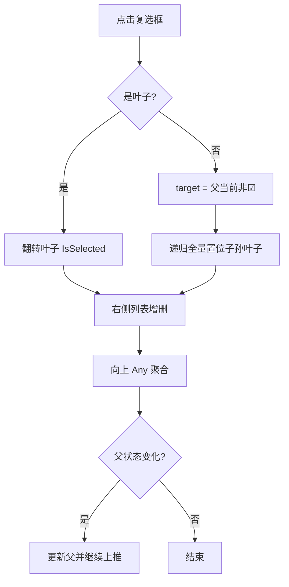

# 目标参数与全局变量绑定 UI 优化方案

| 项 | 内容 |
|---|---|
| 文档类型 | 方案设计 |
| 工作区 | `D:\MyWork\SunEyeVision_V2` |
| 生成时间 | 2026-09-17 14:40:20 |
| 状态 | **待确认 → 待实施**（方案已冻结 P1 交互规格） |
| 覆盖范围 | 目标参数管理（复选框交互 / 中文显示名）、全局变量管理器（输入来源对齐）、选择变量窗口（主题）、模块结果绑定回显 |
| 不在范围 | 工作流执行引擎、全局变量总线机制（`src/Workflow/**`，属另一工作包） |

> 依据：rule-004（方案设计要求）、rule-008（开发与代码纯净原则）、rule-010（参数系统）、rule-015（禁止兜底回退）、rule-021（双 AI 协作写入边界）。

---

## 0. 一页摘要

| # | 问题 | 最终改法 | 决策来源 |
|---|---|---|---|
| **P1** | 参数右侧「添加」按钮，交互别扭 | 改为**复选框**：叶子勾 = 绑定 / 取消 = 解绑；**父节点可点 = 全选 / 反全选**；父节点 ☑ 表示"下面有叶子被勾选"（ANY 语义） | 人工决策（本次会话）：**二态无半选** + **父节点可点** + **ANY 聚合** |
| **P2** | 参数名显示英文，且混入派生属性 | ① 工具侧补中文显示名（与输出变量 `DisplayName` 对称）② 统一"已配置参数"与"元数据参数"两条枚举口径 | 人工："应该都是中文显示才对" |
| **P3** | 「输入来源」列不居中 | 补齐行内垂直居中（同表既有范式） | 人工："显示不在中间" |
| **P4** | 「选择变量」窗口不适配主题 | 12 处硬编码亮色 → 主题令牌 | 人工："不适配主题" |
| **P5** | 绑定后看不出绑给了哪个变量 | 结果行回显「已绑定：变量名」 | 人工："看不出绑定的是哪个全局变量" |

---

## 1. 人工决策记录（本方案已冻结项）

| 项 | 决策 | 影响范围 |
|---|---|---|
| 1 | 复选框**二态**（☐ / ☑），**不要**三态半选（▣） | P1 状态模型、聚合谓词、清理清单 |
| 2 | **父节点可点击**：☐ → 全选其下叶子；☑ → 反全选（全部取消） | P1 交互动作表 |
| 3 | 父节点 ☑ 的语义 = **子树中至少一个叶子被勾选**（ANY），**不代表全选** | P1 聚合算法 |
| 4 | 父节点无法区分"全选/部分选"的代价，用 **ToolTip 计数**（已绑定 x / y 个参数）补偿 | P1 补偿手段（推荐项，如改口径请更新本节） |

---

## 2. 问题分析与证据

### 2.1 P1 目标参数复选框

| 事实 | 来源 |
|---|---|
| 叶子用 `Button` + `SelectionActionText`（"添加"/"已添加"） | `src/UI/Features/ParameterSetting/TargetParameterDialog.xaml:88-93`；`TargetParameterViewModel.cs:34` |
| VM **已实现**父子级联逻辑（`SetChildrenSelected` 向下、`UpdateParentCheckState` 向上、`SupportsTriState`） | `TargetParameterViewModel.cs:36-118` |
| `SupportsTriState` 全项目**无 XAML 引用**；父节点**没有控件** ⇒ 级联逻辑实际不可用 | `TargetParameterDialog.xaml:88-93`（按钮仅 `Visibility={Binding IsParameter}`） |
| 载入时初始化与一次性聚合已具备 | `TargetParameterViewModel.cs:98-106`、`:218-220`、`:321-332` |
| 右侧列表与叶子 1:1 同步已具备（含去重、✕ 反向取消） | `TargetParameterViewModel.cs:350-374`、`:545-571`、`:537-543` |

### 2.2 P2 参数显示名

| 事实 | 来源 |
|---|---|
| `GetAllPropertyMetadata` 返回的是**输出变量表**（由 `OutputVariable.DisplayName` 填充） | `src/Plugin.Infrastructure/Managers/Tool/ToolRegistry.cs:457-465`；`src/Plugin.SDK/Execution/Parameters/PropertyMetadata.cs:17-27` |
| 输入参数查不到显示名 ⇒ 回退 `[DisplayName]` 特性 ⇒ 再回退 **CLR 属性名（英文）** | `TargetParameterViewModel.cs:504-510`、`:515-521`、`:527-535` |
| 途径1（`ParamSettings`，用户已配置参数）**不做任何过滤**；途径2（`ToolParameters`）排除 `[JsonIgnore]` 与非基本类型 ⇒ **口径不一致** | `TargetParameterViewModel.cs:397-405` vs `:411-412`、`:455-483` |
| 于是 `PositionCorrectionBindingDisplayText`（`[JsonIgnore]` 派生显示文本）被列进面板 | `src/Plugin.SDK/Execution/Parameters/MeasureGuideParameters.cs:193-196` |

### 2.3 P3 / P4 / P5

| 问题 | 事实 | 来源 |
|---|---|---|
| P3 | 「输入来源」内容无 `VerticalAlignment="Center"`；同表「当前值」列有 `VerticalContentAlignment="Center"` | `src/UI/Features/GlobalVariableManager/GlobalVariableManagerDialog.xaml:511` vs `:498` |
| P4 | 12 处硬编码亮色（`#F5F5F5`/`White`/`#E0E0E0`/`#F0F0F0`/`#9E9E9E`）；**同目录**两窗口已是主题令牌范式 | `GlobalVariableSelectDialog.xaml:14,32,57,58,80,81,83,134,145` vs `TargetParameterDialog.xaml:16,22,51`、`GlobalVariableManagerDialog.xaml:478-479` |
| P5 | 绑定只写 `ProducerBinding` + 打日志；结果侧无状态字段 | `src/UI/Shell/Controls/Shell/ImageResultControl.xaml.cs:138-150`；按钮 `ImageResultControl.xaml:192-200` |
| P5 | 绑定关系唯一可读处在变量侧 | `src/Workflow/GlobalVariable.cs:230`（`InputSourceDisplayText`） |

### 2.4 语义边界（避免误改）

| 方向 | 数据结构 | 入口 |
|---|---|---|
| **输入来源**（谁产生这个变量） | `GlobalVariable.ProducerBinding` | 模块结果里的 🔗 |
| **目标参数 / 目标输出**（谁消费这个变量） | `GlobalVariable.ConsumerBindings` | 本方案的复选框面板 |

两者独立、互不影响；本方案只动后者。[来源] `src/Workflow/GlobalVariable.cs:207-215`

---

## 3. Bug 模式分析（治本优先）

| 项 | 结论 |
|---|---|
| 真因分类 | P1 = **实现偏差**（级联逻辑写了，UI 没接）；P2 = **设计缺陷**（显示名 SSOT 仅覆盖输出侧 + 双途径口径不一）；P3/P4 = **规范未贯彻**（同目录已有正确范式）；P5 = **实现偏差**（状态存在、视图缺失） |
| 同类潜伏点 | ① 主题硬编码：`src/UI/Features/Camera/AddCameraDialog.xaml:67-68,73-75,143`、`src/UI/Shell/Windows/AboutWindow.xaml:36-37` 同样写死亮色 ② 显示名回退英文：任何读 `GetDisplayName` 的 UI 同源复发 ③ 派生属性混入：任何读 `ParamSettings` 的地方都有风险 |
| **治本点** | ① 显示名 SSOT **扩展到输入侧**，并把"缺显示名"变成**可检测违约**（守卫测试），不再静默回退英文（rule-015）② **参数枚举口径唯一化**（两途径共用同一过滤函数）③ **UI 一律走主题令牌**（加守卫测试）④ 绑定状态**单一数据源** = `ProducerBinding`，视图只读它 |

---

## 4. 业界对标

| # | 来源 | 关键特征 | 借鉴 / 偏离 |
|---|---|---|---|
| 1 | WPF `CheckBox`（Microsoft Learn 官方）<br>https://learn.microsoft.com/zh-cn/dotnet/api/system.windows.controls.checkbox | `IsChecked` 是 `bool?`，`IsThreeState=true` 才启用"不确定"态；官方示例即三态用法 | **有意偏离**：按人工决策使用**两态**；代价（父节点无法区分全选/部分选）由 ToolTip 计数补偿 |
| 2 | MS Learn《ResourceDictionary 和 XAML 资源引用》<br>https://learn.microsoft.com/zh-cn/windows/apps/develop/platform/xaml/xaml-resource-dictionary | 主题/样式应集中在资源字典声明，以资源引用消费，避免散落字面值 | 支撑 P4：硬编码色 → 主题令牌（本项目已有 `ThemeKeys` + `DynamicResource` 范式） |
| 3 | 海康 VisionMaster（同类视觉平台）<br>https://www.hikrobotics.com/cn/machinevision/visionmaster/ | 流程间以"变量/绑定"为核心，绑定关系在两端可见 | 支撑 P5：结果侧 + 变量侧双向可见，不能只在一端 |
| 4 | WPF 复选框父子级联实践（社区）<br>https://dev59.com/tG865IYBdhLWcg3wOb9h | 父节点聚合子节点选择是通行做法（通常用半选态表达部分选中） | 采纳"父级聚合"，**不采纳半选态**（人工决策） |

> 说明：1、2 为厂商官方文档；3、4 含社区来源，已如实标注，仅作同类产品行为参考。

---

## 5. 方案对比与推荐

### 5.1 P1 交互形态

| 维度 | **A（选定）** 两态 + 父可点全选/反全选 + ANY 聚合 | B 三态（含 ▣） | C 父节点只读指示器 |
|---|---|---|---|
| 与人工决策 | ✅ 完全一致 | ❌ 已否决 | ⚠ 已否决（要求父可点） |
| 信息量 | 父 ☑ 不区分全选/部分选 ⇒ **ToolTip 计数补偿** | 一屏可知部分选中 | 同 A |
| 批量操作 | 有（点父节点） | 有 | 无 |
| 实现复杂度 | 低（VM 逻辑几乎原样复用，删三态分支） | 低 | 低 |
| 长期 ROI | 高 / 高 / 高 | 中 | 低（缺批量） |

**推荐 A**（即人工三条决策 + ToolTip 计数补偿）。

### 5.2 P2 显示名来源

| 维度 | **A（推荐）** 工具侧声明中文名 | B UI 层属性名→中文映射表 | C 输入参数元数据纳入工具契约 |
|---|---|---|---|
| 架构一致性 | ✅ 一处声明、多处消费（与输出 `DisplayName` 对称） | ❌ 两处产线（违反"契约唯一产出点"） | ✅ 最彻底 |
| 改动量 | 中（18 工具参数类补标注，中文名取自各工具调试窗既有标签） | 低但长期负债 | 高（SDK + 全工具） |
| 长期 ROI | 高 / 高 / 高 | 低 | 高（3 年尺度） |
| 结论 | **本期采用 A** + 缺名守卫测试 | 否决 | 中期演进 |

### 5.3 P3 / P4 / P5
- **P3**：唯一合理做法 = 与同表对齐规范一致（无争议）
- **P4**：A 全量换主题令牌（推荐）；B 只改窗口底色（否决：表头/表格仍亮）；C 重做主题系统（否决：无必要）
- **P5**：A 结果行回显绑定目标（读 `ProducerBinding` 单一源，推荐）；B 只在变量管理器看（已否决）；C 全局绑定关系图（规模大，留后续）

---

## 6. 详细规格

### 6.1 P1 复选框交互规格（冻结）

**角色**：叶子 = 唯一真源（勾 = 绑定 / 取消 = 解绑）；父节点 = 派生显示 + 批量操作入口。

| 点击对象 | 点击前状态 | 结果 |
|---|---|---|
| 叶子 | ☐ | **☑** → 该参数加入绑定（右侧列表出现该条） |
| 叶子 | ☑ | **☐** → 解除绑定（右侧列表移除该条） |
| **父节点** | ☐（子树一个都没勾） | **全选**：其下所有叶子置 ☑ |
| **父节点** | ☑（子树有勾选，**部分或全部**均显示 ☑） | **反全选**：其下所有叶子置 ☐ |
| 右侧列表某条 ✕ | — | 解除该绑定，并让树中对应叶子 ☐ |

**状态传播**

```text
[向下] 点父节点：target = !(父当前为 ☑)              // ☐→全选(☑)，☑→全不选(☐)
       递归 SetChildrenSelected(target)              // 逐叶置位；叶子触发"右侧同步"
[向上] 任何叶子变化后：
       parent.isSelected = parent.children.Any(c => c.isSelected)   // ANY 聚合
       状态变化才继续上推，直到根
```



**一致性要求**：`_selectedConsumers` 与树中叶子严格 1:1（叶子 ☑ ⇔ 右侧列表有且仅有一条，无重无漏）。

**生命周期**

| 时机 | 行为 |
|---|---|
| 打开对话框 | 已有绑定 → 对应叶子初始 ☑ → 一次性向上聚合（不产生事件风暴） |
| 确定 | 由 `_selectedConsumers` 生成 `ConsumerBindings` 写回 |
| 取消 | 全部丢弃，不写回 |

**边界**

| # | 场景 | 规格 |
|---|---|---|
| 1 | 无匹配参数的节点（含类型过滤后为空） | **不显示复选框** |
| 2 | 子程序嵌套 | 子程序调用节点的勾选 = 其展开子树的叶子批量操作 |
| 3 | 父节点部分选中 | ToolTip 显示"已绑定 x / y 个参数" |
| 4 | 同一子工作流被多处调用 | 见 §13 待定项 1 |
| 5 | 参数已被别的变量绑定 | 见 §13 待定项 2 |

**实现形态**

```csharp
private bool _isSelected;                          // bool? → bool

public bool IsSelected
{
    get => _isSelected;
    set
    {
        if (!SetProperty(ref _isSelected, value)) return;

        if (Children.Count > 0)
            SetChildrenSelected(value);            // 父：向下全量置位
        else
            OnLeafSelectionChanged?.Invoke(this);  // 叶子：同步右侧列表

        Parent?.UpdateParentCheckState();          // 向上 Any 聚合
    }
}

internal void UpdateParentCheckState()
{
    if (Parent == null) return;
    bool anySelected = Parent.Children.Any(c => c._isSelected);   // ANY 语义
    if (Parent._isSelected != anySelected)
    {
        Parent._isSelected = anySelected;
        Parent.OnPropertyChanged(nameof(IsSelected));
        Parent.Parent?.UpdateParentCheckState();
    }
}
```

XAML（`TargetParameterDialog.xaml` 树模板）：

```xml
<Grid>
    <Grid.ColumnDefinitions>
        <ColumnDefinition Width="Auto"/>
        <ColumnDefinition Width="*"/>
    </Grid.ColumnDefinitions>
    <CheckBox Grid.Column="0"
              IsChecked="{Binding IsSelected, Mode=TwoWay}"
              VerticalAlignment="Center"
              Margin="2,0,6,0"
              Cursor="Hand"/>
    <TextBlock Grid.Column="1"
               Text="{Binding Name}"
               VerticalAlignment="Center"
               Padding="0,3"
               TextTrimming="CharacterEllipsis"
               Foreground="{DynamicResource {x:Static base:ThemeKeys.TextPrimaryBrush}}"/>
</Grid>
```

### 6.2 P2 显示名规格

1. 显示名解析顺序固定：**工具契约 / 参数声明优先**；缺失时**不得静默回退英文**（改为日志告警 + 守卫测试拦截）
2. 工具侧为可绑定输入参数补中文 `[DisplayName]`，**取该工具调试窗 XAML 已有中文标签**，保证同一参数全项目同名
3. 途径1（`ParamSettings`）与途径2（`ToolParameters`）**共用同一过滤函数**：排除 `[JsonIgnore]`、排除非可绑定项、按 `targetTypeName` 过滤
4. 新增守卫测试：可绑定输入参数必须存在中文显示名；两途径对同一节点返回**同一集合**

### 6.3 P3 规格
「输入来源」列内容补 `VerticalAlignment="Center"`，表头与内容对齐一致（若需水平居中，同一处补 `ElementStyle`）。

### 6.4 P4 规格
`GlobalVariableSelectDialog.xaml` 12 处硬编码色替换为 `{DynamicResource {x:Static base:ThemeKeys.*}}`；DataGrid 走主题样式（对照 `GlobalVariableManagerDialog.xaml` 写法）。

### 6.5 P5 规格
结果行增加绑定状态回显：已绑定 → 图标 ✅、文案"已绑定：变量名"、ToolTip 显示完整路径、点击可改绑/解绑；数据唯一来源 = `GlobalVariable.ProducerBinding`；变量被删除时刷新为"目标变量已删除"。

---

## 7. 修改清单

| # | 文件 | 类型 | 核心变更 | 前置依赖 |
|---|---|---|---|---|
| 1 | `src/UI/Features/ParameterSetting/TargetParameterDialog.xaml` | 改 | `Button` → `CheckBox`（**所有层级可见**、空节点隐藏）；提示文案改为"勾选即绑定，点父节点可全选 / 全不选" | — |
| 2 | `src/UI/Features/ParameterSetting/TargetParameterViewModel.cs` | 改 | `bool?` → `bool`；`Any` 聚合；删除命令与文案属性；两途径过滤口径统一；显示名缺失告警 | 与 #3 配套 |
| 3 | 18 个工具参数类 + `MeasureGuideParameters` 等 SDK 参数类 | 改 | 可绑定输入参数补中文 `[DisplayName]` | 先导出"既有中文标签清单" |
| 4 | `src/UI/Features/GlobalVariableManager/GlobalVariableManagerDialog.xaml` | 改 | 输入来源列垂直居中 | — |
| 5 | `src/UI/Features/GlobalVariableManager/GlobalVariableSelectDialog.xaml` | 改 | 主题令牌化（12 处） | — |
| 6 | `src/UI/Shell/Controls/Shell/ImageResultControl.xaml` / `.xaml.cs` | 改 | 绑定状态回显 + 改绑 / 解绑入口 | — |
| 7 | 新增守卫测试（UI 测试工程） | 新增 | 显示名守卫、主题字面色守卫、两途径一致性守卫 | — |
| 8 | 交互单元测试（VM 层） | 新增 | 级联 / 聚合 / 1:1 同步 | — |

---

## 8. 清理清单

| 文件 | 清理内容 | 原因 |
|---|---|---|
| `TargetParameterViewModel.cs` | `SelectionActionText`(:34)、`ToggleSelectionCommand`(:32,318)、`SupportsTriState`(:39)、三态 `null` 分支(:81-96)、注释"三态（☐/▣/☑）"(:37) | 两态化后均为死代码 / 错注释 |
| `TargetParameterDialog.xaml` | 按钮样式引用 `ToolButtonStyle`/`MinWidth`/`Height`/`Padding`(:92-93)、"点击参数右侧『添加』"文案(:61) | 与实现不符的残留 |
| `GlobalVariableSelectDialog.xaml` | 硬编码色、空 `Window.Resources` 块(:17-19) | 死资源 / 规范违规 |
| 工具参数类 | 中文名与调试窗标签统一后，删除旧注释中的别名说明 | 避免两名并存 |

---

## 9. 防御机制（4 项）

1. **契约守卫（单测）**：可绑定输入参数缺中文显示名 ⇒ 失败；两途径参数集合不一致 ⇒ 失败
2. **主题守卫（单测）**：`src/UI/**/*.xaml` 出现 `#RRGGBB` / `White` / `Black` 字面色 ⇒ 失败（白名单需注释理由）
3. **交互守卫（单测）**：① 勾任一叶子 ⇒ 所有祖先 ☑ ② 子树叶子全取消 ⇒ 祖先全 ☐ ③ 点父（☑）⇒ 子树叶子全 ☐ ④ 叶子与右侧列表 1:1
4. **端到端冒烟（manual）**：目标参数勾选 → 确定 → 依赖图连边；模块结果绑定 → 变量侧「输入来源」显示同一绑定；目标变量被删除 → 回显刷新为"目标变量已删除"

---

## 10. 验收标准

| # | 验收项 | 验收方法 | 关联测试 | 对应防御机制 |
|---|---|---|---|---|
| 1 | 参数前为复选框，勾选即加入右侧列表 | manual | — | 端到端冒烟 |
| 2 | 无半选态（不出现 ▣） | manual | — | — |
| 3 | 父节点勾选 = 全选其下叶子；父节点取消 = 全部解除 | unit | UT-TP-01 | 交互守卫 |
| 4 | 任一叶子被勾 ⇒ 所有祖先 ☑；子树全取消 ⇒ 祖先全 ☐ | unit | UT-TP-02 | 交互守卫 |
| 5 | 叶子与右侧列表严格 1:1（无重无漏） | unit | UT-TP-03 | 交互守卫 |
| 6 | 面板内不再出现 `PositionCorrectionBindingDisplayText` 等派生属性 | unit | UT-TP-04 | 契约守卫 |
| 7 | 所有可绑定输入参数显示中文名 | unit | UT-TP-05 | 契约守卫 |
| 8 | 无参数节点不显示复选框 | unit/manual | UT-TP-06 | — |
| 9 | 「输入来源」列垂直居中对齐 | manual | — | — |
| 10 | 「选择变量」窗口明 / 暗主题均无亮色残留 | manual（切主题对比） | UT-UI-01 | 主题守卫 |
| 11 | 绑定后结果行显示"已绑定：变量名"，变量侧输入来源一致 | manual + unit | UT-GV-01 | 端到端冒烟 |
| 12 | 解绑 / 改绑两端同步刷新 | manual | — | 失败兜底（目标变量删除提示） |

---

## 11. 测试方法

- **unit test**：#3、#4、#5、#6、#7、#8、#10(扫描)、#11
- **manual**：#1、#2、#9、#10(视觉)、#11、#12
- **code review**：§8 清理清单逐项确认

---

## 12. 风险评估

| 风险 | 等级 | 应对 |
|---|---|---|
| 目标文件属**另一写者在飞工作包**（`ParameterSetting`、`GlobalVariableManager`、`ImageResultControl` 相关目录）⇒ 同时改必冲突 | **高** | 实施前冻结该目录 / 由该工作包负责人实施 / 或人工授权后实施并接受不回改他人在飞内容 |
| 18 工具补显示名波及多工程 | 中 | 先导出"既有中文标签清单"，批量补后由契约守卫拦截遗漏 |
| 主题令牌替换后暗色对比度 | 低 | 只替换为既有令牌，不引入新色值 |
| 父 ☑ 不区分全选 / 部分选（无半选态的固有代价） | 中 | ToolTip 计数补偿 + 右侧列表为权威清单 |

---

## 13. 待定项（需人工一句话）

| # | 事项 | 现状 | 建议 |
|---|---|---|---|
| 1 | **同一子工作流被多处调用** | `visited.Add(subWf.Id)` 使**只有第一个调用点**展开子参数，第二处看不到 | 按**缺陷修**：每处调用点都展开，且同一 `(NodeId, ParameterName)` 的多个树节点**状态联动**（语义上它们就是同一个参数：绑一次、两处调用都生效）；防环改为**按调用路径**而非全局去重 |
| 2 | **某参数已被别的变量绑定** | 无冲突检测 | 先做**只读提示**（叶子加标记 + ToolTip"已被变量 X 绑定"），**不拦截**；实现时确认执行侧对"一个参数多个消费源"的实际行为，若引擎仅支持单源则升级为拦截 |

---

## 14. 实施归属与下一步

| 步骤 | 内容 |
|---|---|
| 1 | 人工确认本方案（含 §13 两项建议） |
| 2 | 按 rule-021 出**交接单**给当前占用该目录的工作包负责人；或人工**明确授权**实施者直接修改 `src/UI/Features/ParameterSetting`、`src/UI/Features/GlobalVariableManager`、`src/UI/Shell/Controls/Shell/ImageResultControl` |
| 3 | 实施按主题分批提交（中文 message 经 UTF-8 文件 `git commit -F`），每批构建验证 |
| 4 | 实施完成后按「方案测试」技能做全链路验证（含 §10 验收表逐项） |

---

## 附录：关键代码位置索引

| 位置 | 用途 |
|---|---|
| `src/UI/Features/ParameterSetting/TargetParameterDialog.xaml:61,77-94` | 提示文案、树模板（复选框改造点） |
| `src/UI/Features/ParameterSetting/TargetParameterViewModel.cs:21,32,34,39,45-118` | 状态模型与级联逻辑（两态化改造点） |
| `src/UI/Features/ParameterSetting/TargetParameterViewModel.cs:392-448,453-483` | 参数枚举三途径（口径统一改造点） |
| `src/UI/Features/ParameterSetting/TargetParameterViewModel.cs:504-535` | 显示名解析（SSOT 改造点） |
| `src/UI/Features/GlobalVariableManager/GlobalVariableManagerDialog.xaml:498,508-517` | 输入来源列对齐 |
| `src/UI/Features/GlobalVariableManager/GlobalVariableSelectDialog.xaml:14,32,57-58,80-83,134,145` | 主题令牌化 |
| `src/UI/Shell/Controls/Shell/ImageResultControl.xaml:192-200`、`.xaml.cs:117-151` | 绑定入口与回显 |
| `src/Workflow/GlobalVariable.cs:207-215,230` | `ProducerBinding` / `ConsumerBindings` / 输入来源显示 |
| `src/Plugin.Infrastructure/Managers/Tool/ToolRegistry.cs:457-465` | 属性元数据来源（输出侧） |
| `src/Plugin.SDK/Execution/Parameters/MeasureGuideParameters.cs:193-196` | `[JsonIgnore]` 派生属性（混入证据） |
