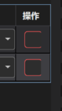

# 通讯事件条件与动作条件及参数绑定优化基线

本基线采用两级判断：接收事件决定事件是否发生，触发配置根据本次输出与触发参数是否相等决定动作是否执行。触发参数复用 ParamBinding，支持绑定当前事件输出或手填比较值；按输出类型适配后比较，不统一转成字符串。暂不向工作流节点运行参数或模块输入赋值，后续由通信工具链接入工作流数据传递。

本次最终优化聚焦全局数据触发和心跳管理：全局匹配增加“不等于”，保留原生类型适配，移除旧来源和旧文本范围的兼容实现。心跳恢复“单数据／多数据”名称，发送内容仅显示一个 TextBox 或两个 TextBox 加短横分隔；多数据仍交替发送两份内容，不使用 Range 或索引范围。目标树必须支持父节点整行及箭头单击展开、叶子单击选择，并解决箭头无反应和难以命中的问题。

- 更新日期：2026-10-10。
- 状态：全局匹配和心跳紧凑布局已实施，补充的OPC UA类型锁定、失败原因可见提示和删除按钮修正也已更新Release。最新209项回归通过，实际EXE无硬件启动探针退出0；真实设备、可见设计器、主题和高DPI待人工验收。详见[心跳反馈实施记录](../../../collaboration/HANDOFF_HEARTBEAT_FEEDBACK_20261010.md)；此前[最终优化记录](../../../collaboration/HANDOFF_COMMUNICATION_FINAL_REFINEMENT_20261010.md)的208项结果为历史，不重复累计。
- 源码基线：main，1173baedc23eb879811f53242282c6072b10101a；保留工作区既有未提交改动。
- 当前 Release 实际行为：手填非空内容或配置输出绑定即按类型执行等于判断；无输入且无绑定时不附加条件。没有启用开关，旧 ParameterComparisonEnabled 字段保留兼容但不参与执行判断。已有非空触发参数也按新规则自动参与比较，不再由旧开关值决定。
- 当前 Release 全局匹配为等于／不等于／包含／不检查内容，仅识别新 GlobalData 规则。旧 String 规则不装载执行，加载说明提示重新创建；旧来源限制、旧文本范围、旧匹配名称转换和待迁移界面已移除。事件触发的 ParamBinding 与仅等于判断不变。
- 当前 Modbus 支持既有保持寄存器模型：IntBits16 单值为 UInt16，IntBits32 双寄存器按 ByteOrder 为 Int32；本次未新增线圈或浮点配置，不取集合第一项、不统一转字符串。心跳已恢复单数据／多数据和紧凑 TextBox 输入；箭头区采用28×32透明背景，整行与箭头统一处理预览点击，避免依赖小三角图形命中或默认双击。实际鼠标边界及高DPI仍待人工验收。
- 以下当前方案优先于后面的历史记录；旧复杂比较规则、节点映射弹窗及默认 Debug 测试要求不再作为本轮要求。

## 事件触发的动作等于判断

接收事件触发成功后，为每条匹配事件 ID 的规则评估独立动作条件。规则只支持“等于”，不提供比较规则下拉框。上升沿和下降沿仍由接收事件层判断，动作层不重复维护边沿历史。

执行顺序为：接收事件判断通过 → 取得本次事件快照 → 按类型比较判断输出与触发参数 → 条件通过 → 申请执行权限并校验目标及取消状态 → 执行动作。动作忙碌时跳过、不排队，不提前改写节点参数或共享全局变量。

事件触发行包含序号、触发事件、触发命令类型、执行目标、触发参数和操作，不显示开关、独立“判断输出（等于）”列或比较规则设置。触发参数列只保留 ParamBinding 及必要的判断输出选择；单输出有效时隐藏选择框，多输出、未配置输出或已选输出失效时显示以便明确选择或修复。判断输出限定为当前模式的普通解析或组装输出，不默认取多输出中的第一项。字段身份保持稳定，删除不得自动改绑。

前次隐藏单输出选择的界面记录见[触发参数界面收简记录](../../../collaboration/HANDOFF_TRIGGER_COMPACT_UI_20261010.md)，其中开关设计已被自动比较规则替代。通讯来源按下方统一上传入口新方案调整；忙碌保护和节点不赋值边界保留。

触发参数使用行内 ParamBinding，可绑定同一事件的适用输出作为比较值，也可直接填写常量。它不是布尔开关：手填 true 仅在 Boolean 判断输出为 true 时相等，手填 false 仅在该输出为 false 时相等。绑定某个输出也不是判断其“真值”，而是将它的本次值与指定判断输出比较。

## 类型适配与失败处理

以判断输出声明的类型为比较类型。ParamBinding 手填内容保存为字符串，在动作判断阶段解析；绑定来源保持原类型，数值间仅允许安全、无损转换，不任意强转。两侧都取自同一次事件快照，不能读取下一条消息更新后的 UI 值。

| 判断输出类型 | 比较值处理及等于语义 |
| --- | --- |
| Boolean | 手填 true 或 false 解析成 Boolean，忽略大小写和首尾空格；执行布尔等于 |
| 整数 | 按对应整数类型解析，校验符号和范围；执行整数等于，不经过浮点数转换 |
| 浮点数 | 按对应类型解析，执行数值等于；不隐式增加容差，非有限值无效 |
| String | 原样进行文本等于，默认区分大小写，保留空格和换行 |
| 数组或对象等 | 暂不支持直接比较，明确提示而不是转成字符串 |

不得用非空文本或非零数值隐式代表 true。类型转换失败、绑定失效、判断输出缺失或本次值无效时，该规则不执行并提示具体原因；不静默回退为字符串比较。

示例：Boolean 输出 true 与手填字符串 true 经适配后相等；整数输出 2 与合法整数常量 2 相等；字符串输出 START 只与原样文本 START 相等。浮点输出 2 与合法浮点常量 2.0 按数值相等判断，文本 2 与文本 2.0 则不相等。

## 自动比较与清空

手填内容长度非零，或存在绑定路径时自动比较；参数清空且无绑定时放行事件，不要求判断输出有效。纯空格属于已输入文本，不自动当成未填写。失效绑定仍为已配置条件，告警并不执行；只有解除绑定并清空才恢复不比较。

不再支持手填空字符串作为等于条件，因为空输入统一表示不比较。绑定输出即使本次值是空字符串也仍参与比较，不因取到空值而放行；本次没有有效绑定值则拦截。旧 FieldId 的有效绑定继续兼容读取，显式清空 TriggerParameterSource 覆盖旧字段。旧开关值忽略，ConditionRule 和 ParameterMappings 仅保留兼容，不恢复复杂规则或节点赋值。

## 全局数据触发

将原“字符串触发”调整为“全局数据触发”。它直接判断开启数据上传后进入系统的本次值，不要求先创建接收事件，也不要求把 Boolean、数值转换为字符串。事件触发仍适合字段解析、来源绑定和上升沿／下降沿；两条路径共用动作执行保护，不相互替代。

接收路径为：设备收到或新读取业务数据 → 开启数据上传 → 生成保留原类型的上传快照 → 全局规则适配触发参数并匹配 → 请求执行动作。上传数据不是接收事件解析后的 out1/out2，也不是比较结果 OK/NG。

界面保留序号、触发参数、匹配方式、触发命令类型、执行目标和删除操作。“触发字符”改为“触发参数”，规则中的来源设备列移除、不增加设备树；默认明确面向所有有效上传通知，界面须提示其全局范围。要限定某台设备或某个数据点，使用绑定来源的接收事件，不将当前全局规则暗中限定为某个来源。

### 类型适配与匹配

选择保留原类型、适配比较参数的方案，而不是统一 ToString 后比较。手填参数虽保存为文本，但按本次上传值的声明类型解析；不根据常量内容猜测原数据类型。

| 本次上传类型 | 等于模式的处理 |
| --- | --- |
| Boolean | 参数 true/false 解析为 Boolean，忽略大小写及首尾空白，按布尔等于 |
| 整数 | 按对应整数类型和范围解析，不绕经浮点数，按整数等于 |
| 浮点数 | 按对应类型解析，按数值等于，不隐式加容差，非有限值无效 |
| String | 原样进行文本等于，区分大小写，保留空格和换行 |
| 原始字节、数组、对象 | 暂不直接比较，先明确字段提取或解析，不转成文本、不默认取第一项 |

匹配方式为“等于”“不等于”“包含”“不检查内容”，不增加其它复杂规则。

| 匹配方式 | 判定逻辑 |
| --- | --- |
| 等于 | 参数按本次上传类型解析成功后，与本次值相等才申请动作 |
| 不等于 | 参数按本次上传类型解析成功后，与本次值不相等才申请动作 |
| 包含 | 仅 String 支持，按原样文本包含判断，区分大小写 |
| 不检查内容 | 不判断参数内容，但仍须收到支持类型且质量有效的标量通知 |

“不等于”不是把所有失败结果取反：先验证通知质量、支持类型和参数解析，全部有效后才能对等于结果取反。参数空、转换失败、类型不支持、坏质量或缺少本次值均不执行。不检查内容也不能绕过质量、目标、会话、取消及忙碌保护，未解析字节、数组和对象不直接触发。

例如 Modbus 上传整数1，参数填写1，先按整数适配后等于，直接请求执行；OPC UA 上传 Boolean true，参数填写true，按布尔适配后请求执行。本次值为浮点数1时，参数1.0解析后相等；本次值为整数1时，手填1.0不应绕过整数格式校验。字符串1与字符串1.0仍不相等。整数溢出严格校验，不通过浮点舍入强行适配。

全局规则的等于／不等于／包含模式要求有效比较参数，空参数不自动变成全局无条件执行；需明确选择不检查内容。纯空格对 String 是实际比较内容，不自动清空；数值及 Boolean 按既定解析器验证。事件触发中已有的“空参数不附加判断”语义只适用于事件触发，不混入全局规则。

参数无效、类型不兼容或缺少本次值时不执行，提供原因。不把本次类型从数值转为文本来掩盖适配失败。绑定功能若复用 ParamBinding，必须明确本次来源及快照解析契约，不借用其它事件的最新缓存；没有定义的跨来源绑定不显示可用项、不放行。本轮不恢复工作流节点参数赋值。

### 全局范围与重复通知

不限定来源意味着同一规则可能被多台设备命中。例如参数1可能匹配某设备的整数1及另一个设备的文本1，两者各自按本次类型判断。这是全局范围的效果，不是自动把两种类型视为同一种数据。需要隔离来源或固定类型的业务，应使用明确配置的接收事件；实施时不能根据第一次收到的值永久锁定规则类型。

同一通知可以命中多条规则，也可能同时命中事件触发和全局数据触发。每份通知在该入口仅匹配一次，相同值再次真实收到仍是新通知；不增加隐式去重或默认边沿判断。每次执行申请继续遵守忙碌跳过、不排队，因此重复通知不等于保证每次动作都能执行。

### 统一上传结构与协议适配

上传入口采用逐次、不可变通知，而不是一个被后续值覆盖的全局变量。结构至少保留来源设备、数据点或地址、时间、声明类型、原生值、质量及会话身份；字节或集合需复制或采用不可变表示，不能引用后续会更新的驱动缓冲区。来源元数据用于追踪，不因 UI 不显示来源列而丢失。

| 数据来源 | 上传内容与全局触发边界 |
| --- | --- |
| TCP／UDP／串口 | 原始业务报文保留为字节；按明确编码解码成功后提供 String，沿用既有报文处理及 UTF-8 校验，不猜测数字文本的类型 |
| OPC UA | 本次有效数据点值，保留 String、Boolean、整数或浮点等原类型，可直接进入相应标量判断 |
| Modbus | 本次位／寄存器业务数据；单个位保留 Boolean、单个原生寄存器保留 UInt16，配置的组合数值须按明确类型及字序解释后进入标量判断 |
| 多寄存器、字节数组或其它集合 | 无明确标量解释时保留集合，先定义字段提取，不能随意拼字符串或取第一项 |

Modbus 可不经接收事件，通过全局入口触发动作；它不因没有文本值而被排除。但多寄存器数据并不能在没有类型、字序或字段定义时猜成一个整数。协议报头等传输元数据不当作业务值参与判断。

数据上传开关控制该入口，不控制接收事件。关闭上传时接收事件仍正常接收、解析、比较和检测边沿。无效质量、读取失败和类型不支持不得触发；上传结构可供诊断保留质量信息。方案切换、断线和退出使旧会话通知失效。UI 刷新、历史回放和周期回放缓存不产生上传触发；新读取成功才算新样本。本轮不新增报文拆包或组包机制，不声称一次读取或接收就是完整业务命令。

### 移除全局旧兼容

不再保留旧来源设备筛选、LegacyText 类型范围、旧匹配名称转换、迁移按钮、迁移弹窗和对应执行分支。界面不显示“待迁移（暂停）”或“旧文本规则”，新规则只有统一全局语义；需要指定来源时使用接收事件。

旧全局规则不自动转换、不按新语义偷偷扩大范围，需重新创建。当前以 Source=GlobalData 识别新规则，旧 Source=String 规则不装载为可执行规则，通讯页提供加载说明，而不是保留迁移系统。该标识仅用于拒绝旧格式，不实现旧规则转换或旧逻辑执行。不能因为删掉旧来源字段就直接执行原规则。

本轮只移除全局触发相关旧兼容，不借机清理事件 ParamBinding、其它方案字段、工作流或协议的兼容逻辑。不擅自改写或批量删除用户方案文件；保存规则和旧数据处理须按正常显式保存流程，保证其它配置不受影响。

### VM 参考与产品选择

VM 官方手册第148页的 Modbus 配置说明将数据上传与全局字符串触发关联，第92页说明文本匹配方式。[VM 官方手册](https://pinfo.hikrobotics.com/hkws/unzip/20231101163730_26101_doc/pdf.pdf)。不能因其名称是字符串触发就断言它只接受 TCP 文本或原生 String。

官方资料尚不足以确定 VM 的 Modbus 值如何转成匹配内容、数组如何序列化或 Boolean 如何表示。保留原类型并适配参数是 SunEyeVision 本次明确选择，不声称复制 VM 内部的转换或调度机制。此前“全局路径只接文本、Modbus数值只走事件触发”的方案限制已撤销，不作为当前要求。

## 心跳目标树

本轮局部修复心跳选择器模板，不直接修改共用树模板，以免影响其它工具或参数绑定界面。数据点依然使用稳定设备 Id 和目标 Id，不改变实际发送目标。

```text
清除选择
TCP客户端
▼ OPC UA
    通道1.设备1.test1
▼ Modbus
    地址点1
```

只有有子节点的设备显示展开箭头；折叠时隐藏子节点，展开后有明确缩进。“清除选择”及 TCP／UDP／串口叶子不显示展开箭头。TCP／UDP／串口可选择设备，OPC UA／Modbus 父节点只展开，必须选择具体数据点。

父节点单击名称、行内空白或箭头均展开／收起，不要求双击，也不把父节点绑定成发送目标。叶子单击整行即选中并关闭弹层，重复选择当前叶子也必须正常关闭；右键不改变目标、不展开或驱动心跳。

箭头图形可以小，但独立点击区域至少28×32个 WPF 逻辑单位，使用可命中的透明背景；整行高度至少32，内容横向铺满可用宽度。单击箭头后立即更新方向和子项显示，悬停与键盘焦点反馈清晰，避免边框变化导致布局跳动。不增加动画等待，不精准限定三角形像素区域。

箭头与行点击由同一套路径处理一次，检查事件被截获、ToggleButton 默认处理及双击默认处理，防止一次点击展开后又收起。子节点事件不能再切换父节点；箭头点击只操作对应节点。快速双击不产生额外默认切换或误选目标；滚轮和滚动条不被行点击吞掉。

键盘上下键导航，左右键展开／收起，Enter 确认叶子，Esc 关闭不改目标；导航或聚焦本身不提交目标。重新打开弹层定位已绑定目标，展开其父节点并滚入可见区域，但不触发重新绑定或自动发送。

子节点不重复拼接设备名称，完整目标路径在提示或选中摘要展示。失效目标明确标识，不自动改绑。清除目标应停止对应心跳并保留可编辑配置，不向未指定地址发送。

## 心跳模式与输入控件

界面恢复“单数据／多数据”，不显示“固定值／两值交替”。发送内容仅用单行 TextBox，删除“值 A”“值 B”标签，不为内容说明占用第二行。

| 心跳类型 | 发送内容布局 | 运行语义 |
| --- | --- | --- |
| 单数据 | [ TextBox ] | 每个发送周期重复发送该值 |
| 多数据 | [ TextBox ] - [ TextBox ] | 每个发送周期只发送一个值，第一份与第二份交替 |

两个输入框等高、垂直居中，多数据尽量等宽，中间短横居中且不拥挤。短横仅作视觉分隔，不是范围、索引、减法或报文分隔字符；不发送短横，不使用 SDK Range 控件。单数据输入框使用剩余宽度，模式切换不增加行高，切回单数据保留第二份草稿。输入提示仅用 tooltip 和必要的错误提示，自动化名称可用“发送内容1／发送内容2”，无需常驻标签。

类型控制按协议区分：TCP／UDP／串口按当前文本发送实现，不显示类型选择；Modbus保留整数／浮点／文本编码选择，必须与外部寄存器约定一致；OPC UA从已获取节点值的标量类型确定发送类型，只读显示，不允许手动切换。没有节点类型或发送格式暂不支持时显示“未知类型”，提供明确说明并阻止启用，不回退猜为String。类型变化同步配置，普通值更新不反复重建目标树或重启发送任务。

TextBox 内容仍按发送类型校验、编码，而非一律发送String。Boolean手填true/false，数值校验类型、范围和非有限值，文本按发送协议处理；不增加复杂参数绑定。无效输入阻止启用，不静默变为0、false或其它值。OPC UA每次写入前继续检查连接、类型、质量和权限，界面锁定类型不替代底层写入校验。

心跳失败、等待连接或类型未确认的原因在表格下方按完整目标路径显示，不再只隐藏在设备格和开关tooltip里；发送成功及未启用等正常状态不占常驻提示。应用级Warning日志仍按错误状态变化记录，不每个周期刷同一错误，也不弹模态框。切换目标清除旧目标状态，不把旧错误显示成新目标失败。删除按钮统一24×24、Padding=0、居中“×”和删除提示，复用正常危险操作样式。

例如第一框为1、第二框为5，按周期发送1、5、1、5，不发送中间的2、3、4，也不是访问列表第1项和第5项。已有 Single／Alternate 后台行为保留；不增加范围递增、索引轮询或同时发送两份内容。

本机 VM 4.4 中文帮助的心跳管理章节明确将多数据定义为两组内容循环发送，已核对[本地帮助原文](<D:/Program Files/VisionMaster4.4.0/Applications/Help/CH/GUID-017832F1-828D-47BE-93E2-9496B6DA41A3.html>)。该依据只支持发送语义，不宣称 VM 使用本项目的控件或定时实现。

心跳删除确认框及目标弹窗使用主题资源，验证亮暗、悬停、选中、失焦、禁用、窄窗口及高 DPI。保留既有定时发送、非重叠、取消及退出释放边界。

## 执行目标与通讯编号

执行目标只显示工作流名称，不附加“编号 1”等数字后缀；实际绑定和执行继续使用稳定的工作流 Id。长名称使用省略及完整提示，保持合理列宽。

数字来自 CommunicationResponses.WorkflowIdentifiers，是通讯模块分配并随方案保存的流程状态响应编号，不是工作流自身的数字属性。已有映射保留以免改变外部协议；响应配置需要展示时明确标为“通讯编号”，不为移除下拉显示而删除或重排映射。

## 保留范围与界面边界

保留 OPC UA 变化订阅及周期读取、可配置间隔、显式上升沿和下降沿；普通解析及组装输出按模式提供候选。不修改其监视生命周期或接收严格类型规则来替代动作判断。

不恢复复杂条件弹窗和节点参数映射弹窗。触发参数不向节点运行参数或模块输入赋值，后续通信工具链另行定义消费契约。UI 只编辑配置和展示状态，事件比较放在通讯处理层，工作流调度仍由执行层负责。

统一行高、对齐、列宽、紧凑加号和“×”删除样式；删除确认只删除触发规则。亮暗主题、选中、悬停、失焦、禁用及弹窗状态均使用主题资源，验收窄窗口与高 DPI。

日志区分事件未触发、动作条件不相等、条件配置无效、目标失效、动作忙碌、取消及执行失败。不要把事件 UI 的 OK 状态当作动作已执行的证明。

## 实施顺序与验收

1. 明确授权后评估全局规则格式、加载保存、判断逻辑和心跳局部 UI 的跨模块影响；不修改工作流调度、节点赋值或共享 SDK 树模板。
2. 删除全局旧兼容和迁移界面，实现新规则格式及拒绝旧规则的加载说明；验证不扩大旧规则范围，其它方案字段不受影响。
3. 增加全局“不等于”，先进行质量和类型解析，再比较；验证 Boolean、各整数、浮点、String、空参数、溢出、未知模式及无效质量。事件触发仍仅等于。
4. 心跳恢复单数据／多数据名称和一个框／两个框加短横的单行布局；去除值 A/B 标签，全部内容采用 TextBox，保留按发送类型校验及实际交替逻辑。
5. 修复树箭头与整行单击，验收三角形中心、箭头周围空白、名称、行内空白、父子隔离、重复选叶子、快速连续点击、键盘导航、重新打开及滚动。验证至少28×32命中区、32行高和主题／高 DPI。
6. 明确授权实施后更新 Release 供用户测试，执行 UI Release、设计时检查及运行时验证；涉及 SDK、插件或发布规则时全量 Release 并运行验证。补验上传开关、缓存回放、会话失效、动作忙碌及心跳停止，不用以前的191项结果替代新回归。

优先使用 Release 测试，不默认要求用户测试 Debug。测试不得擅自执行真实设备业务、结束用户进程、递增版本或制作安装包；打包需用户单独要求。本次已按用户授权完成实施和 Release 更新，共208项回归通过：通讯核心195、触发界面1、心跳10、发送界面2。全量构建和独立 UI 构建均0错误，实际启动探针通过；真实设备、可见设计器、实际鼠标边界、明暗主题及高DPI人工验收仍待确认。

当前实现历史见[触发参数收简记录](../../../collaboration/HANDOFF_TRIGGER_PARAMETER_SIMPLIFICATION_20261010.md)。下方完整方案仅作历史参考，不得恢复其中已暂停的节点映射和复杂规则。

## 此前完整方案记录

- 日期：2026-10-10。
- 状态：核心实现和自动化回归已完成，待用户人工验收。详见[实施记录](../../../collaboration/HANDOFF_COMMUNICATION_TRIGGER_OPTIMIZATION_20261010.md)；自动化验证不替代真实设备和可见设计器验收。
- 源码基线：main，1173baedc23eb879811f53242282c6072b10101a；工作区仍有此前未提交的变更，应保留。
- 范围：通讯接收解析、触发配置、目标参数绑定、OPC UA 监视配置、主题适配及相关测试。心跳、响应和其它协议不作无关重构。
- 后续变更应更新本基线并说明原因，不能只按参考软件的外观猜测其内部语义。

## 现有实现与优化目标

实施前源码的关键事实如下，保留用于说明优化原因，不代表实施后的当前行为。

| 当前事实 | 优化目标 |
| --- | --- |
| MonitorOpcUaPointAsync 先读取一次，再以写死的 100ms 建立订阅 | 数据点可设置监视模式和间隔 |
| 接收到 OPC UA 通知后转发，没有客户端相同值去重 | 明确变化订阅与周期读取，显式实现边沿规则 |
| OPC UA Boolean 比较支持等于和不等于，没有上一有效值判断 | 增加上升沿和下降沿 |
| 接收事件比较成功后，按事件 ID 找触发规则并请求执行 | 增加独立动作条件，可选择无附加条件 |
| 行内字段选项只读取 AssemblyOutputs | 普通解析输出和组装输出都可绑定 |
| 所选字段值放入触发请求，但宿主执行分支没有消费这个值 | 分开实现执行条件和目标参数映射，取消无用途的数据携带 |
| 执行目标与字段下拉框混在 2* 的触发配置列中 | 明确执行目标、执行条件和参数绑定的入口 |
| 删除按钮以普通危险按钮样式缩成 24×24 | 使用清晰、主题化的紧凑删除图标 |

关键源码位置：

- src/DeviceDriver/Communications/OpcUa/OpcUaAdapter.cs：SubscribeAsync。
- src/DeviceDriver/Communications/Runtime/CommunicationRuntimeManager.cs：RefreshOpcUaPointAsync、OnOpcUaPointValueChanged。
- src/UI/Services/Communication/CommunicationApplicationService.cs：MonitorOpcUaPointAsync、OnAutomationOpcUa。
- src/UI/Services/Communication/CommunicationAutomationService.cs：ProcessOpcUa、Accept、Dispatch。
- src/UI/Features/CommunicationManager/CommunicationReceiveProcessor.cs：ProcessOpcUa、IsRuleMatch。
- src/UI/Features/CommunicationManager/CommunicationAutomationViewModels.cs：RefreshChoices。
- src/UI/Features/CommunicationManager/CommunicationTriggersView.xaml：触发配置布局。
- src/UI/Shell/Windows/MainWindowCommunicationAutomation.cs：DispatchCommunicationAsync。

## 接收事件条件

接收事件负责检查质量、解析类型和格式，再判断是否产生事件。解析失败、质量无效或条件不满足时，不产生可执行事件。

| 规则 | 判定 |
| --- | --- |
| 不比较 | 每个有效且解析成功的样本均满足 |
| 等于或不等于 | 根据本次值与配置值比较 |
| 数值范围 | 保留现有适用规则，按字段类型校验 |
| Boolean 上升沿 | 前一次有效值为 False，本次为 True |
| Boolean 下降沿 | 前一次有效值为 True，本次为 False |

边沿状态按接收事件和字段身份隔离，不使用 UI 显示值作为历史值。首次有效样本只建立基准，不触发边沿。断线重连、数据点绑定、类型或规则改变后重新建立基准。无效质量和解析失败不作为有效历史值，并使相关基准失效；恢复后的首个有效样本先建立基准，防止跨无效区间误判。

普通解析输出和组装输出纳入统一事件结果模型，但按当前模式提供适用字段，不能把两个列表无条件混合。字段身份使用稳定 ID，不依赖名称、列表位置或显示序号。

## 动作执行条件

接收事件产生后，逐条评估绑定该事件的触发规则。行内含糊的“触发字符”调整为“执行条件”，明确条件来源、比较规则和比较值，而不是仅有一个字段选择框。

每条动作规则有明确条件策略：

- 无附加条件：事件产生即可请求执行，不要求重复判断接收条件。
- 有附加条件：事件产生且该规则的比较条件满足，才请求执行。

执行条件的数据来源优先限定为本次接收事件的普通解析输出或组装输出，通过参数绑定控件选择。比较值可配置为相应类型的常量。按类型提供 Boolean 等于或不等于、字符串等于或不等于、数值适用比较；不进行任意字符串到 Boolean 或数值的隐式转换。

上升沿和下降沿放在接收事件层，本轮不在动作层重复维护边沿状态。无效条件来源或类型不兼容时，规则不执行，并显示明确原因。

示例：

```text
收到有效的“命令,型号”数据
  |
  +-- 接收事件：格式、类型及事件条件通过
       |
       +-- 规则1：命令等于 START --> 执行检测流程
       |
       +-- 规则2：命令等于 RESET --> 执行复位流程
```

此处第二级条件用于动作分流，并非强制再次判断同一个 True。两级条件都具备明确策略，“无附加条件”就是动作层的放行策略。

## 独立参数绑定

触发事件旁提供绑定按钮，打开弹窗配置以下映射：

- 接收输出到目标模块运行参数。
- 接收输出到目标模块输入参数。

参数绑定不参与是否触发的判断，也不要求再将同一个值绑定到执行条件。只配置参数映射并选择无附加条件时，事件仍可触发目标并传入参数。

绑定校验包含字段和目标身份、目标所属执行范围、类型兼容性及允许的显式转换。目标和字段重命名不破坏绑定；删除后显示绑定失效，不自动改绑其它项。禁止把接收字段名、展示序号或字符串路径当作唯一身份。

## 执行快照和架构边界

```text
有效数据样本
    |
    v
解析和接收事件条件
    | 满足
    v
生成本次事件结果快照
    |
    v
逐条判断动作执行条件
    | 满足
    v
校验参数绑定并申请执行权限
    | 获准
    v
提交参数快照给执行层
    |
    v
执行流程或模块
```

条件判断和参数绑定必须使用同一次事件结果快照，不能在执行时重新读取被下一条消息覆盖的最新值。多条规则共享该事件的不可变结果，各自构造目标输入。

沿用忙碌时跳过、不排队的策略，被拒绝的请求不得提前修改运行参数或全局变量。执行开始时按项目架构传递输入、参数及全局变量快照，避免通过临时写入共享配置实现本次参数覆盖。

UI 负责配置编辑和状态展示，不承担工作流调度；执行层不得访问 WPF 控件。UI 的缓存回放和重新打开窗口不应产生新的自动执行请求。方案切换、取消、重连和退出应使旧会话及旧配置的迟到事件失效。

## OPC UA 数据点监视配置

将写死的 100ms 开放为数据点配置。同一数据点被多个接收事件使用时共用监视配置，避免每个事件各建一次订阅或轮询。

| 模式 | 间隔含义 | 持续 True 的表现 |
| --- | --- | --- |
| 变化订阅 | 请求服务器采样间隔，实际值以服务器接受结果为准；初版发布间隔沿用相同请求值 | 通常不会反复产生相同值的数据变化通知，但初始、重订阅和状态变化通知仍需处理 |
| 周期读取 | 客户端主动读取的间隔 | 每次有效读取均进入接收事件比较 |

默认间隔为 100ms，沿用当前 10～600000ms 的配置校验范围。变化订阅不能描述成“每100ms保证通知一次”，请求间隔也不是硬实时承诺。界面应区分请求间隔和服务器实际接受的间隔。

周期读取不重叠发起请求、不积压补发；上次读取未结束时不并发追加。实际周期受服务器和网络延迟影响，不能保证每100ms完成一次。断线、方案切换、监视关闭或退出时取消对应读取任务。

周期处理缓存值不能冒充周期读取；本方案使用新读取成功的样本。两种模式中的上升沿和下降沿均由客户端显式判定，不依赖服务器通知过滤来模拟严格边沿。短于采样周期的脉冲可能漏检，应在配置说明中提示。

## 触发配置界面

```text
事件触发
序号 | 触发事件 [绑定] | 命令类型 | 执行目标 | 执行条件 [配置] | 删除
  1  | 文本解析       | 执行流程 | 检测流程 | out1 等于 START | 图标
  2  | Boolean事件   | 执行流程 | 检测流程 | 无附加条件      | 图标

[+] 添加规则
```

- 执行目标不再使用过宽的 2* 混合列；建议宽度 240～320 DIP，作为布局目标而非不可调整的硬限制。长名称省略并提供完整提示，小窗口保留合理最小宽度和滚动能力。
- 执行条件显示摘要，例如“无附加条件”或“out1 等于 START”；点击配置入口打开编辑弹窗，复用现有参数绑定控件，不另造不一致的字段下拉框。
- 事件旁的绑定弹窗列出当前模式的普通解析输出或组装输出，提供目标参数和模块输入绑定。
- 删除复用其它通讯配置中已正常显示的紧凑“×”按钮样式，统一边框、圆角、尺寸、内边距及主题状态，不另做一套无边框图标。确保符号居中可见、不被裁切；提示“删除触发规则”。确认框明确只删除规则，不删除事件或流程。
- 添加采用紧凑加号并提供提示；统一行高、控件高度、间距和对齐。
- 所有亮暗主题、选中、悬停、失焦、禁用及弹窗状态使用主题资源，避免白底回退和不可见符号。
- 字符串触发页保留对原始文本的匹配功能，不与事件触发页的执行条件混用。

## 删除按钮截图补充

2026-10-10 用户提供以下两张当前程序截图，作为样式一致性的补充依据。此补充替代此前“取消常驻红框”的独立设计建议，以现有正常删除按钮为统一参考，不改变删除业务语义。

触发配置中的异常显示：操作列内只见红色边框，截图中未见可辨识的“×”，边框右侧看起来不完整。截图能够确认显示异常，但不能单凭图片确定是内边距、模板还是布局裁切造成，实施时需检查实际控件。



其它位置的参考显示：红色圆角边框内能清楚看到居中的“×”。触发配置应复用该按钮的实际公共样式及尺寸规则，而不是只模仿截图颜色。


验收补充：事件触发和字符串触发两页的操作列都需与参考按钮一致；正常、悬停、选中、失焦、禁用及亮暗主题下符号应清晰，边框完整，高 DPI 下不裁切。截图保留为实施前的问题依据；统一样式已进入当前 Debug，实际显示仍待用户人工验收。

## 持久化和旧配置兼容

新增监视模式和间隔、动作条件及参数映射需要可版本化、可校验的持久化模型。旧 OPC UA 数据点默认迁移为变化订阅和 100ms，保持现有获取方式。

旧触发规则默认无附加条件，保持按事件触发的行为。旧 FieldId 不自动变成过滤条件或目标参数映射，因为现有值没有对应消费者；保留旧字段供迁移检查，不能悄悄改变规则语义或丢失原配置。

字段或目标失效时显示原因；未知版本或不支持规则不能静默按放行处理。迁移、导入及另存需测试，不能只验证新建配置。

## 实施顺序和跨模块影响

1. 明确事件结果快照、条件定义、参数映射与数据点监视模型及兼容策略。
2. 实现 OPC UA 可配置监视和接收事件边沿状态，验证连接生命周期。
3. 实现动作条件和执行端参数快照消费，保持执行权限、取消和方案切换边界。
4. 改造绑定弹窗及触发配置布局，完成主题状态适配。
5. 补充模型、处理器、执行链、配置迁移和 UI 回归，构建测试程序。

涉及通讯运行层、接收解析、配置持久化、执行管理器和主题资源，实施前必须评估跨模块影响。若现有 Plugin.SDK 契约无法表达目标输入绑定，应先明确契约扩展及插件部署影响，不以 UI 反射或直接调用工具绕过架构。

同一目录只允许一个 AI 写入；需要并行开发时使用独立分支或 Worktree。本次保存不授权提交、同步其它分支、发布或操作真实设备。

## 验收标准

- 持续 True：周期读取的等于 True 可逐样本满足；变化订阅不被宣称固定周期触发。
- Boolean 上升沿和下降沿：首次样本不触发，持续不变不重复触发，正常转换各触发一次；无效质量恢复和重连先建立基准。
- 接收事件满足但动作条件不满足时不执行；无附加条件时可独立传参并执行。
- 普通解析和组装输出均可按对应模式绑定；多规则和下一条消息不会污染同次输入快照。
- 忙碌跳过不排队、不提前改写共享参数；取消和方案切换后旧事件不执行。
- 字段重命名、删除、目标失效、类型错误和配置迁移有明确且一致的结果。
- 变化订阅实际间隔、周期读取不重叠、断线取消与退出释放均有测试。
- 亮暗主题和选中、悬停、失焦、禁用状态可读；删除确认框保持主题；验证窄窗口和高 DPI。
- 分别验证 Visual Studio 设计时与运行时；人工验收单独记录，不能以编译通过代替。

交付先提供 Debug 给用户测试，并按项目要求补验 UI Release。若修改 SDK、插件或发布依赖，必须全量 Release 并实际运行验证。只有用户明确申请才制作安装包；不因普通优化递增版本或自动打包。

## VM 参考依据和未确认边界

VM 文档将事件旁参数绑定与行内触发字符分别配置。文本解析输出可被订阅为触发字符，不能据此仅支持组装输出。[VM 官方用户手册第91及166页](https://pinfo.hikrobotics.com/hkws/unzip/20231101163730_26101_doc/pdf.pdf)及[VM3D 官方用户手册第80至81页](https://pinfo.hikrobotics.com/hkws/unzip/20240919112534_17943_doc/%E6%B5%B7%E5%BA%B7%E6%9C%BA%E5%99%A8%E4%BA%BAVM3D%E7%AE%97%E6%B3%95%E5%BC%80%E5%8F%91%E5%B9%B3%E5%8F%B0_%E7%94%A8%E6%88%B7%E6%89%8B%E5%86%8C_V2.2.0_20240914.pdf)提供相关步骤和示例。

官方图像源文档另有字符触发过滤功能。[图像源说明](https://pinfo.hikrobotics.com/hkws/unzip/20231101163730_26101_doc/GUID-8D7949F0-EB91-4794-BD3C-D4182726D931.html)不能单独证明行内触发字符必定通过该路径消费，也不能证明所有执行模式必须绑定它。

本方案的两级条件是 SunEyeVision 明确采用的产品设计，不宣称与 VM 内部实现完全一致。VM 参考段落由官方搜索索引获得，PDF直接打开超时，尚未逐页核验全文；后续发现新证据时补充参考结论，不擅自推翻本方案的独立职责划分。
