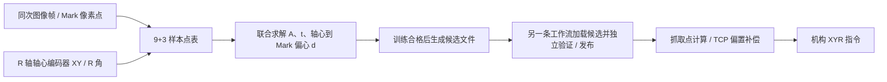

# N 点标定（9 平移 + 3 旋转）联合标定与抓取链沟通基线

> 创建：2026-09-29；方案修订：2026-09-30。本文是后续讨论与实施的统一基线，**方案目标不等于已实现功能**；实际进度见第 10 节。适用首期工位：固定上视相机、固定工作平面、同一 Mark 的 2D 采样。本文覆盖此前基线文档中与 N 点 9+3 数学模型、点表、求解和结果语义不一致的部分；九个标定工具的产品规划仍见 `../28/标定工具链与定位抓取设计基线-20260928.md`。VM 4.4.0 本机帮助的 N 点标定页 `GUID-E02DEF21-AC77-4183-B15E-021A8CED94E9.html` 是参数语义的对照来源；其帮助未公开内部求解器，不将我们的联合模型宣称为 VM 源码实现。

## 1. 已确定的输入语义与工程目标

- 每条样本的 `u,v` 是同一个 Mark 中心在**同一图像域**中的像素坐标，`u` 对应图像 X/列，`v` 对应图像 Y/行。图像中提取的 Mark 姿态角**不参与本次标定求解**。
- 点表的 `Xs,Ys` 是拍摄该帧时 **R 轴轴心在机台坐标系下的 XY 编码器坐标**，不是 Mark、吸嘴/TCP 或工件抓取点的物理坐标。这一定义是方程成立的前提；若控制器报出的 XY 并非实际 R 轴轴心位置，须先明确机构几何偏置并换算，不能直接填表。
- `Theta` 是同次采样的 **R 轴编码器真实角度**，单位为度；求解前按已定义的正方向换算为弧度。不能用图像 Mark 角度替代。
- 默认采样为 9 个平移点加 3 个旋转点：平移时 R 角保持参考值 `Theta0`，轴心 XY 变化；旋转时轴心 XY 保持固定，仅 R 角变化。9+3 是默认充分采样方案，不限制今后增加冗余点或独立验证点。
- 目标输出为固定相机图像像素到机台平面的仿射关系，以及参考角度下 **R 轴轴心 → Mark** 的偏心向量；不把偏心向量冒称为机台坐标系中固定不动的旋转中心。机台轴心在每个姿态的物理位置就是该姿态的 `Xs,Ys`。
- 研发阶段直接替换旧求解与旧字段；旧样本、旧 CSV、旧标定文件和旧结果不做兼容或迁移，需清空重采、重新求解。生产端只允许使用新契约下验证、发布的结果。



## 2. 坐标、参考角与联合方程

令 `p_i = [u_i,v_i]^T`，`s_i = [Xs_i,Ys_i]^T`，`q_i` 为图像中 Mark 的实际机台物理位置，`Theta0` 为平移阶段的 R 轴参考角，`phi_i = signR × (Theta_i-Theta0)`。`signR` 由机台与图像坐标约定确定，不能在计算结果出来后任意加负号。角度进入三角函数前转弧度。

固定相机与共面条件下，用 `q_i = A p_i + t` 描述图像→Mark 物理位置，其中 `A` 为 2×2 仿射线性部，`t` 为 2D 平移；令 `d=[dx,dy]^T` 为参考角度下轴心指向 Mark 的物理偏心向量，则所有有效样本共用：

```text
A · p_i + t = s_i + R(phi_i) · d

R(phi) = [ cos(phi)  -sin(phi) ]
         [ sin(phi)   cos(phi) ]
```

展开成对未知量 `z=[a,b,c,dA,e,f,dx,dy]^T` 的两条线性观测方程（`dA` 是矩阵系数，避免与偏心 `d` 混淆）：

```text
a*u + b*v + c  - cos(phi)*dx + sin(phi)*dy = Xs
dA*u + e*v + f - sin(phi)*dx - cos(phi)*dy = Ys
```

所以在编码器角度已知时，8 个参数可由所有 9+3 样本的联合线性最小二乘解出；**“方程非线性、必须用 LM”不是本模型的要求**。优先采用数值稳定的 QR/SVD，并报告设计矩阵秩、条件性和逐点物理残差。HALCON 用于图像特征定位、坐标适配和适宜的数值处理；不能继续用只接收图像/物理对应点的仿射算子代替 8 参数联合求解。若以后引入透视、镜头畸变或未知角度等新参数，须另定义模型与求解器，不能作为本阶段仿射模型的隐藏选项。

在平移点 `phi=0` 时，`A p+t=s+d`；轴心移动而 Mark 与轴心保持同一相对偏置。旋转点中 `s` 不变、`phi` 改变，Mark 绕该固定轴心移动；这些角度已知的观测用于把 `t` 与 `d` 分离。原先“先用 9 点拟合图像→轴心 XY、再用 3 个图像点拟合圆并变换圆心”的算法须删除：它既未联合利用角度和全部残差，也会在一般仿射成像下把物理圆误当图像圆。

## 3. 样本采集与生命周期

每条**数学样本**必需：类别、有效状态和 `u,v,Xs,Ys,Theta` 五个数值。触发采集另外应由上游工作流节点及本轮执行上下文提供同一个采样/运动步标识、图像帧 ID/时间、机构 XYR 快照/时间、相机/机构及图像域标识、数据来源和采集质量；N 点节点不直接读取设备，也不让操作员逐项手填技术元数据。手动录入/CSV 导入可没有自动采样的时序证据，但必须标记手动来源，不能声称已通过自动配对检查。缺失数值为空槽，不得用全零占位行参加求解。两条路径最终进入同一个点表和求解器。

**一键自动标定通过工作流实现，不新建独立的 N 点标定向导或应用级标定编排器。**一次工作流执行最多向 N 点节点提交一组已对应的样本，工作流随机构的 9+3 次采样事件重复运行；第 `i` 次由上游通讯/控制节点或外部 PLC 程序负责运动、到位稳定与实际 XYR 回读，图像源和特征节点负责同次新帧与 Mark 点，N 点节点只验证并记录本轮上游结果。工作流后续节点可返回本轮进度/错误给机构。若改为工作流主动下发 12 个运动目标，移动、等待到位、采图和循环仍由工作流中的通讯及控制节点负责，不能隐入 N 点工具。

每次自动入表应核验上游样本属于同一个运动步或触发周期：到位确认、唯一新帧、同次 XYR 快照和采样事件 ID 不得相互冲突。图像帧回调、手动执行按钮、通讯事件必须由现有工作流调度层统一仲裁，不能分别令 N 点节点记录同一个步；单看帧与读数时间接近**不能证明**点位对应。超时、旧帧、重复步号/帧、定位失败、读数无效或采集期间运动均拒绝入表；若设备协议支持一次回读 XYR，应优先使用同一读数快照。当前通讯事件驱动和到位回读链尚未完整实现时，只能手动点表或有限的上游触发采点，不能宣称完成一键自动标定。

VM 的九宫格基准点、步距、X/Y 优先、换向次数、基准角度、角度偏移用于**生成运动目标和顺序**，见第 4.3 节；若本项目需要这些规划值，由工作流上游节点或机构控制程序持有。真正参与拟合的 `Xs,Ys,Theta` 必须是该帧对应的编码器实际回读值，不能拿指令目标或自动生成坐标冒充测量值。默认在 9 点轨迹的第 5 点机构 XY 进行三次旋转，中间 R 角与平移参考角一致；重新拍摄的中间姿态应与第 5 点比较轴心 XY、R 角和 Mark 像素位置，形成重复定位自检。这是推荐采样路径，不是联合方程要求旋转轴心、Mark 和图像中心重合。点表草稿随方案保存；采集提交需沿用工作流结果版本检查，避免过期快照、重复事件或并发编辑把旧点写回。收满 12 组后可自动生成候选结果，但生产发布仍需独立验证；生产连续运行不逐帧重新标定。标定窗口不得自行占用第二路相机。

## 4. 数据检查、拟合与质量门槛

1. **基础一致性**：有效点字段完整、数值有限、设备/图像域/工作平面一致；同一个 Mark 特征在各姿态可重复定位。非对称 Mark 并非一概禁止，但其“中心”算法必须对旋转稳定，否则会出现虚假位移。
2. **平移几何**：R 编码器角与 `Theta0` 的差值在容差内；9 个轴心位置覆盖目标工作区域，图像点不能重复或近共线。校验联合设计矩阵满秩与条件性，不能只看点数。
3. **旋转几何**：3 个旋转点的轴心 `Xs,Ys` 在编码器/机构精度容差内保持一致；R 角间隔足够，不全为同角或近同角；Mark 到轴心有足够可观测的偏心。推荐覆盖较大角度范围，例如参考角附近、约 90°、约 180°，以设备行程和可视范围为准，不硬编码具体角度。
4. **求解**：三种权重函数（最小二乘、Huber、Tukey）均属于本轮交付范围，按下节定义实现；未实现某种方法时不得在 UI 中看似可用或静默退回最小二乘。异常点只允许有记录地降权、停用或重采，不静默删除。
5. **残差**：逐点计算 `r_i = A p_i+t-s_i-R(phi_i)d`，展示物理 X/Y 分量及模长；同时给出平移/旋转分组 RMS、整体 RMS、最大误差、参与点数和被禁用点。残差单位是机台物理单位，不与像素误差混写。
6. **独立验证**：由另一条验证工作流加载候选文件，在未进入拟合的平移位置及旋转角度重新采图、回读机构 XYR，检查模型预测与观测的残差。发布门槛由现场抓取容差反推，不以训练 RMS 代替抓取精度。反向轴、镜像、非零 `Theta0`、角度跨周、机械回差、相机/工作平面变化均需覆盖；最终抓取精度另作工艺验收。
7. **点位对应自检**：自动点必须以会话 ID、运动步号、到位确认、唯一新帧和同次 XYR 快照建立对应关系；第 5 点与旋转中间点的重复定位误差须单独报告。逐点残差超限、鲁棒权重接近零和错误的运动顺序要指向具体点号并阻止生产发布。手动点表无此时序证据，只能依靠几何、逐点残差和独立验证；三条旋转点中若一条错配，不能保证自动识别是哪一条。

### 4.1 相机模式与自由度：首期选择边界

| VM 显示项 | 9+3 中的含义 | 首期处理 |
|---|---|---|
| 相机静止上相机位 | 相机固定俯视，像素→机台平面映射不随机构移动 | **支持、默认** |
| 相机静止下相机位 | 相机固定仰视，但轴向/成像方向及遮挡需独立验证 | 保留概念，不复用上视结果；首期不可选 |
| 相机运动 | 像素→固定机台的映射随相机姿态改变 | 不属于本联合模型；首期不可选 |
| 缩放、旋转及平移（4 自由度） | 相似变换，无斜切、XY 等比 | 不用于本轮 9+3，首期不可选 |
| 缩放、旋转、纵横比、倾斜及平移（6 自由度） | 本文 `A,t` 的仿射 6 参数 | **9+3 唯一启用项** |
| 包含透射/透视（8 自由度） | 单应映射需要另一套刚体观测方程 | 禁止套用本文模型；首期不可选 |

“首期不可选”不是自动回退：方案若配置了不支持项，应在执行前明确失败。相机、镜头、分辨率、固定安装或工作平面改变，标定结果即需重新验证。固定下视将来可能沿用部分数学结构，但必须单独定义方向、轴正负并实机验收，不能直接加载上视结果。

### 4.2 权重函数与权重系数：三种方法都要真正求解

对每条点对定义二维物理残差 `r_i=A p_i+t-s_i-R(phi_i)d`，标量 `rho_i=||r_i||`。一条点对的 X/Y 方程**共用同一权重**。普通最小二乘 `w_i=1`；Huber 在阈值 `c` 内 `w_i=1`，阈值外 `w_i=c/rho_i`；Tukey 在阈值内 `w_i=(1-(rho_i/c)^2)^2`，阈值外 `w_i=0`。零残差权重为 1。

我们的“权重系数”定义为**无量纲的稳健尺度倍数**，默认 20；实际物理阈值 `c=权重系数 × sigma`，`sigma` 由高稳健初值的残差分布估计，并设置与测量精度匹配的正下限。结果同时显示 `sigma` 和 `c`（物理单位）。系数越大，外点门槛越高。这样避免把 VM 截图中的“20”未经确认就解释成 20 mm；**界面数值对齐不等于声称与 VM 内部阈值或结果逐位一致**。最小二乘下系数禁用且不影响结果；Huber/Tukey 下必须是有限正数。精度下限和推荐系数应通过现场噪声数据确定，不拿默认 20 充当验收阈值。

Huber/Tukey 采用“稳健初值 → 按上述函数计算点权 → 加权 QR/SVD 重解 8 参数 → 更新权重”的 IRLS 迭代，规定最大迭代数、参数/目标变化收敛判据及未收敛错误。编码器 `Theta` 为已知量，8 参数观测方程仍是线性的；鲁棒权重引起迭代，**不是因为基础方程必须用 LM**。Tukey 的 `w=0` 是本次拟合自动拒绝该点，不是从点表删除；必须报告点号、残差、权重与拒绝原因。每轮重查有效平移/旋转样本数和联合矩阵秩：恰好 3 条旋转样本中若一条被剔除，拒绝发布并提示重采；想自动容错旋转野值，应采超过 3 条。稳健初值不能只用已被单个大外点严重拉偏的普通最小二乘，须用可验证的候选子集/留一评估或同等稳健方法。

### 4.3 VM 物理坐标系参数的真实用途与本项目归属

VM 帮助说明：未直接设置物理点/物理 X/Y/物理角度时，“物理坐标系参数”用于**自动生成物理采样点和运动顺序**，不是标定求解之后的坐标补偿。此前本文件把基准点、偏移和角度偏移写成输出后处理，现明确撤销该解释。本项目若需要同类参数，应由工作流上游通讯/控制节点或外部机构程序使用，不在 N 点工具中另造一个自动标定向导。VM 帮助未公开其内部是否用 8 参数联合求解。

| VM 参数 | 正确用途 | 本项目位置及限制 |
|---|---|---|
| 基准点 X/Y | 九宫格基准物理位置；绝对坐标时通常取第 5 点机构 XY | 工作流上游/机构程序的运动目标规划；不得替代实测编码器 XY |
| 偏移 X/Y | 相邻规划位置的物理步距，可正可负 | 工作流上游/机构程序的运动目标规划；不是全局坐标补偿 |
| 移动优先 X/Y | 九宫格运动顺序 | 上游运动控制；不参与拟合 |
| 换向移动次数 | 运动顺序/换向策略 | 上游运动控制；不参与拟合 |
| 基准角度 | 规划旋转的中间 R 姿态 | 上游运动目标；求解时仍以各点实测 R 角为准 |
| 角度偏移 | 旋转目标间隔，例如 `-10°、0°、10°` 的步距为 10° | 上游运动目标；不是输出角度补偿 |
| 使用相对坐标、标定原点 | 定义生成点位的相对坐标原点；VM 示例通常为第 5 点、索引 4 | 首期求解/发布仍采用绝对机台坐标；上游相对规划需明确原点变换，不可混填实测点表 |

完整的一键自动标定由工作流连接上游运动/通讯、图像源、特征定位和 N 点节点完成；机构若由外部 PLC 自行走 12 个目标，也应通过通讯节点把同次回读和采点事件送入工作流。VM 这组参数只可能是**工作流上游或 PLC 的轨迹规划**输入。N 点工具中的“图像点/物理点/R 角”由上游结果绑定，或在手动模式直接编辑点表。现场另有真实的抓取输出坐标补偿需求时，应独立定义并由抓取/通讯输出层处理，不借用 VM 的同名规划参数。

## 5. N 点工具 UI：两种输入路径与完整参数示意

沿用现有图像区、基本参数/运行参数/结果显示页签和项目主题。**触发获取**消费上游图像点与通讯/机构结果，并在明确的采点事件时记录一组；**手动输入**只通过编辑点表填写或导入样本，不能要求手动用户填写帧时间或模拟示教信号。两种路径使用同一个样本契约、求解器和结果页。下面的 ASCII 图是待实施的条件布局，**不是当前界面截图**。

### 5.1 基本参数：触发获取

```text
+---------------- N 点标定 / 基本参数：触发获取 ----------------+
| 标定参数                                                   |
|   标定点获取       [触发获取                            v]   |
|   标定点输入       (o) 按点       ( ) 按坐标                |
|                                                            |
|   按点时：                                                 |
|     图像点         [绑定上游 Mark 中心点              ...]   |
|     物理点         [绑定上游机构轴心 XY               ...]   |
|   按坐标时，上述两项替换为：                               |
|     图像坐标 X/Y   [上游 X ...] [上游 Y ...]                |
|     物理坐标 X/Y   [上游 X ...] [上游 Y ...]                |
|   物理角度        [绑定上游 R 编码器角度，单位 deg   ...]   |
|   平移次数        [ 9 ]                                    |
|   旋转次数        [ 3 ]             [编辑标定点...]        |
|   点表进度        平移 0/9，旋转 0/3                      |
|   示教            [关/开]                                  |
|     开启后才显示：输入字符 [绑定上游解析结果        ...]   |
|                   触发字符 [TEACH                    ]      |
|                                                            |
| 标定文件                                                   |
|   更新文件        [关/开]                                  |
|   标定文件路径    [                             ] [...]    |
|   文件状态        未采满 / 候选 / 待验证 / 已发布           |
|                                                            |
| [清空标定点] [记录本次] [生成候选文件] [执行]              |
+------------------------------------------------------------+
```

“记录本次”只消费本轮已有的上游结果；示教字符仅判断外部事件是否构成记录命令，不负责通讯协议解析。自动会话的步号、帧号、帧/读数时间、去重和机构到位状态来自执行上下文，出现在诊断/点表明细中，不作为日常手填参数。上游若无法证明数据属于同一个运动步，自动样本拒绝入表。VM 的图像角度在本模型中不参与求解，故主界面不显示；这不等于断言 VM 内部不使用该项。

界面命名与 VM 对齐为“物理点／物理坐标 X/Y／物理角度”，但本项目数学语义不变：物理点是 R 轴轴心编码器 XY，物理角度是同次采样的 R 轴编码器角；不是 Mark、吸嘴或图像特征的位姿。内部 `AxisX/Y/AxisAngle` 字段及求解方程不因显示名称改变。

### 5.2 基本参数：手动输入

```text
+---------------- N 点标定 / 基本参数：手动输入 ----------------+
| 标定参数                                                    |
|   标定点获取       [手动输入                            v]  |
|   平移次数        [ 9 ]                                     |
|   旋转次数        [ 3 ]             [编辑标定点...]         |
|   点表进度        平移 0/9，旋转 0/3                       |
|                                                             |
|   不显示：上游绑定、示教字符、帧号/时间、机构时间。           |
|                                                             |
| 标定文件                                                    |
|   更新文件        [关/开]                                   |
|   标定文件路径    [                             ] [...]     |
|   文件状态        未采满 / 候选 / 待验证 / 已发布            |
|                                                             |
| [清空标定点] [生成候选文件] [执行]                          |
+-------------------------------------------------------------+
```

手动模式的“编辑标定点”是录入 12 组数据的主要入口；导入和逐格编辑同效，不是一次运行自动补齐 12 组。手动样本须标记来源，且不能因为没有自动采样元数据而被拒绝求解；发布仍要满足独立验证和工位身份条件。

### 5.3 运行参数：完整展开

```text
+------------------ N 点标定 / 运行参数 ------------------+
| 求解模型                                               |
|   相机模式        [相机静止上相机位              v]    |
|                   可见：静止上 / 静止下 / 相机运动     |
|   自由度          [缩放、旋转、纵横比、倾斜及平移 v]   |
|                   可见：相似 4 / 仿射 6 / 透视 8      |
|   权重函数        [最小二乘 / Huber / Tukey       v]    |
|   权重系数        [ 20 ]  仅 Huber/Tukey 时显示         |
|                                                        |
| 高级：机构角度与质量阈值（默认收起，展开如下）          |
|   平移参考 R 角   [ 0.000 ] deg                        |
|   R 轴正方向     [+1 / -1                       v]    |
|   平移角容差      [ 0.100 ] deg                        |
|   旋转 XY 容差    [ 0.0100] mm                         |
|   最小旋转跨度    [20.000 ] deg                        |
|   稳健尺度下限    [ 0.001 ] mm                         |
|   训练点残差告警阈值 [按工位精度设定] mm               |
+--------------------------------------------------------+
```

相机模式、自由度、权重函数均是**下拉框**，与 VM 的参数形态一致。前两项完整展示 VM 的三类名称以便辨认，但首期只有“相机静止上相机位 + 缩放、旋转、纵横比、倾斜及平移（6 自由度仿射）”组合可选并可执行；其余选项应显示为暂不支持并禁选，若由配置文件或历史状态读到不支持值，则执行前明确报错，不静默回退。不能把显示了三种选项当成实现了三套模型。权重函数三项都可选，且必须分别真实求解。参考 R 角和正方向是模型的机构约定，不能无证据自动猜测。权重系数 20 在本项目中是无量纲稳健尺度倍数，不宣称与 VM 内部同名参数具有相同单位或数值结果。训练点逐点残差阈值是拟新增的质量门槛；不能只显示 RMS 而允许明显错配点通过。独立验证点、验证误差阈值和发布操作**不属于 N 点工具参数**，由第 5.6 节的独立验证工作流配置和执行。

### 5.4 点表与结果

```text
编辑标定点           平移 0/9 · 旋转 0/3      [导入 CSV] [导出 CSV]
+----+------+--------+--------+--------+--------+----------+--------+
|序号|类别  |图像 X  |图像 Y  |物理 X  |物理 Y  |物理角度(deg)|状态|
+----+------+--------+--------+--------+--------+----------+--------+
|  1 |平移  |        |        |        |        |          |待采集  |
| ...| ...  |        |        |        |        |          |        |
|  9 |平移  |        |        |        |        |          |待采集  |
| 10 |旋转  |        |        |        |        |          |待采集  |
| 11 |旋转  |        |        |        |        |          |待采集  |
| 12 |旋转  |        |        |        |        |          |待采集  |
+----+------+--------+--------+--------+--------+----------+--------+
选中行：来源/步号/帧号/时间 · 残差 X/Y · 权重 · 自检错误
[清空…]                                            [取消] [确定]
```

点表采用项目主题化 DataGrid 和数值控件。空槽显示空白/“待采集”，不能以 `0.000` 默认参与拟合；停用异常点保留历史。导入检查列名、单位、数值和类别；清空需确认。N 点结果页只展示整体/分组 RMS、最大误差、逐点残差与权重、第 5 点重复定位检查及候选文件状态；独立验证报告由另一条工作流生成，不在此页维护验证点表。3 条旋转样本中若一条明显异常，结果可判为不可靠，但不能保证自动识别究竟是哪一条，应提示重采或增加冗余旋转点。

### 5.5 工作流实现一键自动标定

不创建“一键自动标定设置”独立窗口、独立编排器或隐藏在 N 点工具内的运动循环。用户的一键动作是启动已配置的**标定工作流**，或启动外部机构程序并由其事件驱动该工作流；工作流多次执行，N 点节点每次只接收并记录一组上游数据。VM 帮助中的示例也是图像源、特征定位、接收数据、协议解析、N 点标定及后续发送数据通过工作流连接，不由 N 点节点独立完成全链条。

```text
                      同一个标定工作流（重复执行 9+3 次）
  ┌───────────────────────────────────────────────────────────┐
  │ 机构/PLC 运动到第 i 步并确认稳定                           │
  │     ↓                  （运动控制由上游通讯节点或 PLC 完成）│
  │ 机构 XYR 回读 → 接收数据 → 协议解析 ───────────────┐      │
  │                                                     ↓      │
  │ 新图像 → 图像源 → 匹配/定位 → Mark 图像点 ───→ N 点标定     │
  │                                           本轮只记录第 i 组 │
  │                                                     ↓      │
  │                              进度/错误/候选结果 → 发送数据│
  └───────────────────────────────────────────────────────────┘
                     第 1...9 步平移，第 10...12 步旋转
```

外部 PLC 走位时，工作流订阅或接收其步号/到位事件；工作流自行发运动命令时，应由已有通讯/控制节点表达目标、等待到位和取消。两种接法都不能把规划点当成真实回读。相机关闭触发时只接受到位之后的新帧；开启触发时由工作流采集链在到位后请求对应帧。图像源的预览仍只用于调相机参数，不进入标定工作流。帧事件、通讯事件和手动执行不能同时使同一步重复记录；此仲裁属于已有工作流调度层的扩展，不是第二套标定调度器。通讯事件触发、运动控制/等待节点若尚未实现，工作流方案先标为待开发，不能画成已经可运行的一键功能。

### 5.6 独立验证与发布工作流

独立验证是**第二条工作流**，不在 N 点工具内增设“编辑验证点”窗口，也不要求操作员在图像上预先绘制验证点。现场运动到未用于拟合的新姿态，重新拍摄同一 Mark，并采集同次机构轴心 XYR；图像点来自特征定位节点，机构数据来自通讯/协议解析节点。至少验证一个新的平移姿态和一个新的旋转角度，且要保留独立采样证据；重复使用训练点、训练图像或仅重算训练残差不算独立验证。

```text
                 独立验证工作流（候选文件 + 新采样）
  候选文件 → 标定加载节点（仅验证模式允许 SolvedUnverified） ─┐
                                                           ├→ 残差计算/门槛判定
  新图像 → 特征定位 → Mark 像素点 ──────────────────────────┤        ↓
  机构运动/到位 → 实际 XYR 回读 → 协议解析 ────────────────┘   验证报告
                                                                    ↓
                                         全部通过 → 原子发布已验证文件
                                         任一失败 → 保留旧活动文件
```

验证残差沿用同一坐标定义：`r=A·p+t-s-R(signR×(Theta-Theta0))·d`，按 X/Y 分量和物理距离判断。验证工作流配置最大允许误差、独立样本数量/几何范围、相机/图像域/工作平面一致性及超时策略；阈值按工位精度设定，不写死为求解器默认值。可先由现有“加载文件、特征定位、通讯解析、数值计算、条件判断”节点组装；若现有通用节点不足，仅补最小的候选加载、共用残差计算/验证报告和原子发布能力，不造第二个单体标定工具。验证通过时，报告绑定候选文件内容摘要及工位身份，并仅发布**该摘要对应的同一候选内容**；候选在验证过程中被重写则验证作废重来。验证失败或执行中断，不得覆盖正在使用的活动文件。

### 5.7 与 VM 的对应和有意差异

| VM 行为或参数 | 本项目方案 | 不一致的原因或边界 |
|---|---|---|
| 触发获取/手动输入；手动时直接编辑点表 | 保留相同的两条路径及条件显示 | 对齐 VM 操作习惯；两条路径共享求解，手动点不伪造自动采样证明 |
| 图像点、物理点、图像角度、物理角度 | 图像 Mark 中心点、机构轴心 XY、R 编码器角；不显示图像角度 | 当前 9+3 方程只用 Mark 中心和已知 R 角。VM 帮助未公开图像角度在其内部算法中的确切作用；不能声称完全复现 VM |
| 物理坐标系参数用于生成采样点 | 如需自动规划，由工作流上游节点或 PLC 程序设置运动目标；N 点表记录实际回读 | 不新增独立标定向导；N 点工具不驱动机构，目标值不能充当编码器真值。VM 帮助未明确其“物理点”是否总指 R 轴轴心；这是本项目模型的额外输入约定 |
| 使用相对坐标及标定原点 | 首期求解/发布使用绝对机台坐标；上游工作流或 PLC 可相对显示和规划 | 避免把相对目标、绝对回读、Mark 偏心和抓取输出混为一套坐标；后续如开放相对输出须显式定义原点变换 |
| 上视、下视、运动相机及相似/仿射/透视多选 | 保留相机模式、自由度两个下拉框及完整选项名称；首期仅固定上视、6 自由度仿射可选 | 当前联合方程和现场测试只覆盖该工况；其余选项显示“暂不支持”并禁选，外部配置的不支持值不得静默回退 |
| 最小二乘、Huber、Tukey及权重系数 | 三种真实求解；权重系数按本项目无量纲稳健尺度解释 | UI 名称可对齐，但 VM 内部阈值单位、算法和结果未公开，不宣称逐位一致 |
| 9 点或 9+3 常见；旋转建议在第 5 点 | 首期只支持 9+3；默认第 5 点旋转并复拍自检 | 纯 9 点无需/无法由相同数据求出 R 偏心，应另建不输出偏心的结果模式；第 5 点是推荐路径而非联合方程的硬性条件 |
| 更新文件在一轮标定后写本地结果 | N 点 12 点合格后可更新候选；另一条验证工作流通过后才原子发布活动文件 | 训练数据低残差仍可能是系统性错配；正式生产文件增加安全门槛。候选不供抓取链加载 |
| 简洁的基本/运行参数页 | N 点日常只显示绑定、次数、示教、权重及文件；高级训练阈值折叠，独立验证参数放在验证工作流 | 保留来源、时序和质量自检，但不让操作员手填帧时间、相机尺寸或内部事件序号，也不让 N 点承担验证工作流职责 |

与 VM 的一致性是**用户操作路径和参数语义的对照**，不是对其未公开数学实现、自动采样同步机制或文件安全策略的推断。

## 6. 输出契约、持久化与生产抓取边界

新的候选标定结果包含：图像→Mark 机台物理坐标的 `A,t`、参考角 `Theta0`、R 正方向、轴心→Mark 的 `d`、所用权重函数/系数/估计尺度/有效阈值、逐点权重与残差、坐标系/单位、相机/图像域/工作平面标识、训练采样点和禁用原因、训练报告及 `SolvedUnverified` 状态。独立验证报告与发布时间由验证工作流生成，并绑定至最终 `Verified` 文件及候选内容摘要；N 点结果不预填验证结论。不得沿用无语义区分的 `RotationCenterPhysicalX/Y` 作为新结果，也不得把现有用于“参考图像→当前图像”位置修正的 `AffineMatrix` 当作像素→机台标定矩阵。图像列/行、UI X/Y、HALCON row/column 的转换须在边界处固定并测试。自动样本的来源和相机身份由上游会话传入；手动样本可先求解候选，但发布时须由工位配置确认相机/图像域与工作平面，不能让操作员随意补写帧时间伪造自动来源。

“更新文件”的目标语义分为两层：N 点收满 12 组且几何/逐点残差门槛通过后，可以原子更新**候选标定文件**（状态 `SolvedUnverified`），满足 VM 式一键得到本地结果；正式供生产抓取使用的活动文件仅由**另一条验证工作流**在独立位置及角度验证通过后原子发布（状态 `Verified`）。N 点 UI 的“标定文件路径”指活动文件目标，候选写到同目录同名的 `.candidate.json` 旁路文件，绝不覆盖活动文件；关闭 N 点“更新文件”时仍可手动生成候选，开启时训练成功自动更新候选，**该开关不控制正式发布**。验证工作流单独配置候选路径、活动路径与发布动作。写入采用同目录临时文件、可恢复备份和原子替换；失败保留原活动文件并报告。自动流程若要求从一键启动走到正式发布，需再运行验证工作流，在 12 个训练姿态之外采至少一条独立平移和一条独立旋转验证数据。验证模式加载器仅能读取候选并保持不可生产使用标记；生产加载器必须拒绝候选、失效或环境不匹配的文件。发布时应锁定并复核所验证候选的内容摘要，防止验证后文件被替换。若用户要求 VM 式“12 点即覆盖正在使用的生产标定文件”，必须作为显式改变安全门槛的决策另行确认，不能从“更新文件”开关暗中推断。当前插件实际上只有“工具内部验证后写文件”，尚未实现候选/正式文件分层、独立验证工作流和生产加载器。

生产链由独立“抓取坐标计算”工具消费**已发布**标定结果。用户可以在任意满足当前有效位置修正关系的图像上绘制抓取点，也可以手动示教；绘制的点随现有位置修正映射到运行时当前图像，随后通过 `q_grasp=A p_grasp+t` 得到机台中的目标抓取物理点。不强制某一张永久参考图像，但绘制与运行必须使用可验证的同相机/同图像域、同对象定位关系；无有效修正、目标丢失或超出标定有效范围时拒绝输出。

Mark 偏心 `d_mark` 与吸嘴/TCP 偏置 `d_tcp` 是不同几何量。若目标 TCP 与 R 轴不重合，最终发送给机构的轴心目标应按选定 R 姿态补偿，例如 `s_target=q_grasp-R(phi_target)d_tcp`；TCP 重合时该偏置为零。工件图像角度属于**定位与抓取姿态计算**，不是 N 点标定输入；图像方向需通过 `A` 与机构角度正方向换算，不能直接把图像角度数值加到 R 指令。若提取的特征位置就是实际抓取点，不必再额外示教工件抓取偏移，但 TCP 偏置仍须单独确认。通讯节点只接收已验证的目标 XYR/有效状态，不负责补全标定语义。

## 7. 实施顺序与验收

1. **保留并加固已实现的核心**：保留联合仿射求解、三种权重、逐点残差、手动点表与结果提交；新增训练点残差上限、第 5 点重复定位自检、步号/来源诊断，以及旋转样本错配和系统性顺序错配测试。9+3 模式不允许 UI 把旋转次数设为 0 却在执行时拒绝；若以后开放 VM 的纯 9 点模式，须另定义不输出 R 偏心的求解/结果契约。
2. **收敛 N 点参数和 UI**：按第 5 节条件显示触发/手动两条路径，移除 N 点页中的帧时间、机构时间、相机尺寸、独立验证点和验证误差阈值等手填框，以及未生效的运动规划/假后处理项；示教仅保留开关与启用时两项字符设置，事件序号在执行上下文中管理。VS 设计时和运行时均验收主题、绑定、空槽/数值编辑。
3. **建立工作流上游数据契约**：图像特征点、机构轴心 XYR、到位稳定、标定会话 ID、运动步号、唯一帧和时间快照由工作流前序节点提供；支持取消、超时、重试与失效，避免相机帧/手动/通讯三路重复触发。仅在本轮工作流上下文确认同一步的数据后向 N 点节点提交一次样本；手动录入不伪造这些信息。
4. **用工作流实现一键流程**：由已有图像源、特征定位、接收数据/协议解析、运动控制/等待到位、N 点和发送数据节点组成工作流；机构也可由外部 PLC 预设轨迹，工作流消费其逐步回读和采样事件。九宫格基准点、步距、X/Y 优先和 R 目标若由软件生成，应属于工作流上游通讯/控制节点参数，而非独立向导或 N 点工具。默认第 5 点 XY 旋转，中间 R 姿态复拍；目标轨迹与实际编码器回读分列展示。先评估通讯事件触发和运动等待能力的现状，再实施缺失的节点及调度扩展，不新建一套工作流调度器。
5. **候选与发布**：N 点 12 组通过训练质量检查后只原子更新候选文件；另建独立验证工作流加载候选、采新图像和机构 XYR、计算验证残差，并在通过后原子发布该候选摘要对应的活动文件。优先复用通用工作流节点，仅补必要的候选加载/验证/发布能力；补齐生产标定加载器的状态/环境检查，后续抓取坐标工具只消费已发布结果。N 点保留用户选择文件路径与“更新文件”开关，但 UI 必须明确该开关只控制候选更新。
6. **工程验收**：先用合成数据测试、手动 12 点、错配/重复帧/第 5 点复拍/旋转外点/取消恢复等定向测试，再做全量 Debug/Release 构建、Release 程序运行、VS 设计时及主题运行时检查，最后用真实机构做独立位置/角度和抓取精度验收。记录人工结果；构建或仿真不能替代现场验收。

## 8. 明确不在本轮 N 点范围内

- 旧方案/CSV/结果兼容与版本迁移；
- 拼接、移动相机、3D 手眼、不同高度及任意畸变/透视下的隐式适配；
- N 点工具**自身**直接驱动机台完成 9+3 轨迹，或新建独立于工作流的一键标定向导/编排器；一键自动标定由工作流及其上游通讯/控制节点实现，是后续交付项而非当前已实现项；
- 在 N 点工具内部采集独立验证点、设置验证阈值或发布生产活动文件；这些操作属于另一条验证工作流，不等于放弃独立验证门槛；
- 将自动生成九宫格目标位置作为编码器真实值；
- 从图像 Mark 角度推断本次标定的 R 编码器角度；
- 把 N 点的 Mark 偏心直接当成吸嘴/TCP 偏置。

## 9. 实施前差距（历史快照）

实施前 `tools/SunEyeVision.Tool.NPointCalibration/NPointCalibrationTool.cs` 为“平移点拟合相似/仿射/投影矩阵 + 前三个旋转图像点圆心拟合”，`ImageAngle/PhysicalAngle` 未参与拟合；Huber/Tukey 显式拒绝；点表显示图像角度和物理角度；物理点自动生成可进入样本，缺少与编码器同次快照的强制配对。实施后的现状与边界见第 10 节。

## 10. 实施记录与剩余边界（2026-09-29）

上述第 9 节是实施前的历史快照。当前已替换 N 点插件的样本字段和求解器：`Xs,Ys,Theta` 分别按轴心 XY/R 编码器角度解释，全部平移和旋转样本进入同一 8 参数线性观测；采用列缩放、列主元 Householder QR 求解，Huber/Tukey 采用稳健初值与 IRLS，输出 Mark 偏心、逐点 X/Y 残差、权重、RMS 和有效阈值。点表去除图像角度和旧物理角度，改显示“轴心 X/Y、R 轴角度”；空槽与实际样本区分，编辑/CSV/停用历史在方案中管理。固定上视、仿射以外的配置显式拒绝；旧九宫格自动生成点不再进入轴心编码器真值。

触发采点增加训练点/独立验证点切换，要求图像源帧号、ISO 8601 帧时间、机构 XYR 回读时间在设定窗口内匹配；手动点表仍可录入。至少一条独立平移点和一条独立旋转点、现场最大误差上限、相机 ID、图像宽高和图像域完整且通过后才可发布标定文件；发布按钮在手动求解副本上运行，避免误采一帧。**这些是当前代码的实现状态，不是新方案：训练/验证点切换、验证点表、阈值和内部发布须从 N 点职责中移出，改由独立验证工作流承担。**新文件只写当前研发契约，不实现旧格式迁移。最小二乘、Huber、Tukey 及拒绝案例有合成数据测试。

**尚未完成，不能当作生产闭环：** 当前通讯事件尚不能原子回读机构 XYR、确认运动稳定并自动提供读数时间；时间窗检查不能单独证明机构整个曝光周期绝对静止。现场相机/机构的联合采点、VS 设计时和可见运行时 UI、独立抓取精度需人工验收。生产侧的“标定加载”和“抓取坐标计算”（含任意图像绘制抓取点、位置修正、TCP 偏置、输出坐标后处理、通讯发送）仍是后续独立工具链，不由 N 点插件伪装完成。发布文件带验证状态，但现阶段**没有生产加载器来消费或作环境失效检查**。本节后续应随实装更新，不把构建和合成测试等同于现场验证。

本轮自动验收：N 点定向测试 Release、Debug 各 20/20；全量 Release 构建 0 错误（867 警告），`git diff --check` 通过。Release 程序启动冒烟的进程可响应，但日志只到 `CreateWorkflowTab.Register begin`，未观察到 `MainWindow.Show`；已结束本轮自启进程，不把它记作完整运行时 UI 验收。Debug 插件输出已更新，需重启应用加载新程序集；真实相机/机构与 VS 设计时仍待现场验证。

2026-09-30 方案修订**仅更新文档，尚未实施**：第 3、4.3、5、6、7 节规定的工作流上游样本配对、VM 物理坐标系参数正确定义、条件 UI、候选/正式文件分层、第 5 点复拍自检与运动步号契约均不属于上述 20/20 测试和 Debug 输出。用户进一步明确一键自动标定必须由工作流实现；原“独立自动标定向导/标定会话编排器”设想已从方案撤销。独立验证也改为**另一条加载候选文件的工作流**，不在 N 点工具内编辑验证点或执行发布。当前代码仍在 N 点页手填帧号/时间、机构读数时间及相机元数据，并内置验证点/阈值和发布逻辑；`UseRelativeCoordinates` 会被拒绝；自动写文件只在内部独立验证通过后发生；没有完整的通讯事件驱动、工作流运动/到位等待、一键 9+3 链、候选文件、独立验证工作流和生产加载器。后续实施不得把本文目标写成已完成功能。

2026-09-30 后续实施（以上段落为此前历史状态）：N 点插件已删除内部验证点采集、验证点表/阈值和直接发布入口；训练合格且满足现场设置的最大训练误差后，只生成 `SolvedUnverified` 旁路候选文件。新增独立的“N点标定验证”工作流节点及配置页，可加载候选，逐轮提交具有递增事件号、独立帧号和配对时间的新平移/旋转样本；达到现场验证误差门槛后，复核候选内容摘要与相机/图像域，原子发布 `Verified` 活动文件，失败保留旧活动文件。读取生产文件的基础状态/图像环境检查函数已提供，但**抓取链尚未接入该读取函数**。N 点运行参数中的相机模式、自由度、权重函数改为三个下拉框；前两项只允许固定上视和仿射 6 自由度，三种权重均可选。N 点界面已移除无效的输出坐标后处理与运动规划组，并将采样同步参数折叠。仍未完成：工作流主动运动/到位等待、通讯事件仲裁与同一步原子 XYR/新帧证据、第 5 点复拍自检、真实机构现场验证、抓取工具接入已发布文件，以及 VS 可见设计时/运行时人工验收；独立验证节点的事件号和时间窗只提供基础防错，不能替代机构到位证据。上述为代码实施记录，不将合成测试视为生产闭环。

2026-09-30 UI 收敛补充：上一轮虽更换了文件职责和三个下拉框，主界面仍沿用大量旧布局，不能称为已对齐第 5 节。现已重排基本参数页为“获取方式 → 条件图像/轴心/R 输入 → 平移/旋转次数和点表进度 → 条件示教 → 文件开关/路径/状态”，加入“记录本次”和候选状态反馈；手动模式隐藏上游采点与示教区。运行参数页默认只显示三个下拉框及鲁棒模式下的权重系数，机构角度/质量阈值与采样环境/同步绑定分为两个默认收起的高级组。通过 WPF 控件渲染图人工检查布局，并以自动测试确认手动/触发显隐、示教条件显隐和进度更新。此处是插件调试窗口布局完成度，不代表工作流输入契约或真机验收完成。
