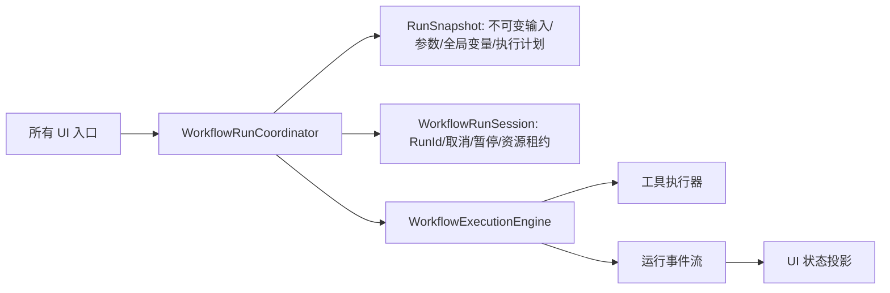

# 工作流执行架构审计

日期：2026-09-16  
范围：`WorkflowExecutionManager`、`WorkflowExecutionEngine`、`WorkflowRunSession`、`WorkflowContext`，以及工作流运行入口。  
结论：当前功能可用，但执行架构存在三项 P0 风险。它们会在长耗时工具、连续运行、多个工作流同时启动或用户在运行中修改输入时产生“停止无效、输入错轮、并发重叠、状态与实际执行不一致”。这不是某个工具的局部问题。

## 已确认的 P0 问题

### P0-1：外层停止令牌没有进入引擎会话

`WorkflowExecutionManager.StartContinuousRun` 为连续运行创建 `CancellationTokenSource`，并把该令牌传给 `ExecuteWorkflowInternal`（`src/UI/Services/Workflow/WorkflowExecutionManager.cs:165-188`）。但内部调用引擎时没有传入该令牌（同文件 `:411`）。

`WorkflowExecutionEngine.ExecuteWorkflowAsync` 会自行创建新的 `WorkflowRunSession` 与取消源（`src/Workflow/WorkflowExecutionEngine.cs:998-1028`），节点最终只读取这个内部会话的令牌（`:619-625`、`:962-969`）。因此，`StopContinuousRun` 取消的是循环与下一轮延时，不能保证取消当前正在执行的节点。

影响：长时间 HALCON 运算、相机取像或阻塞插件运行时，界面已显示停止，底层工具仍可继续运行。随后再次启动时可能与旧运行重叠。

### P0-2：所谓运行时输入快照未成为执行输入，反而改写了设计对象

管理器读取并记录 `RuntimeInputSnapshot`（`WorkflowExecutionManager.cs:389-402`），但调用引擎时仍传入 `null` 图像和未使用的 `runtimeParameters`（`:411`）。随后它递归读取 WPF `ImageInputSource`，直接写入设计节点 `Parameters.FilePath`（`:497-540`），再由执行引擎克隆参数。

这意味着：

- 本轮输入快照只是日志，未进入 `WorkflowContext` 或工具参数；
- 运行过程修改方案设计数据，运行和保存的边界混在一起；
- 输入源切图、并发运行、加载方案与保存方案可能互相影响；
- `AGENTS.md` 中“输入、参数、全局变量在执行开始时以快照传递”的约束目前没有真正落实。

影响：这是此前“工作流运行与工具调试显示/结果不同、继承区域与绘制区域组合时表现异常”一类问题反复出现的根源之一。

### P0-3：引擎声称单会话，宿主却每轮创建新引擎并允许多工作流并发

`WorkflowExecutionEngine` 用 `_sessionGate` 拒绝同一实例内的并发根运行（`WorkflowExecutionEngine.cs:1002-1013`）。但 `WorkflowExecutionManager` 每次执行都 `new WorkflowExecutionEngine(_workflowEngine, ...)`（`WorkflowExecutionManager.cs:350-353`）。因此这把锁只保护该次短生命周期实例，并不能保护共享的 `_workflowEngine`。

同时，`StartAllWorkflowsRun` 使用 `Task.WhenAll` 并行启动所有根工作流（`WorkflowExecutionManager.cs:248-254`）。多个运行会共同读取同一个工作流定义，并可能同时接受 UI 编辑与输入源更新。

影响：引擎对“只允许一个根运行”的承诺与宿主实际行为矛盾。运行相机、共享图像、共享变量或同一插件时，结果没有确定性。

## P1 架构问题

### P1-0：节点“并行组”目前只是拓扑批次，组内实际串行

节点顺序由 Kahn 拓扑分层决定：入度为零的节点先进入同一批次，只有本批次全部处理后才会产生下一批次（`src/Workflow/Workflow.cs:618-674`）。工作流引擎又按批次顺序 `await`（`src/Workflow/WorkflowExecutionEngine.cs:140-174`）。

`ExecuteNodesInParallel` 的名称和注释与实现不符。组内节点先通过 `SortNodesByDependencies` 排序，随后在 `foreach` 中对每个 `ExecuteNode` 逐个 `await`（`WorkflowExecutionEngine.cs:336-386`）；项目中没有对这些节点使用 `Task.WhenAll`、`Parallel` 或任务调度器。因此同组节点**不是真并行**。

这在当前阶段反而避免了 `WorkflowContext` 中普通 `Dictionary` 被并发写入的竞态，也保证了结果显示的确定性；但会让互不依赖的工具、多个独立图像分析分支和多个图像载入节点被无谓串行化。

建议分两步优化：

1. 近期先更名为“拓扑执行批次”或“执行层”，移除“同组并行”的误导性日志/注释，并让计划器明确输出每个节点的依赖与资源需求。
2. 在 P0 快照与会话边界修复后，再引入**受资源约束的并发调度器**：只对依赖已满足、无共享资源、工具声明为线程安全的节点使用 `Task.WhenAll`；每个节点写入独立结果槽，批次完成后一次性合并到上下文。相机、图像显示、HALCON 非线程安全算子及单例插件必须用资源键串行化。

不能直接把当前 `foreach` 改为 `Task.WhenAll`，否则 `WorkflowContext` 的节点状态/结果字典、日志、工具实例和 UI 事件会产生竞态，结果可能比当前更不稳定。

### P1-1：运行状态有三套真相源

- `WorkflowExecutionManager`：`_activeWorkflowIds`、`_cancellationTokens`、`_runningTasks`；
- `WorkflowExecutionEngine`：`_activeSession`；
- UI 画布节点：`WorkflowNode.Status`。

三者没有共同的 `RunId` 和生命周期事件契约。管理器还直接把引擎事件写进 UI 节点（`WorkflowExecutionManager.cs:363-387`）。这会让“已停止/实际仍运行”“画布状态覆盖判定状态”“无法精确对应某次运行日志”成为长期维护问题。

### P1-2：执行层依赖 UI 编辑对象

管理器位于 UI 项目，却承担输入解析、运行调度、节点状态写回、子程序递归输入注入。`InputSource` 是 UI 的 `ImageInputSource`，运行时逻辑依赖它（`WorkflowExecutionManager.cs:524-539`）。这使工作流引擎无法脱离 WPF 复用，也令后台执行不得不绕回 UI 线程。

### P1-3：冻结范围不完整

工具参数通过 `ToolParameterSnapshot.Create` 冻结（`WorkflowExecutionEngine.cs:714-729`），但 `ParamSettings` 直接引用设计对象（`:731-732`）。全局变量也以可变字典引用直接挂入 `WorkflowContext`（`:619-625`）。因此用户运行中编辑绑定或全局变量时，当前运行仍可能看到新值。

### P1-4：名称与实现不一致的“并行组”

`GetParallelExecutionGroupsByChains` 生成拓扑层（`Workflow.cs:618-674`），但 `ExecuteNodesInParallel` 对组内节点按拓扑顺序逐个 `await` 执行。当前并非真正并行。名称本身不是故障，但它会误导未来在未使 `WorkflowContext` 线程安全的情况下贸然并行化；该上下文中的字典没有同步保护（`WorkflowContext.cs:199-204`、`:576-632`）。

## 目标架构

### 必须满足的约束

1. **一次运行只有一个 `RunId` 和一个 `WorkflowRunSession`。** 协调器创建会话，执行引擎接收会话；引擎不得再私建第二个取消边界。
2. **设计定义与运行计划分离。** `Workflow`/节点/绑定配置是可保存的定义；运行开始时编译出只读 `ExecutionPlan`。任何运行都不得写 `Parameters.FilePath` 或 UI 节点。
3. **输入、参数、全局变量一次性进入 `RunSnapshot`。** 图像加载工具从快照解析本轮路径/图像，运行中 UI 切图只影响下一轮。
4. **并发是显式策略。** 默认同一根工作流只允许一个运行；“运行全部”必须按资源租约决定串行或并行，不能由 `Task.WhenAll` 暗中决定。相机、图像空间、插件实例必须声明资源键。
5. **UI 只订阅事件。** UI 通过 `RunId` 把事件投影成画布状态、日志和结果；不参与调度，也不持有运行真相。
6. **子程序是同一会话的子作用域。** 子作用域共享父取消令牌、RunId 和快照，只增加 `ScopeId`、父作用域 ID 和局部变量层。

## 修复顺序

### 第一阶段：先消除 P0（应优先实施）

1. 增加 `RunRequest`、`RunSnapshot` 与由协调器创建的 `WorkflowRunSession`。
2. 让 `ExecuteWorkflowAsync` 接收外部会话/令牌，删除内部重新创建会话的路径；连续运行的停止操作直接调用该会话的 `RequestStop`。
3. 把 `RuntimeInputSnapshot`、运行参数和全局变量复制进 `WorkflowContext`；删除 `InjectFilePathFromInputSource` 对设计节点的写入。
4. 在修复期间，`StartAllWorkflowsRun` 改为串行，或引入明确的资源调度器后再允许并行。

### 第二阶段：收敛生命周期与 UI

1. 将 `WorkflowExecutionManager` 演进为不依赖 WPF 的 `WorkflowRunCoordinator`，放入应用/工作流执行层。
2. 统一 `RunStarted`、`NodeStateChanged`、`RunCompleted` 事件，其中每条事件包含 `RunId`、根工作流 ID、作用域 ID、节点 ID、时间与状态。
3. UI 只在 Dispatcher 上消费事件，更新展示模型；运行结果保留在按 `RunId` 索引的结果仓库。

### 第三阶段：明确并发和并行

1. 对工具声明线程模型和资源键：独占相机、共享图像只读、插件实例单线程等。
2. 只有 `WorkflowContext`/结果仓库改为并发安全，并完成确定性测试后，才把同一拓扑层真正并行化。
3. 失败、跳过、NG 判定和取消分别建模，避免用 UI 文本状态驱动流程。

## 建议验收

完成第一阶段后，至少覆盖：

1. 长耗时节点运行中点击停止，当前节点收到取消并且不会启动下一轮；
2. 连续运行切图后，每轮日志记录的快照版本与图像加载节点实际使用的路径一致；
3. 运行中修改参数/绑定/全局变量，只影响下一次运行；
4. 两个根工作流尝试共享相机或同一图像输入时，系统按资源策略拒绝、排队或串行，且日志可定位 RunId；
5. 子程序的停止、异常、结果回传均保持同一根 RunId。
