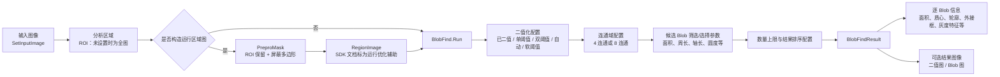

# VM Blob 高层处理流程（来源分层版）

目标：回答“像 HALCON Blob 一样，VM Blob 从图像到对象结果大致经历什么处理环节”。本文只描述功能流程和数据对象，不描述底层算法实现。

## 已有来源支持的流程

**阅读图时的证据边界：** 实线表达 SDK 公共接口、样例调用顺序和随包参数架构所支持的高层数据流；`BlobFind.Run` 内部的阈值计算、连通域扫描、孔洞处理、筛选执行先后及排序实现，现有这些材料没有给出算法函数体。因此图中的阈值、连通域、筛选和排序是“支持的参数/结果阶段模型”，不是对二进制内部执行先后的逐指令证明。

## 逐阶段依据

1. **输入与区域。** `BlobFindCpp.h` 的 `IBlobFindTool` 定义 `SetInputImage`；`SetROI` 文档说明 ROI 可为空（默认全区），支持矩形、扇环、多边形。SDK 样例先设置输入图，再从主视图取得当前 ROI 的最新形状信息并调用 `SetROI`，无 ROI 时传 `NULL`。
2. **可选运行区域图。** SDK 样例有屏蔽形状时，先清空 `PreproMask` 区域、设置同一输入图，把 Blob ROI 作为感兴趣区 (`true`)，把屏蔽多边形作为非感兴趣区 (`false`)，运行 PreproMask，然后把其输出传给 Blob 的 `SetRegionImage`；无屏蔽区时传 `NULL`。`PreproMaskCpp.h` 明确 `true` 表示感兴趣区域、`false` 表示屏蔽区域。Blob 头文件说明该 RegionImage 与其生成时的 ROI 必须一致，并将该接口关联用途描述为优化算子运行效率。故此图将它画作辅助路径，不将其断言为另一套 Blob 算法输入语义。
3. **阈值与连通性配置。** 随包 `paramKey/BlobFind.xml` 明确列出阈值模式：输入已是二值图、单阈值、双阈值、自动阈值、固定软阈值、相对软阈值；另有二值化极性、低/高阈值、软阈值参数。该文件还定义连通类型 `8` 和 `4`。这确认软件暴露这些配置项；并未暴露其算法实现或精确执行次序。注意极性枚举存在别名和名称/说明不一致，本文不推断枚举数值的亮暗含义。
4. **候选对象的选择和排序。** 同一参数文件定义孔洞最小面积、面积查找开关/上下限、最大 Blob 个数、排序特征与升/降序/不排序，并包含周长、长短轴、轴比、圆度、矩形度、Box 角度、宽高、质心偏移等特征开关/限制/权重。它证明参数和结果维度存在，无法单独证明阈值边界细节、权重公式、多个过滤条件的合并规则或应用先后。
5. **执行与结果。** SDK 样例按输入/区域设置后，从 `GetBasicParam()` 设置 `SetShowBlobImageStatus(true)`，调用 `Run()`；随后取得 `GetResult()`。样例显示 Blob 图像并刷新渲染控件，读取 Blob 数量，并逐项读取 BlobInfo：轮廓点、面积、周长、质心、角度、长短轴、圆形度、矩形度、最小/最大灰度、灰度对比度和 Box。头文件还公开 `GetBinaryImage()`、`GetBlobImage()` 和 `GetBlobTotalArea()`；基本参数说明二值图/Blob 图可设为不输出以加速。因此这两类图是可选结果输出，不是保证每次都生成。

## VM 主程序模块与 SDK 样例的区别

反编译的 `IMVSBlobFindModuTool` 托管包装器里，模块 `Run()` 调用框架 `SyncSelfRun(ID)`；`ModuResult` 通过 `QueryModuleOneResult(ID)` 和 `SetModuleResult(...)` 取得框架结果。它说明主程序模块的执行/取结果边界，但包装器本身没有展开 SDK 参数装配或原生算法步骤。

因此，上图可作为**“已恢复到 SDK/API 和参数层的 Blob 功能流程”**供主程序方案参考；不能冒充 VM 插件模块每条参数绑定和原生执行细节已经完全闭合。若要将其作为严格复现规格，还需从 `IMVSBlobFindModu.dll` / `MVDBlobFindCpp.dll` 继续恢复配置字段到 `SetRunParam`、ROI、Mask/RegionImage 的逐项绑定，并与 VM 主程序运行探针核对。

## 来源与身份

| 来源 | 路径 | SHA-256 | 可证明范围 |
|---|---|---|---|
| Blob C++ 公共接口 | `MVDAlgorithmSDK/Includes/Algorithms/BlobFindCpp.h` | `4305608BC0BF620C85BCAF5862A34D39F2F96218B8064B438ED6BD81F3C2C805` | 接口、ROI 文档、结果字段、二值图/Blob 图输出开关、RegionImage 优化说明 |
| Blob SDK 示例 | `MVDAlgorithmSDK/Samples/Cpp/BasicSamples/MVD_GeoFind/BlobFindCppDemo/src/BlobFindCppDemoDlg.cpp` | `2EA4AB0A689319168EC02E31096B14EBA6C7468C7B15CE7513E298FB2BCC13A3` | 示例中的对象创建、输入/ROI/Mask/RegionImage 装配、Run 与结果消费顺序 |
| Blob 参数键定义 | `MVDAlgorithmSDK/MVDTools/ExportMVDCode/components/data/paramKey/BlobFind.xml` | `3AF9DBA5B328888E13F7CCF66C74C257E61B6A2D5FA6B81BFE77489AFEC6B7EC` | 阈值、极性、4/8 连通、孔洞、筛选/排序参数名称与声明值 |
| PreproMask 公共接口 | `MVDAlgorithmSDK/Includes/Algorithms/PreproMaskCpp.h` | 本次未单独固定散列 | `AddRegion` bool 的感兴趣/屏蔽语义、输出图接口 |
| 反编译托管包装器 | `analysis/selfdev-support/VM-CONTROL-BLOB-ASSEMBLY-20261024/root/IMVSBlobFindModuTool.decompiled.20261026.cs` | `08AF033551889B440AD4CBCCF1921C5C1C6144C2547B77F3A39A6FECC6BF1F74` | VM 模块 `Run`、结果对象与框架服务边界；反编译产物而非原始源码 |
