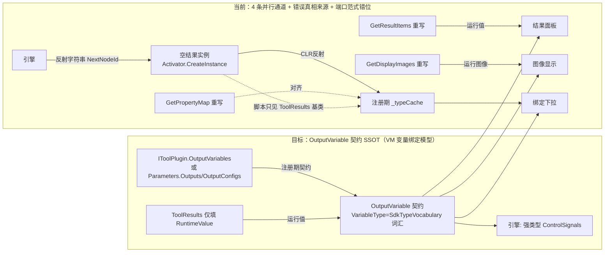
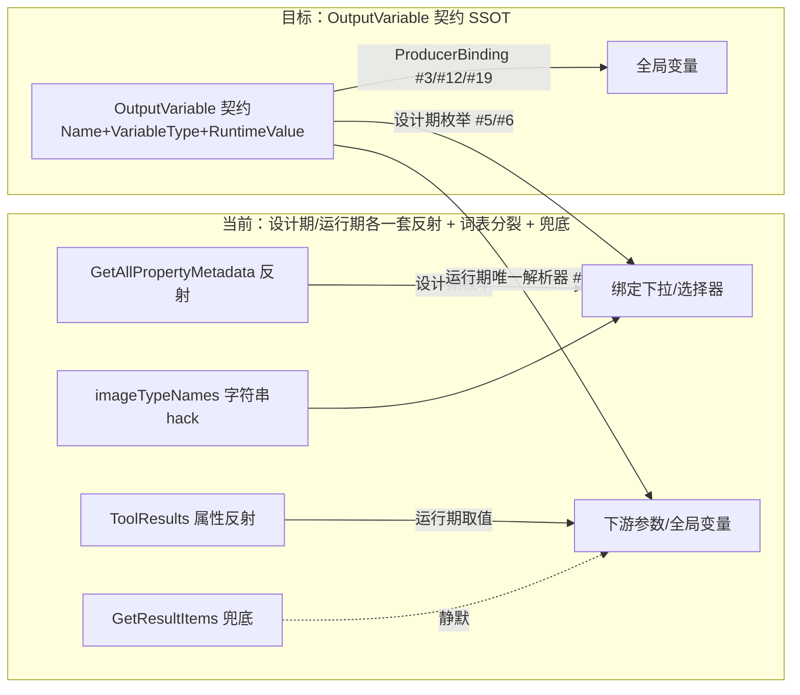

# 输出变量契约统一重构 — 最终方案设计

> 参考系：**海康 VisionMaster（流程驱动 + 数据变量绑定模型）**。范围：**全量统一**（脚本 / 子程序 / 条件分支 / 普通工具走同一条输出变量契约）。本文档为方案设计，**未改动任何代码**。
>
> **概念澄清（关键修正）**：当前架构参考的是 VisionMaster 的**数据变量绑定**模型——工具输出**变量（名 + 类型）**，下游在参数面板选 `模块名.变量名` 绑定，**没有"端口"概念**，更没有"端口连线"。因此本方案统一使用 **`OutputVariable`（输出变量）** 而非 `OutputPort`；"端口暴露 / 端口连线"是 LabVIEW 节点编辑器（数据流连线）模型的范式，不适用于本架构。连 `SdkTypeVocabulary` 的命名（全局**变量**类型）也都印证这是变量模型。

---

## 一、改前 → 改后 → 依据（用户功能性视角）

### 改前（用户看到什么）
| 工具 | 图形显示 | 结果面板 | 下游变量绑定 |
|---|---|---|---|
| 普通工具（ImageLoad/Threshold） | ✅ 能选图像 | ✅ 列出数值 | ✅ 能绑定 |
| **脚本工具** | ❌ 声明了 `Outputs` 变量，运行产出的图像看不到 | ❌ 数值不出现 | ❌ 绑不上 |
| **子程序** | ⚠️ 图像能显示 | ⚠️ 变量时有时无 | ⚠️ 运行期新增输出绑不上 |
| **条件分支** | ⚠️ 残留旧图 | ❌ `NextNodeId`（控制信号）被当数据变量显示 | ❌ 误入绑定候选 |

用户明明在设计时已经声明了脚本/子程序的输出变量，但这些变量在图形显示、结果面板、绑定下拉里"三个地方各显示各的"，行为不一致。

### 改后（用户看到什么）
- **所有工具走同一条"输出变量契约"通道**：设计时声明的变量（脚本 `Outputs`、子程序 `OutputConfigs`）即契约，运行时只填值。
- 图形显示、结果面板、下游绑定**三个 UI 全部从同一份输出变量契约读取**，脚本/子程序/普通工具行为完全一致。
- 图像不再是特殊通道，而是"类型 = `Image` 的一种输出变量"；条件分支的 `NextNodeId` 被识别为**流程控制信号**，不再污染数据变量面板与绑定候选。

### 依据（业界参考，可追溯）
| 框架 | 关键特征 | 借鉴 |
|---|---|---|
| **海康 VisionMaster**（本项目参考系） | 模块输出=固定类型"变量"；脚本/子流程设计时声明变量；下游按"模块名.变量名+类型"绑定；图像即变量 | ✅ 变量即契约、来源于设计时参数、固定类型词汇 |
| **Cognex VisionPro** | 工具暴露强类型 `Outputs`（如 `CogBlobTool.Results`），按名+类型绑定 | ✅ 强类型变量 |
| **NI LabVIEW（子 VI connector pane）** | 子 VI 设计时定义 terminal，调用前即知类型 | ✅ 设计时即知变量类型（但本架构不采用其"端口连线"形态） |
| HALCON HDevelop | 全局变量 + `dev_display` 即时显示 | ⚠️ 不取全局变量模型（破坏数据流绑定），仅取"图像只是值"思路 |

**共同范式：变量即契约，契约来源于工具定义/参数（设计时已知），而非运行时结果实例的反射。** 本项目 `SdkTypeVocabulary` 已经是 VisionMaster 风格的"固定变量类型词汇表"，方案直接复用它，不另起炉灶。

---

## 二、调研记录（含来源标注）

### 文件分布
| 文件 | 行号 | 角色 |
|------|------|------|
| [来源] `src/Plugin.Infrastructure/Managers/Tool/ToolRegistry.cs` | 425-538 | **注册期元数据提取**：`Activator.CreateInstance(resultType)` 空实例（L438）+ 反射 CLR 属性（L454-533）+ 交叉 `GetPropertyMap()`（L459） |
| [来源] `src/Plugin.SDK/Execution/Parameters/DataSourceQueryService.cs` | 282-361 | `GetImageDisplaySources`：`imageTypeNames = {"IVisionImage"}`（L287）硬编码字符串特例（L298/334/350） |
| [来源] `src/Plugin.SDK/Execution/Parameters/DataSourceQueryService.cs` | 363-412 | `GetNodeOutputProperties`：从 `_metadataProvider.GetAllPropertyMetadata`（注册期元数据，L376）派生绑定候选 |
| [来源] `src/Plugin.SDK/Models/SdkTypeVocabulary.cs` | 14-39 | **VM 风格固定类型词汇表**：CLR `Type` ↔ `"Image"/"Double"/"Region"/…` 双向映射 |
| [来源] `src/Plugin.SDK/Models/SdkTypeVocabulary.cs` | 69-70 | `ToTypeVocabulary(type)` 未映射返回 `null`（rule-015 要求据此报错） |
| [来源] `src/Plugin.SDK/Models/SdkTypeVocabulary.cs` | 72-73 | `ToSystemType(typeName)` 字符串→CLR 类型还原 |
| [来源] `src/Plugin.SDK/Core/IToolPlugin.cs` | 73-141 | **工具插件接口**：仅 `ParamsType`/`ResultType`/`Run()` + 调试窗口方法，**无输出变量声明能力**（根因①） |
| [来源] `src/Plugin.SDK/Execution/Results/ToolResults.cs` | 402/408/576 | 三个虚方法 `GetDisplayImages`/`GetResultItems`/`GetPropertyMap` 基类默认实现 |
| [来源] `src/Plugin.SDK/Execution/Results/ToolResults.cs` | 461-503 | `ToDictionary()` 用反射把所有 public 属性倒腾进字典（第四套输出描述） |
| [来源] `src/Workflow/WorkflowExecutionEngine.cs` | 638-659 | `TryExtractNextNodeId`：**反射字符串属性 `GetProperty("NextNodeId")`** 消费控制信号（根因②/坏味道） |
| [来源] `tools/SunEyeVision.Tool.Script/Models/ScriptOutputConfig.cs` | 28-40 | 脚本变量声明 `TypeName`（全局变量类型字符串）+ `ParamType => ToSystemType(TypeName)` |
| [来源] `src/Plugin.SDK/Models/SubroutineOutputConfig.cs` | 23-34 | 子程序变量声明 `TypeName` + `ParamType => ToSystemType(TypeName)` |
| [来源] `tools/SunEyeVision.Tool.Script/ScriptTool.cs` | 90-93 | `Run()` 只把运行值塞进 `result.OutputValues`，**未把 `parameters.Outputs` 传给结果** |
| [来源] `tools/SunEyeVision.Tool.Script/Models/ScriptResults.cs` | 37-62 | 仅重写 `GetResultItems()`，未重写 `GetDisplayImages`/`GetPropertyMap` |
| [来源] `src/Plugin.SDK/Execution/Results/SubroutineResults.cs` | 24-66 | 重写三件套，但依赖运行期 `ResolvedOutputValues`/`OutputConfigs` |
| [来源] `tools/SunEyeVision.Tool.Condition/Models/ConditionResults.cs` | 21-39 | `NextNodeId`（控制信号）被暴露为"数据结果项" |
| [来源] `src/UI/ViewModels/MainWindowViewModel.cs` | 3815-3852 | `UpdateModuleResults` 以注册期 `_typeCache` 为权威，再运行期 patch 合并 `result.GetPropertyMap()` |
| [来源] `src/Plugin.Infrastructure/Managers/Tool/PropertyMetadataProviderAdapter.cs` | 29-34 | `IPropertyMetadataProvider` 桥接 `ToolRegistry.GetAllPropertyMetadata`（=注册期缓存） |

### 无依据推断
- [推测] 普通静态工具（ImageLoad/Threshold 等）当前已有 `GetPropertyMap()`（声明性映射，不依赖实例值）+ `ResultType` CLR 类型，框架可**自动派生**输出变量契约，无需逐工具手写声明。具体每个静态工具的变量清单需在实施阶段逐一确认（调研未逐工具展开）。

---

## 三、架构完整性评审（架构师视角）

> 用户指出：本架构为零散实现、未经架构师完整性分析；且参考的是 **VisionMaster"流程驱动 + 数据变量绑定"模型**，没有"端口"概念。本节对**与输出契约直接相关的三块**（工具插件接口 / 输出变量模型 / 工作流引擎执行逻辑）做系统性拆解与对标，给出"保留 / 重构"判断，并将分析落到具体代码行（限定范围，不发散无关模块，遵循 rule-008 YAGNI）。

---

### 3.1 工具插件接口设计分析（`IToolPlugin`）

**接口当前成员与职责划分**（`src/Plugin.SDK/Core/IToolPlugin.cs:73-185`）：

| 成员 | 类型 | 职责类别 |
|---|---|---|
| `ParamsType` / `ResultType` | 属性（CLR `Type`） | 执行契约（元数据） |
| `Run(ToolParameters)` | 方法 | 执行契约（算法入口） |
| `HasDebugWindow` / `CreateDebugWindow` / `CreateDebugControl` / `CreateDataAnalysisControl` | 默认方法返回 null/控件 | **UI 展示契约**（调试窗 / 数据分析 Tab） |
| `GetDefaultParameters()` | 默认方法，`Activator.CreateInstance(ParamsType)` | 配置 |

泛型版 `IToolPlugin<TParams,TResult>`（L156-185）用**显式接口实现**做类型安全桥：`IToolPlugin.Run` 内部 `if (parameters is TParams) return Run(typed); else throw`，把框架容器需要的非泛型接口与实际泛型 `Run` 衔接——这是标准类型擦除补偿（对标 `IEnumerable`/`IEnumerable<T>`），设计合理。

**设计取舍评估（逐条）**：

1. **"一个类 = 一个工具"极简风格**（L46-71 注释明确）：开发者只标 `[Tool]` 特性 + 实现 `Run`，调试 UI 可选重写。开发体验好，符合视觉软件"工具即插件"的直觉。**保留**。
2. **元数据声明体系已存在但漏了"输出变量"**：`[Tool]` 特性已集中声明 `Name/Description/Category/Icon/Version`，框架靠反射获取（L49-50）。这说明作者**已意识到工具元数据应集中声明**，却**唯独没把"输出变量"纳入这个声明体系**——输出发现被迫退化为运行期反射 `ResultType` 属性（见 3.2）。这是**设计一致性断裂**，不是能力缺失。**重构点**。
3. **接口职责混合执行 + UI**：一个接口同时承担"算法执行契约"和"调试/数据分析 UI 契约"。业界（VisionPro `CogTool` 与 `CogToolEditor` 分离、LabVIEW 子 VI 不含 UI 渲染）倾向**接口隔离（ISP）**。但本架构的"极简单类"取向使合并有合理性。**本轮不拆**（属 YAGNI 红线外的可选审视，见 3.5），仅记录。
4. **`GetDefaultParameters()` 用 `Activator.CreateInstance(ParamsType)`**（L140）：反射实例化，与 `ToolRegistry` 的 `Activator.CreateInstance(resultType)`（L438）是同一类"反射空实例"味道——正是输出发现层 bug 的同源问题（3.2）。**随输出契约重构一并消除**。
5. **默认接口方法返回 null/true 安全默认**（L89/92/112/137）：框架对 null 有 null 检查，属"UI 可选性"而非"类型映射兜底"（不违反 rule-015）。**保留**。

**对标与结论**：

| 维度 | VisionPro `CogTool` | LabVIEW 子 VI | 本架构 `IToolPlugin` |
|---|---|---|---|
| 输出变量 | 强类型 `Outputs`（设计期即知） | connector pane（仅取"即知类型"思想） | ❌ 仅 `ResultType` CLR 类型，靠反射发现 |
| 元数据声明 | 特性/属性 | 前面板控件 | ✅ `[Tool]` 特性（但漏输出变量） |
| UI 与执行 | 分离（Editor 独立） | 分离（独立 VI） | 合并（极简，可接受） |

→ **保留**：泛型类型安全桥、`[Tool]` 元数据模式、图像输入由参数绑定框架统一管理（`ResolvedInputImage`，符合 VM 数据绑定）。
→ **重构**：输出变量声明上提到 `IToolPlugin`（与既有 `[Tool]` 元数据声明体系一致，不另起炉灶），消除运行期反射发现输出。

---

### 3.2 输出变量模型设计分析（`ToolResults`）

**现状**（`src/Plugin.SDK/Execution/Results/ToolResults.cs`）：`GetDisplayImages()`/`GetResultItems()`/`GetPropertyMap()` 三个虚方法（L402/408/576），每个 Results 子类必须**手动对齐重写三遍**；`ToDictionary()`（L461-503）再用反射把 public 属性倒腾进字典——共 **4 套输出描述**，且真相来源是 `ToolRegistry` 的 **`Activator.CreateInstance(resultType)` 空实例反射**（L438）。

**核心缺陷**：输出"Schema"被锁死在**运行期结果类型的反射**上。动态工具（脚本/子程序）的结果类型只是基类 `ToolResults`（L55 摘要），反射只能看到基类属性（`Dictionary<string,object?>`），它们真正规范的变量契约（`Parameters.Outputs`/`OutputConfigs`，已是全局变量类型字符串）从未被输出发现层读取——这就是你看到 bug 的真因。

**对标**：VisionMaster 每个模块输出变量（名+类型）由工具定义统一给出，UI 三处（显示/面板/绑定）读同一份，不存在"重写三个方法对齐"。**重构**：引入 `OutputVariable` 契约 SSOT，三虚方法退化为框架基于契约的默认实现，子类不再手写；静态工具从 `GetPropertyMap`（声明性）+ `ResultType` 类型元数据自动派生，动态工具从 `Parameters` 注入。

---

### 3.3 工作流引擎执行逻辑分析（`WorkflowExecutionEngine` + `Workflow`）

**主执行路径**（全部有代码依据）：

1. **拓扑分层驱动**（`Workflow.cs:616-673` `GetParallelExecutionGroupsByChains`）：用 **Kahn 算法按入度分层**——入度为 0 的节点入队，逐层出队，同层归为一个"并行组"。每一层 = 一个组。
2. **"并行"是名不副实的**（`WorkflowExecutionEngine.cs:251-306` `ExecuteNodesInParallel` 注释自承 *"为支持参数绑定解析，组内节点按依赖顺序执行"*）：**组内实际是顺序执行**，只有"组间按拓扑层推进"。注释与命名（`ParallelGroups`/`ExecuteNodesInParallel`）**有误导性**。对"流程驱动"模型本身 OK（VM 也顺序跑），但命名应澄清。
3. **条件分支的实现机制（核心架构脆弱点）**：
   - 条件节点 `Run()` 返回 `ConditionResults`，含 `NextNodeId`（`string`）属性（`tools/SunEyeVision.Tool.Condition/Models/ConditionResults.cs:21-39`）。
   - 引擎在**每组执行完后**调用 `TryExtractNextNodeId`（L638-659），**反射** `resultType.GetProperty("NextNodeId")` 取字符串值（L647-650）。
   - 下一组执行前用 `forcedNextNodeId` **过滤该组**：只保留目标节点，其余标记 `Skipped`（L143-160）。
   - **致命约束**：分支**只在"并行组边界"生效**。若条件节点与目标节点落在**同一拓扑层（同一组）**，组间过滤无法分开它们，分支逻辑**静默失效**。即分支正确性**依赖图的拓扑形态**，而非显式分支边。
   - 同时 `NextNodeId` 既是**结果对象的属性**（进 ConditionResults → 进数据面板/绑定候选，即你发现的"控制信号被当数据变量"bug），又是**控制流信号**——引擎靠反射魔法字符串把它抠出来。这是"控制流/数据流未分离"的典型症状。
4. **工作流连接模型无分支概念**（`Workflow.cs:686-727` `WorkflowConnection`）：只有 `SourceNodeId`/`TargetNodeId` + 固定字符串 `SourcePort="output"`/`TargetPort="input"` 端口标签。连接是**纯执行顺序/数据流传递**，**没有"条件边/分支标签"**。即本架构的"流程驱动"里，分支完全靠**条件节点在结果对象里输出一个节点 ID 字符串来劫持执行顺序**——是"流程框架里塞结果对象回调控制流"的 hack。
   - ⚠️ **概念澄清（避免再次错位）**：`WorkflowConnection.SourcePort/TargetPort` 虽有 "Port" 字样，但那是**连线两端的 UI 标签**（output/input），**不是 VisionMaster 的"变量端口"**，也不是 LabVIEW 的 connector pane。在"数据变量绑定"层面，本架构**确实没有端口概念**——变量绑定是参数面板独立选 `模块名.变量名`，与连线无关。你的判断准确。

**对标与结论**：

| 维度 | VisionMaster | 通用 DAG 引擎（如 Airflow/Temporal） | 本架构 |
|---|---|---|---|
| 执行驱动 | 拓扑/执行链顺序 | DAG 调度 | ✅ Kahn 分层（合理） |
| 分支 | 连线带条件/分支边 | 条件边 | ❌ 靠结果对象输出节点 ID 字符串 hack |
| 控制流/数据流 | 分离（引擎职责） | 分离 | ❌ 混合（NextNodeId 进数据结果） |
| 分支生效范围 | 显式边，确定 | 显式边，确定 | ❌ 依赖拓扑层形态（脆弱） |

→ **保留**：Kahn 拓扑分层驱动、统一 `AlgorithmNode` 执行所有节点、图像/数据绑定在执行期从 `nodeResults` 字典解析（VM 数据绑定核心，正确）。
→ **重构（强类型化，轻量治本）**：`NextNodeId` 不应是条件结果对象里的反射字符串魔法属性，应提升为**引擎一等概念**——新增 `IControlFlowResult` 接口（`string NextNodeId { get; }`），`ConditionResults` 实现它；引擎改读 `if (result is IControlFlowResult cfr) forcedNextNodeId = cfr.NextNodeId`，删除反射（L647-650）；`NextNodeId` 从数据结果契约里剔除（控制信号隔离）。**不采用"连接线带条件"彻底方案**（改动大、当前"连接无分支"是有意取舍，按 YAGNI 不纳入本轮）。
→ **命名修正（低危）**：`ParallelGroups`/`ExecuteNodesInParallel` 应重命名或注释澄清"组内顺序、组间分层"，消除误导。

---

### 3.4 评审结论汇总

| 对象 | 结论 | 对方案的影响 |
|---|---|---|
| `IToolPlugin` 输出变量缺位（与 `[Tool]` 元数据体系不一致） | 重构 | 接口增加 `OutputVariables` 声明（工具定义层一等公民） |
| `ToolResults` 4 套输出描述 + 空实例反射 | 重构 | 统一 `OutputVariable` 契约 SSOT + 框架默认实现 |
| 引擎反射 `NextNodeId` + 只在组边界生效 + 控制/数据流混合 | 重构（强类型，轻量） | 新增 `IControlFlowResult` 接口；引擎读接口而非反射；`NextNodeId` 隔离出数据变量 |
| Kahn 拓扑分层 / 统一 AlgorithmNode / 执行期绑定解析 | **保留** | 不动 |
| 接口隔离（执行 vs UI） / 连接线带条件 | 可选审视（不纳入本轮） | 记录，YAGNI |

### 3.5 可选审视（本轮不做，仅记录，避免发散）

- **接口隔离**：`IToolPlugin` 拆 `IToolExecution`（Params/Result/Run）+ `IToolDebugUI`（调试/数据分析）。当前"单类极简"取向可接受，暂不拆。
- **连接模型带条件边**：在 `WorkflowConnection` 增加 `Condition` 表达式，条件节点输出布尔分支，引擎按出边条件走。改动大且与"连接仅表执行顺序"的有意设计冲突，YAGNI 不纳入。
- **真并行**：组内按依赖关系真正并发。当前顺序执行对流程驱动无功能影响，且参数绑定解析需要上游先完成，收益低，不动。

---

## 四、问题分析（Phase 0）

### Step 1 — 根本问题
- **表面需求**：脚本/子程序声明的输出变量，在图形显示/结果面板/绑定下拉里对不上。
- **根本问题**：输出发现层用错误的真相来源，把"输出 Schema"锁死在运行期结果类型反射上，且输出变量契约不是工具定义的一等公民。
- **问题分类**：**架构冗余 + 实现方式有误 + 概念模型错位**（4 条并行通道描述同一件事；且误用"端口"范式，正确应为"变量"）。

### Step 2 — 架构分配检查
- 最自然归属层：**Plugin.SDK 的输出变量契约层**（变量概念应是一等公民，来源于 Parameters/代码声明）。[来源] `ScriptOutputConfig.cs:28-40`、`SubroutineOutputConfig.cs:23-34` 已证明"变量契约"活在 Parameters 层。
- 是否重复：**是**。当前"输出描述"分散在 4 处（见下），必须收敛。
- 不改能否覆盖：**否**。反射空实例对动态工具只能看到基类 `ToolResults` 属性（`Dictionary<string,object?>`），无论怎么补虚方法都补不齐。
- 是否改变分层边界：**否**（在既有 SDK 契约层内收敛，复用 `SdkTypeVocabulary`）。

### 当前 4 条并行输出描述通道（根因结构）
| 通道 | 定义位置 | 数据来源 | 驱动 |
|---|---|---|---|
| ① 反射 CLR 属性（空实例） | `ToolRegistry.cs:454-533` | `Activator.CreateInstance` 空实例反射 | 绑定下拉/结果树/图像源 |
| ② `GetPropertyMap()` | 各 Results 子类 | 声明性映射（不依赖值） | 注册期元数据 + 运行期 patch |
| ③ `GetResultItems()` | 各 Results 子类 | 运行期值 | 数据面板 |
| ④ `GetDisplayImages()` | 各 Results 子类 | 运行期图像值 | 图像显示 |
| ⑤ `ToDictionary()` 反射 | `ToolResults.cs:461-503` | public 属性反射 | 第四套 |

### Step 3 — 方案对比（≥3 候选）
| 维度 | 方案 A+（推荐·根治） | 方案 B（最小补齐） | 方案 C（变量契约+运行时推断） |
|---|---|---|---|
| 做法 | 引入 `OutputVariable` 契约 SSOT（声明上提到 `IToolPlugin`）；`VariableType` 复用 `SdkTypeVocabulary` 词汇；4 通道退化为默认实现；引擎强类型读控制信号 | 仅把子程序的 `GetDisplayImages`+`GetPropertyMap` 抄到 `ScriptResults` | 同 A+，额外加运行时类型推断兜底 |
| 架构一致性 | ✅ 符合 VM"变量即契约" | ❌ 各工具各写各的 | ✅ 最完整 |
| 解决根因（Schema≠结果类型） | ✅ 契约来自工具定义/Parameters | ❌ 未触及 | ✅ |
| 复用既有设施 | ✅ 直接吃 `SdkTypeVocabulary` + `GetPropertyMap` 声明 | ⚠️ 部分 | ✅ |
| 未来新增动态工具 | 只需声明变量 | 必再踩坑 | 只需声明变量 |
| 改动量 | 中（SDK 契约层 + 接口声明 + 引擎强类型化 + 4 工具适配） | 小（2 文件） | 大 |
| 长期 ROI（3 年） | 高（免维护） | 低（技术债累积） | 高但当前无纯动态未声明场景，过度设计 |

**推荐方案 A+**：治本、复用 `SdkTypeVocabulary` 与既有 `GetPropertyMap` 声明、改动可控、保留现有健全部分（per-tool 结果对象、DisplayCollector、`ToolRegistry` 注册、工作流引擎）。方案 C 的"运行时推断"当前无明确需求，按 rule-008 YAGNI 不纳入。

---

## 五、Bug 模式分析（Phase 0.5）

**当前 bug**：脚本/子程序设计时声明的输出变量，在 UI 三处（图形显示/结果面板/绑定）对不上、缺失或不一致。

**真因分类**：**设计缺陷（架构层面注定出问题）** + **契约漏洞（变量声明与输出发现层无契约保护）** + **概念错位（误用端口范式）**。

**同类潜伏点**（凡"从结果类型反射推导 Schema"或"图像字符串特例"或"反射魔法字符串"处均潜伏）：
- [来源] `ToolRegistry.cs:438` — `Activator.CreateInstance` 空实例反射，对**所有动态工具**必然丢变量（不止脚本，未来任何动态工具都会踩）。
- [来源] `DataSourceQueryService.cs:298/334/350` — `imageTypeNames.Contains(...)` 图像字符串特例，任何"非 CLR `IVisionImage` 属性但语义是图像"的变量都会被漏掉。
- [来源] `WorkflowExecutionEngine.cs:638-659` — 反射 `GetProperty("NextNodeId")` 字符串属性消费控制信号，约定脆弱。
- [来源] `MainWindowViewModel.cs:3835-3852` — 运行期 patch 合并 `GetPropertyMap()` 是对"注册期元数据不全"打的补丁，属症状级修补。
- [来源] `ConditionResults.cs:21-39` — 控制信号被当数据项，是"缺少数据变量 / 控制信号区分"这一模式的具体表现。

**治本点**：修复**"输出发现层的真相来源"**（改为工具定义/Parameters 声明的输出变量契约，复用 `SdkTypeVocabulary`），并把控制信号强类型化交给引擎，而非在 `ScriptResults` 上补重写虚方法这个症状点。

---

## 六、目标架构：统一 `OutputVariable` 契约（SSOT）

### 核心模型（`VariableType` 复用 VM 固定类型词汇，不是原始 `System.Type`）
```csharp
public sealed class OutputVariable
{
    public string Name;            // 工具内唯一
    public string VariableType;    // ★ 全局变量类型字符串："Image"/"Double"/"Region"…（复用 SdkTypeVocabulary）
    public string DisplayName;
    public string? Group;
    public OutputVariableKind Kind;// Data | ControlSignal（流程控制信号，如 NextNodeId）
    public object? RuntimeValue;   // 执行时填充
}
public enum OutputVariableKind { Data, ControlSignal }
```

### 契约来源（关键：来自设计时定义，不再来自空结果实例）
- **静态工具**：框架基于 `ResultType` 的 CLR 属性类型元数据 + `GetPropertyMap()`（声明性映射）自动派生 `OutputVariable`；`VariableType = SdkTypeVocabulary.ToTypeVocabulary(clrPropType)`；未映射 → `null` → **直接报错**（落实 rule-015）。
- **动态工具（脚本/子程序）**：契约 = `Parameters.Outputs`/`OutputConfigs` 的 `TypeName` —— **已是全局变量类型字符串，无需转换，直接作变量类型**。
  - ⚠️ **中文名/分组缺口（实施必补）**：当前 `ScriptOutputConfig` / `SubroutineOutputConfig` 仅有英文 `Name`（`C# 字段名`，合法标识符、不能中文）+ `TypeName`，**无 `DisplayName`、无 `Group`**。重构后若只映射 `TypeName`，脚本/子程序变量将只剩英文、全扁平无分组。治本：`ScriptOutputConfig` / `SubroutineOutputConfig` 各新增 `public string DisplayName { get; set; }` 与 `public string? Group { get; set; }`，并在变量编辑 UI 暴露；派生时 `OutputVariable.DisplayName = config.DisplayName`（空则回退 `Name`）、`OutputVariable.Group = config.Group`。详见修改清单 #7/#8/#9。

### 派生关系（4/5 条通道降级为基于契约的默认实现）
- 图像显示源 = `Kind==Data && VariableType=="Image"` 且有值 → **取代 `imageTypeNames.Contains` 特例**（DataSourceQueryService.cs:287/298/334/350）。
- 绑定下拉 = 所有 `Data` 变量，按全局变量类型字符串过滤（与既有 `ToTypeVocabulary` 一致）。
- 结果数据面板 = 所有 `Data` 变量（图像/区域走显示控件，不进数据树）。
- 结果树结构 = 契约本身（注册期即可见，因来自工具定义/Parameters，无需运行期 patch）。
- 控制信号 = `Kind==ControlSignal`，引擎强类型消费（分支），不进数据面板/绑定。



---

### 6.x 消费侧实现：模块结果树（UI）契约驱动

`MainWindowViewModel.UpdateModuleResults` 从"注册期空实例反射结构 + 显示期属性反射取值 + 两处静默兜底"改为"直读 `OutputVariable` 契约建结构 + 读 `RuntimeValue` 取值"——三处反射全部消失，静态/动态工具走同一条路。

> **概念澄清（非"中英映射"）**：之前中文显示名是开发者在 `GetPropertyMap()` 里**手写**的别名（`("ThresholdUsed","实际使用的阈值","参数回写")`），并非"英文→中文"自动映射表。统一契约没动"英文变量名→中文显示名"的对应关系，只把这份别名的声明从散点（反射空实例 + 手写 map 混合）收拢到 `OutputVariable.DisplayName` 一个 SSOT 字段，并让动态工具也获得声明能力。

**实现逻辑（伪代码）**：

```csharp
public void UpdateModuleResults(ToolResults? result, string? nodeName, string? toolId, string? nodeId)
{
    ModuleResultTree.Clear();
    HasModuleResults = false;

    // ① 结构 + 值 = 同一份契约（SSOT）。无 result 时仍可从工具定义拿到结构（空表头）
    IReadOnlyList<OutputVariable> variables = string.IsNullOrEmpty(toolId)
        ? []
        : (result?.GetOutputVariables()                 // 运行后：契约已填 RuntimeValue
           ?? ToolRegistry.GetOutputVariables(toolId));  // 未运行：仅结构，RuntimeValue=null

    if (variables.Count == 0) return;

    // ② 只保留数据变量、且非图像——用契约字段判断，不反射
    var dataVars = variables.Where(v =>
        v.Kind == OutputVariableKind.Data &&
        v.VariableType != "Image");

    var rootNode = new ModuleResultNode { DisplayName = nodeName ?? "结果", IsGroup = true, IsExpanded = true };

    // ③ 按 Group（'/' 分层）建组节点 —— 分组/递归逻辑原样保留
    var groupNodeCache = new Dictionary<string, ModuleResultNode>();
    foreach (var group in dataVars.GroupBy(v => v.Group ?? "其他").OrderBy(g => g.Key))
    {
        var currentParent = EnsureGroupPath(rootNode, group.Key, groupNodeCache); // 复用 Split('/') 递归

        foreach (var v in group)
        {
            // ④ 取值 = 直读契约 RuntimeValue，无反射、无字典兜底
            string displayValue = result != null
                ? FormatTypedValue(v.RuntimeValue, v.VariableType)   // 格式化按 VariableType 词表
                : "--";

            currentParent.Children.Add(new ModuleResultNode
            {
                DisplayName        = v.DisplayName,                    // ★ 中文显示名（来自契约）
                DisplayValue       = displayValue,
                PropertyName       = v.Name,
                SourceNodeId       = nodeId,
                SourcePropertyName = v.Name,
                PropertyClrType    = SdkTypeVocabulary.ToSystemType(v.VariableType),
                IsGroup            = false
            });
        }
    }

    PruneEmptyGroups(rootNode);   // 原逻辑保留

    if (rootNode.Children.Count > 0)
    {
        ModuleResultTree.Add(rootNode);
        HasModuleResults = true;
        BuildFlatRows();
    }
}
```

**删除**（3 反射 + 2 兜底 + 1 补丁）：`ReflectGetValue` 整体（属性反射 + try/catch 吞异常）、运行期 `GetPropertyMap()` 合并补丁（L3835-3852）、`GetResultItems()` 字典兜底取值（L3915-3918）、注册期空实例反射（`ToolRegistry` 侧，修改清单 #4）。
**保留**（纯 UI 逻辑，不动）：`GroupName.Split('/')` 递归建组、`groupNodeCache` 缓存、空组裁剪 `PruneEmptyGroups`、`FormatTypedValue`（入参从 `Type` 改为 `VariableType` 字符串）、`BuildFlatRows()` 扁平化。

**中文显示与分组保证**：
- 静态工具：`OutputVariable.DisplayName ← PropertyMapEntry.DisplayName`、`OutputVariable.Group ← PropertyMapEntry.Group`（`ThresholdResults.cs:202-229` 已带中文名 + 中文分组），原样继承。
- 动态工具：依赖 #7/#8/#9 补齐的 `DisplayName`/`Group` 字段，与静态工具同构。

---

## 七、修改清单（移交方案实施）

| # | 文件 | 变更类型 | 核心变更 | 前置依赖 |
|---|---|---|---|---|
| 1 | `src/Plugin.SDK/Execution/Results/OutputVariable.cs`（新增） | 新增 | 定义 `OutputVariable` + `OutputVariableKind` | 无 |
| 2 | `src/Plugin.SDK/Core/IToolPlugin.cs` | 修改 | 接口增加 `IReadOnlyList<OutputVariable> OutputVariables { get; }`（工具定义层一等公民）；默认实现从 `ResultType`+`GetPropertyMap` 自动派生 | 1 |
| 2b | `src/Plugin.SDK/Core/IControlFlowResult.cs`（新增） | 新增 | 定义 `interface IControlFlowResult { string NextNodeId { get; } }`；条件结果实现此接口，**引擎据此强类型读取分支信号**，取代反射 `GetProperty("NextNodeId")`（L647-650） | 无 |
| 3 | `src/Plugin.SDK/Execution/Results/ToolResults.cs` | 修改 | 新增默认实现 `GetOutputVariables()`（基于契约）；`GetDisplayImages/GetResultItems/GetPropertyMap` 改为基于变量的默认统一实现；`ToDictionary` 基于契约 | 1 |
| 4 | `src/Plugin.Infrastructure/Managers/Tool/ToolRegistry.cs` | 修改 | 删除 `Activator.CreateInstance` 空实例反射（L434-533）；读 `IToolPlugin.OutputVariables`（静态自动派生 / 动态来自 Parameters）；未映射类型直接报错 | 2 |
| 5 | `src/Plugin.Infrastructure/Managers/Tool/PropertyMetadataProviderAdapter.cs` | 修改 | `IPropertyMetadataProvider` 返回变量契约（来源改为契约层） | 4 |
| 6 | `src/Plugin.SDK/Execution/Parameters/DataSourceQueryService.cs` | 修改 | 删除 `imageTypeNames` 特例（L287/298/334/350），统一改 `variable.VariableType=="Image"`；绑定/图像源从变量契约派生 | 3,5 |
| 7 | `tools/SunEyeVision.Tool.Script/ScriptTool.cs` + `ScriptOutputConfig.cs` | 修改 | `Run()` 把 `parameters.Outputs` 传入 `ScriptResults`（L90-93）；**`ScriptOutputConfig` 新增 `DisplayName`/`Group` 字段**（中文别名 + 分组，变量编辑 UI 暴露） | 1 |
| 8 | `tools/SunEyeVision.Tool.Script/Models/ScriptResults.cs` | 修改 | 基于 `Outputs`(名/类型/中文名 `DisplayName`/分组 `Group`)+`OutputValues`(值) 构建变量；删除只重写 `GetResultItems` 的不对称实现 | 1,7 |
| 9 | `src/Plugin.SDK/Execution/Results/SubroutineResults.cs` + `SubroutineOutputConfig.cs` | 修改 | `OutputConfigs`→契约（含 `DisplayName`/`Group`），`ResolvedOutputValues`→运行值；图像变量按 `VariableType=="Image"` 识别；**`SubroutineOutputConfig` 新增 `DisplayName`/`Group` 字段** | 1 |
| 10 | `tools/SunEyeVision.Tool.Condition/Models/ConditionResults.cs` | 修改 | **实现 `IControlFlowResult`**，`NextNodeId` 仅通过接口暴露给引擎；从数据结果契约（`GetResultItems`/`GetPropertyMap`/显示源）中**剔除** `NextNodeId`/`IsMatched`，不再进数据面板/绑定候选；无图像变量 → `GetDisplayImages()` 返回空 | 1,2b |
| 11 | `src/Workflow/WorkflowExecutionEngine.cs` | 修改 | `TryExtractNextNodeId`（L638-659）改为 `if (result is IControlFlowResult cfr) return cfr.NextNodeId`，**删除反射字符串逻辑**（L647-650）；`ParallelGroups`/`ExecuteNodesInParallel` 命名澄清为"组内顺序、组间分层"（注释，消除误导，不改变行为） | 2b |
| 12 | `src/UI/ViewModels/MainWindowViewModel.cs` | 修改 | 改写 `UpdateModuleResults`：直读 `OutputVariable` 契约建树、读 `RuntimeValue` 取值（伪代码见第六章 6.x）；删除 `ReflectGetValue`、运行期 patch 合并 `GetPropertyMap()`（L3835-3852）、`GetResultItems()` 字典兜底；静态/动态同路 | 4,5,6.x |
| 13 | 静态工具（ImageLoad/Threshold 等） | 无需逐工具改造 | 框架从 `GetPropertyMap`+`ResultType` 自动派生变量契约；仅需确认 `GetPropertyMap` 声明完整 | 2 |

### 清理清单（rule-008 零兼容，删除旧路径）
| 文件 | 清理内容 | 原因 |
|------|---------|------|
| `ToolRegistry.cs` | 删除 `Activator.CreateInstance(resultType)` 空实例反射块（L434-533）+ 相关 try/catch 兜底 | 真相来源改为工具定义/Parameters 声明，空实例反射对动态工具本就失效 |
| `ScriptResults.cs` | 删除"只重写 GetResultItems"的不对称实现 + 对 `Dictionary` 类型属性的错误暴露 | 与统一变量契约结构一致 |
| `ConditionResults.cs` | 删除 `NextNodeId` 作为数据结果项的暴露代码 | 控制信号不应进数据面板/绑定 |
| `DataSourceQueryService.cs` | 删除 `imageTypeNames` HashSet（L287）及三处 `.Contains` 特例（L298/334/350） | 图像特例消除，统一走 `VariableType=="Image"` |
| `MainWindowViewModel.cs` | 删除运行期 patch 合并 `GetPropertyMap()` 补丁（L3835-3852） | 契约注册期已完整，无需运行时打补丁 |
| `WorkflowExecutionEngine.cs` | 删除 `TryExtractNextNodeId` 中 `GetProperty("NextNodeId")` 反射字符串逻辑（L647-650），改读 `IControlFlowResult` 接口；`ParallelGroups`/`ExecuteNodesInParallel` 加注释澄清"组内顺序、组间分层"（命名误导修正，行为不变） | 控制信号强类型化，分支不再依赖反射魔法字符串 |

---

## 八、防御机制（≥2 项）

| 防御机制 | 说明 | 验证方式 |
|---|---|---|
| **契约测试（双端保护）** | 注册期契约（来自工具定义/Parameters）与运行期实际变量名/类型必须一致，不一致直接抛异常（rule-015），禁止静默 | unit test（UT-CT-01/02） |
| **端到端冒烟** | 脚本输出图像 → 图形显示主图出现 + 图像源下拉可选 `脚本名.outputX`；下游 `double` 参数能绑定脚本数值 | manual |
| **Fail-Forward** | 变量类型映射缺失（未知 `TypeName`）→ 直接报错提示用户，而非显示空白/全部 | unit test（UT-FF-01）+ manual |
| **控制信号隔离** | Condition 的 `NextNodeId` 不出现在绑定下拉与结果数据树（断言）；引擎强类型读取 | unit test（UT-CS-01） |

---

## 九、验收标准

### 功能验收
| # | 验收项 | 验收方法 | 关联测试 | 对应防御机制 | 备注 |
|---|--------|---------|---------|------------|------|
| 1 | 脚本输出 `IVisionImage`：图形显示主图出现，图像源下拉可选 `脚本名.outputX` | manual | - | 端到端冒烟 | |
| 2 | 脚本输出数值/文本：结果面板列出，下游 `double`/`string` 参数能绑定 | manual | - | 端到端冒烟 | |
| 3 | 子程序透传图像/数值：行为与脚本一致，下拉可选、面板可见 | manual | - | 端到端冒烟 | |
| 4 | 注册期契约与运行期变量名/类型一致 | unit test | UT-CT-01/02 | 契约测试 | |
| 5 | 普通工具（ImageLoad/Threshold）行为不变 | unit test + manual | UT-REG-01 | 契约测试 | 回归 |
| 6 | 脚本/子程序变量在结果面板显示**中文别名**（`DisplayName`）并按 `Group` **正确分组**（非扁平、非英文 `Name`） | manual | - | 端到端冒烟 | 落实动态工具 DisplayName/Group 缺口补法（#7/#8/#9） |
| 7 | 脚本输出 `double` 绑定到下游 `double` 参数，运行期取到的即契约 `RuntimeValue`，静态/动态走同一条路（无反射、无 `GetResultItems` 兜底） | manual + unit | - | 契约测试 | 落实 #14-#19 单一解析器收口 |
| 8 | 下游 `Image` 类型参数绑定靠 `AvailableDataSource.VariableType=="Image"` 识别，图像绑定候选无 `imageTypeNames` 字符串 hack 残留 | code review + unit | - | 契约测试 | 落实 #18 类型词表统一 |

### 边界/异常验收
| # | 验收项 | 验收方法 | 关联测试 | 对应防御机制 | 备注 |
|---|--------|---------|---------|------------|------|
| 1 | 脚本声明未知 `TypeName`：直接报错提示，不静默显示空白 | unit test | UT-FF-01 | Fail-Forward | rule-015 |
| 2 | 下游绑定类型与变量类型不匹配：下拉不可选（类型过滤），不误绑 | manual | - | 契约测试 | |
| 3 | 条件分支 `NextNodeId` 不出现在结果面板/绑定候选，且无图像残留；引擎强类型读取控制信号 | unit test + manual | UT-CS-01 | 控制信号隔离 | |
| 4 | 绑定 `NodeId.不存在的变量` → 运行期报错提示（节点不在结果集 / 变量不在契约），不静默捞取 | unit test | UT-FF-02 | Fail-Forward（rule-015） | 落实 #14 报错优先、关掉 `GetResultItems` 兜底后门 |
| 5 | 全局搜索 `GetResultItems()` 调用点 = 仅 `ToolResults` 默认实现，解析侧（ParameterResolver/ScriptBindingResolver/AlgorithmNode/DSQS）零残留 | grep + code review | - | 清理清单 | 落实 #14-#19 清理 |

---

## 十、测试方法

| 测试类型 | 范围 | 自动化 |
|---------|------|:------:|
| 单元测试 | 契约一致性（UT-CT）、Fail-Forward（UT-FF）、控制信号隔离（UT-CS）、普通工具回归（UT-REG） | ✅ |
| 集成测试 | `IToolPlugin.OutputVariables` 注册期契约 → `DataSourceQueryService` 派生绑定/图像源 | ✅ |
| 端到端 | 脚本/子程序输出 → 图形显示 + 结果面板 + 下游绑定完整路径 | ❌（手动） |
| 回归 | 全部普通算法工具的图像显示/结果面板/绑定 | ✅ 部分 |

### 手动验证步骤
1. 新建脚本工具，声明 `output1:Image` + `output2:Double` → 运行 → 图形显示出现 output1 图像，图像源下拉含 `脚本名.output1`，结果面板列出 output2。
2. 下游工具参数（`double` 类型）绑定 → 下拉可选 `脚本名.output2`，绑定后运行取到值。
3. 条件分支运行 → 结果面板无 `NextNodeId`，绑定候选无 `NextNodeId`，画面无旧图残留。
4. 下游参数绑定一个**不存在的变量名** → 运行期报错提示（节点不在结果集 / 变量不在契约），而非静默取到空值或旧值（落实 #14 报错优先 + rule-015）。
5. 全局搜索 `GetResultItems` → 仅 `ToolResults` 默认实现内出现，解析侧（ParameterResolver/ScriptBindingResolver/AlgorithmNode/DSQS）零残留。

---

## 十一、风险评估

| 风险 | 影响 | 缓解措施 |
|------|------|---------|
| 注册期元数据来源切换影响现有普通工具 | 中 | 普通工具走"框架自动派生"（GetPropertyMap+ResultType），与现有等价；先单 csproj 编译验证（rule-016） |
| 静态工具 `GetPropertyMap` 声明遗漏 | 低 | 实施阶段逐工具核对；未声明 → rule-015 报错暴露，不静默 |
| 删除 `Activator.CreateInstance` 影响其他依赖方 | 中 | 全局搜空实例反射调用方，逐处改读契约 |
| 引擎强类型化 `NextNodeId` 影响其他消费方 | 中 | 全局搜 `NextNodeId` 反射/字符串消费方，统一改强类型读取 |
| 历史工程文件（已序列化 Parameters）变量声明缺失 | 低 | 动态工具变量来自 Parameters，历史文件已含 `Outputs/OutputConfigs`；缺失按 fail-fast 报出 |

---

## 十二、验证清单（实施后逐条核验）

- [ ] rule-008：零兼容，删除空实例反射旧路径，不保留兼容壳
- [ ] rule-015：变量类型映射缺失直接报错，无静默兜底
- [ ] rule-004：复用 `ToolRegistry`/`IPropertyMetadataProvider`/`SdkTypeVocabulary`/`GetPropertyMap`，不重复造轮子
- [ ] rule-016：先单 csproj 编译验证，再全量集成
- [ ] 概念一致性：全文使用"输出变量（OutputVariable）"术语，无"端口/Port"错位
- [ ] 绑定机制适配：运行期取值收敛到唯一 `OutputVariableResolver`（#14），`ParameterResolver`/`ScriptBindingResolver`/`AlgorithmNode`/`DataSourceQueryService` 四处反射 + `GetResultItems()` 兜底已删除（#15-#19）
- [ ] `AvailableDataSource` 携带 `VariableType`（字符串词表），类型过滤/图像识别统一按 `VariableType`，`imageTypeNames` 特例彻底消失（#18）
- [ ] 验收标准功能 1~8 + 边界 1~5 全部通过
- [ ] 防御机制（契约测试 + 冒烟 + Fail-Forward + 控制信号隔离）全部实现
- [ ] 清理清单（修改清单 + 13.5 追加项）全部执行，无残留黑洞，全局 `GetResultItems()` 仅存于 `ToolResults` 默认实现
- [ ] **第十四章类型数组化**：几何/对象类型词汇表条目自身为 `T[]`（单元素=长度1数组），无 `IsArray` 标志、无单元/数组双条目（14.0 决策定稿）
- [ ] `SdkTypeVocabulary` 与 `ScriptTypeMapper` 统一为**单一词汇源**（#20/#21），消除"Circle 到底是哪个 CLR 类型"的双语心病（14.3 开放点2）
- [ ] 输入侧采用"绑定标签默认 `T[]`，取元素显式 `T[i]`"；`T[]`→单值口子无索引时**直接报错**、**不隐式取 `[0]`**（14.3 决策1，落实 rule-015）
- [ ] 结果树几何数组走 `IMonitorable`/`IEnumerable` 递归展开（#23，落实 14.2-D）；存量脚本单值几何访问升级后明确报错（#22/#28，零兼容）
- [ ] 序列化：类型名字符串不变无需词表迁移；变量值若序列化已核实并一次性迁移或 fail-fast（14.2-H/#28）

---

## 十三、绑定机制适配（运行期取值收口）

> 用户质疑：输入/输出契约改成 `OutputVariable` 后，下游工具的参数绑定（把上游输出变量绑到当前工具输入/全局变量）是否要同步适配？
> 结论：**必须同步适配**。第六章 #5/#6/#12 只覆盖了**设计期"枚举可绑定上游输出候选"**这一个环节，而绑定机制还有**运行期"按 `NodeId.PropertyName` 取上游输出值"**这条更关键的通道——当前是 4 处反射 + `GetResultItems()` 兜底的老病灶。IO 契约改了，`RuntimeValue` 按 `Name` 寻址，这些运行期解析器若不改，静态/动态走同一条路、零反射的治本目标就落空。

### 13.1 当前绑定机制解剖（8 个触点）

绑定机制 = 把"上游节点输出变量"接到"下游输入参数/全局变量"。分两期：

**设计期：枚举"可绑定的上游输出"候选列表**

| 触点 | 位置 | 当前真相来源 |
|---|---|---|
| ① 节点输出属性枚举 | `DataSourceQueryService.GetNodeOutputProperties` L363-412 | `_metadataProvider.GetAllPropertyMetadata(nodeType)`（注册期 `_typeCache` 反射），取值再 `context.ResultType.GetProperty(name).GetValue()` 反射 L390-391 |
| ② 图像源特例 | `DataSourceQueryService.GetImageDisplaySources` L287 | `imageTypeNames = {"IVisionImage"}` 字符串 hack，L298/334/350 三处 `.Contains` |
| ③ 输出→全局变量选择器 | `MainWindowViewModel` L4465-4512 | 遍历 `ModuleResultTree` 扁平行（`SourceNodeId`/`SourcePropertyName`/`DisplayName`/`PropertyClrType`） |
| ④ 输入侧（哪些参数可被全局变量绑） | `TargetParameterViewModel.GetParameterNames` L376-429 | 反射 `ToolParameters` + `Inputs` 集合 — **输入侧**，不读输出契约 |

**运行期：解析 `NodeId.PropertyName` → 实际值**

| 触点 | 位置 | 当前取值方式 |
|---|---|---|
| ⑤ `ParameterResolver.ResolveDynamic` | `ParameterResolver.cs` L271-375 | `GetPropertyValue` 反射（`ToolResults` 属性，L380-461）+ `GetResultItems()` 兜底（L355-368） |
| ⑥ `ScriptBindingResolver.ResolveNodeProperty` | `ScriptBindingResolver.cs` L137-252 | 反射 `ToolResults` 属性 + `GetResultItems()` 兜底（`GetPropertyOrResultItem` L220-252） |
| ⑦ `AlgorithmNode.GetPropertyValueFromResult` | `AlgorithmNode.cs` L216-238 | 反射 + `GetResultItems()` 兜底（图像源/AvailableDataSource 回填用） |
| ⑧ `DataSourceQueryService.GetNestedPropertyValue` | `DataSourceQueryService.cs` L457-517 | 反射 `ToolResults` 属性 |

**关键证据**（运行期兜底老路，与输出发现层同源）：

```355:368:src/Plugin.SDK/Execution/Parameters/ParameterResolver.cs
// ★ 新增：从 GetResultItems() 中查找（支持 GenericToolResults 等基于结果项的弱类型类）
if (value == null && nodeResult is ToolResults toolResult)
{
    var resultItems = toolResult.GetResultItems();
    var foundItem = resultItems.FirstOrDefault(item =>
        string.Equals(item.Name, binding.SourceProperty, StringComparison.OrdinalIgnoreCase));
    if (foundItem != null) value = foundItem.Value;
}
```

```220:252:tools/SunEyeVision.Tool.Script/ScriptEngine/ScriptBindingResolver.cs
var property = type.GetProperty(propName, BindingFlags.Public | BindingFlags.Instance);
// ...
// 弱类型回退：GenericToolResults 等通过 GetResultItems() 暴露命名值
if (current is ToolResults tr)
{
    var foundItem = tr.GetResultItems()
        .FirstOrDefault(i => string.Equals(i.Name, propName, StringComparison.OrdinalIgnoreCase));
    if (foundItem != null) return foundItem.Value;
}
```

### 13.2 合理性判定：当前设计与新契约的三大矛盾

- **矛盾 1 — 真相来源分裂**：设计期枚举用 `GetAllPropertyMetadata`（注册期 `_typeCache` 反射），运行期取值用 `ToolResults` 属性反射 + `GetResultItems()`。同一份"上游输出"，两期两套反射，且对动态工具两期都看不到变量（即最初 bug"绑不上"的根因）。
- **矛盾 2 — 类型词表分裂**：绑定类型过滤用 `AvailableDataSource.PropertyType`（CLR `Type`），而新契约用 `OutputVariable.VariableType`（"Image"/"Double" 字符串）。两套词表并行，图像还要靠 `imageTypeNames` 字符串 hack 兜底。
- **矛盾 3 — 静默兜底通道未关**：`GetResultItems()` 弱类型兜底在 ⑤⑥⑦⑧ 四处都存在。契约化的本意是"`Name → RuntimeValue` 单一寻址、找不到即报错（rule-015）"，但兜底让"契约没覆盖到的变量"仍能靠反射捞出来——等于治本留了后门。

**判定：当前绑定设计在新契约下是不合理的**，它带着与结果树完全相同的病（多反射通道 + 词表分裂 + 静默兜底），只是分布在解析侧。

### 13.3 最佳实践适配方案（单一解析 SSOT）

> **核心思想（对齐 VisionMaster 变量绑定 + 本文"静态/动态同路"目标）**：把"运行期按 `Name` 取上游输出值"收敛成**唯一一个** `OutputVariableResolver.Resolve(nodeResults, nodeId, propertyPath)`，4 个运行期触点全部委托它；设计期枚举已由 #5/#6 覆盖。契约成为绑定机制唯一的真相源，零反射、零 `GetResultItems()` 兜底。

**13.3.1 新增单一解析器（治本，取代 ⑤⑥⑦⑧ 四处反射）**

```csharp
// 取代 ParameterResolver/ScriptBindingResolver/AlgorithmNode/DSQS 各自反射
internal static class OutputVariableResolver
{
    public static object? Resolve(
        IDictionary<string, ToolResults> nodeResults,
        string nodeId, string propertyPath, string? targetTypeName)
    {
        if (!nodeResults.TryGetValue(nodeId, out var result) || result is null)
            throw new InvalidOperationException(
                $"绑定源节点 '{nodeId}' 不在执行结果中。可用节点: [{string.Join(", ", nodeResults.Keys)}]");

        // 契约 SSOT：按 Name 寻址，取代反射 ToolResults 属性
        var variables = result.GetOutputVariables();
        var parsed = PropertyPathParser.ParsePropertyPath(propertyPath);
        object? current = null;
        foreach (var (name, index) in parsed)
        {
            var v = variables.FirstOrDefault(x =>
                string.Equals(x.Name, name, StringComparison.OrdinalIgnoreCase))
                ?? throw new InvalidOperationException(
                    $"节点 '{nodeId}' 无输出变量 '{name}'（契约中不存在）。");
            current = v.RuntimeValue;
            if (index.HasValue && current is Array arr) current = arr.GetValue(index.Value);
        }
        // 类型适配：复用 SdkTypeVocabulary（与 ScriptBindingResolver.Coerce* 一致）
        return targetTypeName != null ? Coerce(current, targetTypeName) : current;
    }
}
```

四处调用点改为 `OutputVariableResolver.Resolve(...)`：删除各自的反射 + `GetResultItems()` 兜底块（rule-008 零兼容，不保留回退壳）。

**13.3.2 `AvailableDataSource` 携带 `VariableType`（修矛盾 2）**

`GetNodeOutputProperties` 产出的 `AvailableDataSource` 增加 `VariableType`（全局变量字符串），来源 `OutputVariable.VariableType`。#6 的图像识别改为 `v.VariableType == "Image"`、类型过滤改为按 `VariableType` 比对——这样 `imageTypeNames` 特例与 CLR `Type` 词表一并消失，与设计期契约同源。

**13.3.3 `ProducerBinding` 字段对齐（修矛盾 1 的写入侧）**

`MainWindowViewModel` L4486-4493 已用 `SourcePropertyName`/`DisplayName`，只需确保这两个值来自 `OutputVariable.Name`/`OutputVariable.DisplayName`（由 #12 结果树契约驱动，已一致）。运行期"输出写回全局变量"（`ProducerBinding.CachedResult` → `GlobalVariable.Value`）的路径也要改用 `GetOutputVariables()` 取值，与 ⑤⑥⑦⑧ 同源。

### 13.4 现有方案文档的缺口对照

| 文档已覆盖 | 文档漏掉（本章补） |
|---|---|
| #5 `PropertyMetadataProviderAdapter` 返回变量契约（设计期枚举来源） | ⑤ `ParameterResolver.ResolveDynamic` 改读契约 |
| #6 `DataSourceQueryService` 删 `imageTypeNames`、绑定候选从契约派生 | ⑥ `ScriptBindingResolver.ResolveNodeProperty` 改读契约 |
| #12 `UpdateModuleResults` 结果树契约驱动（驱动 ③ 选择器） | ⑦ `AlgorithmNode.GetPropertyValueFromResult` 改读契约 |
| | ⑧ `DataSourceQueryService.GetNestedPropertyValue` 改读契约 |
| | `AvailableDataSource` 需携带 `VariableType`（字符串词表），否则 #6 的类型过滤/图像识别无处着落 |

### 13.5 扩展修改清单（#14-#19）

| # | 文件 | 变更类型 | 核心变更 | 前置依赖 |
|---|---|---|---|---|
| 14 | `src/Plugin.SDK/Execution/Parameters/OutputVariableResolver.cs`（新增） | 新增 | 唯一运行期解析器：`Name→RuntimeValue`，支持嵌套/数组索引 + `SdkTypeVocabulary` 类型适配，报错优先（rule-015） | 3 |
| 15 | `ParameterResolver.cs` | 修改 | `ResolveDynamic` 委托 #14，删反射 + `GetResultItems()` 兜底（L342-368） | 14 |
| 16 | `ScriptBindingResolver.cs` | 修改 | `ResolveNodeProperty` 委托 #14，删 `GetPropertyOrResultItem` 反射兜底（L220-252） | 14 |
| 17 | `AlgorithmNode.cs` | 修改 | `GetPropertyValueFromResult` 委托 #14，删反射 + `GetResultItems()` 兜底（L216-238） | 14 |
| 18 | `DataSourceQueryService.cs` | 修改 | `GetNestedPropertyValue`/`GetPropertyValue` 委托 #14；`AvailableDataSource` 增 `VariableType`；#6 图像/类型过滤改按 `VariableType` | 14,3,5 |
| 19 | 全局变量写回路径 | 修改 | `ProducerBinding` 运行期"输出写回全局变量"改用 `GetOutputVariables()` 取值，与 ⑤⑥⑦⑧ 同源 | 12,3 |

**清理清单追加（rule-008 零兼容）**：

| 文件 | 清理内容 | 原因 |
|------|---------|------|
| `ParameterResolver.cs` | 删除 `GetPropertyValue` 反射块（L380-461）+ `GetResultItems()` 兜底（L355-368） | 运行期取值收敛到 #14 单一解析器 |
| `ScriptBindingResolver.cs` | 删除 `GetPropertyOrResultItem` 反射兜底（L220-252）+ 同类反射取值 | 同上 |
| `AlgorithmNode.cs` | 删除 `GetPropertyValueFromResult` 反射 + `GetResultItems()` 兜底（L216-238） | 同上 |
| `DataSourceQueryService.cs` | 删除 `GetNestedPropertyValue` 反射（L457-517） | 同上 |
| 全局 | 确认 ⑤⑥⑦⑧ 外再无 `GetResultItems()` 硬依赖；`GetResultItems` 降级为契约的纯默认实现（#3） | 关掉静默兜底后门 |

### 13.6 验证对照（补进验收标准）

| 验收项 | 方法 | 防御机制 |
|---|---|---|
| 脚本输出 `double` 绑定到下游 `double` 参数，运行取到值（静态/动态同路） | manual | 契约测试 |
| 绑定 `NodeId.不存在的变量` → 报错提示，不静默 | unit | Fail-Forward（rule-015） |
| 图像类型绑定靠 `VariableType=="Image"`，无 `imageTypeNames` 残留 | code review + unit | 契约测试 |
| 全局搜索 `GetResultItems()` 调用点 = 仅 `ToolResults` 默认实现，无解析侧残留 | grep | 清理清单 |



---

## 十四、类型表重构：原子类型即「长度 1 的数组」（影响范围评估与落地决策）

> **来源**：本对话第四章节（用户最终拍板）。原始方案（第一~十三章）把 `SdkTypeVocabulary` 当"固定类型词汇表"复用，但其条目是**单值/单元类型**（`Circle→Circle2d`）。用户指出：主流视觉软件（VisionMaster 等）**只有一张类型表**，几何/对象的"原子类型"**本身就是数组**（`T[]`），单元素 = 长度为 1 的数组，没有"单值型 vs 数组型"的分裂，也没有 `IsArray` 勾选框。
>
> 本章把这个决策**钉死为类型系统核心原则**，并**量化其对现有代码的影响范围**（用户明确要求：影响范围挺大，必须先评估）。

### 14.0 决策定稿（整合对话，三版收敛）

| 版本 | 主张 | 结论 |
|---|---|---|
| 初版 | `IsArray` 正交标志（`VariableType` + `bool IsArray`） | ❌ 多一层 UI，全链路多一个维度要携带比对 |
| 二版 | 词汇表含 `Circle` + `CircleArray` 两条目 | ❌ 词汇表翻倍，漏一个就缺一种 |
| **终版（采纳）** | **类型表每张几何/对象条目本身就是 `T[]`；单元素 = 长度 1 的数组；标量（int/double/string/bool/byte/float）保留真标量；标量数组（`Integer[]`/`Double[]` 等）作为同表额外条目存在** | ✅ 一张表、无勾选框、不造数组类 |

**钉死的核心原则（替换原方案所有 `IsArray`/双条目设想）**：
> 类型词汇表只有一套。几何/对象类型（`Point`/`Line`/`Circle`/`Rectangle`/`RotatedRectangle`/`Polygon`/`Annulus`/`Arc`/`Region`/`Image`/`Contour`）**自身即数组 `T[]`**；单个对象 = 长度 1 的数组，与 N 个对象共用同一代码路径。不存在"单值型"与"数组型"的分裂，不设 `IsArray` 标志。标量类型按算法需要保留为真标量，数组形态（如"数值数组"）作为同表中的额外条目存在。

与上一轮结论一致：**不造 `CircleArray2d` 类**（数组就是 `Circle2d[]`），**不分裂单值/数组**，**不加勾选框**。

---

### 14.1 影响范围总览（按表面量化）

| # | 影响表面 | 关键文件（来源标注） | 严重度 | 容器策略 |
|---|---|---|---|---|
| A | `SdkTypeVocabulary` 语义翻转（单值→数组） | `src/Plugin.SDK/Models/SdkTypeVocabulary.cs:14-43` | **高** | 接受单值 CLR 类型→按 len-1 提升（显式），避免改所有静态工具 |
| B | `ScriptTypeMapper` 第二张表，且与 A **互相矛盾** | `tools/SunEyeVision.Tool.Script/Models/ScriptTypeMapper.cs:18-100` | **高** | 统一为单一词汇源（A 为权威，B 委派） |
| C | 脚本 DSL 字段代码生成（单值→数组） | `ScriptTypeMapper.cs:47-78`、`ScriptParameters.cs:143-150` | **高** | 字段改 `T[]`，已有脚本 `x.Radius`→`x[0].Radius`（破坏性，需迁移/报错） |
| D | 结果树渲染（叶子 `FormatTypedValue`→数组展开） | `src/UI/ViewModels/MainWindowViewModel.cs:3975-3997`、`src/Plugin.SDK/VisionAdapters/IMonitorable.cs` | 中 | 走 `IMonitorable`/`IEnumerable` 递归展开（基础设施已存在） |
| E | 绑定路径与类型适配（单值 CLR 比对→数组） | `ScriptBindingResolver.cs:270-383`、`PropertyPathParser.cs`、`AvailableDataSource.cs:142-199` | **高** | 标签默认 `T[]`；单值口子需用户显式 `T[i]`；无索引给数组则报错，不隐式取 `[0]`（决策1） |
| F | 输入侧枚举过滤（单值→数组） | `TargetParameterViewModel.cs:434-465` | 中 | 同 A：接受单值 CLR 入参→按 len-1 提升比对 |
| G | 全局变量 UI 下拉 | `GlobalVariableManagerViewModel.cs:148` | 低 | 下拉结构不变（本就含 `Integer[]` 等），仅语义变"圆即数组" |
| H | 序列化 / 历史方案迁移 | `SdkTypeVocabulary.cs:22-25`、`WorkflowSerializationOptions.cs` | 中 | 类型名字符串不变→无需改词表迁移；**变量值**若序列化需验证 |

> **影响范围结论**：真正"大"的地方是 **A/B/C/E/F** 五处——根因有二：(1) **输入侧阻抗**：工具算法层（`Run` 签名、脚本字段）用的是 CLR **单值**类型，而输出/变量层改数组后两端对不上；(2) **两张互相矛盾的 Mapper**（`SdkTypeVocabulary` 说 Circle=Circle2d，`ScriptTypeMapper` 说 Circle=ShapeParameters），原本就是一颗未爆的雷，本次决策把它逼出来了。

---

### 14.2 逐表面影响分析

#### 表面 A — `SdkTypeVocabulary` 语义翻转（高）

**当前**（L14-39）：`TypeToString` 以**单值 CLR 类型**为键——
```
[typeof(Circle2d)]="Circle", [typeof(Line2d)]="Line",
[typeof(ShapeParameters)]="Rectangle", [typeof(Point2D)]="Point", ...
[typeof(int[])]="Integer[]", [typeof(double[])]="Double[]", ...
```
`ToSystemType("Circle")` 返回 `Circle2d`（单值）；`StringToType`（L41-43）用 `GroupBy(Value).First()` 重建——**导致重复键只剩第一个**：`"Point"` 解析成 `Point2D`（首个），`"Rectangle"` 解析成 `OpenCvSharp.Rect`（首个），而 `ShapeParameters`/`System.Windows.Rect` 被丢弃。

**新行为**：几何条目 `ToSystemType("Circle")` 必须返回 `Circle2d[]`（数组）。即 `TypeToString` 键改为 `typeof(Circle2d[])`。
**关键开放点（见 14.3）**：静态工具自动派生 `OutputVariable.VariableType = ToTypeVocabulary(clrPropType)`（原方案 #4）。若某静态工具 `ResultType` 有 `Circle2d` **单值**属性，`ToTypeVocabulary` 找不到 `Circle2d[]` 键→返回 null→报错。
   - 若**强制**所有静态工具把 `ResultType` 属性改成 `Circle2d[]`：影响面爆炸（所有几何输出工具）。
   - **推荐**：`ToTypeVocabulary` 同时接受 `Circle2d` 与 `Circle2d[]` 都映射到 `"Circle"`，且在**构建契约时显式把单值提升为 `Circle2d[1]`**（模型约定：变量即数组，一个元素就是长度 1）。这不是"静默兜底"，而是词汇语义归一（"Circle" 词目本就表示 `Circle2d[]`，单值是其 len-1 特例）。

#### 表面 B — `ScriptTypeMapper` 与 A 互相矛盾（高）

**当前矛盾**（逐条对照）：
| 类型名 | `SdkTypeVocabulary` 解析为 | `ScriptTypeMapper.ToCsTypeName` 生成 | 一致？ |
|---|---|---|---|
| `"Circle"` | `Circle2d`（L35） | `ShapeParameters`（L35） | ❌ |
| `"Rectangle"` | `OpenCvSharp.Rect`（First 残留） | `ShapeParameters`（L32） | ❌ |
| `"Point"` | `Point2D`（L28） | `Point2D`（L31，全称） | ✅ |
| `"Line"` | `Line2d`（L36） | `ShapeParameters`（L36） | ❌ |

即"Circle/Line/Rectangle"在两张表里指向**完全不同的 CLR 类型**——这是本次决策必须根治的隐患。

**新行为**：`ScriptTypeMapper` 不再独立维护映射，改为**委派** `SdkTypeVocabulary`（单一词汇源）。几何类型统一为 `Circle2d[]`/`Line2d[]`/`ShapeParameters[]`（或几何类数组，取决于 A 的最终 CLR 选型）。`ToCsTypeName("Circle")`→`Circle2d[]`，`GetFieldDefault("Circle")`→`null!`。

#### 表面 C — 脚本 DSL 字段代码生成（高，破坏性）

**当前**（`ScriptTypeMapper.GetFieldDefault` L60-68 + `GenerateFieldCode`）：声明 `Circle` 的输出/输入，生成
```csharp
public SunEyeVision...ShapeParameters myCircle = new ShapeParameters { ShapeType = ShapeType.Circle };
```
脚本作者在代码里写 `myCircle.Radius`（**单值**）。

**新行为**：生成
```csharp
public Circle2d[] myCircle = null!;   // 数组，运行期由绑定/运行填充
```
脚本作者必须写 `myCircle[0].Radius`。
**影响**：所有**已部署的脚本工具**（`.csx`/脚本定义里用单值访问几何字段的）在升级后**编译/运行失败**。容器策略：
- 升级时对新脚本强制数组语法；
- 对存量脚本：要么提供迁移脚本（单值字段→`[0]`），要么在脚本编译期对"单值几何字段访问"给出**明确报错**（rule-015，不静默），让用户定位修改。倾向后者（零兼容、报错优先）。

#### 表面 D — 结果树渲染（中）

**当前**（`MainWindowViewModel.FormatTypedValue` L3975-3997）：几何数组落到 `Array arr => $"[{arr.Length}个]"` 分支，结果面板只显示"[3个]"，无字段展开。
**新行为**：几何变量恒为数组，应走**递归展开**——`IMonitorable.GetMonitorFields()`（接口已存在于 `src/Plugin.SDK/VisionAdapters/IMonitorable.cs`）+ `IEnumerable` 分支生成分组节点 `[0]/[1]/...` + 字段（中心X/中心Y/半径）+ 聚合摘要（数量/平均半径/总面积）。
**需验证**：`IMonitorable` 是否已被结果树消费（`src/Plugin.SDK/VisionAdapters/*` 已实现 `GetMonitorFields`，但 `MainWindowViewModel` 当前 `FormatTypedValue` 未调用它——需确认并接线，或沿用反射字段展开）。长度 1 时做展示糖：摊平到父节点（底层仍是 `Circle2d[1]`）。
> 注：此展开逻辑与"数组如何表示"正交，原方案第六章的 `IMonitorable` 递归设计**原封不动**沿用。

#### 表面 E — 绑定路径与类型适配（高）

**当前**：
- `PropertyPathParser`（已支持 `[N]`/`[]`，无需改）。
- `AvailableDataSource.GetBindingPath()`（L194-199）/ `DropDownDisplayText`（L142-145）：`PropertyType.IsArray` 时才加 `[]`。新模型几何输出**本就是数组**→恒为 `NodeId.CircleFound[]`，取单元素用 `NodeId.CircleFound[0]`。UI 绑定树（DataSourceQueryService）需为数组输出暴露 `[i]` 子节点（基础设施已有，接线上）。
- `ScriptBindingResolver.CoerceValue/CoerceNodeValue`（L270-383）：`targetType.IsInstanceOfType(rawValue)`。若上游产出 `Circle2d[]`、下游输入声明为单值 `Circle2d`（工具 `Run` 签名），**直接 mismatch 报错**。

**新行为（见 14.3 决策1）**：词汇层 "Circle" 恒=`Circle2d[]`，绑定标签默认给整个数组。下游若要单值 `Circle2d`，用户须在绑定路径**显式写索引 `T[i]`**（`PropertyPathParser` 现有 `[N]` 能力）。解析器规则：array→array 直通；`T[i]`→单值 直通；`T[]` 无索引→单值 **直接报错**"目标为数组，请指定索引 `[i]`"，**不隐式取 `[0]`**（连 len-1 也不自动解包）。这是 rule-015 的显式契约，系统零猜测。

#### 表面 F — 输入侧枚举过滤（中）

**当前**（`TargetParameterViewModel.IsBindableParamForTargetBinding` L434-465）：用 `SdkTypeVocabulary.ToTypeVocabulary(genericArg)` 把入参 CLR 类型转词表名再比对 `targetTypeName`。若入参是单值 `Circle2d`，`ToTypeVocabulary` 按 14.3-A 的"接受单值"策略也归一为 "Circle"→比对通过。
**新行为**：随 A 的归一策略自动一致，无需单独改逻辑，只保证 `ToTypeVocabulary` 单值/数组都映射到同一词目。

#### 表面 G — 全局变量 UI 下拉（低）

**当前**（`GlobalVariableManagerViewModel.TypeOptions` L148 = `GetAllTypeOptions()`）：下拉本就含标量（"双精度"）与标量数组（"双精度数组"），几何项（"圆"/"直线"）也在。
**新行为**：下拉结构**不变**（仍是"一张表"），仅语义上"选圆"即意味着变量持有 `Circle2d[]`。无需加 `IsArray` 勾选框（符合用户终版决策）。UI 文案可微调提示"几何变量为数组"。

#### 表面 H — 序列化 / 历史方案迁移（中）

- **类型名字符串**（`VariableType="Circle"`）不变 → 历史方案文件**词表层面无需迁移**。
- **变量值**：若 `GlobalVariable.Value` 被序列化（需核实 `WorkflowSerializationOptions` 是否含 Value），旧值存的是单值 `Circle2d` JSON，新模型期望 `Circle2d[]` → 加载时需做 len-1 包装或报错。**需核实**：全局变量值通常在运行期填充，序列化概率低；若序列化，则加一次性迁移或 fail-fast 提示用户重建。

---

### 14.3 两个开放设计点——用户已拍板定稿（2026-07-14）

> 本节两点原为"待拍板"，用户已在对话中明确定稿。以下为**最终决策**，不再有备选项。

**决策 1（数据流形态）—— 标签默认 `T[]`，取元素显式 `T[i]`，不隐式提取**

用户原话："用户默认标签 `T[]`，如果需要对应索引就 `T[i]`。"

定稿规则：
- **绑定标签默认给整个数组 `T[]`**（如 `找圆.结果` = `Circle2d[]`），与"几何类型本身即数组"（14.0）一致。
- 需要单个元素时，用户在绑定路径上**显式写索引 `T[i]`**（如 `找圆.结果[0]`）。索引由 `PropertyPathParser` 现有 `[N]` 能力解析。
- **系统绝不隐式取 `[0]`**。当下游输入口声明为单值（`Circle2d`）、而绑定给了未加索引的数组 `T[]` 时 → **直接报错**，提示"目标为数组，请指定索引 `[i]`"。
- array→array 直通；`T[i]`→单值 直通；`T[]`→单值 **报错**（不猜元素）。

> 相较此前"选项 2（边界自动取 `[0]` + length≠1 报错）"，本定稿**更彻底**：连 len-1 也不自动解包，取哪个完全由用户显式声明。完全落实 rule-015（禁止兜底回退）与 rule-008（报错优先），系统零猜测。

**决策 2（类型系统单一权威）—— 数据类型定义 + 类型映射统一归 SDK，脚本层仅保留代码生成职责**

用户原话："脚本自己有一套数据结构这对么？数据类型不应该在 SDK 就定义好，所有工具层共用一套么？"

事实核实（[来源] 已确认）：
- 几何**数据类**（`Circle2d`/`Line2d`/`Annulus2d`）**已统一定义在 SDK** [来源] `src/Plugin.SDK/Models/Geometry/*.cs`；`Point2D`/`ShapeParameters` [来源] `src/Plugin.SDK/UI/Controls/Region/Models/`。脚本层**未另造数据类**。
- 真正分裂的是**"类型名↔CLR类型"的映射表**：脚本层 `ScriptTypeMapper` [来源] `tools/SunEyeVision.Tool.Script/Models/ScriptTypeMapper.cs:18-100` 手抄了一份，且与 SDK `SdkTypeVocabulary` [来源] `src/Plugin.SDK/Models/SdkTypeVocabulary.cs:35-38` **互相矛盾**（Circle：SDK 说 `Circle2d`，脚本说 `ShapeParameters`）。

定稿规则（用户判断正确，采纳）：
- **类型权威事实（single source of truth）统一在 SDK**：`SdkTypeVocabulary` 唯一负责 类型名 ↔ CLR `System.Type` ↔ 中文名。所有工具层共用这一套，不得重抄。
- **脚本层 `ScriptTypeMapper` 退化为唯一独有职责**：把 SDK 给的 CLR `Type` 翻译成 **C# 源码字符串**（用于动态编译时生成字段声明，如 `public Circle2d[] myVar;`）。此职责 SDK 不具备且仅脚本需要，正当保留。
- 该源码字符串**应基于 SDK 的 `Type` 自动推导**（`type` → C# 可写形式），**禁止**脚本层再手写 `"Circle" => "ShapeParameters"` 这类映射 switch。
- 顺带根治 `SdkTypeVocabulary.StringToType` 的 `GroupBy().First()` 丢键 bug [来源] `SdkTypeVocabulary.cs:41-43`（导致 "Rectangle" 被解析成 `OpenCvSharp.Rect` 而非 `ShapeParameters`）。

> 架构定型：`SDK（类型名↔Type↔中文名，唯一权威）` → `脚本层（Type→C# 源码字符串，唯一独有职责）`。消除双字典打架，符合 rule-004（复用优先）+ rule-008（零兼容，删旧表）。

---

### 14.4 增量修改清单（接第十三章 #19 之后，#20+）

| # | 文件 | 变更类型 | 核心变更 | 依赖 |
|---|---|---|---|---|
| 20 | `SdkTypeVocabulary.cs` | 修改 | 几何条目键改为 `T[]`（`typeof(Circle2d[])` 等）；`ToTypeVocabulary` 单值/数组同映一词目；`StringToType` 重建避免 `First()` 丢键（按词目分组保留全部可还原 CLR 类型，或显式双键）；新增几何 `T[]` 中文名 | 无 |
| 21 | `ScriptTypeMapper.cs` | 修改（根治矛盾+退化职责） | 删除手抄的类型名 switch；`ToCsTypeName`/`GetFieldDefault`/`GetDefaultValue` 改为：先经 `SdkTypeVocabulary.ToSystemType` 拿 SDK 权威 `Type`，再**自动推导** C# 源码字符串（几何输出 `Circle2d[]` 等）；脚本层仅剩"Type→源码字符串"这一独有职责（决策2） | 20 |
| 22 | `ScriptParameters.cs` | 修改 | `GenerateFieldCode`（L143-150）随 #21 生成数组字段；存量脚本单值访问编译期报错（rule-015） | 21 |
| 23 | `MainWindowViewModel.cs` | 修改 | `UpdateModuleResults` 几何数组走 `IMonitorable`/`IEnumerable` 递归展开（替代 L3975-3997 的 `[N个]` 叶子）；len-1 展示糖 | 20, D |
| 24 | `ScriptBindingResolver.cs` | 修改 | `CoerceValue`/`CoerceNodeValue`（L270-383）按决策1：array→array 直通；`T[i]`（用户显式索引）→单值 直通；`T[]` 无索引→单值 **直接报错**"目标为数组，请指定索引 `[i]`"；**不隐式取 `[0]`**；删除单值/数组静默互转 | 20, 决策1 |
| 25 | `TargetParameterViewModel.cs` | 修改 | `IsBindableParamForTargetBinding`（L434-465）随 #20 单值归一自动一致；输入侧过滤语义对齐数组词表 | 20 |
| 26 | `AvailableDataSource.cs` | 修改 | `GetBindingPath`/`DropDownDisplayText`（L142-199）几何输出恒为数组→恒带 `[]`；绑定树暴露 `[i]` 子节点（与 DSQS 协同） | 20, E |
| 27 | `DataSourceQueryService.cs` | 修改 | 绑定候选树为数组输出生成 `[i]` 子节点（协同 #26） | 26 |
| 28 | 序列化迁移（如需） | 修改 | 核实 `GlobalVariable.Value` 是否序列化；若是，加载期对单值几何做 len-1 包装或 fail-fast 提示 | 20, H |

**清理清单追加（rule-008 零兼容）**：
| 文件 | 清理内容 | 原因 |
|---|---|---|
| `SdkTypeVocabulary.cs` | 删除 `StringToType` 的 `GroupBy().First()` 丢键逻辑（L41-43） | 导致 "Rectangle" 解析成 `OpenCvSharp.Rect` 而非 `ShapeParameters`，与脚本侧矛盾 |
| `ScriptTypeMapper.cs` | 删除与 `SdkTypeVocabulary` 重复的独立映射分支 | 单一词汇源，消除双语心病 |
| `ScriptBindingResolver.cs` | 删除"单值↔数组静默互转"分支 | 改为用户显式 `T[i]` + 无索引给数组时报错，不隐式取 `[0]` |
| 存量脚本 | 单值几何字段访问（`x.Radius`）升级后编译/运行报错，引导用户改 `[0]` | 零兼容，不静默 |

---

### 14.5 风险评估（类型数组化专属）

| 风险 | 影响 | 缓解 |
|---|---|---|
| 存量脚本 `x.Radius` 破坏性变更 | 高 | 编译/运行期明确报错 + 迁移指引；不静默 |
| 两 Mapper 矛盾的 Hidden bug 暴露 | 中 | #20/#21 统一词汇源，一次性根治 |
| 静态工具 `ResultType` 单值属性→数组契约断裂 | 中 | 开放点1 选项2：构建契约时显式 len-1 提升 |
| 输入侧 array→单值阻抗 | 中 | 用户显式 `T[i]`；无索引给数组则报错，不隐式取 `[0]`（决策1） |
| 变量值序列化形态变化 | 低-中 | 核实后一次性迁移或 fail-fast |
| `IMonitorable` 结果树接线缺失 | 低 | 实施前核实是否已消费（D 表面） |

---

## 结论

**根因**：输出发现层绕开了项目已建立的 VisionMaster 变量类型体系（`SdkTypeVocabulary`），改用"空结果实例 CLR 反射 + 图像字符串特例 + 反射魔法字符串控制信号"三条野路，并以 4~5 条需手工对齐的并行通道描述同一件事，还混淆了数据变量与控制信号。动态工具（脚本/子程序）的 CLR 属性只是基类 `ToolResults`，在反射野路上必然丢变量，而它们真正规范的变量契约（`Parameters.Outputs/OutputConfigs`，已是全局变量类型）从未被输出发现层读取。更本质的是，输出变量**本应是工具定义的一等公民**（对标 VisionPro `Outputs` / VM 模块变量），却被压在运行期结果对象的虚方法上。

**治本**：引入统一 `OutputVariable` 契约作为唯一事实源，变量声明上提到 `IToolPlugin`（静态工具自动派生、动态工具来自 Parameters），`VariableType` 复用 `SdkTypeVocabulary` 词汇；控制信号由引擎强类型消费，不混入数据变量。4~5 条通道降级为基于契约的默认实现。

**概念修正**：本架构为 VisionMaster 数据变量绑定模型，无端口概念；故统一使用"输出变量（OutputVariable）"，不采用 LabVIEW 端口连线范式。
