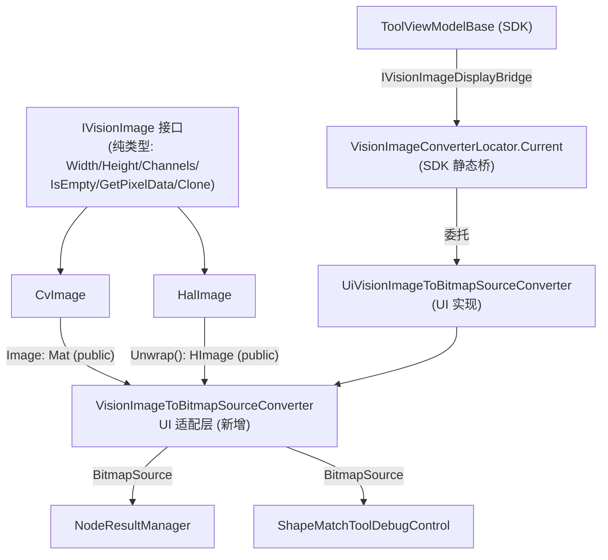

# SDK 类型系统收敛与图像去耦合方案（基线）

> 状态：待确认实施  
> 创建日期：2026-07-15  
> 用途：作为后续沟通、评审、实施的统一基线；任何修改须在此文件上增量更新并标注修订。

---

## 一、改前 → 改后 → 依据（用户视角）

### 改前
1. **变量类型下拉**能看到一堆用不上的类型：`点/矩形/圆/直线/圆环/旋转矩形/多边形/弧形/尺寸/单精度/字节`，甚至第三方 `System.Windows`/`OpenCvSharp` 残影。
2. **ROI 输出被统称「矩形」**——用户以为拿到矩形，实际可能是圆，形状信息在变量表被吃掉。
3. **阈值/形态学的像素数、面积、`long` 值、文件大小进不了变量表**（词汇表无 `long` → `ToTypeVocabulary` 返回 null），无法被下游绑定。
4. **形状匹配的位姿变换矩阵（`AffineMatrix`）无法绑定**，位置校正链路不能数据驱动。
5. **`IVisionImage` 通用图像接口里塞了 `ToBitmapSource()`**（WPF 显示转换）——类型定义承担了转换桥接职责，SDK 层耦合了展示层。

### 改后
1. 变量类型下拉**只剩 7 个概念**：`整型 / 双精度 / 字符串 / 布尔 / 图像 / 区域 / 变换矩阵`。
2. ROI 统一显示「区域」，具体形状运行时由 `ShapeType`/`Geometry` 区分（对齐 HALCON `region`）。
3. `int/long`→「整型」、`float/double`→「双精度」，**像素/面积不再溢出**；`AffineMatrix`→「变换矩阵」可绑定。
4. **`IVisionImage` 收敛为纯类型定义**（无 WPF 转换方法）；`ToBitmapSource` 桥接统一下沉到 UI 适配层 `VisionImageToBitmapSourceConverter`，转换只有一条路径。

### 依据（业界）
- **HALCON**：control 变量 `integer/real/string/boolean/handle` 不分位宽；`region` 为 iconic 不区形状。
- **VisionMaster / VisionPro**：全局变量仅 `int/float/string/Bytes/Image` 等 5 种。
- **依赖倒置原则**：类型定义不应依赖展示层；桥接交给适配层（与现有 `ImageConverterPool`/`MatExtensions` 同源）。

---

## 二、调研记录（关键来源）

| 文件 | 行号 | 角色 |
|---|---|---|
| src/Plugin.SDK/Models/SdkTypeVocabulary.cs | 17-47 / 53-78 / 80-99 | 类型词表 SSOT（待改） |
| src/Plugin.SDK/Models/SdkTypeVocabulary.cs | 105-122 | `ToTypeVocabulary`（缺 NormalizeNumeric） |
| src/Workflow/GlobalVariableValueConverter.cs | 103-149 / 162-201 | 解析/序列化分发（待改） |
| src/Workflow/GlobalVariable.cs | 350-354 | `IsValidType`：`type!="Region"`（几何不进全局变量） |
| src/Plugin.SDK/VisionAdapters/IVisionImage.cs | 2,24-25 | **SDK 接口耦合 WPF `ToBitmapSource()`** |
| src/Plugin.SDK/VisionAdapters/CvImage.cs | 4,56-70 | `ToBitmapSource` 实现（直接内存拷贝） |
| src/Plugin.SDK/VisionAdapters/HalImage.cs | 4-5,64-94 | `ToBitmapSource` 实现（Halcon→BitmapSource） |
| src/Plugin.SDK/ViewModels/ToolViewModelBase.cs | 7,457 | SDK 层调用方（已引用 WPF） |
| src/UI/Services/Workflow/NodeResultManager.cs | 315 | UI 调用方 |
| tools/.../ShapeMatchToolDebugControl.xaml.cs | 227-231 | UI 调用方（内联 Halcon→BitmapSource） |
| src/UI/Services/Performance/ImageConverterPool.cs | 36-100 | 既有 UI 适配层（Mat→BitmapSource，优化池） |
| src/UI/Extensions/MatExtensions.cs | 115-157 | 既有 UI 扩展（Mat→BitmapSource） |
| src/Plugin.SDK/Execution/Results/AffineMatrix.cs | 13-57 | `AffineMatrix`（6 双精度字段） |
| tests/.../SdkTypeVocabularyContractTests.cs | — | 既有契约测试（待扩展） |

**无依据推断**：`IVisionImage` 仅 `CvImage`/`HalImage` 两实现（搜索 `: IVisionImage` 仅此 2 处）；`byte[]` 无任何 `*Results.cs` 产出（搜索 0 命中）。

---

## 三、问题分析

- **表面需求**：类型词表过多/含第三方；`IVisionImage` 不该承担 WPF 转换。
- **根本问题**：
  - 词汇表缺乏**规范数值类型**概念，`int/long/float/double` 平铺、几何/第三方类型泛滥，且 `long`/`AffineMatrix` 缺失导致真实输出无法绑定（设计缺陷）。
  - `IVisionImage` 作为**通用类型定义**却内嵌展示层转换（`ToBitmapSource`），违反依赖倒置（架构耦合）。
- **问题分类**：架构冗余 + 实现偏差 + 分层违例。

---

## 四、Part 2：`IVisionImage` 去耦合设计（新增）

### 4.1 当前耦合证据

```2:25:src/Plugin.SDK/VisionAdapters/IVisionImage.cs
using System.Windows.Media.Imaging;   // ← SDK 层引入 WPF 展示类型
// ...
    BitmapSource ToBitmapSource();    // ← 把"转成 WPF 显示格式"写进了通用图像接口
```

`CvImage` 与 `HalImage` 各自实现了一份 `ToBitmapSource`，而 UI 层**早已存在**等价的 `ImageConverterPool.ConvertToBitmapSource` / `MatExtensions.ToBitmapSource`（两套并行实现，违反单一职责）。

### 4.2 目标架构



### 4.3 修改清单（Part 2）

1. **`IVisionImage.cs`**：删除 `using System.Windows.Media.Imaging;`；删除 `BitmapSource ToBitmapSource();`（行 24-25）。接口仅留纯数据/中性方法。
2. **`CvImage.cs`**：删除 `using System.Windows.Media.Imaging;`（行 4，仅 `ToBitmapSource` 用到）；删除 `BitmapSource IVisionImage.ToBitmapSource()` 实现（行 56-70）。`Image` 属性（Mat，行 42）保持 `public`，供适配器访问。
3. **`HalImage.cs`**：删除 `ToBitmapSource()` 实现（行 64-94），其逻辑**移入适配器**；`using System.Windows.Media*`（行 4-5）**保留**（`FromBitmapSource` 工厂仍用，属输入桥接，本轮保留为已知残留，见 §七）。
4. **新增 `src/UI/Services/Vision/VisionImageToBitmapSourceConverter.cs`**（UI 适配层，`public static`）：
   - `BitmapSource? ToBitmapSource(IVisionImage? image)` 分派：
     - `image is CvImage cv` → 直接内存拷贝（搬 `CvImage` 旧实现，通道感知 Gray8/Bgr24/Bgra32，取 `cv.Image`）。
     - `image is HalImage hal` → Halcon→BitmapSource（搬 `HalImage` 旧实现，取 `hal.Unwrap()`）。
     - 其他 → `throw new NotSupportedException`（仅 2 实现，穷尽；fail-fast，rule-015）。
   - 这是 `CvImage`/`HalImage` 显示的**唯一**路径；`ImageConverterPool`/`MatExtensions` 保留（供调试控件等其他 Mat→BitmapSource 场景）。
5. **新增 SDK 桥 `src/Plugin.SDK/VisionAdapters/IVisionImageDisplayBridge.cs`** + 静态定位器 `VisionImageConverterLocator`（`Current` 属性）。UI 启动时注册 `UiVisionImageToBitmapSourceConverter`（包装上面的转换器）。
6. **3 个调用方改造**：
   - `ToolViewModelBase.cs:457` → `OutputImage = VisionImageConverterLocator.Current?.ToBitmapSource(primaryImage);`
   - `NodeResultManager.cs:315` → `return VisionImageToBitmapSourceConverter.ToBitmapSource(hImage);`
   - `ShapeMatchToolDebugControl.xaml.cs:230` → `return VisionImageToBitmapSourceConverter.ToBitmapSource(new HalImage(hImage));` 并**删除**内联 `ConvertHImageToBitmapSource` 辅助方法（行 224-231）。

> 设计取舍：`ToolViewModelBase` 在 SDK 且无 DI，故用最小静态桥（SDK 接口 + UI 实现 + 启动注册），避免 SDK→UI 反向依赖，也避免改动 `OutputImage` 类型引发大量 XAML 联动。更"纯 WPF"的替代方案是把 `OutputImage` 改为 `IVisionImage?` 并用 `IValueConverter` 在 XAML 绑定——侵入面更大，本轮不采用。

---

## 五、Part 1：词汇表收敛设计（最终数据表）

### 表 1：最终词汇表（SSOT）

**正向 `TypeToString`（仅 5 个规范键 + `Region`）**

| CLR 类型 | 变量类型名 | 中文 | 状态 |
|---|---|---|---|
| `long[]`（int/int[]/float/float[] 经 NormalizeNumeric 归并） | `Integer` | 整型 | **规范键** |
| `double[]` | `Double` | 双精度 | **规范键** |
| `string[]` | `String` | 字符串 | 保留 |
| `bool[]` | `Boolean` | 布尔 | 保留 |
| `IVisionImage` | `Image` | 图像 | 保留（绑定类型；持久化边界保持） |
| `IVisionRegion` | `Region` | 区域 | **唯一区域词目**（统一栅格区域输出；`ShapeParameters` 是编辑态内部模型 `RegionDefinition` 子类，不进词汇表） |
| `AffineMatrix[]` | `Transform` | 变换矩阵 | **新增** |

**删除**：`int[]`/`float[]`/`byte[]` 独立键；`Float`；`Point`(含 System.Windows/OpenCvSharp/Point2D)；`Rectangle`(含 System.Windows/OpenCvSharp)；`Size`；6 几何 `Circle/Line/Annulus/RotatedRect/Polygon/Arc`。

**反向 `StringToType`（加载兼容）**
- 规范：`Integer→long`、`Double→double`、`Transform→AffineMatrix`、`Image→IVisionImage`、`Region→IVisionRegion`、`String/Boolean` 保留。
- **保留历史加载**：`Integer[]→int[]`、`Double[]→double[]`、`String[]→string[]`、`Float[]→float[]`、`Rectangle→ShapeParameters`、`Float→float`。
- **删除并 fail-fast**：`Byte`、以及 `Point/Size/Circle/Line/Annulus/RotatedRect/Polygon/Arc`（从未是顶层变量，旧数据几乎不可能存在；触发 `NotSupportedException` 可见，rule-015）。

### 表 2：各工具输出变量归类（节选，验证用）

| 工具 | 可绑定词目（修复点） |
|---|---|
| Threshold | `Integer`(WhitePixelCount/OutputArea，**long 保宽**)、`Double`(阈值/面积)、`Region`(输出区域)、`Image`×4 |
| Morphology | `Integer`(TotalArea, long)、`Double`/`Boolean` 标量、`Image`×3 |
| ImageThreshold | `Integer`(白像素/面积)、`Double[]`、`Image`×3 |
| ImageLoad | `Integer`(总像素/文件大小, long)、`Image` |
| ShapeMatch | **`Transform`**(BestPositionCorrection/MatchedPositionCorrections)、`Integer`(MatchCount)、`Double`(BestScore)、`Boolean`(HasMatch)、`Image`×3 |
| BlobAnalysis / ImageFilter / Condition | 现有归类不变 |

**总数**：原 17+ 词目 → **7 个核心**，对齐 HALCON(5+iconic)/VM(5)/VP(5)。

---

## 六、Part 1 修改清单（精确）

**`SdkTypeVocabulary.cs`**
- `TypeToString`：数值仅留 `[long[]]="Integer"`、`[double[]]="Double"`、`[string[]]="String"`、`[bool[]]="Boolean"`、`[AffineMatrix[]]="Transform"`；`[IVisionRegion]`→`"Region"`（唯一区域词目）；**删除** `ShapeParameters[]` 正向映射（它是编辑态内部模型 `RegionDefinition` 子类，非可绑定输出）；保留 `IVisionImage`；**删除** `int[]`/`float[]`/`byte[]`、6 几何、`Point/Rectangle/Size` 全部键。
- 新增 `private static Type NormalizeNumeric(Type t)`：`int→long`、`int[]→long[]`、`float→double`、`float[]→double[]`，否则原样；`ToTypeVocabulary` 查表前先 `t = NormalizeNumeric(t)`。
- `StringToType`：`Integer→typeof(long)`、`Double→typeof(double)`、新增 `Transform→typeof(AffineMatrix)`；保留历史 `Integer[]/Double[]/String[]/Float[]` 与 `Rectangle→ShapeParameters`/`Float→float`；**删除** `Byte`、`Point/Size/Circle/Line/Annulus/RotatedRect/Polygon/Arc`。
- `ChineseNames`：保留 `Integer/String/Boolean/Double/Image/Region` + 新增 `Transform=变换矩阵`；**删除** `Byte/Float/Point/Rectangle/Size/Circle/Line/RotatedRect/Polygon/Annulus/Arc`。
- 清理 `using`：删除 `OpenCvSharp`、`...Geometry`；保留 `...Region.Models`、`...VisionAdapters`。

**`GlobalVariableValueConverter.cs`**
- `ParseValue`：合并 `int/int[]/long/long[] → ParseAdaptive(e=>e.GetInt64())`；合并 `double/double[]/float/float[] → ParseAdaptive(e=>e.GetDouble())`；**删除** `byte` 分支（原 122-123）；**删除** 6 几何分支（127-138）与 `OpenCvSharp.Point/Rect/Size` 分支（141-143）；**新增** `AffineMatrix/AffineMatrix[] → ParseAdaptive(e=>ParseAffineMatrix(e))`。
- `SerializeValue`：新增 `long longValue`、`long[] longArr`；保留 `int/int[]/double/double[]/string/string[]/bool`；**删除** `float fltValue`、`float[] fltArr`（死代码，float 已归并 double）、`Point/Rect/Size` 分支（181-183）、6 几何分支（186-198）；**新增** `AffineMatrix m`、`AffineMatrix[] ms` 分支。
- **删除死方法**（rule-008）：`ParsePoint/SerializePoint`、`ParseRectangle/SerializeRectangle`、`ParseSize/SerializeSize`、`ParseCircle…ParseArc`/`SerializeCircle…SerializeArc`（原 206-387 段）。**新增** `ParseAffineMatrix`/`SerializeAffineMatrix`（6 字段：M11/M12/M21/M22/OffsetX/OffsetY）。
- `Mat`/`IVisionImage` 图像持久化分支（`ParseImage`/`SerializeImage`/`Mat mat` case）**保留**（边界实现，非本次范围）。

**`tests/.../SdkTypeVocabularyContractTests.cs`**：扩展用例 `int→Integer`、`float→Double`、`long→Integer`（不溢出）、`IVisionRegion→Region`、`AffineMatrix→Transform`、`Byte`/几何类型删除后历史加载 fail-fast（防御机制）。

> 各工具 `*Results.cs` **无需改动**——只产出真实 CLR 类型，归类由词汇表/转换器负责。

---

## 七、Part 3：区域订阅面板统一改造设计（新增）

### 7.1 改前 → 改后 → 依据（用户视角）

**改前**
1. 打开「区域订阅」面板，它其实是个**坏的半成品**：界面写「按矩形区域/按圆形区域/按矩形参数/按圆形参数」四选一，但这套逻辑接到一个**旧 ViewModel**（`RegionSubscribeViewModel`），而真正干活的数据（`ParameterPanelViewModel`）被它硬覆盖掉——你点的绑定**根本没写进区域数据**。
2. 工程里还有另一个「参数面板」（`ParameterPanel`）是能用的，但它**自己手搓了 🔗/✕ 按钮**，没用 SDK 现成的 `ParamBinding` 控件。
3. 「订阅整个区域」（选上游 Region）和「按形状生成区域」（圆/矩形/旋转矩形…）两种模式，目前是**两套分散、互不相通**的东西。

**改后**
1. 统一的「区域订阅」面板，顶部两个单选：
   - `○ 订阅整个区域` → 一个选择框（与下面每行同款），只能挑上游的 Region 输出（Blob 连通域、画的圆/矩形统一成 `Region` 一种类型）。
   - `○ 订阅几何参数` → 形状下拉（圆/矩形/旋转矩形/点/线/多边形 6 种），下面自动铺出对应参数行，每行用同一个 SDK 控件选上游 `double`（多边形那行选点数组）。
2. 所有「选上游/解绑/绑全局变量」都由 SDK 现成的 `ParamBinding` 控件提供，**零自研按钮**。
3. 选完就落盘：几何参数写进 `ComputedRegion`，整区域写进 `FixedRegion`，刷新/重开能正确回显。

**依据（业界）**
- 业界视觉软件（VisionMaster / VisionPro / 基恩士）的区域订阅都是「整体区域订阅 + 几何参数订阅」双模式，且绑定控件统一（树形选择器 + 类型过滤）。
- 与本方案 §五 的「区域」唯一词目对齐：所有区域上游输出类型均为 `IVisionRegion`，过滤时只列 `Region`（`SdkTypeVocabulary` + `ParamBindingBase.FilterDataSourcesByType` 精确匹配）。

### 7.2 调研记录（关键来源）

| 文件 | 行号 | 角色 |
|---|---|---|
| `Region/Views/RegionSubscribePanel.xaml` | 19 | **根因 bug**：`<Grid DataContext="{StaticResource SubscribeViewModel}">` 用静态旧 VM 覆盖了父级注入的 `ParameterPanel` |
| `Region/Views/RegionSubscribePanel.xaml` | 51-151 | 旧面板：4 模式 RadioButton + `ParamBinding` 绑到旧 VM 的 `*Source` 字符串属性 |
| `Region/Views/RegionEditorControl.xaml` | 89-90 | 父级本就把 `RegionSubscribePanel.DataContext` 设成 `{Binding ParameterPanel}`（即 `ParameterPanelViewModel`），并透传 `AvailableDataSources` |
| `Region/ViewModels/ParameterPanelViewModel.cs` | 83-101 | `UpdateParameterDefinitions()`：切形状→清空重生成 `Parameters` |
| `Region/ViewModels/ParameterPanelViewModel.cs` | 106-149 | `GetParameterDefinitions()`：6 种形状参数定义（点2/线4/圆3/矩形4/旋转矩形5/多边形1），仅几何参数，无「整区域」分支 |
| `Region/ViewModels/ParameterPanelViewModel.cs` | 178-198 | `ApplyBindingSelection(NodeOutputInfo)`：选中节点写成 `NodeOutputSource` 放进 `SelectedParameter.Source` |
| `Region/ViewModels/ParameterPanelViewModel.cs` | 214-232 / 237-253 | `LoadFromComputedRegion` / `ExportToComputedRegion`（仅几何，且 Export 全仓未被调用=死代码） |
| `Region/Models/ParamSettingItem.cs` | 18-28 / 33-44 | 参数项：`ParameterName`/`DisplayName`/`DataType`(string)、`Source`/`DisplayPath`；**缺 `BindingPath` 双向桥** |
| `Region/Models/RegionDefinition.cs` | 298-326 | `FixedRegion`（整区域订阅：SourceNodeId+OutputName+RegionIndex） |
| `Region/Models/RegionDefinition.cs` | 331-377 | `ComputedRegion`（几何订阅：TargetShapeType + ParameterBindings 字典） |
| `UI/Controls/ParamBinding.cs` | 69-74 | `BindingSource`（`string`，TwoWay，格式 `NodeId.PropertyName`/`[i]`/`__GlobalVars__.x`） |
| `UI/Controls/ParamBinding.cs` | 209-214 / 76-81 | `BindingSourceSelectedEvent`（冒泡、无载荷）+ `AvailableDataSources` DP |
| `UI/Controls/ParamBinding.cs` | 347-361 / 327-364 | 自带「无」(解绑) + 「全局变量」动作节点；`FilterDataSourcesByType` 按 `DataType` 过滤 |
| `UI/Controls/ParamBindingBase.cs` | 177-206 | 过滤规则：数组→只列数组；标量→不列数组；数字跨类型可见；其余精确匹配 |
| `Execution/Parameters/AvailableDataSource.cs` | 77 / 83 / 209-214 | `PropertyType`(Type)、`VariableType`(string "Region")、`GetBindingPath()` |
| `Models/SdkTypeVocabulary.cs` | 25 / 41 | `IVisionRegion` ↔ `"Region"` 互转（所有区域上游输出=接口） |
| `Region/ViewModels/RegionEditorViewModel.cs` | 311-319 | `AvailableShapeTypes` = 点/线/圆/矩形/旋转矩形/多边形（6 种，与 `GetParameterDefinitions` 对齐） |
| `Region/ViewModels/RegionEditorViewModel.cs` | 448-464 | `OnParamSettingChanged`：把几何绑定写进 `ComputedRegion`（已通的持久化路径） |
| `Region/ViewModels/RegionEditorViewModel.cs` | 691-715 | `UpdateEditingShape`：**只处理 ComputedRegion/ShapeParameters，忽略 FixedRegion** → 整区域订阅重开后不回显 |
| `Region/ViewModels/RegionEditorViewModel.cs` | 767-776 | `SetRegionSubscription`：写 `FixedRegion`（整区域的落盘入口） |
| `Region/Views/ParameterPanel.xaml` + `.cs` | 全文 | **孤儿 UI**：用 `ParameterPanelViewModel` 但自搓 🔗/✕ 按钮，且未被任何 XAML 放置 |
| `Execution/RegionSubscribeMode.cs` + `Region/ViewModels/RegionSubscribeViewModel.cs` + `Region/Converters/RegionConverters.cs:181-204` | — | 旧 4 模式枚举/VM/转换器：仅被旧面板使用 |

**无依据推断**：`RegionSubscribeViewModel` / `RegionSubscribeMode` / 孤儿 `ParameterPanel` 三处重复表达「订阅模式」，是同一套过时设计残留；`ExportToComputedRegion` 全仓 0 调用（search 确认）。

### 7.3 问题分析

- **表面需求**：把「形状下拉」展开成每种形状的完整参数 UI。
- **根本问题**：区域订阅的「两种模式 + 6 种形状」目前**没有统一、可落盘的 UI 载体**——旧面板接错 VM、新面板散落且自搓控件。
- **问题分类**：架构冗余 + 接线断裂（非单纯画 UI）。
- **Bug 模式**：真因 = **DataContext 被覆盖导致接线断裂**（`RegionSubscribePanel.xaml:19` 覆盖父级注入的 `ParameterPanel`）+ **整区域模式在载入时未被处理**（`RegionEditorViewModel.cs:691-715` 忽略 `FixedRegion`）。
- **治本点**：以 `ParameterPanelViewModel` 为唯一数据源，重写 `RegionSubscribePanel` 的 XAML 与接线，删除过时三件套（rule-008 零兼容）。

### 7.4 修改清单（实施步骤）

**Step 1 — 修 DataContext 根因**（`RegionSubscribePanel.xaml`）
- 删除 `SubscribeViewModel` 资源与 `<Grid DataContext=...>`，改为根 `<Grid>` 直接继承父级 `DataContext`（`ParameterPanel`）。删除无用的 `vm:` 命名空间。

**Step 2 — 扩展 `ParameterPanelViewModel`（单一数据源）**
- 新增子模式枚举 `RegionSubscribeSubMode { WholeRegion, GeometricParameters }`，属性 `SubscribeSubMode` + `IsWholeRegionMode` / `IsGeometricMode`（bool，供 Visibility）。
- 新增 `WholeRegionSource`(`ParameterSource?`) 与 `WholeRegionBindingPath`(`string?`)；新增 `ApplyWholeRegionSelection(NodeOutputInfo)`：把选中节点写成 `NodeOutputSource`（`SourceNodeId`/`OutputName`），触发新事件 `WholeRegionChanged`。
- `ParamSettingItem` 增加 `BindingPath` 属性（`SetProperty`，作为 `ParamBinding.BindingSource` 双向桥；载入时由 `Source.GetBindingPath()` 赋值回显，选择时由 `BindingSourceSelected` 事件统一处理）。
- `ParamSettingItem.DataType` 由 `string` 改为 `Type`（与 `ParamBinding.DataType`/`AvailableDataSource.PropertyType` 一致，全仓类型定义类统一形态）；`GetParameterDefinitions` 形参改用 `typeof(double)`/`typeof(Point2D[])` 常量，落盘时由 `SdkTypeVocabulary` 适配层转 `string`。
- 将 `LoadFromComputedRegion` 泛化为 `LoadFromRegionDefinition(RegionDefinition def)`：
  - `FixedRegion` → `SubscribeSubMode=WholeRegion`，填 `WholeRegionSource`/`WholeRegionBindingPath`；
  - `ComputedRegion` → `SubscribeSubMode=GeometricParameters`，`CurrentShapeType=cr.TargetShapeType`，逐参数填 `Source`+`BindingPath`；
  - `ShapeParameters`(绘制) → 默认 `GeometricParameters`（保留上次形状）。
- `ExportToComputedRegion` 改名为 `ExportToRegionDefinition()`（返回 `RegionDefinition`，按子模式产 `FixedRegion`/`ComputedRegion`），消除死代码命名。

**Step 3 — 重写 `RegionSubscribePanel.xaml`（统一 UI，全用 SDK 控件）**
```
顶部两个 RadioButton（订阅整个区域 / 订阅几何参数）
↓ 订阅整个区域（Visibility={Binding IsWholeRegionMode}）
   <LabeledControl Label="区域源">
     <ParamBinding DataType="{x:Type regions:IVisionRegion}"
                   ParameterName="WholeRegion"
                   BindingSource="{Binding WholeRegionBindingPath, Mode=TwoWay}"
                   AvailableDataSources="{Binding AvailableDataSources, RelativeSource=FindAncestor RegionSubscribePanel}"/>
   </LabeledControl>
↓ 订阅几何参数（Visibility={Binding IsGeometricMode}）
   <ComboBox ItemsSource="{Binding AvailableShapeTypes}" SelectedItem="{Binding CurrentShapeType}"/>
   <ItemsControl ItemsSource="{Binding Parameters}">
     <ItemsControl.ItemTemplate>
       <DataTemplate>
         <LabeledControl Label="{Binding DisplayName}" LabelWidth="70">
           <ParamBinding Width="200"
               ParameterName="{Binding ParameterName}"
               DataType="{Binding DataType}"
               BindingSource="{Binding BindingPath, Mode=TwoWay}"
               AvailableDataSources="{Binding AvailableDataSources, RelativeSource=FindAncestor RegionSubscribePanel}"/>
         </LabeledControl>
       </DataTemplate>
     </ItemsControl.ItemTemplate>
   </ItemsControl>
```
- `ParamSettingItem.DataType` 由 `string` 改为 `Type`，与 `ParamBinding.DataType`、`AvailableDataSource.PropertyType` 保持一致——全仓「数据类型定义」的标准形态就是 `Type`（CLR 类型），不再用 `"double"`/`"Point2D[]"` 字符串字面量。
- `GetParameterDefinitions` 形参用 `typeof(double)` / `typeof(Point2D[])` 等常量（`Point2D` 位于 `UI.Controls.Region.Models`，同命名空间可直接引用），XAML 直接 `DataType="{Binding DataType}"`（两端都是 `Type`），**无需任何转换器**。
- 删除原计划的 `Region/Converters/StringToTypeConverter.cs`：它与权威类型词表 `SdkTypeVocabulary` 重复，且小写 `"double"` 与词汇表规范键 `"Double"` 冲突（rule-015 下会误判为未知类型）。
- 需要字符串形态（持久化 / JSON）时：统一走 `SdkTypeVocabulary`（适配层）`ToTypeVocabulary(Type)` / `ToSystemType(string)`，未知类型按 rule-015 抛 `NotSupportedException`，不静默。
- `ApplyBindingSelection` 中 `ParameterSource.DataType = SelectedParameter.DataType` 改为
  `ParameterSource.DataType = SdkTypeVocabulary.ToTypeVocabulary(SelectedParameter.DataType)`（`ParameterSource.DataType` 是 `string` 字段，在边界用适配层转换，内存态保持 `Type`）。

**Step 4 — 接线闭环（`RegionSubscribePanel.xaml.cs`）**
- 构造函数 `AddHandler(ParamBinding.BindingSourceSelectedEvent, OnBindingSourceSelected)`。
- `OnBindingSourceSelected`：取 `e.OriginalSource as ParamBinding` → 读 `pb.BindingSource`：
  - 空 → 解绑（`ParameterName=="WholeRegion"` 调 `ClearWholeRegion()`，否则 `ClearBinding(item)`）；
  - 以 `__GlobalVars__.` 开头 → 构造 `NodeOutputSource(SourceNodeId="__GlobalVars__", PropertyName=变量名)`；
  - 否则 → 在 `AvailableDataSources` 中按 `SourceNodeId`+`PropertyName` 反查，构造 `NodeOutputInfo`；
  - 调 `vm.ApplyWholeRegionSelection(...)` 或 `vm.SelectedParameter=item; vm.ApplyBindingSelection(...)`。

**Step 5 — `RegionEditorViewModel` 接整区域闭环**
- 订阅 `PPVM.WholeRegionChanged`（新增）→ 内部复用 `SetRegionSubscription` 逻辑写 `FixedRegion`（`RegionEditorViewModel.cs:767`）。
- `UpdateEditingShape`（691-715）：把 `LoadFromComputedRegion` 改为 `LoadFromRegionDefinition(SelectedRegion.Parameters)`，使 `FixedRegion` 也能回显。

**Step 6 — 清理清单（rule-008 零兼容）**

| 文件 | 清理内容 | 原因 |
|---|---|---|
| `Region/ViewModels/RegionSubscribeViewModel.cs` | 整文件删除 | 旧 4 模式 VM，已被统一 VM 取代 |
| `Execution/RegionSubscribeMode.cs` | 整文件删除 | 旧枚举，仅被旧 VM/转换器引用 |
| `Region/Converters/RegionConverters.cs:181-204` | 删除 `RegionSubscribeMode` 分支 / `SubscribeModeToBoolConverter` | 随旧枚举失效；新面板用 bool→Visibility |
| `Region/Views/ParameterPanel.xaml` + `.cs` | 整文件删除（先 search 确认零引用） | 孤儿 UI，自搓按钮，功能被统一面板覆盖 |
| `ParameterPanelViewModel.ExportToComputedRegion` | 改名 `ExportToRegionDefinition` 并更新调用 | 消除死代码命名 |

> 清理前均用 `search_content` 确认零引用（如 `ParameterPanel` 类型、`SubscribeModeToBoolConverter` 使用点）。

### 7.5 防御机制（Part 3）

| 机制 | 说明 | 验证 |
|---|---|---|
| 类型过滤原生保护 | `ParamBinding.DataType=IVisionRegion` → 只列 Region；`double`→只列数字；`Point2D[]`→只列数组（`ParamBindingBase.cs:177-206`） | 手动：选整区域时下拉只见 Region 输出 |
| 报错优先（rule-015） | `DataType` 统一为 `Type`，不再有 Region 本地小写字符串与词汇表冲突；边界转字符串统一走 `SdkTypeVocabulary.ToSystemType`，遇未定义类型按 rule-015 抛 `NotSupportedException`；上游区域输出必须声明 `IVisionRegion`（否则 `SdkTypeVocabulary` 已报错） | code review |
| 回显闭环 | `LoadFromRegionDefinition` 覆盖 Fixed/Computed/Shape 三种 | 手动：订阅后关闭重开，绑定仍在 |
| 死代码消除 | 删除旧三件套 + 孤儿 UI，避免「看似可改实则无效」的误导 | 全仓 search 零命中 |

### 7.6 验收标准（Part 3）

| # | 验收项 | 方法 |
|---|---|---|
| 1 | 选「订阅整个区域」→ 出现 1 个 Region 选择框，下拉只列 Region 类型上游；绑定后关闭重开仍显示 | manual |
| 2 | 选「订阅几何参数」→ 形状下拉 6 种；切到圆显示 3 行、矩形 4 行、旋转矩形 5 行、点 2 行、线 4 行、多边形 1 行（数组） | manual |
| 3 | 几何每行弹出的列表按类型过滤（double 行只见数字、多边形行只见数组）；可解绑/绑全局变量 | manual |
| 4 | 绑定后 `RegionChanged` 触发，区域数据写入 `ComputedRegion`/`FixedRegion` | unit |
| 5 | `DataType` 全程为 `Type`；`SdkTypeVocabulary` 对未定义类型（如误用小写 `"double"`）返回 null 且调用方按 rule-015 报错，而非 Region 本地静默转换 | unit |
| 6 | `dotnet build` 全量通过；旧 `RegionSubscribeViewModel`/`RegionSubscribeMode`/孤儿 `ParameterPanel` 全仓零引用 | build |

---

## 八、清理清单 & 已知残留

| 文件 | 清理内容 | 原因 |
|---|---|---|
| SdkTypeVocabulary.cs | 删 6 几何 + 第三方 + Byte/Float 键与中文名 | 死重/第三方污染 |
| GlobalVariableValueConverter.cs | 删 Point/Rect/Size/6 几何 Parse/Serialize 方法 | 与词汇表同步 |
| IVisionImage.cs / CvImage.cs | 删 `ToBitmapSource` + 无用 WPF using | 类型去耦合 |
| ShapeMatchToolDebugControl.xaml.cs | 删内联 `ConvertHImageToBitmapSource` | 统一到适配器 |
| RegionSubscribePanel.xaml / .xaml.cs | 删静态 `SubscribeViewModel` 资源 + `<Grid DataContext>`；改由父级 `ParameterPanel` 驱动 | 修 DataContext 根因（接线断裂，见 §7.4 Step1/4） |
| ParameterPanelViewModel.cs | 新增 `SubscribeSubMode`/`WholeRegion*`/`BindingPath`；`LoadFromComputedRegion`→`LoadFromRegionDefinition`；`ExportToComputedRegion`→`ExportToRegionDefinition` | 单一数据源 + 消除死代码（见 §7.4 Step2） |
| RegionEditorViewModel.cs | 订阅 `WholeRegionChanged` 写 `FixedRegion`；`UpdateEditingShape` 改调 `LoadFromRegionDefinition` | 整区域闭环回显（见 §7.4 Step5） |
| RegionSubscribeViewModel.cs / RegionSubscribeMode.cs / RegionConverters.cs:181-204 / 孤儿 ParameterPanel.xaml(.cs) | 整文件/分支删除 | rule-008 零兼容清理过时三件套+孤儿 UI（见 §7.4 Step6） |

**已知残留（本轮不处理，已确认）**：`HalImage.FromBitmapSource`（`BitmapSource→HalImage` 输入桥接）仍在 SDK 引用 WPF。它是输入方向工厂，与用户指出的 `ToBitmapSource`（输出方向）不同；若需彻底纯净可后续单列。

---

## 九、防御机制（≥2 项）

| 机制 | 说明 | 验证 |
|---|---|---|
| 契约测试 | `SdkTypeVocabularyContractTests` 覆盖规范化 + `AffineMatrix→Transform` + `IVisionRegion→Region` + `Byte`/几何类型删除 fail-fast | unit |
| 端到端冒烟 | Threshold 的 `long` 值显示「整型」可绑定下游；ShapeMatch「变换矩阵」可绑定 Morphology 位置校正；图像在 UI 正常显示（适配器路径） | manual |
| Fail-Forward | `ToolRegistry.cs` 对未知类型报错；词汇表反向删除类型触发 `NotSupportedException` 可见 | code review |
| 类型过滤原生保护（Part 3） | `ParamBinding.DataType=IVisionRegion`→只列 Region；`double`→只列数字；`Point2D[]`→只列数组（`ParamBindingBase.cs:177-206`） | manual |
| 报错优先（Part 3） | `DataType` 统一为 `Type`；边界转字符串走 `SdkTypeVocabulary.ToSystemType`，遇未定义类型按 rule-015 抛 `NotSupportedException`；上游区域输出须声明 `IVisionRegion`（否则 `SdkTypeVocabulary` 已报错） | code review |

---

## 十、验收标准

| # | 验收项 | 方法 |
|---|---|---|
| 1 | `ToTypeVocabulary(long/int/float/double)` 返回 `Integer`/`Double` 且值不溢出 | unit |
| 2 | `ToTypeVocabulary(IVisionRegion)` == `"Region"`（唯一区域词目，非 `"Rectangle"`） | unit |
| 3 | `ToTypeVocabulary(AffineMatrix[])` == `"Transform"` | unit |
| 4 | `GetAllTypeOptions` 不含 Float/Point/Rectangle/Size/Circle/Line/Annulus/RotatedRect/Polygon/Arc/Byte | review |
| 5 | Threshold 的 `long` 值在 UI 变量表显示「整型」并可绑定下游 `Integer` 输入 | manual |
| 6 | ShapeMatch 输出「变换矩阵」可绑定 Morphology 等位置校正 | manual |
| 7 | 图像在结果面板/节点正常显示（走 `VisionImageToBitmapSourceConverter`，行为与原 `ToBitmapSource` 一致） | manual |
| 8 | 历史含 `Float`/`Rectangle` 的方案 JSON 仍可加载；含 `Byte`/几何类型则报错可见 | manual |
| 9 | `dotnet build` 全量通过，无 `OpenCvSharp.Point` 等第三方类型残留于词汇表；无 `IVisionImage.ToBitmapSource` 调用 | build |
| 10 | （Part 3）区域订阅面板两种模式完整走查：整区域只列 Region、几何 6 形状参数行正确、类型过滤/解绑/全局变量可用、关闭重开回显 | manual |
| 11 | （Part 3）`DataType` 全程为 `Type` 且未新建 Region 本地 `StringToTypeConverter`；旧 `RegionSubscribeViewModel`/`RegionSubscribeMode`/孤儿 `ParameterPanel` 全仓零引用 | unit/build |

---

## 十一、测试 / 风险 / 验证清单

- **测试**：单元测试（SdkTypeVocabulary 规范化 + 转换器 long/float/AffineMatrix 往返）；端到端（Threshold/ShapeMatch/图像显示冒烟）；回归（8 工具输出归类）。
- **测试（Part 3）**：单元测试（`ParameterPanelViewModel` 子模式切换、Load/Export、WholeRegion）；集成（`RegionEditorViewModel` 整区域/几何落盘+回显）；手动（启动→区域订阅面板两种模式完整走查）。
- **风险**：① 历史 JSON 含已删几何类型→加载报错（概率极低，可见）；② `AffineMatrix` 新增序列化→契约测试覆盖 6 字段往返；③ `CvImage.ToBitmapSource` 删后图像显示回归→端到端冒烟（适配器逻辑为原样搬迁，行为一致）。
- **验证清单**：rule-008 零兼容无残留；rule-015 未知类型报错优先；数值仅 `Integer`/`Double`；`IVisionRegion→Region` 修正（`ShapeParameters` 不进词汇表）；`AffineMatrix→Transform` 注册+转换器支持；第三方 `OpenCvSharp`/`System.Windows` 类型零残留于词汇表；`IVisionImage` 无 `ToBitmapSource`。

---

## 十二、待对齐决策点（未决）

1. **`HalImage.FromBitmapSource`**（输入桥接）本轮**保留**为已知残留，还是也要一并移到适配层？建议保留（限制侵入面）。
2. 适配器桥接 `ToolViewModelBase` 采用**静态定位器**（`VisionImageConverterLocator.Current`）——可接受，还是倾向更纯的 XAML `IValueConverter` 方案（改动更大）？

> 以上两项确认后，调用「方案实施」技能按上述清单落地（Part 1 + Part 2 + Part 3 一并），再由「方案测试」技能全链路验收。

3. **区域订阅面板**（Part 3）：形状下拉范围锁定 6 种（点/线/圆/矩形/旋转矩形/多边形），整区域类型过滤锁定 `IVisionRegion`（统一 `Region` 词目）。
   - `DataType` 改为 `Type`，与 `ParamBinding`/`AvailableDataSource` 一致；字符串转换统一走 `SdkTypeVocabulary` 适配层（已明确，不再新建 Region 本地转换器）。
   - 「订阅整个区域」行**不加区域预览缩略图**（已确认）。
   - 形状下拉**不加搜索框**（仅 6 项，无意义，已确认）。
   - **状态：已决。**
