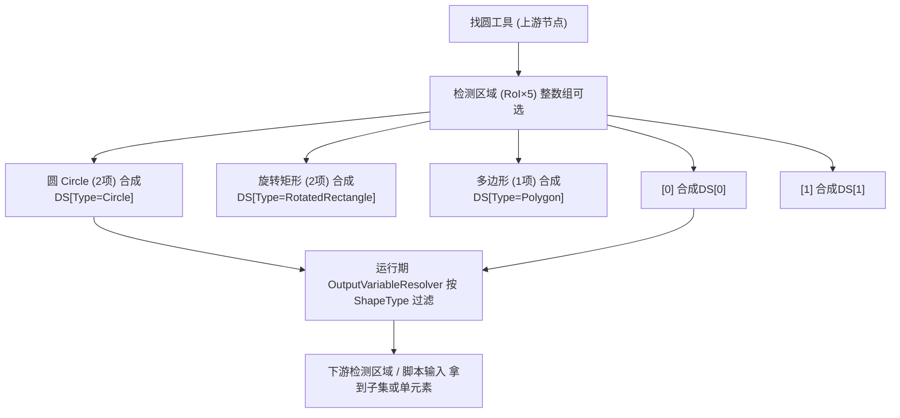

# 检测区域 RoI 多图形统一绑定 + 按图形类型/单图形绑定 方案设计

> 分支：`feature/script-tool`
> 日期：2026-07-20
> 关联记忆：节点结果树最佳实践调研（ID 87145966）、RoI 与 Region 双轨数据结构优化（20260718）

## 🔄 改前 → 改后 → 依据（说人话）

### 改前（用户视角）
你的检测区域支持圆 / 矩形 / 旋转矩形 / 多边形 / 圆环 / 弧形等多种图形，它们底层都是 `ShapeParameters[]`（即 RoI 数组）。但当前绑定树对 RoI 走的是**字段聚合**（拿第一个图形的字段当模板给整列）：
- 数组里混了不同图形时，树里会显示 `圆心X: 100; --; 150`（`--` 是矩形没有的字段），**既错又没用**；
- 你只能"绑整个 RoI 数组"，**不能"只要圆"或"只要第 0 个"**；
- 绑完控件上的标签冗长：`找圆工具.检测区域 (RoI×5): Circle2d(...); RotatedRect2d(...); ... []`。

### 改后（用户视角）
同一个 RoI 数组，在绑定树里同时提供三种粒度，**不造端口、不增控件**：
```
检测区域 (RoI×5)                ← ① 统一绑定：选这个，整数组流过去
   ▾ 圆 Circle (2项)            ← ② 按图形类型：选这个，只绑圆子集
   ▾ 旋转矩形 RotatedRectangle (2项)
   ▾ 多边形 Polygon (1项)
   [0] Circle2d(...)            ← ③ 按单个图形：选这个，绑单元素
   [1] Circle2d(...)
```
绑定后控件标签变为（用户已拍板风格）：
- 统一：`找圆工具.检测区域 (RoI×5)`
- 按图形：`找圆工具.检测区域[圆]`（圆）/ `找圆工具.检测区域[矩形]`（矩形）…
- 按单个：`找圆工具.检测区域[0]`

### 依据（业界参考）
- **VisionMaster / VisionPro 的 ROI 变量模型**：区域类变量按"类型分组"组织，既可整体引用也可按子类型 / 索引引用——与本项目 `OutputVariable` 契约 + `SdkTypeVocabulary` 固定词汇 + `GetMonitorFields` 声明式映射的最佳实践一致（见记忆 ID 87145966）。
- **复用现有 SSOT**：`OutputVariableResolver.Resolve` + `PropertyPathParser` 已是脚本 / 子流程绑定的唯一解析入口；`GetShapeTypeName(ShapeType)` 已有中文映射可复用。
- 修复的是**字段聚合对异质数组不成立**这个真问题（治本），而非打补丁。

---

## 调研记录

### 文件分布
| 文件 | 行号 | 角色 |
|------|------|------|
| [来源] `src/Plugin.SDK/Execution/Parameters/ArrayTreeFormatter.cs` | 81-114 | RoI **字段聚合**分支（要改为按 `ShapeType` 分组） |
| [来源] `src/Plugin.SDK/Execution/Parameters/ArrayTreeFormatter.cs` | 116-137 | 逐元素 `[i]` 分支（复用） |
| [来源] `src/Plugin.SDK/UI/Controls/ParamBinding.cs` | 540-557 | `ApplyDataSourceBinding` 强依赖 `selectedNode.DataSource!`（分组节点须挂合成 DataSource） |
| [来源] `src/Plugin.SDK/UI/Controls/ParamBinding.cs` | 579-624 | `FindNodeByBindingPath` / `FindNodeRecursive` 按 `DataSource.PropertyName` 匹配（需支持后缀） |
| [来源] `src/Plugin.SDK/UI/Controls/ParamBinding.cs` | 631-663 | `GenerateBindingDisplayText` 仅处理 `[N]`（需支持 `[Type=]`） |
| [来源] `src/Plugin.SDK/UI/Controls/ParamBinding.cs` | 674-680 | `GetDisplayLeafName` 追加 `[]`（需组合祖先 + 中文图形名） |
| [来源] `src/Plugin.SDK/Execution/Parameters/AvailableDataSource.cs` | 210-214 | `GetBindingPath()` 数组自动追 `[]`（需支持 filter suffix 避免双括号） |
| [来源] `src/Plugin.SDK/Execution/Parameters/OutputVariableResolver.cs` | 42-117 | **运行时 SSOT**，`[N]` 索引在此解析（需新增 `[Type=]` 过滤） |
| [来源] `src/Plugin.SDK/Execution/Parameters/PropertyPathParser.cs` | 23-49 | `ParsePropertyPart` 仅认 `[N]` / `[]`（需扩展认 `[Type=]`） |
| [来源] `src/Plugin.SDK/UI/Controls/Region/Models/ShapeType.cs` | 12-58 | `ShapeType` 枚举（Circle / Rectangle / RotatedRectangle / Polygon / Annulus / Arc…） |
| [来源] `src/Plugin.SDK/UI/Controls/Region/Models/RegionDefinition.cs` | 105 | `ShapeParameters.ShapeType => GeometryToShapeType(_geometry)`（运行时判别锚点） |
| [来源] `src/Plugin.SDK/UI/Controls/Region/ViewModels/RegionEditorViewModel.cs` | 163-175 | `GetShapeTypeName(ShapeType)` 中文映射（标签 `[圆]` 来源；Annulus / Arc 缺映射待补） |
| [来源] `tools/SunEyeVision.Tool.Script/ScriptEngine/ScriptBindingResolver.cs` | 154 | 脚本绑定经 `OutputVariableResolver.Resolve`（已走 SSOT） |

### 无依据推断
- RegionEditor 的 Inspection / Mask 下游在运行期取 RoI 值时**是否**已走 `OutputVariableResolver`？需实施时核实；若当前为直接字典访问，须改为 SSOT 解析才能生效 `[Type=]` 过滤（见实施步骤 6）。

---

## 问题分析（Phase 0）

### 需求拆解
- **表面需求**：检测区域支持多种图形都是 RoI，要能统一绑定 + 按图形绑定 + 按单个图形绑定。
- **根本问题**：绑定树对 `ShapeParameters[]` 的渲染模型是"按字段聚合"，只适用于**同质**数组；异质（多图形）时既显示错乱，也无法表达"子集 / 单元素"语义。
- **问题分类**：设计缺陷（数组渲染模型未覆盖异质 RoI）。

### 架构分配检查
- 最自然归属层：**SDK 绑定渲染层 + 运行时解析 SSOT**（均在 `Plugin.SDK/Execution/Parameters`）。
- 已有类似机制：有（`OutputVariableResolver` / `PropertyPathParser` / `GetShapeTypeName`）。
- 不改是否可覆盖：否（字段聚合对异质数组不成立）。
- 是否改变分层边界：否（纯扩展，不新增层）。

### 方法对比（≥ 3 候选）

| 维度 | 方案 A：按 `ShapeType` 分组（推荐） | 方案 B：继续字段聚合 + 补 `--` | 方案 C：为每种图形建独立输出变量 |
|------|------|------|------|
| 实现方式 | 绑定树按图形类型分组，挂合成 DataSource + `[Type=]` 解析 | 字段聚合容忍 `--` | 工具输出拆成 CircleOut / RectOut… |
| 架构一致性 | ✅ 复用 SSOT + 现有词汇表 | ⚠️ 掩盖真问题 | ❌ 改工具契约，侵入上游 |
| 复杂度 | 中（集中改 4 文件） | 低但错误 | 高（所有工具都要改） |
| 维护成本 | 低 | 高（误导用户） | 高 |
| 长期 ROI | 高 | 负 | 低 |

→ 选 **方案 A**（治本 + 复用 SSOT）。

---

## Bug 模式分析（Phase 0.5）
- **当前问题**：`ArrayTreeFormatter.cs:81-114` 字段聚合对异质 RoI 显示 `--` 错位。
- **真因分类**：设计缺陷（渲染模型假设同质数组）。
- **同类潜伏点**：`MainWindowViewModel` 结果树已正确逐元素展开（`[i]` + 各自字段），说明"按元素"才是对的；绑定树却走了另一条"聚合"路，两者模型不统一。
- **治本点**：统一为"按 `ShapeType` 分组 + 按元素 `[i]`"模型，与结果树一致。

---

## 业界对标（Phase 0.7）
| 框架 | 关键特征 | 借鉴 |
|------|---------|------|
| VisionMaster | ROI 变量按类型分组，可整体 / 子类型 / 索引引用 | 绑定树分组模型 |
| VisionPro | 区域集合 CogRegion 支持按类型查询 | `[Type=]` 过滤语义 |
| Halcon | `HRegion` tuple 语义（Count=N 输出长度 N） | 数组封顶防炸（已落地） |

---

## 解决方案

### 方案概述
把 `ShapeParameters[]` 在绑定树里的渲染从"字段聚合"改为"**按 `ShapeType` 分组 + 逐元素 `[i]`**"，分组 / 元素节点挂**合成 `AvailableDataSource`**（携带 `[Type=]` / `[i]` 过滤后缀），运行时在 `OutputVariableResolver`（SSOT）新增 `[Type=]` 过滤。三种粒度统一可用，标签按用户拍板的 `检测区域[圆]` 风格。

### 标签后缀短名映射（用户拍板 `[圆]` 风格）
在 `RegionEditorViewModel`（或就近的 `ArrayTreeFormatter` 静态辅助）新增短名映射，仅用于绑定树标签与 `GenerateBindingDisplayText`，不影响枚举 / 运行时路径：

| ShapeType | 枚举名（路径用） | 标签短名 |
|-----------|----------------|----------|
| Circle | Circle | 圆 |
| Rectangle | Rectangle | 矩形 |
| RotatedRectangle | RotatedRectangle | 旋转矩形 |
| Polygon | Polygon | 多边形 |
| Annulus | Annulus | 圆环 |
| Arc | Arc | 弧形 |

运行时绑定路径仍用**枚举名**（语言无关、可被 `PropertyPathParser` 解析），例如 `检测区域[Type=Circle]`；界面标签把 `Type=Circle` 译为 `[圆]`。

### 技术方案（实施步骤）

**步骤 1 — `AvailableDataSource` 增加 `BindingSuffix`（避免双 `[]`）**
- 字段：`public string? BindingSuffix { get; set; }`（如 `[Type=Circle]` / `[0]`）。
- 改 `GetBindingPath()`（`AvailableDataSource.cs:210-214`）：
  - `if (BindingSuffix != null) return $"{SourceNodeId}.{PropertyName}{BindingSuffix}";`
  - 否则维持原 `[]` 逻辑。

**步骤 2 — `PropertyPathParser` 扩展认 `[Type=]`**
- `ParsePropertyPart` 返回三元组 `(propertyName, int? arrayIndex, string? typeFilter)`（`PropertyPathParser.cs:23-49`）。
- 当 `indexStr` 以 `Type=` 开头 → `typeFilter = indexStr.Substring(5)`（枚举名，如 `Circle`），`arrayIndex = null`。
- 同步更新 `ParsePropertyPath` 返回值类型；`ExtractPropertyName` / `HasArrayNotation` 行为不变。

**步骤 3 — `OutputVariableResolver` 新增类型过滤（SSOT）**
- 解析后若 `typeFilter != null` 且 `current` 是 `ShapeParameters[]`：按 `sp.ShapeType == ParseShapeTypeToken(typeFilter)` 过滤（`OutputVariableResolver.cs:63-69` 处，索引处理之前）。
- 新增 `ParseShapeTypeToken(string)` 映射 `Circle→ShapeType.Circle` 等（枚举名，语言无关）；未知值**直接报错**（rule-015）。
- 与现有 `[N]` 索引处理并存（本轮回只支持"类型"或"索引"单独出现，组合 `[Type=Circle][0]` 不纳入，遵循 YAGNI）。

**步骤 4 — `ArrayTreeFormatter` 改为按 `ShapeType` 分组**
- 替换 `ArrayTreeFormatter.cs:81-114` 的字段聚合分支：
  - 先按 `sp.ShapeType` 分组（`GroupBy`），每组生成一个**分组子节点**：`Text = $"{GetShapeTypeName(type)} ({count}项)"`，`IsSelectable = true`，挂合成 `AvailableDataSource`（PropertyName = `检测区域`，BindingSuffix = `[Type={EnumName}]`，PropertyType = `ShapeParameters[]`，CurrentValue = 过滤子集）。
  - 再生成逐元素 `[i]` 子节点（`ArrayTreeFormatter.cs:116-137` 逻辑复用），`IsSelectable = true`，挂合成 `AvailableDataSource`（BindingSuffix = `[{i}]`，CurrentValue = 单元素）。
- 顶层"检测区域 (RoI×N)"数组叶节点保持可选（整数组绑定）。

**步骤 5 — `ParamBinding` 标签与反向查找**
- `GetDisplayLeafName`（`ParamBinding.cs:674-680`）：组合祖先链——取父数组节点名（`检测区域`）+ 读 `node.DataSource?.BindingSuffix` 按上表翻译短名中文，得 `检测区域[圆]`；不再机械追加 `[]`。
- `GenerateBindingDisplayText`（`ParamBinding.cs:631-663`）：在 `[N]` 替换之外，补 `[Type=]` → 中文短名（如 `[圆]`）的替换。
- `FindNodeRecursive`（`ParamBinding.cs:605-624`）：匹配改为比较 `DataSource.GetBindingPath()`（含 suffix）而非仅 `PropertyName`，使"按图形 / 按单个"绑定可被正确还原选中。

**步骤 6 — RegionEditor 下游运行时取值走 SSOT（实施时核实）**
- 确认 Inspection / Mask 取 RoI 是否经 `OutputVariableResolver`；若否，改为 SSOT 解析（否则 `[Type=]` 过滤在运行期不生效）。
- Inspection 仍只认 RoI 源、Mask 认区域类（前序方案已定，`_targetDataType` 落点不变）。

**步骤 7 — 补 `GetShapeTypeName` 遗漏映射 + 短名映射**
- `RegionEditorViewModel.cs:163-175` 补 `Annulus→"圆环"`、`Arc→"弧形"`（目前走 `ToString()` 返回英文）。
- 新增短名映射（见上表），供 `GetDisplayLeafName` / `GenerateBindingDisplayText` 使用。

### 清理清单
| 文件 | 清理内容 | 原因 |
|------|---------|------|
| `ArrayTreeFormatter.cs` | 删除 81-114 字段聚合分支（含 `IsSelectable=false` 字段节点） | 被按图形类型分组取代 |
| `RegionEditorViewModel.cs` | 补 Annulus / Arc 中文映射 | 标签一致性 |
| `ParamBinding.cs` | `GetDisplayLeafName` 去掉机械 `[]` 追加 | 改为祖先链 + 中文后缀 |

### 防御机制（≥ 2 项）
| 防御机制 | 说明 | 验证方式 |
|---------|------|---------|
| 契约测试 | 新增 `SdkTypeVocabularyContractTests` 风格用例：构造异质 `ShapeParameters[]`（圆 + 矩形 + 多边形），断言 `ArrayTreeFormatter.BuildExpansionChildren` 产出"按图形分组"且每组元素数正确、无 `--` 错位 | unit |
| 解析器单测 | `OutputVariableResolver.Resolve(nodeResults, id, "检测区域[Type=Circle]")` 返回仅圆子集；非法 `[Type=XXX]` 抛 `InvalidOperationException` | unit |
| 端到端冒烟 | 找圆工具输出 RoI → 检测区域 Inspection 绑 `检测区域[圆]` → 运行期仅圆进入 → 结果树按 `[i]+字段` 展开 | manual |

---

## 验收标准

### 功能验收
| # | 验收项 | 验收方法 | 防御机制 |
|---|--------|---------|---------|
| 1 | 异质 RoI 绑定树按图形类型分组，无 `--` 错位 | unit / manual | 契约测试 |
| 2 | 选"检测区域 (RoI×5)"→ 标签 `找圆工具.检测区域 (RoI×5)`，运行期得整数组 | manual | 冒烟 |
| 3 | 选"圆"分组 → 标签 `找圆工具.检测区域[圆]`，运行期仅圆 | manual | 解析器单测 + 冒烟 |
| 4 | 选 `[0]` → 标签 `找圆工具.检测区域[0]`，运行期单元素 | manual | 冒烟 |

### 边界 / 异常验收
| # | 验收项 | 关联测试 |
|---|--------|---------|
| 1 | `[Type=不存在]` → 运行期抛错（非静默） | 解析器单测 |
| 2 | 空 RoI 数组 → 不崩，分组为空 | 契约测试 |

---

## 测试方法
- **单元测试**：`ArrayTreeFormatter` 分组逻辑 + `OutputVariableResolver` `[Type=]` 过滤（全自动化）。
- **手动验证**：构建后启动 UI，绑上游 RoI，确认三种标签与运行期过滤。

## 风险评估
| 风险 | 影响 | 缓解 |
|------|------|------|
| RegionEditor 运行期未走 SSOT | `[Type=]` 过滤不生效 | 步骤 6 实施时核实并改造 |
| 组合 `[Type=Circle][0]` 不支持 | 个别高级场景 | 本期 YAGNI，后续可加多 bracket 解析 |

## 验证清单
- [ ] rule-008：无静默回退 / 默认值兜底（`[Type=非法]` 直接报错）
- [ ] rule-015：类型不匹配直接报错
- [ ] 契约测试 + 解析器单测 + 端到端冒烟全部通过

---

### Mermaid：绑定树形态与数据流

