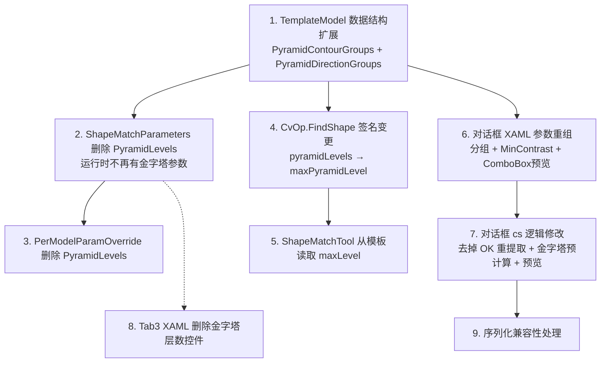

# 轮廓匹配(ShapeMatch)算法优化方案

> **版本**: v1.0  
> **日期**: 2026-05-09  
> **范围**: ShapeMatch 工具 → CvOp.FindShape → TemplateModel 数据模型 — 全链路金字塔感知优化  

---

## 1. 背景与现状分析

### 1.1 当前架构问题

当前轮廓匹配工具的金字塔机制存在根本性设计缺失。对照 Halcon 的 `create_shape_model` + `find_shape_model` 双阶段流程：

**Halcon 流程（正确设计）：**

```
create_shape_model
  ├── 指定 NumLevels（金字塔层数）
  ├── 在创建时预计算各金字塔层的模型轮廓/梯度数据
  ├── 存储多层模型（每层独立轮廓 + 方向信息）
  └── 匹配时直接取对应层轮廓，无需运行时缩放

find_shape_model
  ├── 从最粗层开始搜索候选位置
  ├── 逐层细化到最细层
  └── 用户可指定搜索范围（起始层~终止层）
```

**当前流程（问题架构）：**

```
模板创建（对话框）
  ├── 全分辨率 Canny 边缘检测
  ├── 提取单层轮廓（Point2D 列表）
  └── 仅存储 Level 0 轮廓

运行时匹配（CvOp.FindShape）
  ├── 全分辨率图像 → 内部构建响应图金字塔（BuildResponsePyramid）
  ├── 单层模板轮廓在各层按比例缩放匹配
  └── 金字塔层数 = 总层数（必须从顶层搜到 0 层）
```

**核心缺陷：**
1. **模板创建时未预计算金字塔** — 模板只存单层轮廓，各金字塔层的轮廓在运行时临时从 Level 0 缩放，而非创建时从降采样图像提取
2. **金字塔固定全范围搜索** — `pyramidLevels` 是"总层数"，必须从顶层搜到 0 层（最细）。但当前单层轮廓在各层缩放时特征丢失，导致粗层匹配质量差，筛不掉候选
3. **对话框参数与金字塔脱节** — 轮廓提取参数（Canny）与金字塔无关，用户无法预览各层轮廓形态
4. **"确定"时自动重提取轮廓** — 对话框 OK 按钮无条件重新执行轮廓提取，覆盖用户手动调整的结果

---

## 2. 整体优化架构

### 2.1 核心设计变更

```mermaid
flowchart LR
    subgraph Before["当前设计"]
        A1["模板创建（单一分辨率）"]
        A2["Canny + 轮廓提取 → ContourGroups"]
        A3["↓"]
        A4["存储 Level 0 轮廓"]
        A5["↓"]
        A6["运行时 FindShape"]
        A7["Level 0 轮廓在各层缩放匹配"]
        A8["pyramidLevels = 总层数<br/>(必须搜到最细层)"]
    end

    subgraph After["优化后设计"]
        B1["模板创建（金字塔感知）"]
        B2["Canny + 轮廓提取 → 在 Level 0 提取"]
        B3["逐级下采样轮廓 → 预计算各层轮廓"]
        B4["↓"]
        B5["存储 PyramidContourGroups{Level: 轮廓}"]
        B6["↓"]
        B7["运行时 FindShape"]
        B8["直接使用预计算的多层轮廓<br/>(模板自动确定金字塔层级)"]
        B9["搜索范围 = 模板最大层 → Level 0<br/>(无需用户干预)"]
    end

    Before -->|"全链路重构"| After
```



### 2.2 修改模块清单

| 模块 | 修改类型 | 说明 |
|------|---------|------|
| `TemplateModel` | 数据结构扩展 | 新增多层金字塔轮廓存储 |
| `TemplateModel` | 数据结构扩展 | 新增多层金字塔轮廓存储 |
| `ShapeMatchParameters` | 参数删除 | 删除 `PyramidLevels`（金字塔改为模板属性，运行时不设独立参数） |
| `ShapeMatchTemplateEditorDialog.xaml` | UI 重组 | 参数分组、预览按钮→ComboBox、MinContrast |
| `ShapeMatchTemplateEditorDialog.xaml.cs` | 逻辑重构 | 去掉 OK 自动重提取、金字塔预计算 + 预览 |
| `CvOp.FindShape` | 签名变更 | `pyramidLevels` → `maxPyramidLevel`（由模板决定，运行时读取） |
| `ShapeMatchTool.RunSingleTemplateMatch` | 适配 | 从模板读取 maxLevel 传给 FindShape |
| `ShapeMatchToolDebugControl.xaml` | 参数 UI 删除 | 移除金字塔层数 ConfigSetting |

---

## 3. 详细设计

### 3.1 TemplateModel — 多层金字塔轮廓存储

#### 当前（单层）

```csharp
// 仅存储 Level 0（全分辨率）
List<List<Point2D>>? ContourGroups;
List<List<double>>? ContourDirectionGroups;
```

#### 优化后（多层）

```csharp
/// <summary>金字塔轮廓数据：key=Level（0=全分辨率），value=轮廓组列表</summary>
public Dictionary<int, List<List<Point2D>>>? PyramidContourGroups { get; set; }

/// <summary>金字塔方向数据：key=Level，value=方向组列表</summary>
public Dictionary<int, List<List<double>>>? PyramidDirectionGroups { get; set; }

/// <summary>金字塔实际层数（1~N），序列化时自动计算</summary>
[JsonIgnore]
public int PyramidLevelCount => PyramidContourGroups?.Count ?? 1;
```

**向后兼容：** 旧模板加载时，`PyramidContourGroups` 为 null。运行时检测到 null 时自动用 `ContourGroups` 回退（视为 Level 0 单层），并在匹配时不做金字塔范围限制。

#### 金字塔预计算逻辑（在对话框提取轮廓后自动执行）

```
Level 0 轮廓提取完成后:
    for level = 1 to N:
        1. 对 Level 0 的灰度图像进行 2^level 倍下采样
        2. 在降采样图像上，将 Level 0 的轮廓坐标 / 2^level
        3. 在降采样 ROI 内重采样（确保轮廓点数合理）
        4. 在降采样图像上重新计算 Sobel 梯度方向
        5. 存入 PyramidContourGroups[level] 和 PyramidDirectionGroups[level]
```

#### TemplateModel.DeepClone 更新

```csharp
public TemplateModel DeepClone()
{
    var clone = new TemplateModel
    {
        // ... 原有字段 ...
        PyramidContourGroups = _pyramidContourGroups?.ToDictionary(
            kv => kv.Key,
            kv => kv.Value.Select(g => g.Select(p => new Point2D { X = p.X, Y = p.Y }).ToList()).ToList()),
        PyramidDirectionGroups = _pyramidDirectionGroups?.ToDictionary(
            kv => kv.Key,
            kv => kv.Value.Select(g => g.ToList()).ToList()),
    };
    return clone;
}
```

### 3.2 ShapeMatchParameters — 运行时参数变更

#### 当前

```csharp
/// <summary>金字塔层数（0=自动）</summary>
public ParamValue<int> PyramidLevels { get; set; } =
    ParamValue<int>.CreateConstant(0, "PyramidLevels");

/// <summary>速度尺度（1~10，值越大越快但精度越低，0=自动）</summary>
public ParamValue<int> SpeedScale { get; set; } =
    ParamValue<int>.CreateConstant(0, "SpeedScale");
```

#### 优化后

```csharp
/// <summary>速度尺度（1~10，值越大越快但精度越低，0=自动）</summary>
public ParamValue<int> SpeedScale { get; set; } =
    ParamValue<int>.CreateConstant(0, "SpeedScale");
// PyramidLevels 已删除 — 金字塔是模板属性，运行时不设独立参数
```

**设计核心：金字塔作为模板属性，运行时不暴露独立参数。**

| 问题 | 处理方式 |
|------|---------|
| 模板能搜几层？ | 由模板创建时预计算的 `PyramidContourGroups` 决定 |
| 运行时从哪里开始搜？ | 自动从模板最高层开始（`template.PyramidContourGroups.Keys.Max()`） |
| 运行时搜到哪层？ | 始终搜到 Level 0（全分辨率） |
| 用户怎么控制速度？ | 创建模板时调整 `PyramidMaxLevel`，运行时通过 `SpeedScale` 控制 |

**好处：**
- 用户不需要理解金字塔的创建/运行两套概念
- 模板自带金字塔信息，运行时完全无感
- 不可能出现创建-运行参数不匹配问题

### 3.3 PerModelParamOverride — 同步参数变更

`PerModelParamOverride` 中删除 `PyramidLevels` 字段，金字塔不再作为运行时参数，无需每模板覆盖。

### 3.4 CvOp.FindShape — 范围搜索签名变更

#### 当前签名

```csharp
public static void FindShape(
    Mat grayImage,
    List<Point2f> normalizedTemplateContour,
    double[] templateDirections,
    double minScore,
    double angleStart, double angleEnd, double angleStep,
    double scaleMin, double scaleMax, double scaleStep,
    int pyramidLevels,          // 单值 = 总层数
    int timeoutMs,
    out List<ShapeMatchResult> matchResults,
    int speedScale = 0)
```

#### 优化后签名

```csharp
public static void FindShape(
    Mat grayImage,
    List<Point2f> normalizedTemplateContour,
    double[] templateDirections,
    double minScore,
    double angleStart, double angleEnd, double angleStep,
    double scaleMin, double scaleMax, double scaleStep,
    int maxPyramidLevel,        // 由模板决定：template.PyramidContourGroups.Keys.Max()
    int timeoutMs,
    out List<ShapeMatchResult> matchResults,
    int speedScale = 0)
```

> `minPyramidLevel` 不再需要——始终从模板最高层搜到 Level 0（0层），由模板自身内容决定搜索范围。

#### 搜索循环逻辑变更

```csharp
// 当前: 必须从顶层搜到 0 层
int actualPyramidLevels = pyramidLevels > 0 ? pyramidLevels : AutoPyramidLevels(...);
for (int level = actualPyramidLevels - 1; level >= 0; level--)

// 优化后: 使用模板定义的最大层
int builtLevels = BuildActualLevels(maxPyramidLevel, speedScale, grayImage, ...);
int actualMaxLevel = maxPyramidLevel > 0
    ? Math.Min(maxPyramidLevel, builtLevels - 1)
    : builtLevels - 1;
// 始终搜到 Level 0（全分辨率）
for (int level = actualMaxLevel; level >= 0; level--)
```

**自动逻辑：**

```csharp
private int BuildActualLevels(int maxPyramidLevel, int speedScale, Mat grayImage)
{
    if (speedScale > 0)
    {
        // speedScale 模式：speedScale + 1 层
        int totalLevels = Math.Min(speedScale + 1, 6);
        return maxPyramidLevel > 0
            ? Math.Min(maxPyramidLevel + 1, totalLevels)
            : totalLevels;
    }

    // 普通模式
    if (maxPyramidLevel > 0)
        return maxPyramidLevel + 1; // 需要构建 maxPyramidLevel+1 层才能访问到 maxPyramidLevel

    return AutoPyramidLevels(grayImage.Width, grayImage.Height);
}
```

注意：**响应图金字塔始终保持从 Level 0 完整构建**（因为依赖全分辨率梯度），但搜索循环只从模板最高层搜到 Level 0，不浪费计算资源。

### 3.5 ShapeMatchTool — 适配调用

#### RunSingleTemplateMatch 变更

**核心变更：** 金字塔层级直接从模板读取，不再经过 `ShapeMatchParameters`。

```csharp
// 当前
int pyramidLevels = parameters.PyramidLevels.Value;
CvOp.FindShape(grayImage, normalizedContour, flatDirections,
    minScore, angleStart, angleEnd, angleStep,
    scaleMin, scaleMax, scaleStep,
    pyramidLevels, timeoutMs, out var matchResults, speedScale);

// 优化后：从模板读取金字塔最大层
int maxPyramidLevel = template.PyramidContourGroups?.Keys.Max() ?? 0;
_logger.Log(LogLevel.Info, $"模板金字塔层数: 0~{maxPyramidLevel}, 共{maxPyramidLevel + 1}层", "ShapeMatchTool");

CvOp.FindShape(grayImage, normalizedContour, flatDirections,
    minScore, angleStart, angleEnd, angleStep,
    scaleMin, scaleMax, scaleStep,
    maxPyramidLevel, timeoutMs,
    out var matchResults, speedScale);
```

**模板数据读取变更：**

```csharp
// 当前：只读 Level 0 的归一化轮廓和方向
List<Point2f> normalizedContour = NormalizeContour(template.ContourGroups);
double[] flatDirections = template.ContourDirectionGroups.SelectMany(g => g).ToArray();

// 优化后：读取多层金字塔轮廓（运行时不处理，由 FindShape 内部按层取用）
// 每层单独归一化
var perLevelContours = template.PyramidContourGroups.ToDictionary(
    kv => kv.Key,
    kv => NormalizeContour(kv.Value));
var perLevelDirections = template.PyramidDirectionGroups;
```

> 旧模板回退：`PyramidContourGroups` 为 null 时，单层轮廓视为 Level 0 回退，`maxPyramidLevel=0` 触发运行时自动层数。

### 3.6 模板编辑器对话框 — 全面优化

#### 3.6.1 XAML 布局变更

**工具栏按钮行：** "创建模版" → "提取轮廓"，"👁 预览"按钮替换为金字塔层级 ComboBox：

```xml
<!-- 当前 -->
<Button x:Name="btnExtractContour" Content="创建模版" ... />
<Button Content="👁 预览" ... />
<Button x:Name="btnClear" Content="🗑 清除" ... />

<!-- 优化后 -->
<Button x:Name="btnExtractContour" Content="提取轮廓" ... />
<ComboBox x:Name="cmbPyramidLevel" ... />       <!-- 新增：层级选择 -->
<Button x:Name="btnClear" Content="🗑 清除" ... />
```

**ComboBox 交互逻辑：**
1. 点击「提取轮廓」→ Canny 提取 Level 0 轮廓 → 自动预计算所有金字塔层级
2. ComboBox 填充选项：`Level 0`, `Level 1`, `Level 2`, `Level 3` ...
3. 默认选中 `Level 0`（刚提取完，自然显示全分辨率轮廓）
4. **用户切换下拉框** → 左侧 ImageControl 立即更新为该层轮廓（颜色区分）
5. 提取结果区同步更新该层信息

**参数分组重排（右键参数面板）：**

```
┌─ 轮廓提取参数 (GroupBox) ──────────────────────┐
│  平滑核大小  │ 低阈值   │ 高阈值               │
│  孔径大小    │ 近似方法 │ 近似精度              │
│  目标点数    │ 最小链长 │ 最小面积               │
│  轮廓检索    │ L2梯度   │ 亚像素轮廓             │
│  ─────────────────────────────────────────      │
│  ⚡ 最小对比度 (MinContrast)  ← 新增            │
│     0~255, 过滤低梯度噪声边缘                    │
│  ─────────────────────────────────────────      │
│  仅显示点 (CheckBox)                             │
└────────────────────────────────────────────────┘

┌─ 提取结果 (GroupBox) ─── 增强 ───────────────┐
│  状态: ✓ 成功                                 │
│  当前层级: Level 3 (1/8)   25 / 200pt        │  ← 跟随 ComboBox 联动
│  包围矩形: 8 x 5 (原始 60 x 40)              │
│  中心点: (100.5, 80.3)                       │
│  过滤统计: 原始45组 → 过滤后8组              │
│  ─────────────────────────────────────────      │
│  ⚠ 该层仅25点，建议降低PyramidMaxLevel       │  ← 自动提示
└────────────────────────────────────────────────┘
```

**提示信息规则（自动判断）：**

| 该层轮廓点数 | 提示信息 |
|-------------|---------|
| < 5 | ⚠ 该层仅N点，几乎无法匹配。请降低PyramidMaxLevel或调整Canny参数 |
| < 20 | ⚠ 该层仅N点（原始M点），适合粗定位，建议降低PyramidMaxLevel |
| < 50 | ℹ 该层N点（原始M点），轮廓偏少，可尝试降低层级 |
| ≥ 50 | ✓ 该层N点，轮廓充足 |

**关键交互：**
- 移除了独立的「金字塔层级预览」GroupBox（由 ComboBox + 提取结果联动替代）
- 移除了独立的「模型优化参数」GroupBox（MinContrast 直接集成到轮廓提取参数底部）
- 各层级一览不再通过柱状图展示（由下拉选择和提取结果信息替代）

#### 3.6.2 确定逻辑修正（关键）

```csharp
// 当前（问题代码）:
private void OnOkClick(object sender, RoutedEventArgs e)
{
    // ...
    // ===== 第3步：重新提取轮廓（确保与当前检测区域匹配）=====
    if (DialogInspectionRegions.Count > 0 && _currentMat != null && !_currentMat.Empty())
    {
        ExecuteContourExtraction(saveResult: true);  // ★ 无条件重提取
    }
    // ...
}

// 优化后:
private void OnOkClick(object sender, RoutedEventArgs e)
{
    // ...
    // ===== 第3步：校验轮廓数据（不再自动重提取）=====
    // 用户必须手动点击"提取轮廓"按钮来生成/更新轮廓
    // 确定时仅校验已有数据，不做任何轮廓处理
    if ((_resultTemplate.ContourGroups == null || _resultTemplate.ContourGroups.Count == 0)
        && DialogInspectionRegions.Count > 0)
    {
        // 提示用户先手动提取
        errors.Add("- 轮廓数据为空，请先点击「提取轮廓」按钮。");
    }
    // ...
}
```

#### 3.6.3 新增 MinContrast 参数

**含义（对齐 Halcon）：** Halcon 的 `MinContrast` 在创建模型时指定，用于在匹配时过滤噪声。值越大对噪声越不敏感，但可能丢失弱边缘。典型值：5~30。

**实现方式：**
```csharp
// 在 ExecuteContourExtraction 中, Canny 边缘检测后
// 对边缘图再做一次梯度幅值阈值过滤
int minContrastValue = numMinContrast.IntValue;  // 新增 NumericUpDown
if (minContrastValue > 0)
{
    using var gradMag = new Mat();
    // 计算梯度幅值
    Cv2.Magnitude(gx, gy, gradMag);
    // 边缘点对应的梯度幅值 < MinContrast 则移除
    // (edges 是 Canny 输出的二值边缘图)
    byte[] edgeData = new byte[edges.Total()];
    float[] magData = new float[gradMag.Total()];
    System.Runtime.InteropServices.Marshal.Copy(edges.Data, edgeData, 0, edgeData.Length);
    System.Runtime.InteropServices.Marshal.Copy(gradMag.Data, magData, 0, magData.Length);
    for (int i = 0; i < edgeData.Length; i++)
    {
        if (edgeData[i] > 0 && magData[i] < minContrastValue)
            edgeData[i] = 0;  // 移除低梯度边缘点
    }
    System.Runtime.InteropServices.Marshal.Copy(edgeData, 0, edges.Data, edgeData.Length);
}
```

#### 3.6.4 金字塔层级切换与预览

**交互流程（ComboBox 选择触发）：**

```csharp
/// <summary>
/// ComboBox 选择变更 → 切换预览到指定层级
/// </summary>
private void OnPyramidLevelSelected(object sender, SelectionChangedEventArgs e)
{
    if (cmbPyramidLevel.SelectedItem is not PyramidLevelItem selectedLevel) return;
    if (_resultTemplate?.PyramidContourGroups == null) return;

    ClearContourOverlay();
    DrawSingleLevelContours(selectedLevel.Level);
    UpdateExtractionResultInfo(selectedLevel.Level);
}

/// <summary>
/// 绘制指定金字塔层的轮廓预览（颜色区分层级）
/// </summary>
private void DrawSingleLevelContours(int level)
{
    if (!_resultTemplate.PyramidContourGroups.TryGetValue(level, out var groups)) return;

    var color = level switch
    {
        0 => Colors.LimeGreen,   // Level 0: 亮绿
        1 => Colors.DodgerBlue,  // Level 1: 亮蓝
        2 => Colors.Orange,      // Level 2: 橙
        3 => Colors.Magenta,     // Level 3: 品红
        _ => Colors.Gray,
    };

    DrawContourOverlays(groups, showPointsOnly: false, overrideColor: color);
}

/// <summary>
/// 提取触发后预计算所有层级 → 填充 ComboBox
/// </summary>
private void PopulatePyramidLevelComboBox()
{
    cmbPyramidLevel.Items.Clear();

    if (_resultTemplate?.PyramidContourGroups == null) return;

    foreach (int level in _resultTemplate.PyramidContourGroups.Keys.OrderBy(k => k))
    {
        int pointCount = _resultTemplate.PyramidContourGroups[level]?.Sum(g => g.Count) ?? 0;
        string label = level == 0
            ? $"Level 0 (全分辨率) — {pointCount}pt"
            : $"Level {level} (1/{1 << level}) — {pointCount}pt";
        cmbPyramidLevel.Items.Add(new PyramidLevelItem(level, label));
    }

    // 默认选中水平合适的中间层（不低于最小点阈值），方便用户快速判断
    int defaultLevel = _resultTemplate.PyramidContourGroups.Keys
        .OrderByDescending(k => k)
        .FirstOrDefault(k =>
        {
            int count = _resultTemplate.PyramidContourGroups[k]?.Sum(g => g.Count) ?? 0;
            return count >= 5;
        });
    cmbPyramidLevel.SelectedIndex = Math.Max(0, defaultLevel);
}

/// <summary>
/// 提取结果信息更新（跟随 ComboBox 联动）
/// </summary>
private void UpdateExtractionResultInfo(int level)
{
    if (_resultTemplate?.PyramidContourGroups == null) return;

    int levelCount = _resultTemplate.PyramidContourGroups[level]?.Sum(g => g.Count) ?? 0;
    int originalCount = _resultTemplate.PyramidContourGroups[0]?.Sum(g => g.Count) ?? 0;

    // 更新 UI 文本
    txtCurrentLevel.Text = $"当前层级: Level {level} (1/{1 << level})";
    txtLevelPointCount.Text = $"轮廓点数: {levelCount} / {originalCount} (原始)";

    // 显示提示信息
    string advice = levelCount switch
    {
        < 5  => $"⚠ 该层仅{levelCount}点，几乎无法匹配。请降低PyramidMaxLevel或调整Canny参数保留更多轮廓",
        < 20 => $"⚠ 该层仅{levelCount}点（原始{originalCount}点），适合粗定位，建议降低PyramidMaxLevel",
        < 50 => $"ℹ 该层{levelCount}点（原始{originalCount}点），轮廓偏少，可尝试降低层级",
        _   => $"✓ 该层{levelCount}点，轮廓充足"
    };
    txtLevelAdvice.Text = advice;
    txtLevelAdvice.Visibility = Visibility.Visible;
}
```

### 3.7 Tab3 运行参数 UI 变更

**删除金字塔层数 ConfigSetting**（金字塔由模板属性决定，运行时无需用户干预）：

```xml
<!-- 当前: 有金字塔层数控件 -->
<controls:LabeledControl Label="金字塔层数 (0=自动,最多10层)" Margin="0,8,0,0">
  <controls:ConfigSetting ParameterName="PyramidLevels" .../>
</controls:LabeledControl>

<!-- 优化后: 删除该控件，UI 上不再显示任何金字塔参数 -->
```

Tab3 完整参数分组（优化后，移除金字塔相关参数）：

```
┌─ 匹配参数 ──────────────────────────────┐
│  最小分数 (0~1)      │ 最大匹配数         │
│  超时时间 (ms)       │ 最小间距 (NMS, px) │
│  角度起始 (°)        │ 角度终止 (°)       │
│  角度步长 (°)        │ 缩放起始           │
│  缩放终止            │ 缩放步长           │
│  (注意：金字塔由模板自动决定，❌ 无独立参数) │
└─────────────────────────────────────────┘

┌─ 亚像素精定位 ──────────────────────────┐
│  启用亚像素   │ 搜索半径 (px)            │
└─────────────────────────────────────────┘

  排序方式: [ComboBox]

┌─ 高级参数 (Expander) ───────────────────┐
│  多模板模式   │ 最大并行度 (0=自动)       │
│  目标点数 (精度vs速度)                   │
│  速度尺度 (SpeedScale) 1~10             │
└─────────────────────────────────────────┘
```

**说明：**
- 金字塔不再有独立 GroupBox，所有搜索参数整齐放"匹配参数" GroupBox 中
- `SpeedScale` 仍然保留作为速度/精度权衡，但作用于响应图构建层数，不影响模板金字塔层级

---

## 4. 实施步骤（按依赖顺序）



### Step 1: TemplateModel 扩展

- [ ] 新增 `PyramidContourGroups` 属性（Dictionary<int, List<List<Point2D>>>）
- [ ] 新增 `PyramidDirectionGroups` 属性（Dictionary<int, List<List<double>>>）
- [ ] 新增 `PyramidLevelCount` 计算属性（[JsonIgnore]）
- [ ] 保留 `ContourGroups` / `ContourDirectionGroups` 作为向后兼容的 Level 0 回退
- [ ] 更新 `DeepClone()` 包含新字段

### Step 2: ShapeMatchParameters 删除 PyramidLevels

- [ ] 删除 `PyramidLevels` 属性（金字塔改为模板属性，运行时不设独立参数）

### Step 3: PerModelParamOverride 删除 PyramidLevels

- [ ] 删除 `int? PyramidLevels` 字段（无需同步）

### Step 4: CvOp.FindShape 签名变更

- [ ] 参数列表: `pyramidLevels` → `maxPyramidLevel`（去掉 `minPyramidLevel`，始终搜到 Level 0）
- [ ] 搜索循环改为 `for (int level = actualMaxLevel; level >= 0; level--)`

### Step 5: ShapeMatchTool 适配

- [ ] `RunSingleTemplateMatch` 从模板读取 `maxPyramidLevel`：`template.PyramidContourGroups?.Keys.Max()`
- [ ] 诊断日志更新为模板层级描述
- [ ] 模板数据读取适配多层（优先取 `PyramidContourGroups`，null 则回退 `ContourGroups`，`maxPyramidLevel=0`）

### Step 6: 对话框 XAML 修改

- [ ] "创建模版" → "提取轮廓"
- [ ] "👁 预览"按钮 → ComboBox 下拉选择器（`cmbPyramidLevel`）
- [ ] "模型优化参数" GroupBox **不需要**（MinContrast 直接放入"轮廓提取参数"底部）
- [ ] "金字塔层级预览" GroupBox **不需要**（由 ComboBox + 提取结果联动替代）
- [ ] "提取结果" GroupBox 增强（当前层级信息 + 层级提示文本）
- [ ] 新增 `txtCurrentLevel`、`txtLevelPointCount`、`txtLevelAdvice` 等 TextBlock

### Step 7: 对话框 C# 逻辑修改

- [ ] `OnOkClick`：去掉自动重提取，改为校验数据完整性
- [ ] 新增 `numMinContrast` 控件和绑定
- [ ] 新增金字塔预计算方法 `PreComputePyramidContours()`
- [ ] 新增 ComboBox 填充方法 `PopulatePyramidLevelComboBox()`
- [ ] 新增层级选择处理 `OnPyramidLevelSelected()`
- [ ] 新增提取结果更新方法 `UpdateExtractionResultInfo(int level)`
- [ ] `ExecuteContourExtraction` 集成 MinContrast 过滤，末尾调用金字塔预计算 + ComboBox 填充
- [ ] 移除旧的"预览"按钮点击处理逻辑

### Step 8: Tab3 XAML 删除金字塔层数控件

- [ ] 删除 `PyramidLevels` ConfigSetting 控件（金字塔由模板自动决定，运行时不需用户设置）

### Step 9: 序列化兼容性

- [ ] 旧模板加载时 `PyramidContourGroups` = null → 回退到 `ContourGroups`，`maxPyramidLevel=0` 触发运行时自动计算
- [ ] 旧参数加载时 `PyramidLevels` 值直接丢弃（运行时不再使用，由模板决定）

---

## 5. 验证清单

### 功能验证

- [ ] **对话框打开后不自动执行任何提取操作**
- [ ] 对话框"确定"**不重提取轮廓**，仅保存当前状态
- [ ] 对话框"提取轮廓"按钮正确执行 Canny + MinContrast 过滤
- [ ] **MinContrast 参数正确过滤低梯度噪声边缘**
- [ ] 轮廓提取成功后自动预计算各金字塔层轮廓
- [ ] ComboBox 正确填充所有可用层级（Level 0 ~ Level N）
- [ ] ComboBox 默认选中合理层级（点数 >= 5 的最粗层）
- [ ] ComboBox 切换时 ImageControl 上正确切换为该层级轮廓（颜色区分）
- [ ] 提取结果区域跟随 ComboBox 联动更新（层级信息 + 点数 + 包围盒）
- [ ] 提取结果区域正确显示层级提示信息（点数不足时显示警告）
- [ ] "清除"按钮完全清除轮廓、各层数据、清空 ComboBox、恢复预览

### 匹配功能验证

- [ ] 运行时不使用 `PyramidLevels`，自动从模板 `PyramidContourGroups` 获取层级信息
- [ ] `CvOp.FindShape` 从 `maxPyramidLevel` 搜到 Level 0（全分辨率）
- [ ] 多层金字塔模板匹配精度 ≥ 单层模板匹配精度
- [ ] 多层金字塔模板匹配速度 ≥ 单层模式（粗层快速过滤候选，细层精确定位）
- [ ] 旧模板（仅 `ContourGroups`）加载后 `maxPyramidLevel=0`，触发运行时自动层数计算

### 兼容性验证

- [ ] 旧模板（仅有 `ContourGroups`）加载后匹配正常
- [ ] 旧参数文件（有 `PyramidLevels`）加载正常（该值被忽略，运行时由模板决定）
- [ ] 旧模板编辑后再保存，新建模版数据格式正确
- [ ] `DeepClone()` 完整复制所有金字塔数据

### UI/UX 验证

- [ ] Tab3 已删除金字塔层数控件，绑定移除，无编译错误
- [ ] 对话框右侧面板在不滚动时可见所有核心参数
- [ ] 参数分组折叠/展开正常
- [ ] 提取结果"当前层级信息"和"提示文本"可读
- [ ] ComboBox 层级选择视觉反馈流畅（点击即切换）

---

## 6. 设计决策说明

### 6.1 为什么保留 `ContourGroups` 字段？

- 向后兼容需要：已保存的 `.solution` 文件中的模板数据只包含 `ContourGroups`
- 运行时检测 `PyramidContourGroups == null` 时启用兼容模式

### 6.2 为什么金字塔从图像降采样轮廓而非多边形缩放？

- 图像降采样后重新 Sobel 计算的方向更准确（对齐 Halcon 行为）
- 多边形缩放可能导致特征偏移，尤其在小尺度下
- 降采样后的轮廓点数自然减少，避免手动重采样误差

### 6.3 为什么"确定"不自动重提取？

- 避免用户调整区域后轮廓被意外覆盖（轮廓点数量、质心、方向全部可能变化）
- 用户应通过手动点击"提取轮廓"来主动控制轮廓提取时机
- 符合 Halcon 设计哲学：`create_shape_model` 是显式操作

### 6.4 MinContrast 何时生效？

- **模板创建时生效**：在 `ExecuteContourExtraction` 中过滤 Canny 边缘
- **不是运行时参数**：存储在模板数据中，对应该模板的噪声特性
- 如果后续需要运行时参数，可设为每模板覆盖

### 6.5 为什么运行时没有独立金字塔参数？

金字塔是**模板的固有属性**，而非运行时可独立调节的参数：

- **消除认知负担**：用户不需要理解"创建时设一层数，运行时另设一层数"这两套概念。模板创建时设好金字塔层数，运行时直接使用
- **消除参数冲突**：运行时如果有独立金字塔参数，可能出现创建/运行不匹配问题。现在运行时的金字塔层级由模板自动决定，不可能出错
- **对齐 Halcon 实质行为**：Halcon 的 `create_shape_model(NumLevels)` 创建模型时确定了最长可用的金字塔，`find_shape_model` 的 `NumLevels` 只是在该范围内选择子集。我们的设计更进一步：模板自动使用完整范围，无需用户选择
- **YAGNI**：如果用户确实需要跳过某些细层加速，可以通过创建模板时降低 `PyramidMaxLevel` 来控制，或者在运行时使用 `SpeedScale` 做整体速度调节。当前不需要独立的金字塔搜索范围参数

对比之前的方案：

| 方案 | 用户体验 | 参数数量 | 出错概率 |
|------|---------|---------|---------|
| **独立运行时参数**（旧方案） | 创建和运行时各设一组参数 | 4个（创建1+运行时2+override1） | 高（参数不匹配） |
| **运行时无金字塔参数**（当前方案） | 创建时设好，运行时自动 | 1个（创建时 PyramidMaxLevel） | 无 |

---

## 7. 附录：Halcon API 对照表

| Halcon | 当前 | 优化后 | 备注 |
|--------|------|--------|------|
| `create_shape_model` | 无 | `ExecuteContourExtraction` | 显式创建 |
| `NumLevels` | `PyramidLevels` (单值) | 创建时 `PyramidMaxLevel`，运行时无参 **（模板属性）** | 模板创建时决定，运行时不需设置 |
| `AngleStart` / `AngleExtent` | `AngleMin` / `AngleMax` | 不变 | — |
| `AngleStep` | `AngleStep` | 不变 | — |
| `ScaleMin` / `ScaleMax` | `ScaleMin` / `ScaleMax` | 不变 | — |
| `ScaleStep` | `ScaleStep` | 不变 | — |
| `Optimization` | `TargetPointCount` | 不变 | 点数量控制 |
| `Metric` | 无 | **暂不实现 (YAGNI)** | 极性/忽略极性 |
| `MinContrast` | 无 | **新增** | 噪声过滤 |
| `find_shape_model` | `RunSingleTemplateMatch` | 不变 | — |
| `MinScore` | `MinMatchScore` | 不变 | — |
| `NumMatches` | `MaxMatchCount` | 不变 | — |
| `MaxOverlap` | `MinMatchDistance` | 不变 | — |
| `SubPixel` | `EnableSubPixel` | 不变 | — |
| `Timeout` | `MatchTimeoutMs` | 不变 | — |

---

## 8. 术语表

| 术语 | 含义 |
|------|------|
| **金字塔层级 (Pyramid Level)** | 图像多分辨率层级。Level 0 = 原始分辨率，Level N = 2^N 倍下采样 |
| **PyramidMaxLevel** | 创建模板时设定的最大金字塔层级（最粗层）。模板自动预计算 0~MaxLevel 所有层 |
| **MinContrast** | 创建模型时的噪声过滤参数。边缘点梯度幅值低于此值被丢弃 |
| **响应图 (Response Map)** | 每个方向 bin 的梯度幅值分布图，用于快速相关性计算 |
| **SpeedScale** | （运行时）速度尺度，控制响应图构建层数，1=最慢最准，10=最快但可能漏检 |
