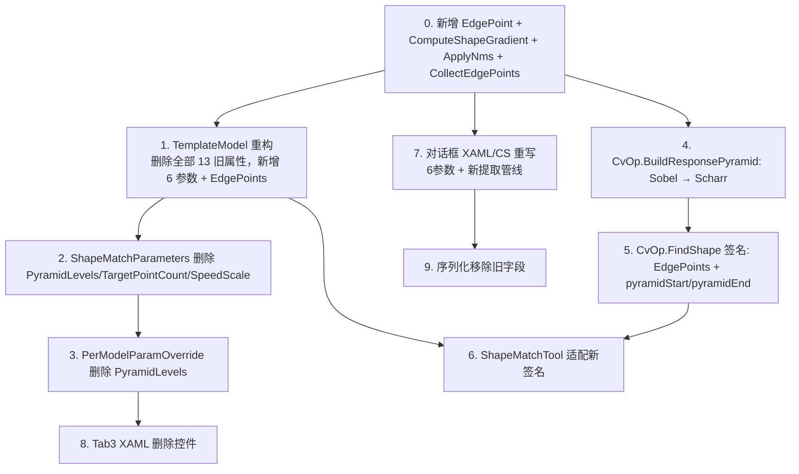

# 轮廓匹配(ShapeMatch)算法优化方案

> **版本**: v3.0  
> **日期**: 2026-05-09  
> **范围**: 全链路重构 — 梯度引擎统一化（Scharr+NMS） + 模板数据扁平化为 EdgePoint 列表 + 创建参数 12→6 + 金字塔双值范围控制  
> **设计原则**: 零兼容（rule-008），不留旧代码、不回退、不兼容旧数据、有问题直接报错

---

## 1. 背景与现状分析

### 1.1 三个根本性缺陷

| # | 缺陷 | 严重程度 |
|---|------|---------|
| **A** | 模板创建用 GaussianBlur + Canny，运行时用 Sobel 3×3（无模糊）—— **同一像素给出不同梯度方向** | 🔴 致命 |
| **B** | 模板存储 approxPolyDP 后的多边形顶点（非原始边缘像素位置）——**模板点落在弱梯度区域**，运行时查响应图得低分 | 🔴 致命 |
| **C** | 对话框暴露 12 个 OpenCV 底层参数（Halcon 仅 4 个），Canny 双阈值+迟滞不适合形状匹配 | 🟡 严重 |

### 1.2 缺陷详情

#### 缺陷 A：梯度计算不一致

```
模板创建 (ExecuteContourExtraction)             运行时匹配 (BuildResponsePyramid)
─────────────────────────────                   ──────────────────────────────
GaussianBlur(img, kernel=3/5/7/9)              ❌ 无 GaussianBlur
Canny: Sobel(kernel=3/5/7)                     Sobel(kernel=3), 固定 aperture=3
       非极大值抑制 + 双阈值迟滞(hysteresis)        硬阈值 mag < 5.0f 丢弃（无NMS）
findContours + 最小链长/面积过滤                  无（直接用每个像素梯度值填入响应图）
approxPolyDP/等距重采样 → 重新采样点              不重新采样（保留原始网格像素）
方向从 blur 后的 Sobel 图采样                      方向从 未模糊 的 Sobel 图计算
```

**后果**：同一像素在创建和运行时得到不同梯度方向值，模板点（多边形顶点）不在原始强梯度像素位置上，匹配分数极低（~0.3）。

#### 缺陷 B：轮廓点位置偏移

- `approxPolyDP` 用 Douglas-Peucker 压缩轮廓，顶点落在拟合线段端点而非真实边缘极值点
- 等距重采样进一步偏离原始强梯度像素网格位置
- 缩放后的轮廓点坐标是浮点数，与运行时响应图（整数网格）不对齐

#### 缺陷 C：Canny 不适用于形状匹配

- Canny 的双阈值迟滞是为**视觉感知**设计的（连接断裂边缘），不是为形状匹配设计的
- Halcon 的形状匹配使用**非迟滞的细线化**（只有 NMS，没有 hysteresis）
- Canny 的 7 个参数（平滑核/双阈值/孔径/L2/最小链长/最小面积/检索模式）与形状匹配的精度无关

### 1.3 Halcon 的正确设计

```
create_shape_model:                          find_shape_model:
  ├── 专用梯度算子（非Canny非标准Sobel）        ├── 相同梯度算子计算响应图
  ├── 非极大值抑制（细线化到1像素）               ├── 模板边缘点直接查表匹配
  ├── Contrast 阈值筛选                          └── 搜索范围 = 模板预设值
  ├── Optimization 控制点精简
  └── ← 存储边缘点列表（位置+方向）= 模型 →       ↕ 100% 一致的梯度引擎
```

**核心原则**：
1. 创建和匹配使用**完全相同的梯度算子**
2. 模板就是一组边缘点（位置 + 方向），**不需要 findContours，不需要多边形近似**
3. 边缘提取是为匹配专门设计的，不是通用视觉检测

---

## 2. 整体架构

```mermaid
flowchart LR
    subgraph Before["当前设计"]
        A1["模板创建"]
        A2["GaussianBlur + Canny + findContours<br>+ approxPolyDP + 方向计算"]
        A3["存储 Level 0 ContourGroups"]
        A4["运行时 FindShape"]
        A5["Sobel 3×3（无模糊）构建响应图<br>模板轮廓缩放匹配"]
        A6["梯度不一致 ❌<br>点位置不匹配 ❌"]
    end

    subgraph After["优化后设计"]
        B1["模板创建"]
        B2["Scharr 3×3 + NMS + Contrast<br>CollectEdgePoints + Optimization"]
        B3["存储 PyramidEdgePoints{Level: EdgePoint[]}<br>每层独立提取"]
        B4["运行时 FindShape"]
        B5["Scharr 3×3（梯度引擎一致）<br>直接使用模板EdgePoints匹配"]
        B6["梯度 100% 一致 ✅<br>点位置精确匹配 ✅"]
    end

    Before -->|"全链路重构"| After
```



### 2.1 修改模块清单

| 模块 | 修改类型 | 说明 |
|------|---------|------|
| `CvOp.cs` | **新增** 3 个方法 | `ComputeShapeGradient` / `ApplyNms` / `CollectEdgePoints` |
| `CvOp.cs` | **修改** | `BuildResponsePyramid` 中 Sobel → Scharr |
| `CvOp.cs` | **修改** | `FindShape` 签名：`EdgePoint` 替代 `(contour+directions)`，`(pyramidStart, pyramidEnd)` 替代 `maxPyramidLevel` |
| `TemplateModel` | **重构** | 删除 11 个 Canny 属性，删除 `ContourGroups`/`ContourDirectionGroups`，新增 `EdgePoints`/`PyramidEdgePoints` + 6 个参数属性 |
| `ShapeMatchParameters` | **删除** | 删除 `PyramidLevels`、`TargetPointCount`、`SpeedScale` |
| `PerModelParamOverride` | **删除** | 删除 `PyramidLevels` |
| 对话框 XAML | **精简** | 12 个控件 → 6 个控件 |
| 对话框 .cs | **重写** | 边缘提取管线替换 + 金字塔预计算 + OK 逻辑 |
| `ShapeMatchTool.cs` | **适配** | 从模板读取 `PyramidStart`/`PyramidEnd`，使用 `EdgePoints` |
| Tab3 XAML | **删除** | 删除金字塔层数 + 目标点数 + SpeedScale 控件 |

---

## 3. 专用梯度算子算法设计（核心新增）

### 3.1 算子选择：Scharr 3×3

| 算子 | 优点 | 缺点 | 选择 |
|------|------|------|------|
| Sobel 3×3 | 速度快 | 对角线方向响应弱，旋转不对称 | ❌ |
| Sobel 5×5 | 较平滑 | 定位精度差，计算量增大 | ❌ |
| **Scharr 3×3** | **旋转对称性好，各向同性**，定位精度高于 Sobel | 对噪声稍敏感 | ✅ |
| Canny | 有 NMS + 迟滞 | 双阈值迟滞不适合形状匹配 | ❌ |

**Scharr 核：**

```
Gx:             Gy:
-3   0   3      -3  -10  -3
-10  0   10      0    0   0
-3   0   3       3   10   3
```

> 系数 `3,10,3` 比 Sobel 的 `1,2,1` 提供更好的旋转对称性。这是形状匹配的关键需求——模板旋转后梯度方向应保持一致。

**设计决策**：Scharr 固定为 3×3，不暴露为参数。即使图像有噪声，用户应通过增大 `Contrast` 来处理，而不是降低梯度算子精度。

### 3.2 新增数据类型

```csharp
/// <summary>形状匹配边缘点 — 对齐 Halcon ModelID 内部结构</summary>
public class EdgePoint
{
    public double X { get; set; }
    public double Y { get; set; }
    public double Direction { get; set; }  // 弧度 [-π, π]，atan2(Gy, Gx)
    public double Magnitude { get; set; }  // 梯度幅值 sqrt(Gx²+Gy²)
}
```

### 3.3 核心算法管线（共享方法）

以下三个方法在模板创建和运行时匹配之间 **100% 共享**：

```csharp
// ==================== 1. 共享基础梯度 ====================

/// <summary>
/// 形状匹配专用梯度提取 — Scharr 3×3 固定算子
/// 模板创建和运行时匹配完全相同的调用
/// </summary>
private static void ComputeShapeGradient(Mat grayImage, out Mat gx, out Mat gy, out Mat mag)
{
    // 不使用 GaussianBlur 预处理
    gx = new Mat();
    gy = new Mat();
    Cv2.Scharr(grayImage, gx, MatType.CV_32F, 1, 0);  // Scharr 3×3 固定核
    Cv2.Scharr(grayImage, gy, MatType.CV_32F, 0, 1);
    mag = new Mat();
    Cv2.Magnitude(gx, gy, mag);
}

// ==================== 2. 非极大值抑制（细线化）====================

/// <summary>
/// 非极大值抑制 — 沿梯度方向保留局部极大值，细线化到 1 像素
/// 等价于 Halcon 的细线化步骤（不含 Canny 双阈值迟滞）
/// 在 3×3 邻域内检查沿梯度方向的前后两个像素
/// </summary>
private static Mat ApplyNms(Mat mag, Mat gx, Mat gy, float contrast)
{
    int w = mag.Width, h = mag.Height;
    var nms = new Mat(h, w, MatType.CV_8U, Scalar.All(0));
    byte[] nmsData = new byte[w * h];
    float[] magData = new float[w * h];
    Marshal.Copy(mag.Data, magData, 0, magData.Length);

    for (int y = 1; y < h - 1; y++)
    {
        for (int x = 1; x < w - 1; x++)
        {
            int idx = y * w + x;
            float m = magData[idx];
            if (m < contrast) continue;

            float gxVal = gx.At<float>(y, x);
            float gyVal = gy.At<float>(y, x);

            // 梯度方向量化到 4 个主方向
            float m1, m2;
            double angle = Math.Atan2(gyVal, gxVal);
            double absAngle = Math.Abs(angle);

            if (absAngle <= Math.PI / 8 || absAngle >= 7 * Math.PI / 8)
            {
                // 水平方向
                m1 = magData[y * w + (x - 1)];
                m2 = magData[y * w + (x + 1)];
            }
            else if (absAngle >= 3 * Math.PI / 8 && absAngle <= 5 * Math.PI / 8)
            {
                // 垂直方向
                m1 = magData[(y - 1) * w + x];
                m2 = magData[(y + 1) * w + x];
            }
            else if (angle > Math.PI / 8 && angle < 3 * Math.PI / 8)
            {
                // 135° 方向
                m1 = magData[(y - 1) * w + (x - 1)];
                m2 = magData[(y + 1) * w + (x + 1)];
            }
            else
            {
                // 45° 方向
                m1 = magData[(y - 1) * w + (x + 1)];
                m2 = magData[(y + 1) * w + (x - 1)];
            }

            if (m >= m1 && m >= m2)
                nmsData[idx] = 255;  // 保留为边缘
        }
    }

    Marshal.Copy(nmsData, 0, nms.Data, nmsData.Length);
    return nms;
}

// ==================== 3. 收集边缘点（替代 findContours）====================

/// <summary>
/// 从 NMS 结果中收集所有边缘点
/// 替代 findContours + approxPolyDP + 等距重采样
/// 按 Optimization 级别控制最大点数
/// </summary>
private static List<EdgePoint> CollectEdgePoints(Mat nms, Mat gx, Mat gy, Mat mag,
    float contrast, OptimizationMode optimization)
{
    byte[] nmsData = new byte[nms.Total()];
    Marshal.Copy(nms.Data, nmsData, 0, nmsData.Length);

    int w = nms.Width, h = nms.Height;
    var points = new List<EdgePoint>(nmsData.Count(b => b > 0));

    for (int y = 0; y < h; y++)
    {
        for (int x = 0; x < w; x++)
        {
            int idx = y * w + x;
            if (nmsData[idx] > 0)
            {
                float gxVal = gx.At<float>(y, x);
                float gyVal = gy.At<float>(y, x);
                float magVal = mag.At<float>(y, x);

                points.Add(new EdgePoint
                {
                    X = x,
                    Y = y,
                    Direction = Math.Atan2(gyVal, gxVal),
                    Magnitude = magVal
                });
            }
        }
    }

    // 按 Optimization 级别控制最大点数
    int maxPoints = GetMaxPointCountForOptimization(optimization, points.Count);
    if (maxPoints < points.Count)
    {
        points = points.OrderByDescending(p => p.Magnitude)
                       .Take(maxPoints)
                       .ToList();
    }

    return points;
}

/// <summary>根据 Optimization 级别计算最大边缘点数</summary>
private static int GetMaxPointCountForOptimization(OptimizationMode mode, int totalEdgePoints)
{
    return mode switch
    {
        OptimizationMode.None   => totalEdgePoints,
        OptimizationMode.Low    => Math.Min(totalEdgePoints, 200),
        OptimizationMode.Medium => Math.Min(totalEdgePoints, 80),
        OptimizationMode.High   => Math.Min(totalEdgePoints, 30),
        OptimizationMode.Auto   => totalEdgePoints <= 80 ? totalEdgePoints
                                 : totalEdgePoints <= 300 ? 80
                                 : 30,
        _ => totalEdgePoints
    };
}
```

### 3.4 完整算法管线对比

| 步骤 | 当前（v2.0） | 优化后（v3.0） |
|------|-------------|---------------|
| 1 | 灰度转换 | 灰度转换 |
| 2 | **GaussianBlur** 高斯模糊 | ❌ **删除** |
| 3 | **Canny** (Sobel+NMS+双阈值迟滞) | **Scharr 3×3 + NMS**（无迟滞） |
| 4 | MinContrast 幅值过滤 | MinContrast 幅值过滤 |
| 5 | ROI 掩码应用 | ROI 掩码应用 |
| 6 | **findContours** 查找轮廓 | ❌ **删除** |
| 7 | 最小链长 + 最小面积过滤 | ❌ **删除** |
| 8 | **approxPolyDP / 等距重采样** | ❌ **删除** |
| 9 | 亚像素轮廓（可选） | ❌ **删除**（NMS 已精确定位） |
| 10 | Sobel 梯度方向（模糊后图） | **Scharr 梯度方向（原始灰度图）** |
| 11 | 轮廓统计（包围盒、中心点） | 从 EdgePoints 计算 |
| 12 | 金字塔预计算（缩放轮廓） | **金字塔预计算（重新提取每层边缘点）** |

### 3.5 链长阈值优化（CollectEdgePoints 内部算法）

在 `CollectEdgePoints` 的 `findContours` 过渡实现中，链长阈值用于过滤碎片噪声轮廓：

| 版本 | 算法 | 问题 |
|------|------|------|
| v3.0 双断崖 | 预过滤 `len>3` → 长度变动率断崖 → 数量断崖 → 中位数兜底 | 连续整数分布断崖失效，中位数返回过大值 |
| **优化后** | **全部链长 Distinct → 升序排序 → 20% 分位值** | 简洁稳定，覆盖所有分布 |

**核心变更**：
- 去掉 `len > 3` 预过滤：20% 分位自动过滤最短噪声
- 去掉双断崖策略：单一百分位计算，不依赖 gap/频数检测
- 去掉中位数兜底：20% 分位本身即为兜底

**效果**：连续递增分布 `[50, 51, ..., 210]`（161 种唯一链长）→ index=32 → 阈值 **82**（原算法返回 210）

---

## 4. 参数设计

### 4.1 创建参数：6 个（原 12 个）

```
┌─ 边缘提取参数 ──────────────────────────────────────────────┐
│                                                              │
│  对比度 (Contrast):         [  30  ▲▼  ]  0~255              │
│       高 = 保留高对比度强边缘，低 = 保留更弱边缘                │
│                                                              │
│  优化级别 (Optimization):   [Auto ▼]                          │
│       Auto / 全保留 / 低 / 中 / 高                            │
│                                                              │
│  最小对比度 (MinContrast):  [  10  ▲▼  ]  0~255              │
│       过滤低梯度噪声边缘                                       │
│                                                              │
│  ─────────────────────────────────────────────────────         │
│                                                              │
│  总层数 (NumLevels):        [   4  ▼  ]  1~10                │
│       例: 4 = 创建 Level 0, 1, 2, 3 共 4 层                   │
│                                                              │
│  搜索起始层 (PyramidStart): [   3  ▼  ]  0~(层数-1)          │
│       从哪层开始搜索（越大越粗，先粗筛后细定位）               │
│                                                              │
│  搜索终止层 (PyramidEnd):   [   0  ▼  ]  0~(起始层-1)        │
│       搜到哪层结束（0=最精确，越大=越快但误差大）               │
│                                                              │
│  ─────────────────────────────────────────────                 │
│  ℹ 模板预计算: Level 0~3 (共 4 层)                            │
│     匹配时将: Level 3 → Level 2 → Level 1 → Level 0           │
│                                                              │
└──────────────────────────────────────────────────────────────┘
```

#### 参数映射验证

| Halcon `create_shape_model` | 优化后实现 | UI |
|---|---|---|
| `Contrast` (1~3 值) | `Contrast` (单值) | NumericUpDown |
| `MinContrast` | `MinContrast` | NumericUpDown |
| `Optimization` (enum) | `Optimization` (enum) | ComboBox |
| `NumLevels` (总层数) | `NumLevels` | NumericUpDown |
| — | `PyramidStart` (搜索起始) | NumericUpDown |
| — | `PyramidEnd` (搜索终止) | NumericUpDown |

> `PyramidStart`/`PyramidEnd` 对应 Halcon `find_shape_model(NumLevels=[start,end])` 的搜索范围。**仅创建时设置，存储在模板中，运行时无独立参数。**

### 4.2 运行时参数

| 参数 | 类型 | 默认值 | 说明 |
|------|------|--------|------|
| `MinMatchScore` | double | 0.50 | 最小匹配分数 |
| `MaxMatchCount` | int | 5 | 最大返回匹配数 |
| `MatchTimeoutMs` | int | 5000 | 超时时间 (ms) |
| `MinMatchDistance` | double | 50 | NMS 最小间距 (px) |
| `AngleMin` / `AngleMax` | double | -180~180 | 角度搜索范围 |
| `AngleStep` | double | Auto | 角度步长 |
| `ScaleMin` / `ScaleMax` | double | 0.80~1.20 | 缩放搜索范围 |
| `ScaleStep` | double | 0.01 | 缩放步长 |
| `EnableSubPixel` | bool | true | 是否启用亚像素精定位 |
| `SubPixelRadius` | double | 2.0 | 亚像素搜索半径 |

> **删除的运行时参数**: `PyramidLevels`（→模板属性）、`TargetPointCount`（→创建时的 Optimization）、`SpeedScale`（无需求，YAGNI）

---

## 5. 详细设计

### 5.1 枚举类型

```csharp
/// <summary>模型点优化级别 — 对齐 Halcon Optimization</summary>
public enum OptimizationMode
{
    Auto = 0,    // 根据模型尺寸自动
    None = 1,    // 全保留，最精确最慢
    Low = 2,     // 低程度精简
    Medium = 3,  // 中等程度精简
    High = 4     // 高程度精简，最快
}
```

### 5.2 TemplateModel 数据模型

```csharp
public class TemplateModel : ObservableObject
{
    // ============ 创建参数（6个）============
    private double _contrast = 30.0;
    private int _minContrast = 10;
    private OptimizationMode _optimization = OptimizationMode.Auto;
    private int _numLevels = 4;
    private int _pyramidStart = -1;   // -1 = 自动 = 最粗层 (NumLevels-1)
    private int _pyramidEnd = 0;      // 0 = 全分辨率

    public double Contrast { get => _contrast; set => SetProperty(ref _contrast, value, "对比度"); }
    public int MinContrast { get => _minContrast; set => SetProperty(ref _minContrast, value, "最小对比度"); }
    public OptimizationMode Optimization { get => _optimization; set => SetProperty(ref _optimization, value, "优化级别"); }
    public int NumLevels { get => _numLevels; set => SetProperty(ref _numLevels, value, "金字塔层数"); }
    public int PyramidStart { get => _pyramidStart; set => SetProperty(ref _pyramidStart, value, "搜索起始层"); }
    public int PyramidEnd { get => _pyramidEnd; set => SetProperty(ref _pyramidEnd, value, "搜索终止层"); }

    // ============ 数据存储 ============
    /// <summary>第 0 层（全分辨率）边缘点列表</summary>
    public List<EdgePoint>? EdgePoints { get; set; }

    /// <summary>各金字塔层边缘点: key=Level</summary>
    public Dictionary<int, List<EdgePoint>>? PyramidEdgePoints { get; set; }
}
```

**删除的旧属性**（11 + 2 个，全部删除不做回退）：

| 删除属性 | 理由 |
|---------|------|
| `SmoothKernelSize` | Scharr 固定 3×3，无需高斯模糊 |
| `EdgeLowThreshold` | 合并为 Contrast |
| `EdgeHighThreshold` | 合并为 Contrast |
| `EdgeApertureSize` | Scharr 固定 3×3 |
| `UseL2Gradient` | 固定 L2 |
| `MinChainLength` | 无 findContours 分组 |
| `MinArea` | 无轮廓分组 |
| `RetrievalMode` | 无 findContours |
| `UseSubPixel` | NMS 精确定位，运行时 RefineSearch 处理亚像素 |
| `ApproxMethod` | 合并为 Optimization |
| `ApproxPrecision` | 合并为 Optimization |
| **`ContourGroups`** | 替换为 `EdgePoints`，不保留回退字段 |
| **`ContourDirectionGroups`** | 方向合并到 `EdgePoint.Direction` |

### 5.3 CvOp.FindShape 签名

```csharp
public static void FindShape(
    Mat grayImage,
    List<EdgePoint> templateEdgePoints,    // 平坦边缘点列表（含位置+方向）
    double minScore,
    double angleStart, double angleEnd, double angleStep,
    double scaleMin, double scaleMax, double scaleStep,
    int pyramidStart,           // 搜索起始层（模板属性）
    int pyramidEnd,             // 搜索终止层（模板属性）
    int timeoutMs,
    out List<ShapeMatchResult> matchResults)
```

**搜索循环：**

```csharp
for (int level = pyramidStart; level >= pyramidEnd; level--)
{
    var levelEdgePoints = template.PyramidEdgePoints[level];
    // 在当前层响应图上匹配 levelEdgePoints
}
```

**响应图构建（改用 Scharr）：**

```csharp
// 原:
Cv2.Sobel(current, gx, MatType.CV_32F, 1, 0, 3);
Cv2.Sobel(current, gy, MatType.CV_32F, 0, 1, 3);

// 改为:
Cv2.Scharr(current, gx, MatType.CV_32F, 1, 0);
Cv2.Scharr(current, gy, MatType.CV_32F, 0, 1);
```

### 5.4 BuildResponsePyramid 变更

```csharp
private static List<ResponsePyramidLevel> BuildResponsePyramid(Mat grayImage, int levels)
{
    var pyramid = new List<ResponsePyramidLevel>(levels);
    using var current = grayImage.Clone();

    for (int i = 0; i < levels; i++)
    {
        // 使用 Scharr 梯度（与模板创建 100% 一致）
        ComputeShapeGradient(current, out var gx, out var gy, out var mag);

        // 构建 8 方向响应图（与现有逻辑相同）
        int w = gx.Width, h = gy.Height, total = w * h;
        var maps = new byte[DIRECTION_BINS][];
        for (int b = 0; b < DIRECTION_BINS; b++)
            maps[b] = new byte[total];

        for (int y = 0; y < h; y++)
        {
            for (int x = 0; x < w; x++)
            {
                float gxVal = gx.At<float>(y, x);
                float gyVal = gy.At<float>(y, x);
                float magVal = (float)Math.Sqrt(gxVal * gxVal + gyVal * gyVal);
                if (magVal < 5.0f) continue;  // 最小梯度噪声门限

                int qdir = QuantizeDirectionFast(gxVal, gyVal);
                byte bMag = (byte)Math.Min(magVal, 255.0f);
                int idx = y * w + x;

                for (int dt = 0; dt < DIRECTION_BINS; dt++)
                    maps[dt][idx] = (byte)((bMag * DIRECTION_LUT[dt, qdir]) >> 8);
            }
        }

        gx.Dispose(); gy.Dispose(); mag.Dispose();

        pyramid.Add(new ResponsePyramidLevel
        {
            ResponseMaps = maps,
            Width = w, Height = h
        });

        // 下采样
        if (i < levels - 1)
        {
            var down = new Mat();
            Cv2.PyrDown(current, down);
            current.Dispose();
            down.CopyTo(current);
        }
    }
    return pyramid;
}
```

**关键变更**：`Sobel(3)` → `Scharr()`，其余逻辑不变。

### 5.5 ShapeMatchTool 调用适配

```csharp
// 从模板读取金字塔搜索范围
int maxLevel = template.NumLevels - 1;
int actualStart = template.PyramidStart >= 0
    ? Math.Min(template.PyramidStart, maxLevel)
    : maxLevel;  // -1 → 自动使用最粗层 NumLevels-1
int actualEnd = Math.Max(template.PyramidEnd, 0);

// 验证范围
if (actualStart < actualEnd)
    throw new InvalidOperationException($"PyramidStart({actualStart}) < PyramidEnd({actualEnd}) — 搜索范围无效");

// 使用金字塔每层的 EdgePoints
var levelEdgePoints = template.PyramidEdgePoints?[actualStart]
    ?? throw new InvalidOperationException($"金字塔第 {actualStart} 层数据为空");

CvOp.FindShape(grayImage, levelEdgePoints,
    minScore, angleStart, angleEnd, angleStep,
    scaleMin, scaleMax, scaleStep,
    actualStart, actualEnd,
    timeoutMs, out var matchResults);
```

### 5.6 对话框交互逻辑

| 控件 | 行为 |
|------|------|
| "提取轮廓" 按钮 | 运行 Scharr+NMS+Contrast+MinContrast → `CollectEdgePoints` → 金字塔跨层预计算 |
| 金字塔 ComboBox | 提取成功后填充 Level 0~NumLevels-1，切换预览每层边缘点 |
| "确定" 按钮 | **校验数据完整性**（EdgePoints 不为空），不自动重提取 |
| "清除" 按钮 | 清除 EdgePoints、PyramidEdgePoints、清空 ComboBox |

**确定逻辑**：

```csharp
private void OnOkClick(object sender, RoutedEventArgs e)
{
    var errors = new List<string>();

    // 校验名称
    if (string.IsNullOrWhiteSpace(TemplateName))
        errors.Add("- 模板名称为空");

    // 校验边缘点数据
    if (_resultTemplate.EdgePoints == null || _resultTemplate.EdgePoints.Count == 0)
        errors.Add("- 边缘点数据为空，请先点击「提取轮廓」按钮");

    // 校验金字塔数据
    if (_resultTemplate.PyramidEdgePoints == null || _resultTemplate.PyramidEdgePoints.Count == 0)
        errors.Add("- 金字塔预计算数据为空，请重新提取");

    if (errors.Count > 0)
    {
        LogWarning($"模板创建失败:\n{string.Join("\n", errors)}");
        return;
    }

    // 保存并关闭对话框
    DialogResult = true;
    Close();
}
```

### 5.7 响应图方向量化（对齐运行时查表）

```csharp
private const int DIRECTION_BINS = 8;

/// <summary>方向查找表: [targetBin, sourceQDir] → weight(0~255)</summary>
private static readonly byte[,] DIRECTION_LUT = new byte[DIRECTION_BINS, DIRECTION_BINS]
{
    { 255, 224, 128,  32,   0,  32, 128, 224 },  // bin 0
    { 224, 255, 224, 128,  32,   0,  32, 128 },  // bin 1
    { 128, 224, 255, 224, 128,  32,   0,  32 },  // bin 2
    {  32, 128, 224, 255, 224, 128,  32,   0 },  // bin 3
    {   0,  32, 128, 224, 255, 224, 128,  32 },  // bin 4
    {  32,   0,  32, 128, 224, 255, 224, 128 },  // bin 5
    { 128,  32,   0,  32, 128, 224, 255, 224 },  // bin 6
    { 224, 128,  32,   0,  32, 128, 224, 255 },  // bin 7
};

private static int QuantizeDirectionFast(float gx, float gy)
{
    // 将 atan2(Gy, Gx) 量化到 [0, 7]
    // 使用角度比较而非真实 atan2 计算（查表加速）
    if (gx >= 0 && gy >= 0)
        return gy > gx ? 1 : 0;
    else if (gx < 0 && gy >= 0)
        return -gx > gy ? 3 : 2;
    else if (gx < 0 && gy < 0)
        return -gy > -gx ? 5 : 4;
    else
        return gx > -gy ? 7 : 6;
}
```

---

## 6. 模板创建对话框参数对比总表

| 位置 | 当前（v2.0）12 个参数 | 优化后（v3.0）6 个参数 |
|------|----------------------|----------------------|
| 平滑核大小 | `[  3  ▲▼  ]` | ❌ 删除 |
| 低阈值 | `[ 50  ▲▼  ]` | ❌ 删除 |
| 高阈值 | `[150  ▲▼  ]` | ❌ 删除 |
| 孔径大小 | `[  3  ▲▼  ]` | ❌ 删除 |
| L2 梯度 | `[✓]` | ❌ 删除 |
| 最小链长 | `[  8  ▲▼  ]` | ❌ 删除 |
| 最小面积 | `[50.0  ▲▼  ]` | ❌ 删除 |
| 轮廓检索 | `[External ▼]` | ❌ 删除 |
| 近似方法 | `[DouglasPeucker ▼]` | ❌ 删除 → 合并为 Optimization |
| 近似精度 | `[ 2.0  ▲▼  ]` | ❌ 删除 → 合并为 Optimization |
| 目标点数 | `[ 60  ▲▼  ]` | ❌ 删除 → 合并为 Optimization |
| MinContrast | `[ 10  ▲▼  ]` | ✅ 保留 |
| **新增 Contrast** | — | `[ 30  ▲▼  ]` |
| **新增 Optimization** | — | `[Auto ▼]` |
| **新增 NumLevels** | — | `[  4  ▼  ]` |
| **新增 PyramidStart** | — | `[  3  ▼  ]` |
| **新增 PyramidEnd** | — | `[  0  ▼  ]` |

---

## 7. 实施步骤



### 详细步骤清单

| Step | 内容 | 涉及文件 |
|------|------|---------|
| **0** | 新增 `EdgePoint` 类 + `ComputeShapeGradient` + `ApplyNms` + `CollectEdgePoints` + `GetMaxPointCountForOptimization` | `CvOp.cs` |
| **1** | `TemplateModel` 删除全部 13 个旧属性（Canny 11 个 + ContourGroups 2 个），新增 `Contrast/MinContrast/Optimization/NumLevels/PyramidStart/PyramidEnd` 6 个参数 + `EdgePoints`/`PyramidEdgePoints` 2 个数据属性 | `TemplateModel.cs` |
| **2** | `ShapeMatchParameters` 删除 `PyramidLevels`、`TargetPointCount`、`SpeedScale` | `ShapeMatchParameters.cs` |
| **3** | `PerModelParamOverride` 删除 `PyramidLevels` 字段 | `ShapeMatchResultConfig.cs` |
| **4** | `BuildResponsePyramid` 中 `Cv2.Sobel(current, ..., 3)` → `Cv2.Scharr(current, ...)` | `CvOp.cs` |
| **5** | `FindShape` 签名改为 `List<EdgePoint>` + `pyramidStart/pyramidEnd`，删除 `speedScale` 参数 | `CvOp.cs` |
| **6** | `RunSingleTemplateMatch` 从模板读取 `PyramidStart`/`PyramidEnd` 和 `PyramidEdgePoints`，传入 `EdgePoints` | `ShapeMatchTool.cs` |
| **7** | 对话框 XAML 缩减为 6 个参数控件；CS 重写 `ExecuteContourExtraction` 调用 Scharr+NMS+CollectEdgePoints + 金字塔预计算；`OnOkClick` 改为校验不重提取 | XAML + `.cs` |
| **8** | Tab3 删除 `PyramidLevels`、`TargetPointCount`、`SpeedScale` 控件及绑定 | `ShapeMatchToolDebugControl.xaml` |
| **9** | `TemplateModel` 序列化：`[JsonIgnore(Condition = JsonIgnoreCondition.Always)]` 标记所有已删除旧字段，确保旧数据反序列化时抛异常 | `TemplateModel.cs` |

---

## 8. 验证清单

### 梯度一致性验证（核心）

- [ ] **同一图像**：模板创建的 `EdgePoints` 位置和方向 与 `BuildResponsePyramid` 中同位置的方向 bin **100% 一致**
- [ ] 模板边缘点在响应图对应位置能查到 **高幅值响应**（>128/255）
- [ ] 相同模板 + 相同搜索图，匹配分数从当前 ~0.3 **提高到 0.8+**
- [ ] 相同模板 + 相同搜索图，定位误差 < 2px

### 模板创建验证

- [ ] Contrast 单参数（30~200）效果等价于 Canny 7 参数综合调节
- [ ] Optimization Auto/None/Low/Medium/High 正确控制边缘点数量
- [ ] MinContrast 正确过滤低梯度噪声边缘
- [ ] NumLevels 1~10 正确创建对应层数
- [ ] PyramidStart/PyramidEnd 正确控制搜索范围
- [ ] 金字塔每层的边缘点从降采样图像**独立提取**（非从 Level 0 缩放）
- [ ] 提取成功后自动填充金字塔 ComboBox（Level 0 ~ NumLevels-1）

### 运行时匹配验证

- [ ] `FindShape` 使用 `PyramidEdgePoints[level]` 而非缩放轮廓
- [ ] 搜索循环从 `PyramidStart` 搜到 `PyramidEnd`
- [ ] 多层金字塔匹配精度 ≥ 单层匹配精度
- [ ] 多层金字塔匹配速度 ≥ 单层模式（粗层快速过滤候选，细层精确定位）

### 交互验证

- [ ] 对话框打开后**不自动执行**任何提取操作
- [ ] "提取轮廓"按钮执行完整的新梯度管线
- [ ] 确定按钮**不重提取**，仅校验数据完整性
- [ ] 数据不完整（EdgePoints 为空）→ 直接报错，不创建模板
- [ ] ComboBox 切换时正确预览每层边缘点（颜色区分层级）

### 零兼容验证（rule-008）

- [ ] 旧模板（仅有 `ContourGroups` 无 `EdgePoints`）→ 反序列化抛出异常
- [ ] 旧参数文件（有 `PyramidLevels`）→ `JsonException`，参数类型变更导致加载失败
- [ ] 旧代码中所有对 `ContourGroups`/`ContourDirectionGroups` 的引用已删除 → **编译错误确保无遗漏**
- [ ] `TemplateModel` 不包含 `[Obsolete]`、条件编译、注释掉的旧代码
- [ ] `ShapeMatchParameters` 不包含被删除参数的默认值回退

---

## 9. Halcon API 对照表（最终版）

### 9.1 create_shape_model 参数对照

| Halcon | 优化后实现 | UI | 状态 |
|--------|-----------|-----|------|
| `Template` | ROI 区域管理器 + 注册图像 | 对话框 | ✅ |
| `NumLevels` | `NumLevels` (1~10) | 对话框 | ✅ 对齐 |
| `AngleStart`/`AngleExtent` | `AngleMin`/`AngleMax` | 运行时 | ✅ |
| `AngleStep` | `AngleStep` | 运行时 | ✅ |
| `ScaleMin`/`ScaleMax`/`ScaleStep` | 同上 | 运行时 | ✅ |
| **`Optimization`** | **`Optimization` (enum)** | **ComboBox** | ✅ **枚举对齐** |
| `Metric` | — | — | ❌ YAGNI |
| `MinContrast` | `MinContrast` | 对话框 | ✅ |
| **`Contrast`** | **`Contrast` (单值)** | **NumericUpDown** | ✅ **替换 7 参数** |

### 9.2 find_shape_model 参数对照

| Halcon | 优化后实现 | 状态 |
|--------|-----------|------|
| `ModelID` | `PyramidEdgePoints` (每层 EdgePoint[]) | ✅ 等价 |
| `NumLevels` (搜索范围) | `PyramidStart` → `PyramidEnd` (模板属性) | ✅ 模板属性 |
| `MinScore` | `MinMatchScore` | ✅ |
| `NumMatches` | `MaxMatchCount` | ✅ |
| `MaxOverlap` | `MinMatchDistance` (NMS 排重) | ✅ 反转 |
| `SubPixel` | `EnableSubPixel` + `SubPixelRadius` | ✅ |
| `Greediness` | — | ❌ YAGNI |
| `Timeout` | `MatchTimeoutMs` | ✅ |

### 9.3 删除的底层实现参数（不再暴露）

| 参数 | 原始 OpenCV 函数 | 删除理由 |
|------|-----------------|---------|
| 平滑核大小 | `GaussianBlur` | Scharr 固定 3×3，无需模糊 |
| 低/高阈值 | `Canny` 双阈值 | Contrast 单参数替代 |
| 孔径大小 | `Sobel(aperture)` | Scharr 固定 3×3 |
| L2 梯度 | `Canny(L2gradient)` | 固定 L2 |
| 最小链长 | 后处理过滤 | NMS 已细线化 |
| 最小面积 | `ContourArea()` 过滤 | 无轮廓分组 |
| 轮廓检索模式 | `RetrievalModes` | 无 findContours |
| 近似方法 | `approxPolyDP`/resample | 扁平边缘点 |
| 近似精度 | Douglas-Peucker epsilon | Optimization 自动 |
| 目标点数 | 等距重采样 | Optimization 自动 |
| 亚像素轮廓 | 梯度插值 | NMS 精确定位 |

---

## 10. 响应图匹配引擎设计

### 10.1 方向量化与查找表

```
模板边缘点方向:                     响应图方向 bin:
angle = atan2(Gy, Gx)               bin 0~7
[−π, π]                             [0°, 45°, 90°, ..., 315°]

量化: QuantizeDirectionFast(Gx, Gy)  →  qdir [0, 7]

匹配时:
  score += mag(t) × DIRECTION_LUT[t_qdir, r_qdir] / 255
  
  其中:
    t_qdir = 模板边缘点的量化方向
    r_qdir = 响应图同位置的量化方向
    DIRECTION_LUT[t, r] = cos(angle_diff) 缩放为 8bit
```

### 10.2 响应图构建

```csharp
private static ResponsePyramidLevel BuildResponseMapAtLevel(Mat levelImage)
{
    // 与模板创建共享梯度计算
    ComputeShapeGradient(levelImage, out var gx, out var gy, out var mag);

    int w = gx.Width, h = gy.Height, total = w * h;
    var maps = new byte[DIRECTION_BINS][];
    for (int b = 0; b < DIRECTION_BINS; b++)
        maps[b] = new byte[total];

    for (int y = 0; y < h; y++)
    {
        for (int x = 0; x < w; x++)
        {
            float gxVal = gx.At<float>(y, x);
            float gyVal = gy.At<float>(y, x);
            float magVal = (float)Math.Sqrt(gxVal * gxVal + gyVal * gyVal);
            if (magVal < 5.0f) continue;  // 最小梯度噪声门限

            int qdir = QuantizeDirectionFast(gxVal, gyVal);
            byte bMag = (byte)Math.Min(magVal, 255.0f);
            int idx = y * w + x;

            for (int dt = 0; dt < DIRECTION_BINS; dt++)
                maps[dt][idx] = (byte)((bMag * DIRECTION_LUT[dt, qdir]) >> 8);
        }
    }

    gx.Dispose(); gy.Dispose(); mag.Dispose();

    return new ResponsePyramidLevel
    {
        ResponseMaps = maps,
        Width = w, Height = h
    };
}
```

### 10.3 匹配扫描

```csharp
private static double MatchTemplateAtPosition(
    ResponsePyramidLevel response,
    List<EdgePoint> templatePoints,
    double shiftX, double shiftY)
{
    double score = 0;
    int w = response.Width;

    foreach (var pt in templatePoints)
    {
        int rx = (int)Math.Round(pt.X + shiftX);
        int ry = (int)Math.Round(pt.Y + shiftY);

        if (rx < 0 || rx >= response.Width || ry < 0 || ry >= response.Height)
            continue;

        int tQDir = QuantizeDirectionFast(
            (float)Math.Cos(pt.Direction),
            (float)Math.Sin(pt.Direction));
        int idx = ry * w + rx;

        score += response.ResponseMaps[tQDir][idx];
    }

    return score / (255.0 * templatePoints.Count);
}
```

---

## 11. 术语表

| 术语 | 含义 |
|------|------|
| **Scharr 算子** | 3×3 梯度算子，旋转对称性优于 Sobel，系数 3,10,3 |
| **非极大值抑制 (NMS)** | 沿梯度方向保留局部极大值，细线化到 1 像素。不含 Canny 迟滞 |
| **EdgePoint** | 模板边缘点 = (x, y, direction, magnitude)，替代轮廓组概念 |
| **Contrast** | 边缘提取对比度阈值（单值），等价于 Halcon 同名参数 |
| **Optimization** | 模型点精简策略枚举 (Auto/None/Low/Medium/High) |
| **NumLevels** | 金字塔总层数，1~10 |
| **PyramidStart** | 搜索起始层（最粗层），存储在模板中 |
| **PyramidEnd** | 搜索终止层（最细层），存储在模板中 |
| **响应图 (Response Map)** | 8 个方向 bin 的预乘梯度幅值图，运行时查表匹配 |
| **DIRECTION_LUT** | 方向查找表，[targetBin, sourceQDir] → 余弦相似度权重 |

---

## 12. 设计决策说明

### 12.1 为什么选择 Scharr 而非 Sobel？

- Scharr 3×3 是所有 3×3 梯度算子中旋转对称性最好的
- 形状匹配的核心操作是旋转模板后比较方向，旋转不对称的算子会导致方向误差
- Halcon 的专有梯度引擎也使用各向同性设计

### 12.2 为什么不保留 GaussianBlur 预处理？

- Scharr 本身已有一定抗噪能力
- 如果图像噪声大，增大 Contrast 过滤即可
- 高斯模糊会降低边缘定位精度，与形状匹配的定位需求矛盾

### 12.3 为什么用 NMS 而不保留 Canny 迟滞？

- Canny 双阈值迟滞的目的是连接断裂边缘（视觉感知目的）
- 形状匹配不需要边缘连续性，只需要每个边缘点的位置 + 方向
- NMS 做细线化已足够，多余的点靠 Optimization 控制

### 12.4 为什么不允许金字塔缩放轮廓？

- 从降采样图像**重新提取边缘点**才能获得正确的梯度方向
- 缩放 Level 0 轮廓到高层 = 坐标变但方向不变 = 方向错误
- 每层独立提取确保每层的边缘点位置和方向都来自该层的 Scharr 梯度

### 12.5 为什么删除向后兼容？

- 旧模板的梯度和方向与运行时 Scharr 响应图**不匹配**，回退只会产生错误结果
- rule-008 零兼容原则：旧数据直接报错，用户必须重新创建模板
- 不做 `try-catch` 吞异常、不做默认值回退、不保留旧字段

---

**总结**：v3.0 相比 v2.0 的核心变更为：

1. **梯度引擎**: GaussianBlur+Canny → **Scharr 3×3 + NMS**，创建与运行时 100% 一致
2. **模板数据**: 轮廓组+多边形 → **扁平 EdgePoint 列表**（对齐 Halcon ModelID）
3. **创建参数**: 12 个 → **6 个**（Contrast + Optimization + MinContrast + NumLevels + PyramidStart + PyramidEnd）
4. **金字塔**: 单值 → **起始+终止双值**，存储在模板中，运行时无独立参数
5. **运行时参数**: 删除 3 个（PyramidLevels/TargetPointCount/SpeedScale）
6. **零兼容**: 删除全部旧字段和回退机制，旧模板/参数直接抛异常
